# Exam Day Checklist — 34840

> [!info] The exam
> **Friday 11 December 2026, 4 hours, written, individual. All aids allowed, no internet.**
> Part 1 = 2–3 problems like the hand-in, answered as a PDF (40 %). Part 2 = about 15 multiple-choice questions (60 %), the last 3–4 on hearing.
> Main tools: [[Cheat Sheet - 34840]] ([[Cheat Sheet - 34840.pdf|PDF]]), [[Old Exams 2022-2024 - Worked]], MATLAB toolkit `5. Semester/Acoustics and Noise Control/Exam/toolkit/`.

> [!danger] Test MATLAB offline NOW, not on the day
> On this desktop PC, MATLAB R2026a is activated with **online licensing** (`licmode = onlinelicensing` in `/usr/local/MATLAB/R2026a/licenses/license_info.xml`). Online licensing checks the licence over the internet when MATLAB starts. **With Wi-Fi off it will most likely refuse to start.** Check the exam laptop the same way.
>
> What to do, well before 11 December:
> 1. On the exam laptop, turn Wi-Fi off and start MATLAB. If it starts and `run_all_checks` passes, you are done.
> 2. If it does not start: turn Wi-Fi on and re-activate MATLAB with an **offline licence file**, not online licensing. Run `/usr/local/MATLAB/R2026a/bin/activate_matlab.sh` (or *Help → Licensing → Activate Software*). Sign in with your DTU MathWorks account and pick the activation that gives a licence file for **this computer** (host ID + your Linux login name). The DTU campus licence allows that. Then repeat step 1.
> 3. Plan B, if activation fails: install GNU Octave (`sudo pacman -S octave`, 18 MB) while you are online. The templates only use base functions (`accumarray`, `interp1`, `ndgrid`, `besselj`, `integral`), so they should run in Octave too. Test it: `cd toolkit; octave --eval run_all_checks`. I have **not** tested Octave.
> 4. Plan C: the cheat sheet has every formula, and a calculator does the rest. Bring a calculator anyway.

## 1. Before the exam (week of 7 December)

- [ ] **Offline test** (box above): Wi-Fi off → MATLAB starts → `run_all_checks` prints **116 of 116 checks passed**.
- [ ] **Copy the toolkit locally** to the exam laptop if it is not already there (it is in the umbrella git repo; `git pull` brings it). Path: `~/DTU/5. Semester/Acoustics and Noise Control/Exam/toolkit/`. Also add it to the MATLAB path or start MATLAB in that folder.
- [ ] **Obsidian vault opens offline.** It is local files, so it does. Check that the course PDFs are actually on the laptop (Syncthing): `Exercises/34840_Exam_20*_solution.pdf`, `Literature/Fundamentals_of_acoustics_2022.pdf`, the slide decks. Open two of them with Wi-Fi off.
- [ ] **PDF writer for part 1** that works offline. Easiest: write in Obsidian and use *Export to PDF* (works offline). Alternative: LibreOffice Writer → Export as PDF. If you want LaTeX, build one test document now: tectonic downloads packages on first use and fails offline for packages it has never seen.
- [ ] **Hand-written pages:** if you will photograph them, the camera device must have **no 5G or broadband** (a phone in flight mode is normally not accepted; check the DTU exam rules on Learn). A cheap scanner app on the laptop webcam is another option. Test the whole route: photo → PDF → one combined PDF.
- [ ] **Battery and charger.** 4 hours with MATLAB running: bring the charger and an extension lead.
- [ ] **Calculator** (backup for everything).
- [ ] Re-read the **Traps** list in the cheat sheet the evening before.

## 2. What to print

| Print | Why |
|---|---|
| [[Cheat Sheet - 34840.pdf]] (2 pages, A4 landscape) | every formula, constants, A-weighting, decision table, traps |
| [[Old Exams 2022-2024 - Worked]] | the three past exams, worked step by step: closest thing to the real exam |
| `toolkit/README.md` table (or this list) | which template for which question type |
| [[Lecture 9 - Hearing - Frequency Selectivity and Masking]] §14 and [[Lecture 10 - Physiological Acoustics]] §10–11 | the hearing MC questions are fact questions, faster on paper |
| [[Lecture 12 - Sound Insulation]] §14–15 and [[Lecture 11 - Structure-borne Sound and Vibration Isolation]] §11–12 | traps + exam angle for the newest material |
| Course text Table 1.3.2 (A-weighting) if you want the full table | already in the cheat sheet |

Everything else stays on the laptop. Paper is for things you look up many times.

## 3. Laptop setup on the morning

1. Charger in, Wi-Fi off (or as the invigilator says).
2. Open MATLAB in the toolkit folder. Run `run_all_checks` once (20 s) so you know it works.
3. Open Obsidian on [[Cheat Sheet - 34840]] and [[Old Exams 2022-2024 - Worked]].
4. Open an empty answer document (Obsidian note or Writer) named `34840_exam_part1`.

## 4. Time plan (4 hours, 09:00–13:00)

```mermaid
gantt
    dateFormat HH:mm
    axisFormat %H:%M
    section Start
    Read both parts, mark question types :a1, 09:00, 10m
    section Part 2 (MC, 60 %)
    First pass, all quick ones, flag hard :a2, after a1, 70m
    section Part 1 (problems, 40 %)
    Problem 1 :a3, after a2, 35m
    Problem 2 :a4, after a3, 35m
    Problem 3 :a5, after a4, 35m
    section Finish
    Flagged MC questions :a6, after a5, 20m
    Build PDF, check, upload :a7, after a6, 15m
    Buffer :a8, after a7, 10m
```

- **09:00–09:10 Read everything.** Write the template number next to each question (T01–T15). Note the constants the sheet gives (always ρ = 1.2, c = 343 so far).
- **09:10–10:20 Part 2, first pass.** About 4–5 minutes each. Hearing questions are pure facts: answer in a minute from the cheat sheet §8–9. Calculation MC questions: one or two formulas, use the template's lettered block. Flag anything that takes longer than 6 minutes.
- **10:20–12:05 Part 1.** About 35 minutes per problem. For each: (1) sketch the situation and say which field it is (plane, standing, spherical, 2π or 4π), (2) run the template with the given numbers, (3) write the answer with the formula, the numbers in, the result **with units**, and one sentence of explanation. The examiners grade the reasoning, so a short "why" sentence per step is worth points (2023 Q1.1 and Q1.2 ask you to *describe* the field).
- **12:05–12:25 Flagged MC questions.**
- **12:25–12:40 PDF.** One PDF, all pages in order, readable. Check page count. Upload.
- **12:40–13:00 Buffer.** Do not start new work after 12:45.

## 5. During the exam: quick reminders

- Peak or rms? Write it next to every pressure you copy from the sheet.
- Same frequency → complex sum. Different frequencies → mean squares.
- 2π for a baffle/ground/rigid plane, 4π for free field.
- Sanity: does the level go the right way? (Further away → lower; more absorption → lower; isolation only above √2 f₀; thicker wall → lower f_c.)
- If a template's pre-filled answer appears unchanged in your output, you forgot to edit a GIVEN line.
