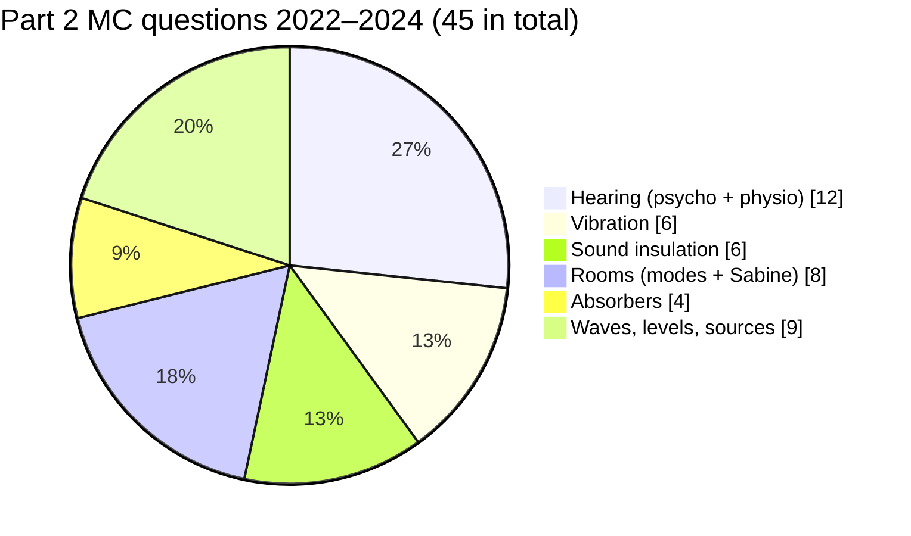

# Old Exams 2022–2024 — Worked

> [!abstract] The idea
> Three old exams, worked in full and checked against the official solutions. The first section shows where the marks come from. Then every part 1 problem with a hidden hint, the worked answer and the official one. Then every multiple-choice question in a table. It ends with the traps that keep coming back, one formula sheet and a two-week plan up to Friday 11 December.

Sources: questions [[34840_Exam_2022_part1.pdf|2022 part 1]] · [[34840_Exam_2022_part2_MPC.pdf|2022 part 2]] · [[34840_exam_2023_part1.pdf|2023 part 1]] · [[34840_exam_2023_part2_questions_answers.pdf|2023 part 2]] · [[34840_Exam_2024_part1.pdf|2024 part 1]] · [[34840_Exam_2024_part2_questions_w_answers.pdf|2024 part 2]]. Official solutions: [[34840_Exam_2022_part1_solution.pdf|2022 p1]] · [[34840_Exam_2022_part2_solution.pdf|2022 p2]] · [[34840_Exam_2023_part1_Solution.pdf|2023 p1]] · [[34840_exam_2023_part2_solution.pdf|2023 p2]] · [[34840_Exam_2024_part1_solution.pdf|2024 p1]] · [[34840_Exam_2024_part2_solution.pdf|2024 p2]]. MATLAB: `5. Semester/Acoustics and Noise Control/Matlab/OldExams_Part1_2022_2024.m` (runs headless, prints every part 1 number below next to the official one).

> [!info] The exam: Friday 11 December 2026, 4 hours, individual
> - **Aids: all**, but **no internet** (course page). Every cover page: "Aids allowed: All · Exam duration: 4 hours".
> - **Part 1 = problems**, like the hand-in. Hand in **one PDF**. If you write by hand you must photograph it with an **allowed device: no 5G/broadband phone** (Finn's announcement, 4-Nov). Sort out the device, or type the answers, before the day.
> - **Part 1 weighting:** "The problem set is evaluated as a whole and counts **40 %** of the written exam" (all three cover pages). So part 2 is the other **60 %** (not printed, but that is what is left).
> - **Part 1 size:** 2022 and 2023 had 3 problems with 1–4 sub-questions each; 2024 had 2 problems with 2 sub-questions each.
> - **Part 2 = 15 multiple-choice questions**, 4 options each, every year. The order follows the course: about 3–4 on waves/levels/sources (Finn), 3–4 on rooms and absorbers (Cheolho), 4 on vibration and insulation, 4 on hearing (Torsten).
> - **Constants printed on the paper:** $c=343$ m/s, $\rho=1.2$ kg/m³, so $\rho c=411.6$ Pa·s/m.
> - The individual hand-in and the lab report count 10 % of the course grade (course page).

> [!warning] Disagreements with the official solutions, in one place
> None of them changes a multiple-choice answer. The ones that matter in part 1 are 2023 P1.1 (83.3 dB, not 83.1), 2023 P3 (the official numbers use $\rho=1.18$) and 2023 P3.2 (the official intensity drops the near-field cross terms). Full list in §6.

---

## 1. Where the marks come from

A part 1 problem is worth about 13 % of the exam (40 % over three problems). A multiple-choice question is worth about 4 % (60 % over 15). So one part 1 problem is worth about three MC questions. Weigh the table with that in mind.

| Topic | 2022 P1 | 2022 MC | 2023 P1 | 2023 MC | 2024 P1 | 2024 MC | Hits | Notes to read |
|---|---|---|---|---|---|---|---|---|
| **Plane waves, reflection, impedance** | – | Q1, Q6 | **P1** (1.1, 1.2) | – | **P1.1** | Q3 | 6 | [[Lecture 1 - Introduction and Plane Waves\|L1]], [[Lecture 2 - Plane Waves Reflection and Spherical Waves\|L2 §2–4]], [[Lecture 4 - Impedance Intensity and Sound Power\|L4]], [[Week 2 - Reflection and Spherical Waves\|Wk 2]], [[Week 4 - Impedance Intensity and Sound Power\|Wk 4]] |
| **Decibels, adding sources, $L_{eq}$** | **P2** | Q2, Q3 | **P2** | Q1 | **P1.2** | Q2 | 7 | [[Lecture 3 - Decibels Frequency Analysis and Measurements\|L3 §2–6]], [[Week 3 - Decibels Frequency Analysis and Measurements\|Wk 3]] |
| **Octave bands, A-weighting** | **P2** | – | **P2** | – | **P1.2** | – | 3 | [[Lecture 3 - Decibels Frequency Analysis and Measurements\|L3 §7–8]], [[Week 3 - Decibels Frequency Analysis and Measurements\|Wk 3 P3]] |
| **Intensity and sound power** | **P1**, **P3.4** | – | **P3** (3.1, 3.2) | – | **P2.2** | – | 5 | [[Lecture 4 - Impedance Intensity and Sound Power\|L4 §5–6]], [[Week 4 - Impedance Intensity and Sound Power\|Wk 4]], [[Week 5 - Radiation Monopoles Dipoles and Pistons\|Wk 5]] |
| **Monopole, image source, dipole, near field, piston** | **P1**, **P3** | – | **P3** | Q2, Q4 | **P2** | Q1 | 7 | [[Lecture 5 - Radiation Monopoles Dipoles and Pistons\|L5]], [[Lecture 2 - Plane Waves Reflection and Spherical Waves\|L2 §5–6]], [[Week 5 - Radiation Monopoles Dipoles and Pistons\|Wk 5]] |
| Loudspeakers | **P1** | – | – | – | – | – | 1 | [[Lecture 8 - Loudspeakers\|L8]], [[Week 8 - Loudspeakers\|Wk 8]] |
| **Room modes** | – | Q4 | – | Q3 | – | Q5 | 3 | [[Lecture 6 - Room Modes and the Diffuse Sound Field\|L6 §2–5]], [[Week 6 - Room Modes and the Diffuse Sound Field\|Wk 6]], [[Lab Exercise - Preparation\|lab prep]] |
| **Reverberation, Sabine, diffuse-field level** | – | Q5, Q7 | – | Q5, Q7 | – | Q4 | 5 | [[Lecture 6 - Room Modes and the Diffuse Sound Field\|L6 §6–14]], [[Week 6 - Room Modes and the Diffuse Sound Field\|Wk 6]] |
| **Absorbers** (α from Z, membrane, Helmholtz, ISO 354) | – | Q6, Q7 | – | Q6 | (P1 uses α) | Q6, Q7 | 5 | [[Lecture 7 - Sound Absorption and Room Acoustic Design\|L7]], [[Lecture 4 - Impedance Intensity and Sound Power\|L4 §4]], [[Week 7 - Sound Absorbers\|Wk 7]] |
| **Psychoacoustics** (filters, masking, beats, recruitment) | – | Q14, Q15 | – | Q14 | – | Q12, Q13, Q14 | 6 | [[Lecture 9 - Hearing - Frequency Selectivity and Masking\|L9]], [[Week 9 - Psychological Acoustics\|Wk 9]] |
| **Physiology** (cochlea, hair cells, hearing loss) | – | Q12, Q13 | – | Q12, Q13, Q15 | – | Q15 | 6 | [[Lecture 10 - Physiological Acoustics\|L10]], [[Week 10 - Physiological Acoustics\|Wk 10]] |
| **Vibration and isolation** | – | Q10, Q11 | – | Q9, Q11 | – | Q9, Q10 | 6 | [[Lecture 11 - Structure-borne Sound and Vibration Isolation\|L11]], [[Week 11 - Structure-borne Sound and Vibration Isolation\|Wk 11]] |
| **Sound insulation** | – | Q8, Q9 | – | Q8, Q10 | – | Q8, Q11 | 6 | [[Lecture 12 - Sound Insulation\|L12]], [[Week 12 - Sound Insulation\|Wk 12]] (all six worked there) |
| Measurement (SLM, accelerometer, ISO 354) | – | (Q7) | – | – | – | Q9 | 2 | [[Lecture 3 - Decibels Frequency Analysis and Measurements\|L3 §10]], [[Lecture 11 - Structure-borne Sound and Vibration Isolation\|L11 §2]] |

**What the table says:**
- **Part 1 is always Finn's half of the course.** Every year: a **level / octave-band** problem, and a **monopole (or two) with intensity or power**. In 2023 and 2024 also a **plane wave hitting a reflector**. Never rooms, absorbers as such, hearing, vibration or insulation in part 1.
- **Hearing is 4 of 15 MC every year** (about 16 % of the exam). Pure reading, no maths, cheap marks.
- **Vibration 2 + insulation 2 every year** (another 16 %). Same formulas each time: $f_0\approx0.5/\sqrt{\xi_0}$, isolation from $\sqrt2 f_0$, the mass law, $f_c$, multi-element $R$.
- **Rooms + absorbers 3–4 MC every year:** a mode frequency, a Sabine calculation, a membrane or Helmholtz resonance.

(2022 Q7 is counted once, under rooms.)

---

## 2. Part 1 — 2022

### Problem 1 — Loudspeaker in an infinite baffle

**Given:** $R_e=5\ \Omega$, $B=1$ T, $l=2$ m ($Bl=2$ Tm), $M=10$ g, $K=1500$ N/m, $R_t=2.5$ Ns/m, $a=6$ cm, infinite baffle, **4 V rms** at 200 Hz. **Q1.1:** volume velocity, pressure amplitude at 5 m, radiated power.

> [!question]- Hint
> Voltage → current $e/R_e$ → force $Bl\,i$ → velocity $F/Z_M$ → $Q=SU$. Then check $ka$: if it is small, the baffled driver is a monopole on a rigid plane, so $2\pi r$ and $2\pi r^2$.

$$Z_M=R_t+j\left(\omega M-\frac K\omega\right)=2.5+j(12.57-1.19)=2.5+j11.37\ \mathrm{Ns/m}$$
$$|Q|=\frac{S\,Bl}{R_e}\frac{\sqrt2\,e_{rms}}{|Z_M|}=\frac{0.01131\cdot2}{5}\cdot\frac{5.657}{11.64}=\boxed{2.20\times10^{-3}\ \mathrm{m^3/s}}\ \text{(amplitude)}$$

$ka=\frac{2\pi\cdot200}{343}\cdot0.06=0.22<1$, so a monopole in half space:
$$|p(5\,\mathrm m)|=\frac{\rho\omega|Q|}{2\pi r}=\frac{1.2\cdot1257\cdot2.2\times10^{-3}}{2\pi\cdot5}=\boxed{0.105\ \mathrm{Pa}}\ \text{(amplitude; 71.4 dB)}$$
$$P_a=2\pi r^2\,\frac{|p|^2}{2\rho c}=2\pi\cdot25\cdot\frac{0.105^2}{823.2}=\boxed{2.1\ \mathrm{mW}}$$

**Official:** 0.0022 m³/s, 0.106 Pa, 2.1 mW ✔. Two typos in the official text: the pressure line shows "3·10⁻³" but uses 2.2·10⁻³, and the power line shows "4π(5 m)²" but the number is the 2π one (4π gives 4.2 mW).

> [!note] Ambiguity: is the electrical damping already in $R_t$?
> "Total damping coefficient" means yes, and the official solution uses 2.5 as it stands. If you add $(Bl)^2/R_e=0.8$ on top, $Q$ drops only 2 % (2.16·10⁻³). Write one line saying which you assume.

### Problem 2 — Two sources in octave bands

| Source | 400 | 600 | 800 | 900 | 1200 | 1500 Hz |
|---|---|---|---|---|---|---|
| #1 | 0.1 | | 0.02 | | 0.01 | |
| #2 | | j0.05 | | j0.03 | j0.01 | j0.006 Pa |

**Q2.1:** SPL in the 250, 500, 1000 and 2000 Hz octave bands, both sources on.

> [!question]- Hint
> Band limits $f_c/\sqrt2$ to $f_c\sqrt2$. Different frequencies: add $p_{rms}^2$. **Same frequency (1200 Hz): add the complex amplitudes first**, then square.

Bands: 250 = 177–354, 500 = 354–707, 1000 = 707–1414, 2000 = 1414–2828 Hz.

| Band | Components | $p_{rms}$ | SPL |
|---|---|---|---|
| 250 Hz | none | 0 | **−∞ dB** |
| 500 Hz | 400 (0.1), 600 (j0.05) | $\sqrt{0.1^2/2+0.05^2/2}=0.0791$ Pa | **71.9 dB** |
| 1000 Hz | 800 (0.02), 900 (j0.03), 1200: $\lvert0.01+j0.01\rvert/\sqrt2=0.01$ | $\sqrt{0.0002+0.00045+0.0001}=0.0274$ Pa | **62.7 dB** |
| 2000 Hz | 1500 (j0.006) | 0.00424 Pa | **46.5 dB** |

**Official:** −∞ / 71.9 / 62.73 / 46.53 dB ✔. The official text says "1600 Hz" for the 2000 Hz band; the table says 1500. No effect.

> [!tip] The phase only matters at 1200 Hz
> The "j" on a lone component changes nothing (its modulus is the same). At 1200 Hz the two are 90° apart, so $|0.01+j0.01|=0.0141$, not 0.02 (in phase) and not 0 (antiphase).

### Problem 3 — Two in-phase monopoles 4 m apart

Sources at $x=0$ and $x=4$ m, the cancellation point $x_c$ drawn just right of the middle.

**Q3.1:** When can complete cancellation happen between them?

> [!question]- Hint
> Two complex numbers add to zero only if they have the same size and opposite phase.

At the point, the two pressures must have **equal amplitude** and be **exactly 180° out of phase**. With $1/r$ spreading, equal amplitude off the midpoint needs unequal source strengths. ✔ official.

**Q3.2:** The lowest cancellation frequency is 500 Hz. Which others?

> [!question]- Hint
> Sources in phase, so all phase comes from the path difference $\Delta x$. Antiphase when $\Delta x$ is an odd number of half wavelengths.

$$\Delta x=(2n+1)\frac\lambda2\ \Rightarrow\ f_n=(2n+1)\frac{c}{2\Delta x}=(2n+1)\cdot500\ \mathrm{Hz}$$
**1500, 2500, 3500 Hz, …** (odd multiples). ✔ official.

**Q3.3:** Position $x_c$ and the level difference of the sources.

> [!question]- Hint
> Moving $d$ from the midpoint changes the path difference by $2d$. Then set $|Q_1|/x_c=|Q_2|/(4-x_c)$.

$$\Delta x=2(x_c-2)=\frac{\lambda}{2}\ \Rightarrow\ x_c=2+\frac{c}{4f_0}=2+\frac{343}{2000}=\boxed{2.172\ \mathrm m}$$
$$\frac{|Q_1|}{|Q_2|}=\frac{x_c}{4-x_c}=\frac{2.172}{1.828}=\boxed{1.188}\quad(+1.5\ \mathrm{dB},\ \text{source 1 is the stronger, it is farther away})$$
✔ official (2.172 m, 1.188).

**Q3.4:** Intensity at the midpoint when SPL there is 80 dB.

> [!question]- Hint
> At the midpoint the two waves are in phase and travel in opposite directions. In phase means the rms pressures add linearly. Opposite directions means their intensities subtract.

$$p_{rms}=20\,\mu\mathrm{Pa}\cdot10^{80/20}=0.2\ \mathrm{Pa}=p_1+p_2,\quad p_1=1.188\,p_2\ \Rightarrow\ p_2=0.0914,\ p_1=0.1086\ \mathrm{Pa}$$
$$I_x=\frac{p_1^2-p_2^2}{\rho c}=\frac{0.01179-0.00836}{411.6}=\boxed{8.33\ \mu\mathrm{W/m^2}}\ \text{(towards source 2)}$$
✔ official (8.333 µW/m²; it says "18 % higher", it is 18.8 %). With $kr=18$ at 2 m and the waves in phase there, the near-field cross terms vanish, so this is exact.

---

## 3. Part 1 — 2023

### Problem 1 — The tunnel

A wall at the end of a long tunnel vibrates uniformly at 240 Hz, velocity amplitude 1 mm/s. A perfect absorber ($\alpha=1$) is 20 m away.

**Q1.1:** Describe the field and find SPL 8 m from the wall.

> [!question]- Hint
> Uniform wall in a tube → plane wave. $\alpha=1$ → $R=0$ → only the forward wave. Match the air velocity to the wall: $p=\rho c\,u$.

A **plane progressive wave**: same amplitude everywhere along the tunnel, $p$ and $u$ in phase, $I=p_{rms}^2/\rho c$.
$$|p|=\rho c\,U=411.6\cdot10^{-3}=0.412\ \mathrm{Pa},\qquad p_{rms}=0.291\ \mathrm{Pa},\qquad SPL=\boxed{83.3\ \mathrm{dB}}\ \text{(at 8 m and everywhere)}$$
**Official: 0.286 Pa, 83.1 dB.** ✘ small slip: $0.412/\sqrt2=0.291$, not 0.286. Use 83.3 dB.

**Q1.2:** The absorber is soaked and behaves like water. Describe the field and find SPL at 8 m.

> [!question]- Hint
> $Z_{water}\approx1.48\times10^6\gg\rho c$, so $R\approx+1$ (like a rigid wall). Write $p=2p_i\cos kx$, $u=\frac{2jp_i}{\rho c}\sin(-kx)$ with $x=0$ at the water. Fix $p_i$ from $u(-20)=U$.

$R=(Z_w-\rho c)/(Z_w+\rho c)=0.9994\approx1$. Now a **standing wave**: pressure maximum at the water surface, nodes every $\lambda/2=0.71$ m, $p$ and $u$ in quadrature, almost no net intensity.
$$k=\frac{2\pi\cdot240}{343}=4.396\ \mathrm{rad/m},\qquad p_i=\frac{U\rho c}{2j\sin(-20k)}=-j5.62\ \mathrm{Pa}$$
$$|p(-12\,\mathrm m)|=|2p_i\cos(12k)|=8.94\ \mathrm{Pa}\ \Rightarrow\ SPL=\boxed{110.0\ \mathrm{dB}}$$
**Official:** $-j5.5$ Pa, 8.8 Pa, 109.9 dB ✔ (rounding).

> [!warning] This answer sits on a resonance
> $\sin(20k)=0.037$: the 20 m tunnel is almost exactly at a resonance at 240 Hz with $c=343$. With $c=344$ the same calculation gives **90.9 dB**, 19 dB less. Use the given constants to the digit, and say in one line that the result is extremely sensitive because there are no losses and the tunnel is close to resonance.

### Problem 2 — Two cello strings

String 1: 334 Hz (0.1), 668 (j0.001), 1002 (0.04). String 2: 501 (0.2), 1002 (0.05), 1503 (j0.02) Pa.

**Q2.1:** rms pressure in the 125–2000 Hz octave bands, both strings.

> [!question]- Hint
> List all six frequencies and drop them into bands (limits 88, 177, 354, 707, 1414, 2828 Hz). Two of them are **both 1002 Hz**: add those with phase.

| Band | Components | $p_{rms}$ | SPL |
|---|---|---|---|
| 125 | none | 0 | **−∞** |
| 250 | 334 (0.1) | 0.0707 Pa | **71.0 dB** |
| 500 | 501 (0.2), 668 (j0.001) | 0.1414 Pa | **77.0 dB** |
| 1000 | 1002: $\lvert0.04+0.05\rvert/\sqrt2$ | 0.0636 Pa | **70.1 dB** |
| 2000 | 1503 (j0.02) | 0.0141 Pa | **57.0 dB** |

**Official:** −∞ / 70.9 / 77 / 70.1 / 57.0 ✔ (70.97 rounds to 71.0).

**Q2.2:** One string drops 1 % in frequency. What happens?

> [!question]- Hint
> Does anything leave its band? Then: the two 1002 Hz components are no longer the same frequency.

Nothing changes band (334→331, 501→496, 1002→992 all stay put). Only the 1000 Hz band changes: the two components now have **different frequencies**, so they add as squares:
$$p_{rms}=\sqrt{0.04^2+0.05^2}/\sqrt2=0.0453\ \mathrm{Pa}\ \Rightarrow\ \boxed{67.1\ \mathrm{dB}}\ (-3\ \mathrm{dB})$$
✔ official (its "|0.4|" is a typo for 0.04).

### Problem 3 — Monopole 2 m from a rigid wall

**Q3.1:** Power at 20 Hz ($Q=3\times10^{-3}$), 200 Hz ($4\times10^{-4}$) and 2 kHz ($5\times10^{-5}$ m³/s).

> [!question]- Hint
> Image source at distance $2h$. Power = free-field power × $(1+\sin 2kh/2kh)$.

$$P=\frac{\rho c\,k^2|Q|^2}{8\pi}\left(1+\frac{\sin2kh}{2kh}\right)$$

| f | $2kh$ | factor | $P$ (ρ = 1.2) | Official |
|---|---|---|---|---|
| 20 Hz | 1.47 | 1.68 | **33.2 µW** | 32.7 µW |
| 200 Hz | 14.7 | 1.06 | **37.3 µW** | 36.6 µW |
| 2 kHz | 147 | 1.006 | **55.3 µW** | 54.4 µW |

✘ **All official values are 1.7 % low.** They come out exactly with $\rho=1.18$, not the 1.2 printed on the paper. Use 1.2. The physics: at 20 Hz the image is close in wavelengths and almost doubles the power; at 2 kHz it is far and the power is the free-field value.

**Q3.2:** At 200 Hz, intensity on the line from the source to the wall at 0, 0.5 and 1 m from the wall.

> [!question]- Hint
> Real source plus image 4 m apart. On the line between them the two spherical waves travel in opposite directions. Find $|p_1|$ and $|p_2|$ at each point.

$r$ = distance from the real source = 2, 1.5, 1.0 m; image distance $4-r$.

| From wall | $\lvert p_1\rvert$ | $\lvert p_2\rvert$ | $I=\frac{\lvert p_1\rvert^2-\lvert p_2\rvert^2}{2\rho c}$ | Exact $\tfrac12\mathrm{Re}\{pu^*\}$ | Official |
|---|---|---|---|---|---|
| 0 m | 0.0240 | 0.0240 | **0** | 0 | 0 |
| 0.5 m | 0.0320 | 0.0192 | **0.80 µW/m²** | 0.69 µW/m² | 0.78 |
| 1 m | 0.0480 | 0.0160 | **2.49 µW/m²** | 2.78 µW/m² | 2.45 |

The official method is the left formula (again with $\rho=1.18$, hence 0.78 and 2.45). **Ambiguity:** that formula drops the cross terms. For two counter-propagating spherical waves the cross terms are not zero: $\tfrac{1}{2\rho c}\,\mathrm{Im}\{p_1p_2^*\}\left(\tfrac1{kr_1}+\tfrac1{kr_2}\right)$, and $kr$ is only 3.7–11 here. The exact values are 0.69 and 2.78 µW/m². At the wall both methods give 0, as they must. On the exam: use the official method, and add one sentence that it neglects the near-field term. (2024 P2.2 does it exactly, so both styles exist.)

---

## 4. Part 1 — 2024

### Problem 1 — Plane wave on a porous absorber

400 Hz: $\alpha=0.9999$, incident amplitude 0.9 Pa. 630 Hz: $\alpha=0.19$, incident $0.4+j0.4$ Pa. $R$ is always positive.

**Q1.1:** Pressure amplitude at each frequency 0.6 m in front of the absorber.

> [!question]- Hint
> $\alpha=1-|R|^2$, and $R$ is real and positive. Absorber at $x=0$, point at $x=-0.6$: $p=p_ie^{-jkx}+Rp_ie^{jkx}$.

$$R_{400}=\sqrt{1-0.9999}=0.01,\qquad R_{630}=\sqrt{1-0.19}=0.9$$
$$|p_{400}|=|0.9e^{jk0.6}+0.009e^{-jk0.6}|=\boxed{0.89\ \mathrm{Pa}},\qquad |p_{630}|=|(0.4+j0.4)(e^{jk0.6}+0.9e^{-jk0.6})|=\boxed{0.86\ \mathrm{Pa}}$$
✔ official. At 400 Hz it is a pure travelling wave. At 630 Hz there is a strong standing wave and 0.6 m happens to be on the high side (0.86 vs the incident 0.57 Pa).

**Q1.2:** A-weighted SPL in the relevant octave band(s), both tones on.

> [!question]- Hint
> Which band? Both 400 and 630 Hz are in the **500 Hz octave** (354–707). Weight each tone with its own A value **before** adding: −4.8 dB at 400, −1.9 dB at 630.

$$p_{A}=\frac{|p|}{\sqrt2}10^{K_A/20}:\quad 0.363\ \mathrm{Pa},\ 0.490\ \mathrm{Pa}\ \Rightarrow\ L_A=20\log\frac{\sqrt{0.363^2+0.490^2}}{20\,\mu\mathrm{Pa}}=\boxed{89.7\ \mathrm{dB(A)}}$$
✔ official (89.7; it rounds 0.490 to 0.50). Unweighted the band is 92.8 dB. Applying one A correction to the band total is the less accurate way the solution warns about.

### Problem 2 — Monopole, then a dipole

$Q=10^{-5}$ m³/s at 500 Hz, $k=9.16$ rad/m.

**Q2.1:** $|p|$ and $|u|$ at 0.1, 0.2, 0.3 m.

> [!question]- Hint
> $|p|=\omega\rho Q/4\pi r$. The velocity has the near-field factor $|1+1/jkr|$, and $kr$ is only 0.9–2.7 here.

| r | $kr$ | $\lvert p\rvert$ | $\lvert u\rvert$ |
|---|---|---|---|
| 0.1 m | 0.92 | **30 mPa** | **108 µm/s** |
| 0.2 m | 1.83 | **15 mPa** | **41.5 µm/s** |
| 0.3 m | 2.75 | **10 mPa** | **25.9 µm/s** |

✔ official. Pressure goes as $1/r$; velocity falls faster (near field).

**Q2.2:** An identical source 0.4 m away in antiphase. Total rms pressure, rms velocity and intensity on the line at 0.1, 0.2, 0.3 m.

> [!question]- Hint
> Sum complex values. Pressure terms get opposite signs (antiphase). For the velocity, the antiphase and the opposite travel direction cancel, so the two velocity terms get the **same** sign. Then $I=\tfrac12\mathrm{Re}\{pu^*\}$.

$$p=\frac{j\omega\rho Q}{4\pi}\left(\frac{e^{-jkr_1}}{r_1}-\frac{e^{-jkr_2}}{r_2}\right),\quad u=\frac{j\omega Q}{4\pi c}\left[\left(1+\tfrac1{jkr_1}\right)\frac{e^{-jkr_1}}{r_1}+\left(1+\tfrac1{jkr_2}\right)\frac{e^{-jkr_2}}{r_2}\right]$$

| $r_1$ | $p$ | $u$ | $p_{rms}$ | $u_{rms}$ | $I$ |
|---|---|---|---|---|---|
| 0.1 m | $0.0200+j0.0275$ Pa | $107.4-j44.6$ µm/s | **24 mPa** | **82.2 µm/s** | **+459 nW/m²** |
| 0.2 m | 0 | $60.1-j57.3$ µm/s | **0** | **58.7 µm/s** | **0** |
| 0.3 m | $-0.0200-j0.0275$ Pa | $107.4-j44.6$ µm/s | **24 mPa** | **82.2 µm/s** | **−459 nW/m²** |

✔ official, every digit. The midpoint has zero pressure but not zero velocity (like a pressure node in a tube). Energy flows away from each source towards the middle plane, where it turns sideways.

---

## 5. Part 2 — multiple choice

Letters A–D follow the order the options are printed in. Values in brackets are the correct option.

### 2022

| Q | Topic | Answer | Why, and the trap |
|---|---|---|---|
| 1 | Plane wave, bubbles in water | **C** (R < 0) | Bubbles lower the impedance far below water's: a pressure-release boundary, so the reflection is in antiphase. Trap: B, thinking "any change reflects in phase". |
| 2 | Two tuning forks, 440.0 / 440.1 Hz | **B** (0.161 Pa) | Different frequencies, and 10 s covers a full 0.1 Hz beat, so add squares: $\sqrt{(0.18^2+0.14^2)/2}$. Trap: D (0.228) is $\sqrt{0.18^2+0.14^2}$ without the $/\sqrt2$. |
| 3 | $L_{eq,24h}$ | **B** (66.2 dB) | 0.1 Pa = 74 dB, on 4 h of 24: $74+10\log(4/24)=66.2$. Trap: D (74.0) is the level while running; C (71.0) takes the 50 % but forgets the 24 h. |
| 4 | Room height from two modes | **B** (4 m) | $f_{010}=10$ Hz → $l_y=17.15$ m; then $45=\frac c2\sqrt{(2/l_y)^2+(1/l_z)^2}$ → $l_z=4.25$ m → 4 m is nearest. The official writes $2/l_y^2$ instead of $(2/l_y)^2$ (gives 4.01 m); same letter. |
| 5 | Sabine, absorption only on the ceiling | **C** (1.6 s) | $T=0.161\cdot1040/(0.8\cdot130)=1.61$ s. Eyring gives 1.47 s, still nearest C. Note the field is not diffuse with one absorbing surface. |
| 6 | Which $Z$ gives the smallest α | **A** ($Z=1$) | $\alpha=1-\lvert\frac{Z-\rho c}{Z+\rho c}\rvert^2$: 0.010 / 0.63 / 0.83 / 0.15. Trap: thinking "small Z = soft = absorbing". Both far below and far above $\rho c$ reflect. |
| 7 | ISO 354 reverberation room | **D** (0.8) | $\alpha=\frac{0.16V}{S}\left(\frac1{T_2}-\frac1{T_1}\right)=\frac{0.16\cdot150}{9}(0.5-0.2)=0.8$. The 1 cm thickness is a distractor. |
| 8 | Window in a wall, minimum $R$ | **D** (40.5 dB) | Insulation: [[Week 12 - Sound Insulation\|Week 12, Extra 6]]. |
| 9 | Two stacked plates, $f_c$ | **C** (3000 Hz) | Insulation: [[Week 12 - Sound Insulation\|Week 12, Extra 8]]. (Stacked unbonded: $B$ and $m$ both double, $f_c$ unchanged.) |
| 10 | Below resonance a mass–spring is… | **B** (stiffness controlled) | Below $f_0$ the spring dominates the impedance; above, the mass. Trap: A swaps them. |
| 11 | Isolation at 7 Hz, 1 cm deflection | **A** (0 dB) | $f_0=0.5/\sqrt{0.01}=5$ Hz; 7 Hz ≈ $\sqrt2f_0$, where $T=1$ (0 dB): isolation only starts there. Trap: thinking anything above $f_0$ isolates. Mass of slab is irrelevant once you have the deflection. |
| 12 | Cochlear map | **A** | High frequencies at the base (stiff, narrow), low at the apex. Trap: B reverses it. |
| 13 | Broad filters in SNHL | **C** | Outer hair cells give frequency-specific amplification; damaged OHCs → broader tuning. Traps: B (the stiffness gradient is passive and unchanged), D (nerve fibres are not the mechanism). |
| 14 | 850 + 900 Hz, 50 dB each | **A** (one filter, 50 Hz beats) | ERB at 875 Hz ≈ 119 Hz > 50 Hz spacing → same filter → beating at $f_2-f_1$. Trap: D, the cubic difference tone is at $2f_1-f_2=800$ Hz, not 950. |
| 15 | Masking experiments | **D** (notched noise) | Notched noise stops off-frequency listening through a neighbouring filter with better SNR. A, B, C are all false (shape depends on level; bandwidth grows with frequency; masking curves need transforming). |

### 2023

| Q | Topic | Answer | Why, and the trap |
|---|---|---|---|
| 1 | Two uncorrelated 10 dB sources | **A** (13 dB) | Uncorrelated → add $p^2$ → +3 dB. Trap: C (+6 dB is for coherent, in-phase). |
| 2 | Very close to a monopole | **D** (u decays faster than 1/r) | $u\propto(1+1/jkr)/r$: near field adds a $1/r^2$ term. Trap: A ("plane wave" is the *far* field); C (it is 90°, not 180°, in the near field). |
| 3 | 7.2 × 5.4 × 3.0 m, 50 Hz third octave | **D** (2,0,0) | Third-octave limits 44.5–56.1 Hz; $f_{200}=47.6$ Hz is the only one in it (23.8 / 31.8 / 39.7 for the others). Trap: picking the "lowest" mode. |
| 4 | What characterises a dipole | **D** (inefficient, especially at low f) | The two antiphase halves cancel when $kd\ll1$; power $\propto f^4$. Trap: C says high frequencies. |
| 5 | Floor/wall α from T = 0.44 s | **A** (0.1) | $A=0.161\cdot126/0.44=46.1$; minus ceiling $0.8\cdot42=33.6$ → 12.5 m² over 120 m² = 0.10. Trap: forgetting to subtract the ceiling, or dividing by the total area. |
| 6 | Membrane absorber, 2.1 kg/m², 0.1 m | **D** (130 Hz) | $f=\frac1{2\pi}\sqrt{\rho c^2/(md)}\approx60/\sqrt{md}=130.5$ Hz. |
| 7 | SPL from $L_W=75$ dB, V = 200 m³, T = 1 s | **B** (66 dB) | $A=32.2$ m²; $L_p=L_W+10\log(4/A)=65.9$ dB. Direct field at 7.3 m adds only 0.05 dB. Trap: forgetting the factor 4. |
| 8 | Receiver room level through a wall | **D** (37.9 dB) | Insulation: [[Week 12 - Sound Insulation\|Week 12, Extra 3]]. |
| 9 | Isolator, 80 kg, 1.5 cm deflection | **A** (4.1 Hz) | $f_0\approx0.5/\sqrt{\xi_0}=4.08$ Hz. The mass is a distractor. Trap: C (2.3 Hz) or forgetting the square root. |
| 10 | Field incidence vs normal incidence | **C** (5 dB lower) | Insulation: [[Week 12 - Sound Insulation\|Week 12, Extra 2]]. |
| 11 | Blocked force of a mass source | **B** ($F=j3.14$ N) | $F=v_{free}/(Y_s+Y_R)$ with $Y_R=0$ (rigid), $Y_s=1/j\omega M$ → $F=j\omega Mv=j\cdot2\pi500\cdot0.1\cdot0.01$. Trap: D drops the $j$ (on a mass the force leads the velocity by 90°); C is twice the right value. |
| 12 | Basilar membrane | **B** (cascade of low-pass filters, lowest cutoff at the apex) | A travelling wave that builds up and dies past its place. Trap: A (it is not a Fourier transform), D (place is frequency, not level). |
| 13 | Sensorineural loss | **C** (less sensitive and less compression) | OHC damage removes gain for soft sounds and the compression. Trap: A describes a conductive loss; D is the wrong direction. |
| 14 | 400 + 600 Hz, 50 dB each | **B** (separate filters, two tones) | ERB ≈ 79 Hz at 500 Hz, spacing 200 Hz. Trap: C, the CDT is at $2f_1-f_2=200$ Hz, not 800. |
| 15 | Outer hair cells | **A** (level-dependent gain, more for soft sounds) | OHCs are the cochlear amplifier and compressor. Trap: C (they are inside the cochlea), B (no low-frequency preference). |

### 2024

| Q | Topic | Answer | Why, and the trap |
|---|---|---|---|
| 1 | Phase between $p$ and $u$, 189 Hz, 50 cm | **B** (30°) | $kr=1.73$; $u\propto p(1+1/jkr)$ → phase $=\arctan(1/kr)=30°$. Trap: C (60°) is $\arctan(kr)$, and the official solution even prints that formula: the number 30° is right, the formula is a typo. |
| 2 | $L_{eq,8h}$, 15 min per hour | **B** (62 dB) | 0.05 Pa = 68 dB; a quarter of the time: $-6$ dB. Trap: D (68) is the level while running. |
| 3 | Ideal absorber on Venus | **C** (50 000) | Match $\rho c=100\ \mathrm{kg/m^3}\cdot500$ (0.1 g/cm³ = 100 kg/m³). Trap: unit slip on the density (A), or the static pressure (D). |
| 4 | Studio, α for walls + ceiling | **B** (0.4) | $A=0.16\cdot120/0.4=48$; minus floor 4 → 44 over 118 m² = 0.37. Trap: dividing by the total surface. |
| 5 | 6 × 9 × 3 m office, 57 Hz | **D** (2,0,0) | $f_{200}=2\cdot343/(2\cdot6)=57.2$ Hz. Others 28.6 / 19.1 / 34.4. Trap: mixing up which dimension is x. |
| 6 | Helmholtz volume, 140 Hz | **D** (0.015 m³) | $V=\frac{c^2S}{4\pi^2lf_0^2}$ with $S=\pi0.025^2$, $l=0.02$ → 0.0149 m³. Trap: using the diameter as radius. |
| 7 | Membrane depth for 350 Hz, 0.2 kg/m² | **D** (15 cm) | $d=\rho c^2/((2\pi f)^2m)=0.146$ m. |
| 8 | Concrete 10 → 15 cm, $f_c$ change | **C** (−63 Hz) | Insulation: [[Week 12 - Sound Insulation\|Week 12, Extra 7]]. ($f_c\propto1/h$: 189 → 126 Hz.) |
| 9 | Piezo accelerometer output | **B** (charge) | The crystal produces charge proportional to force, hence acceleration; a charge amplifier turns it into voltage. Trap: A (voltage is after the amplifier). |
| 10 | Isolation starts at… | **C** (7.0 Hz) | $f_0=\frac1{2\pi}\sqrt{g/\xi_0}=4.98$ Hz; isolation above $\sqrt2f_0=7.05$ Hz. Trap: B (4.2 Hz) sits near $f_0$ itself; at resonance there is amplification, not isolation. |
| 11 | Double gypsum wall, 10 cm apart | **C** (32.1 dB) | Insulation: [[Week 12 - Sound Insulation\|Week 12, Extra 11]]. |
| 12 | Masking by a pure tone | **A** (masks higher frequencies more) | Upward spread of masking: the excitation pattern has a shallow high-frequency skirt, and it gets shallower with level. Trap: D (it is strongly level dependent). |
| 13 | Loudness recruitment | **B** (faster growth than normal) | Raised threshold, then loudness catches up at high levels. Trap: A (opposite), C (it is the OHCs, not IHCs). |
| 14 | Selectivity vs level | **C** (filters broaden with level) | The OHC gain is largest for soft sounds; at high levels the passive, broad tuning dominates. Trap: B (tuning is not fixed). |
| 15 | IHC vs OHC | **C** | IHCs transduce to the nerve; OHCs tune and amplify. Trap: A swaps them. |

---

## 6. Disagreements and ambiguities, collected

| Where | Official | Mine | Verdict |
|---|---|---|---|
| 2022 P1 | "3·10⁻³" and "4π(5 m)²" in the lines | 2.2·10⁻³, 2π | Typos only; 0.106 Pa and 2.1 mW agree. |
| 2022 P1 | $R_t$ includes electrical damping | (same) | Ambiguous wording; adding $(Bl)^2/R_e$ changes $Q$ by 2 %. |
| 2022 P2 | "1600 Hz" | 1500 Hz | Typo, no effect. |
| 2023 P1.1 | 0.286 Pa, **83.1 dB** | 0.291 Pa, **83.3 dB** | Official slip. |
| 2023 P1.2 | −j5.5, 8.8 Pa, 109.9 dB | −j5.62, 8.94 Pa, 110.0 dB | Rounding. But the answer is near a resonance: $c=344$ gives 90.9 dB. |
| 2023 P2.2 | "\|0.4\|" | 0.04 | Typo, 67.1 dB agrees. |
| 2023 P3.1 | 32.7 / 36.6 / 54.4 µW | 33.2 / 37.3 / 55.3 µW | Official uses $\rho=1.18$, not the 1.2 on the paper. |
| 2023 P3.2 | 0.78 / 2.45 µW/m² | 0.80 / 2.49 (same method, ρ = 1.2); exact 0.69 / 2.78 | Official drops the near-field cross terms. |
| 2024 P1.2 | $p_{A,630}=0.50$ | 0.490 | Rounding, 89.7 dB(A) agrees. |
| 2022 MC4 | $2/l_y^2$ | $(2/l_y)^2$, $l_z=4.25$ m | Wrong formula in the solution, same answer B. |
| 2022 MC5 | Sabine 1.6 s | Eyring 1.47 s | Same answer C; the room is not diffuse. |
| 2024 MC1 | "arctan(kr)" | arctan(1/kr) | Formula typo; 30° is right, $\arctan(kr)$ = 60° is the trap. |
| 2024 MC11 | "15.6 kg/m³" | kg/m² | Unit typo (see [[Week 12 - Sound Insulation\|Week 12]]). |

---

## 7. Recurring traps

1. **Same frequency or not?** Add complex amplitudes only for identical frequencies (2022 1200 Hz, 2023 1002 Hz). Everything else adds as $p_{rms}^2$. Slightly detuned = different frequencies, −3 dB vs the in-phase sum (2023 P2.2, 2022 MC2).
2. **Amplitude vs rms.** Exams give amplitudes ("pressure amplitude 0.1 Pa", "velocity amplitude 1 mm/s") and rms voltages ("rms voltage 4 V"). Divide by $\sqrt2$ exactly once before a level.
3. **2π or 4π.** Baffle or rigid wall at $ka\ll1$ → $2\pi r$ and $2\pi r^2$. Free space → $4\pi$. A monopole *near* (not on) a wall → image source, not a simple 2π.
4. **Octave band limits.** $f_c/\sqrt2$ to $f_c\sqrt2$ (third octaves: $2^{\pm1/6}$). An empty band is −∞ dB; say so. Check every component, including the harmonics.
5. **A-weight each tone before adding**, with the value at that tone's frequency (2024 P1.2).
6. **Intensity of opposite waves subtracts.** Two waves meeting head-on: $I=(p_1^2-p_2^2)/\rho c$ (rms). Exact only where the cross terms vanish (plane waves, or spherical waves in phase); otherwise use $\tfrac12\mathrm{Re}\{pu^*\}$ with the near-field factor.
7. **Near field: velocity, not pressure.** $|p|\propto1/r$ always for a monopole; $u$ carries $(1+1/jkr)$; phase between them $\arctan(1/kr)$ (2023 MC2, 2024 MC1, 2024 P2.1).
8. **Sign of R.** Soft/low impedance (bubbles, open end) → $R<0$. Hard/high impedance (water seen from air, rigid wall) → $R\approx+1$, pressure maximum at the surface. α only fixes $|R|$; the sign has to be given or argued.
9. **Sabine with one known surface:** subtract its absorption first, then divide by the *remaining* area (2023 MC5, 2024 MC4).
10. **Distractor data.** The absorber thickness (2022 MC7), the machine mass when the deflection is given (2023 MC9), the room position in a reverberant field (2023 MC7). Notice and ignore.
11. **Vibration isolation starts at $\sqrt2 f_0$**, not at $f_0$. $f_0\approx0.5/\sqrt{\xi_0}$ (ξ in metres).
12. **Hearing MCs:** base = high frequencies; OHC = amplifier/compressor/tuning, IHC = transducer; filters broaden with level and with hearing loss; masking spreads upwards; recruitment = faster loudness growth; the combination tone is $2f_1-f_2$, *below* the lower tone.
13. **Constants to the digit.** $c=343$ and $\rho=1.2$ from the cover page. The official solutions sometimes use 1.18 or 344; you will not lose marks for following the paper.

---

## 8. Formula sheet for the exam

Only formulas that appear in these three exams. rms unless marked $\hat{\ }$ (amplitude). $\rho=1.2$ kg/m³, $c=343$ m/s, $\rho c=411.6$ Pa·s/m, $p_0=20$ µPa.

**Levels**
- $L_p=20\log_{10}(p_{rms}/p_0)$ dB; $p_{rms}=\hat p/\sqrt2$
- Different frequencies / uncorrelated: $p_{tot}^2=\sum p_i^2$; same frequency: $\hat p_{tot}=|\sum\hat p_i|$ (complex)
- $L_{eq,T}=10\log\left(\frac1T\sum t_i10^{L_i/10}\right)$; on for fraction $\tau$: $L+10\log\tau$
- Octave band: $f_c/\sqrt2\dots f_c\sqrt2$; third octave: $f_c2^{\pm1/6}$
- A-weighting (course Table 1.3.2): 400 Hz −4.8, 500 Hz −3.2, 630 Hz −1.9, 1 kHz 0 dB

**Plane waves and reflection**
- $p=\rho c\,u$ (one wave); $I=p_{rms}^2/\rho c$
- $R=\frac{Z-\rho c}{Z+\rho c}$; $\alpha=1-|R|^2$; air→water $R\approx+1$
- Standing wave, $x=0$ at the reflector: $p=\hat p_i(e^{-jkx}+Re^{jkx})$, $u=\frac{\hat p_i}{\rho c}(e^{-jkx}-Re^{jkx})$
- $R=1$: $p=2\hat p_i\cos kx$, $u=\frac{2j\hat p_i}{\rho c}\sin(-kx)$

**Monopole, image, dipole**
- $\hat p=\frac{j\omega\rho\hat Q}{4\pi r}e^{-jkr}$ (free) or $\frac{j\omega\rho\hat Q}{2\pi r}$ (on a baffle)
- $\hat u=\frac{\hat p}{\rho c}\left(1+\frac1{jkr}\right)$; phase $\arctan(1/kr)$
- $P_{free}=\frac{\rho c\,k^2|\hat Q|^2}{8\pi}$; at distance $h$ from a rigid wall: $\times\left(1+\frac{\sin2kh}{2kh}\right)$
- $P=4\pi r^2 I$ (free) or $2\pi r^2I$ (baffle), $I=\hat p^2/2\rho c$
- Cancellation between two in-phase sources: $\Delta x=(2n+1)\lambda/2$
- $I=\tfrac12\mathrm{Re}\{\hat p\hat u^*\}$

**Loudspeaker**
- $Z_M=R_t+j(\omega M-K/\omega)$; $\hat Q=\frac{S\,Bl}{R_e}\frac{\hat e}{Z_M}$; $S=\pi a^2$; omnidirectional if $ka<1$

**Rooms**
- $f_{n_xn_yn_z}=\frac c2\sqrt{(n_x/l_x)^2+(n_y/l_y)^2+(n_z/l_z)^2}$
- $T=0.161V/A$ (Sabine), $A=\sum S_i\alpha_i$; Eyring $A=-S\ln(1-\bar\alpha)$
- $L_p=L_W+10\log\left(\frac{Q}{4\pi r^2}+\frac4A\right)$
- ISO 354: $\alpha=\frac{0.16V}{S}\left(\frac1{T_2}-\frac1{T_1}\right)$

**Absorbers**
- Membrane: $f_0=\frac1{2\pi}\sqrt{\frac{\rho c^2}{md}}\approx\frac{60}{\sqrt{md}}$
- Helmholtz: $f_0=\frac c{2\pi}\sqrt{\frac{S}{Vl}}$ (add end correction if asked)

**Vibration**
- $f_0=\frac1{2\pi}\sqrt{s/m}=\frac1{2\pi}\sqrt{g/\xi_0}\approx\frac{0.5}{\sqrt{\xi_0}}$
- $T=\left|\frac1{1-(f/f_0)^2}\right|$ undamped; isolation for $f>\sqrt2f_0$
- Blocked force: $F=\frac{v_{free}}{Y_s+Y_R}$, mass source $Y_s=1/j\omega M$

**Insulation** (details in [[Week 12 - Sound Insulation|Week 12]])
- $R_0=20\log\frac{\omega m}{2\rho c}$; field incidence $R_0-5$ dB
- $f_c=\frac{c^2}{2\pi}\sqrt{m/B}$, $B=\frac{Eh^3}{12(1-\nu^2)}$, so $f_c\propto1/h$
- $R_{tot}=-10\log\left(\frac1{S}\sum S_i10^{-R_i/10}\right)$
- $L_2=L_1-R+10\log(S/A_2)$
- Double wall above $f_d=c/2\pi d$: $R=R_1+R_2+6$ dB

**Hearing**
- $\mathrm{ERB}=24.7(4.37F+1)$ Hz, $F$ in kHz; beats at $|f_2-f_1|$ inside one filter; CDT at $2f_1-f_2$

---

## 9. Two-week plan (26 Nov → 11 Dec)

The 34870 oral is on 9–10 December and the project demo on Thursday 3 December, so the real 34840 work has to be done by Sunday 6 December. Do each old exam **before** reading its section above.

| Day | 34840 task | Time |
|---|---|---|
| Thu 26 – Fri 27 Nov | 2022 exam under exam conditions (part 1 in 1.5 h, MC in 1 h). Mark it with §2 and §5. | 3 h |
| Sat 28 Nov | Weak spots from 2022. Most likely: monopole + image source + intensity ([[Lecture 5 - Radiation Monopoles Dipoles and Pistons\|L5]] §5–7, [[Week 5 - Radiation Monopoles Dipoles and Pistons\|Week 5]]). | 2 h |
| Sun 29 Nov | Levels and octave bands, then A-weighting ([[Week 3 - Decibels Frequency Analysis and Measurements\|Week 3]] P3, redo 2022 P2 and 2023 P2 from blank). | 2 h |
| Mon 30 Nov | (34870 quiz day.) 30 min: hearing MCs, the 12 in §5 plus [[Week 9 - Psychological Acoustics\|Week 9]] takeaways. | 0.5 h |
| Tue 1 Dec | 2023 exam under exam conditions. Mark it. | 3 h |
| Wed 2 Dec | Plane-wave reflection and standing waves: redo 2023 P1 and 2024 P1.1 from blank, [[Week 4 - Impedance Intensity and Sound Power\|Week 4]] exam problem A. Rooms: [[Week 6 - Room Modes and the Diffuse Sound Field\|Week 6]] P1 and P3. | 2.5 h |
| Thu 3 Dec | (34870 demo.) 30 min: vibration MCs, [[Week 11 - Structure-borne Sound and Vibration Isolation\|Week 11]] takeaways. | 0.5 h |
| Fri 4 Dec | 2024 exam under exam conditions. Mark it. | 3 h |
| Sat 5 Dec | Insulation ([[Week 12 - Sound Insulation\|Week 12]] extras 2–11) and absorbers ([[Week 7 - Sound Absorbers\|Week 7]]). Redo the hand-in from blank. | 3 h |
| Sun 6 Dec | Print or copy §8 into your own sheet. Do the exam-day setup: how you make the PDF, and an allowed camera (no 5G phone). Redo whatever still went wrong. | 2 h |
| Mon 7 – Thu 10 Dec | 34870 oral first. 20 min a day: §7 traps and the MC tables. | 0.3 h/day |
| Fri 11 Dec | Exam. Part 1 first while fresh (it is 40 %, about 1.5 h), then the 15 MC, then go back. | 4 h |
