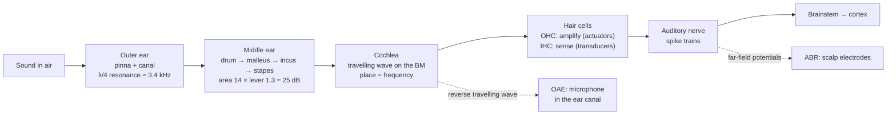
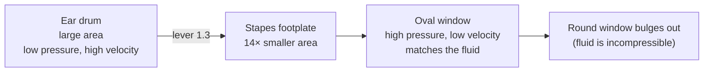
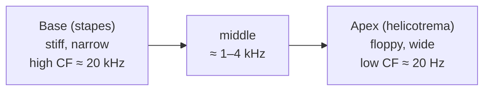

# Lecture 10 — Physiological Acoustics

> [!abstract] The idea
> The cochlea is a frequency analyser built out of a fluid-filled tube and a membrane whose stiffness falls by orders of magnitude from base to apex. A tone sets up a travelling wave that slows down and grows until it reaches the place tuned to it, then dies. High frequencies peak near the stapes, low ones near the apex. The outer hair cells push back on the membrane and make the peak sharp and big at low levels: the "cochlear amplifier". You cannot open someone's head to check all this, so you measure it from outside. Electrodes on the scalp pick up a tiny brain response buried in noise (the ABR), which you dig out by averaging. A microphone in the ear canal picks up the sound the cochlea sends *back* (the otoacoustic emission), which only a working amplifier produces.

> [!warning] Written after the lecture, from the deck only
> Written on Thursday 26 November 2026 from the slide deck (`physiological_acoustics_2026.pdf`, 54 pages), the exercise and its official solutions, and the course text ch. 2.2. There is no recording. The videos in `physiological_acoustics.zip` (travelling wave at 250 Hz and 4 kHz, the "dancing hair cell", an SOAE sound file) were not watched for this note.

**Tuesday 10 November 2026 · Torsten Dau (Hearing Systems, DTU Health Tech).** Sources: [[physiological_acoustics_2026.pdf|Lecture 10 slides (54 pages, no slide numbers; the numbers below are PDF pages)]] · [[Fundamentals_of_acoustics_2022.pdf|course text ch. 2.2 "The ear", pp. 55–60]] (Torben Poulsen; covers the outer and middle ear the deck skips). Previous lecture: [[Lecture 9 - Hearing - Frequency Selectivity and Masking]]. Practice: [[Week 10 - Physiological Acoustics|fully worked exercise]] · MATLAB `5. Semester/Acoustics and Noise Control/Matlab/Week10_Physiological_Acoustics.m`.

> [!tip] What carries over from earlier lectures
> - The middle ear is an **impedance matcher** between air and fluid: the same transmission formula as a plane wave hitting a boundary ([[Lecture 2 - Plane Waves Reflection and Spherical Waves|Lecture 2]]) and the same "match the impedances to transfer power" logic as [[Lecture 4 - Impedance Intensity and Sound Power|Lecture 4]].
> - The basilar membrane is described as an array of **mass–spring–damper** elements: the same $Z=j\omega m+R+K/j\omega$ you used for the loudspeaker in [[Lecture 8 - Loudspeakers|Lecture 8]].
> - The ear canal is a **quarter-wave resonator** (closed at the drum), the same tube physics as the 34870 acoustic tubes and vent resonances.
> - Signal averaging is the same $10\log_{10}n$ trick as averaging repeated measurements in [[Lecture 3 - Decibels Frequency Analysis and Measurements|Lecture 3]].

The dotted arrows are the two windows of this lecture: OAEs look at the cochlea (the mechanics and the OHCs), ABRs look at the nerve and brainstem.

## 1. Why objective measures? (pages 2–5)

Normal hearing tests are **behavioural**: you press a button when you hear the tone. That fails for newborns, people who cannot cooperate, and when you want to know *where* in the chain a problem sits. Objective measures need no response from the subject.

| Measure | What it records | What it tells you | Clinical use |
|---|---|---|---|
| **Auditory evoked potentials** (AEP, ABR) | Voltage on the scalp after a sound | Neural function along the pathway, an estimate of hearing threshold | Threshold estimation, neurological diagnosis |
| **Otoacoustic emissions** (OAE) | Sound in the ear canal coming back out of the cochlea | Cochlear, especially **outer-hair-cell**, function | Newborn hearing screening |

Page 3 sorts measurements into invasive (in animals: electrodes on the nerve, laser on the basilar membrane) and non-invasive (in humans). Page 5 is the map of the whole lecture: OAEs = energy reflected back out of the periphery (mechanical), AEPs = dipole potentials from the neural pathway.

## 2. The parts of the ear (page 6, course text §2.2.1–2.2.2)

Page 6 ("Stages of intervention") just shows where each device acts: a hearing aid in the outer ear, middle-ear implants and tubes, a cochlear implant into the cochlea, a brainstem implant. The deck says nothing more about the outer and middle ear, but the course text does, and it is exam-friendly arithmetic.

### 2.1 Outer ear: the canal is a quarter-wave tube

The canal is about **25 mm long, 7 mm wide, area ≈ 1 cm²**, open at the entrance and closed by the ear drum. A closed–open tube resonates when its length is a quarter wavelength:
$$f_{\rm res}=\frac{c}{4L}=\frac{340}{4\cdot0.025}=3.4\ \mathrm{kHz}.$$
That is why the ear is most sensitive around 3–4 kHz, and why noise-induced hearing loss shows up as a notch near 4 kHz. Real canals bend and taper, so treat 3.4 kHz as a rough number. The **pinna** filters sound by direction (reflections and diffraction), which is what lets you tell front from back and up from down.

### 2.2 Middle ear: an impedance transformer

The problem it solves: air has $Z_{\rm air}=\rho c\approx 412$ Pa·s/m, the cochlear fluid is close to water, $Z_{\rm water}\approx1.48\times10^6$ Pa·s/m. A plane wave going straight from air into water ([[Lecture 2 - Plane Waves Reflection and Spherical Waves|Lecture 2]]):
$$\tau=\frac{4Z_1Z_2}{(Z_1+Z_2)^2}\approx\frac{4Z_{\rm air}}{Z_{\rm water}}=1.1\times10^{-3}\quad\Rightarrow\quad -29.5\ \mathrm{dB}.$$
Only 0.1 % of the power would get in. The middle ear wins most of that back with two mechanical tricks:

- **Area ratio ≈ 14.** The force collected over the big ear drum is concentrated on the small stapes footplate (the oval window). Same force, 14 times smaller area → 14 times the pressure.
- **Lever ratio ≈ 1.3.** The malleus arm is longer than the incus arm, so force goes up 1.3 times (and velocity down).

Total pressure gain $14\times1.3\approx18$, i.e. $20\log_{10}18\approx25$ dB (the course text's number). It does not cancel the full 29.5 dB, but it gets most of it.

Two more middle-ear facts from the course text:
- The **Eustachian tube** connects the middle ear to the throat and equalises static pressure when you swallow. Blocked (a cold) → under-pressure → drum pulled in → reduced sensitivity.
- The **middle-ear (stapedius) reflex** kicks in above about 70 dB SPL and cuts transmission by about 20 dB at 125 Hz, 10 dB at 1 kHz and under 5 dB above 2 kHz. It takes 25–150 ms to act, so it **does not protect against impulses** (gunshots).

## 3. The cochlea (pages 7–14, course text §2.2.3–2.2.4)

A snail shell, 2.75 turns, about **32–35 mm** uncoiled (the course text says 32 mm, the deck's travelling-wave plot runs 0–35 mm, the exercise uses 34 mm). Three fluid channels (page 7):

- **Scala vestibuli** (starts at the oval window, where the stapes pushes),
- **Scala media** (holds the organ of Corti),
- **Scala tympani** (ends at the round window).

Vestibuli and tympani are joined at the apex by the **helicotrema**. The **basilar membrane (BM)** separates media from tympani; on top of it sits the **organ of Corti** with **one row of inner hair cells** (≈3000) and **three rows of outer hair cells** (≈12 000), covered by the **tectorial membrane**. Pages 8–12 are electron-microscope pictures of exactly that: the three neat rows of OHC hair bundles (V shapes) and the single IHC row.

Key mechanical fact: the BM is **narrow and stiff at the base** (≈0.1 mm) and **wide and floppy at the apex** (≈0.5 mm). The opposite of the shell, which is widest at the base.

### 3.1 Place coding: the travelling wave (pages 13–14)

The cochlea analyses sound by **intensity, frequency content and timing** (page 13). Push the stapes with a tone and a wave travels along the BM from base to apex. Each place has a characteristic frequency (CF). Page 13's animation (slowed 360 times) shows 250 Hz peaking far along the 35 mm, and 4000 Hz peaking close to the base.

Page 14 gives the model: the BM as a row of **coupled mass–spring–damper elements** with CF varying along the length (Helmholtz 1863, von Békésy 1947 — Békésy got the Nobel prize for seeing the travelling wave in cadaver cochleae).

### 3.2 The place–frequency map (exercise problem 1)

The exercise uses a Greenwood map with $x$ measured **from the base in metres**:
$$F_c(x)=A\cdot10^{-Gx}-B,\qquad A=20682,\ G=61.765\ \mathrm{m^{-1}},\ B=140.6.$$

| Place | $x$ | $F_c$ |
|---|---|---|
| Base | 0 mm | **20 541 Hz** |
| 7.5 mm | 0.0075 m | 6977 Hz |
| 11.3 mm | 0.0113 m | 4 kHz |
| 20.4 mm | 0.0204 m | 1 kHz |
| Apex | 34 mm | **23.7 Hz** |

So the map gives the familiar 20 Hz–20 kHz hearing range from geometry alone. It is close to **logarithmic**: each octave takes roughly the same length of membrane ($\log_{10}2/G=4.9$ mm per octave where $B$ is negligible; 1→2→4 kHz sits at 20.4 → 15.9 → 11.3 mm), except at the apex where the $-B$ term bends it.

![[Courses/34840 Fundamentals of Acoustics and Noise Control/Images/Lecture10/greenwood_map.png]]

Inverse, handy for "where is X Hz?":
$$x=-\frac1G\log_{10}\frac{F_c+B}{A}.$$

## 4. The 1-D cochlea model (pages 15–18)

> [!note] This part is for understanding, not for number-crunching
> No problem asks you to solve the wave equation. Know what the terms mean and what the result looks like.

**Page 15.** The travelling wave comes from two things: **fluid coupling** (the fluid carries the pressure along the duct) and the **local BM impedance** $Z(x,\omega)$ (mass, stiffness, damping). For the pressure difference $p(x,\omega)$ across the membrane:
$$\frac{\partial^2p(x,\omega)}{\partial x^2}-\frac{2i\omega\rho/h}{Z(x,\omega)}\,p(x,\omega)=0,$$
with $\rho$ the fluid density and $h$ the channel height. That is the "1-D basilar-membrane model". Everything depends on $Z(x,\omega)$. (Page 17 writes the same equation with a $+$ sign and $Z_{BM}$; it is the same model, the sign depends on how $Z$ is defined. Don't let it throw you.)

**Page 16, the impedance terms** (the deck uses $i$, physics sign convention):

| Term | Formula | Behaviour along $x$ |
|---|---|---|
| Mass | $Z_M=i\omega m_0$ | roughly constant |
| Damping (real part) | $Z_W\approx e^{-\frac12\alpha x}$ | decreases with $x$ |
| Stiffness | $Z_K=k_0\dfrac{e^{-\alpha x}}{i\omega}$ | falls **exponentially** with $x$ |

Each place resonates where mass and stiffness cancel: $\omega^2m_0=k_0e^{-\alpha x}$, so
$$\mathrm{CF}(x)=\frac{1}{2\pi}\sqrt{\frac{k_0}{m_0}}\;e^{-\alpha x/2}.$$
An exponential stiffness gives an exponential (log-spaced) frequency map. That is where the shape of the Greenwood formula comes from. Base → high stiffness → high CF; apex → low stiffness → low CF.

**Page 17, the wave at 2250 Hz** (BM partition velocity at three instants):
- the **speed of propagation decreases** as the wave moves apically (it slows down as it approaches its CF place),
- the **amplitude grows** towards the peak: resonance,
- **beyond the peak the amplitude drops very fast**. The wave cannot travel past its own resonance place.

**Page 18, the envelope $|v(x)|$** for 200, 450, 1000, 2250 and 5000 Hz. Every pattern has the same shape, a slow rise from the base and a steep cliff on the apical side, just shifted along $x$. Higher frequency → peak nearer the base. The phase plot underneath shows the phase lag piling up (many cycles) before the peak. This asymmetry, shallow on the base (high-frequency) side and steep on the apex side, is why **a low tone masks high tones more than the other way round** (upward spread of masking, [[Lecture 9 - Hearing - Frequency Selectivity and Masking|Lecture 9]]).

## 5. The active cochlea: outer hair cells (pages 19–20)

**Page 19 (Robles and Ruggero 2001, chinchilla):** BM velocity at one place versus frequency, in a live animal and post-mortem. Alive: a tall, sharp peak at the CF. Dead: a low, broad bump, shifted down in frequency. A **passive** cochlea cannot explain the sharp tuning.

- **Inner hair cells are sensors**: they turn motion into neural signals.
- **Outer hair cells are actuators *and* sensors**: they sense the motion and push back.

**Page 20 (Ashmore 1987):** an isolated OHC **changes its length** when a voltage is applied (electromotility; the "dancing hair cell" video in the zip). That gives **mechanical feedback**, the **cochlear amplifier**.

From the course text (Fig. 2.2.5), what the amplifier does to the BM response at one place:
1. At **low levels** the response is very **sharply tuned**; at high levels it is broad. Auditory filters get wider with level.
2. The peak frequency moves **down** with level (almost an octave at 80 dB).
3. The growth is **compressive**: 60 dB more input gives only about 25 dB more BM motion.

The amplifier matters at low levels and hardly at all at high levels. Destroy the OHCs (noise, age, ototoxic drugs) and you lose sensitivity and sharp tuning: a **cochlear hearing loss**. Quiet sounds disappear, loud ones are as loud as ever, which is **loudness recruitment**.

## 6. From motion to nerve spikes (pages 21–23)

**Page 21:** mechanical motion → biochemical dynamics in the hair cell → electrical spikes for the central nervous system. Most afferent nerve fibres (≈90–95 %) connect to the **inner** hair cells.

**Page 22, hair-cell transformation:**
- The IHC **input–output function** (receptor potential vs. bundle deflection) is a saturating, **asymmetric** S-curve: deflection one way opens channels (depolarises) much more than the other way closes them. That is a half-wave rectifier with compression.
- **Intracellular IHC potentials** for tones from 300 Hz to 5 kHz: at low frequencies the potential follows each cycle (AC component); at high frequencies only the DC shift remains. The cell membrane is a **low-pass filter** (cut-off around 1 kHz in this picture), so fine timing is lost at high frequencies and only the envelope survives.
- The IHC and OHC tuning curves are almost the same as the BM tuning at that place: the sharp tuning is already mechanical.

**Page 23, neural spike trains:** stimulus → stapes → BM at the place $x_I$ → IHC → receptor potential → auditory nerve. The nerve fires mostly in one half of each cycle (**phase locking**) and rests at its spontaneous rate (SR) without sound. Note the delay between stapes and BM: the travel time to $x_I$ (§9 and exercise problem 3).

## 7. Auditory evoked potentials and the ABR (pages 24–27, 33–35)

**Page 24.** When the nervous system reacts to a sound, its activity changes. Electrodes on the scalp pick up a small potential with peaks at different latencies. The early peaks (I–VI, first ≈10 ms) come from the **auditory nerve and brainstem**: the **auditory brainstem response (ABR)**. Later peaks (P1, N1, P2 up to hundreds of ms) come from the cortex. Different components ↔ different stages of the pathway.

**Page 25, ABR recording:** three surface electrodes, **vertex** (top of head), **mastoid** (behind the ear) and **forehead** (reference). A click gives waves I–VI within about 8 ms.
- The ABR is **about four times smaller** than the ACAP (auditory compound action potential, measured near the cochlea) in the same subject.
- **Wave I = ACAP N1 peak**: surface electrodes can see activity from the auditory nerve itself.

**Page 26, the apparatus:** computer with D/A (stimulus) and A/D (recording), audiometric amplifier, insert earphone, EEG pre-amplifier, all in an electrically and acoustically **shielded booth**.

**Page 33, ABR vs click level** (mean of 10 subjects):
- Lower level → **smaller amplitude and longer latency**. Wave V latency goes from ≈5.5 ms at 115 dB peSPL to ≈9 ms at 35 dB peSPL (the ACAP from ≈1.3 to ≈5 ms).
- **Wave V is the most robust** component and can be followed down to near the behavioural threshold. That is how you **estimate a threshold objectively**.
- The latency–level curve of wave V runs about 4 ms above the ACAP's ("constant latency shift of about 4 ms": the time from nerve to upper brainstem).

**Pages 34–35, cochlear hearing loss:** a patient with a flat 45 dB HL cochlear loss has an ABR threshold around **75 dB SPL**; below that, only noise. Page 35 shows the three places it can go wrong: **OHC** (amplifier), **IHC** (transducer) and **ANF** (auditory nerve fibres).

**Pages 36–38, models:** the Bruce et al. (2018) auditory-nerve model (originally cat, adapted to human), with three "knobs" for OHC, IHC and ANF damage. Page 38: Dau (2003) / Gutierrez et al. (2025) predict the ABR by summing the model's neural activity across all CFs and convolving with a "unitary response" (the scalp waveform from one spike), plus internal noise. Not calculation material; know the idea that **the ABR is the sum of many nerve fibres firing in sync**, so a click (everything at once) gives a much clearer ABR than a slow tone.

## 8. Digging the ABR out of the noise: averaging (pages 27–32)

**Page 27.** The electrodes are **far** from the generators ("far-field recording"), so the response is tiny and buried in EEG, muscle and mains noise. Two ways to improve the SNR: **spectral filtering** and **signal averaging**.

**Page 28.** At the electrodes $S=EP+N$. Typical numbers: $EP=0.3\ \mu$V, $N=3\ \mu$V, so
$$\mathrm{SNR}=20\log_{10}\frac{EP}{N}=20\log_{10}0.1=-20\ \mathrm{dB}.$$

**Page 29, the averaging law.** Average $n$ sweeps, each time-locked to the stimulus. The EP is identical every time, so it stays. The noise is independent from sweep to sweep, so its **powers add**: the sum of $n$ noise sweeps has amplitude $\sqrt n\,N$, the average has $N/\sqrt n$:
$$\bar S=EP+\bar N,\qquad \bar N=\frac{N}{\sqrt n},\qquad \mathrm{SNR}_{\rm avg}=\frac{EP}{N/\sqrt n}=\mathrm{SNR}\cdot\sqrt n .$$
In dB: $\mathrm{SNR}_{\rm avg,dB}=\mathrm{SNR}_{\rm dB}+10\log_{10}n$. **Every doubling of $n$ gains 3 dB; every factor 10 gains 10 dB.**

> [!example] Exercise problem 2 in one line each
> - $-20$ dB to $+10$ dB needs $+30$ dB $=10\log_{10}n$ → $n=1000$ sweeps, at 20 sweeps/s that is **50 s**.
> - With 10 % artifact sweeps at 30 µV: mean noise power $P=0.9\cdot3^2+0.1\cdot30^2=98.1\ \mu\mathrm V^2$, $N_{\rm eff}=9.9\ \mu$V. Now $n=10\,900$ sweeps (**545 s**). Reject the bad ones instead: 1111 sweeps, **55.6 s**. Artifact rejection saves a factor 9.8 in time.

![[Courses/34840 Fundamentals of Acoustics and Noise Control/Images/Lecture10/abr_averaging_snr.png]]

**Pages 30–32** show it working: the averaged ABR emerges as $n$ goes 250 → 8000 sweeps. At 2 sweeps (page 31) the two half-averages (yellow and pink) don't agree: S/N = −24 dB. At 10 000 sweeps / 500 s (page 32) they lie on top of each other: S/N = +15 dB. Plotting two independent half-averages is the practical way to see whether you have a response: **if the two halves agree, it is signal; if not, it is noise.**

> [!important] Assumptions behind $1/\sqrt n$
> The EP must be **identical and time-locked** in every sweep, and the noise **independent** of the stimulus and from sweep to sweep. Noise that is synchronised to the stimulus (mains hum at a rate that divides evenly into 50 Hz, or the stimulus artefact itself) does **not** average out. That is why the sweep rate is chosen to avoid sub-multiples of 50 Hz (clinics use odd rates such as 19.1/s or 21.1/s for this reason; this is general practice, not from the deck, and the exercise uses 20/s for round numbers).

## 9. Otoacoustic emissions (pages 39–53)

**Page 39.** OAEs are **sounds generated by the ear**: low-level sound produced by the cochlea and measured with a sensitive microphone in the sealed ear canal. They are a **consequence of active cochlear mechanics**: no working OHCs, no OAE. Hence newborn screening: a probe in the ear, a click, 30 seconds, pass or refer.

**Page 40, the setup:** a probe in the ear canal with two small speakers ($f_1$, $f_2$) and a microphone, driven from a PC through A/D and D/A.

**Pages 41–42, the ear's impulse response.** Click into the ear canal and record:
- **0–2 ms:** the big direct response, the transducer and the ear canal ringing. Most of the response is over within ~2 ms.
- **5–40 ms (100× smaller scale):** a **delayed ringing** that the transducers and the outer ear cannot explain. That is the **otoacoustic emission**. It arrives late because the sound had to travel into the cochlea to its CF place and back.

**Page 43:** the forward travelling wave goes in to its CF place; something sends energy back as a **reverse travelling wave**, out through the middle ear, and the ear drum works as a loudspeaker. High frequencies return first (their place is near the base), low frequencies last. That is **cochlear dispersion**, and exercise problem 3 uses it:

$$x=c_{\rm BM}\cdot\frac{t_{\rm roundtrip}}{2},\qquad F=A\cdot10^{-Gx}-B.$$

With $c_{\rm BM}=3$ m/s: 5, 7 and 12 ms roundtrips → 7.5, 10.5 and 18 mm → **6977, 4505 and 1458 Hz**.

### 9.1 Four kinds of OAE, by how you evoke them (page 44)

| Type | Stimulus | Where it shows up |
|---|---|---|
| **SOAE** spontaneous | **none** | narrow peaks in the ear-canal spectrum (page 44: several lines between 0.5 and 3 kHz). Present in some normal ears only. |
| **SFOAE** stimulus-frequency | one pure tone | at the **same** frequency as the tone, so it overlaps the stimulus |
| **DPOAE** distortion-product | two close tones $f_1<f_2$ (ratio ≈1.2) | at **$2f_1-f_2$**, a frequency not in the stimulus |
| **TEOAE / CEOAE** transient/click-evoked | clicks, tone bursts | as the delayed tail after the click (time window) |

**Page 51:** the DPOAE overlaps the stimulus **in time** but is separated **in frequency**: you read the spectrum at $2f_1-f_2$. The CEOAE is separated **in time** (window out the first few ms). The SFOAE is the hard one: same time and same frequency as the stimulus.

### 9.2 Two kinds of OAE, by how the cochlea makes them (pages 45–49)

All evoked OAEs are carried out by **reverse travelling waves** (page 45). Page 46 gives the two ways to start one:

| | **Reflection source** (place-fixed) | **Distortion source** (wave-fixed) |
|---|---|---|
| Needs | **irregularities** in the cochlea (random variations in the OHC rows), not nonlinearity | **nonlinearity** (the OHC's saturating transfer), not irregularity |
| Fixed to | a **place** on the BM | the **wave** (moves with the stimulus) |
| Phase vs frequency | **rotates rapidly** (many cycles of phase lag) | **almost flat** |
| Examples | **SFOAE** at low levels, **CEOAE** | **DPOAE** ($2f_1-f_2$) |

Why the phase tells them apart (pages 48–49): when you raise the frequency, the travelling wave moves toward the base. A **fixed** irregularity now sits at a different point of the wave, deeper in its phase pattern, so the emission's phase changes a lot. A distortion generated **by the wave itself** moves along with the wave, so it keeps the same phase relation. With $f_2/f_1$ fixed the whole DPOAE pattern scales along the cochlea, so the phase stays roughly constant.

Pages 52–53 show real data: the SFOAE phase falls through 30 cycles from 1 to 7 kHz while the DPOAE phase stays flat near 0; the CEOAE phase falls steadily (≈13 cycles over 1–2.4 kHz), so **CEOAEs are reflection-source emissions**.

### 9.3 Summary (page 54)

Objective measures are a window into the system. Cochlear mechanics make a frequency-selective mechanical representation. AEPs measure the neural side and estimate hearing sensitivity. OAEs measure active cochlear mechanics and OHC function.

## 10. Traps and pitfalls

- **Greenwood $x$ is in metres, from the base.** $G=61.765$ is per metre. Put 34 (mm) in and you get nonsense. The textbook Greenwood formula (165.4·(10^{0.06x}−0.88), $x$ in mm **from the apex**) is the same curve written the other way round; use whichever form the problem gives.
- **Base = high frequency, apex = low.** It feels backwards because the BM is narrowest at the base. Narrow and stiff → high CF.
- **Roundtrip ≠ one way.** Halve the OAE latency before converting to distance.
- **Averaging gains $10\log_{10}n$, not $20\log_{10}n$.** The *amplitude* SNR grows as $\sqrt n$, so in dB it is $20\log_{10}\sqrt n=10\log_{10}n$: 3 dB per doubling.
- **Noise powers add, amplitudes don't.** With mixed sweeps compute $P=\sum n_iN_i^2/\sum n_i$ first. Averaging the amplitudes ($0.9\cdot3+0.1\cdot30=5.7\ \mu$V) is wrong; the right $N_{\rm eff}$ is 9.9 µV.
- **Artifact rejection: count the thrown-away sweeps too.** 1000 clean sweeps need 1111 presented ones.
- **IHC = sensor, OHC = amplifier.** Past exam (2024 part 2 Q15): "outer hair cells enable the internal amplification of weaker sounds". An OAE tests the **OHCs**, not the nerve. A normal OAE with an absent ABR points past the cochlea (auditory neuropathy).
- **The middle ear gives ≈25 dB, the bare air–water mismatch costs ≈30 dB.** 18× is a **pressure** ratio → $20\log_{10}$. The transmission coefficient $\tau$ is a **power** ratio → $10\log_{10}$.
- **The stapedius reflex is too slow for impulses** (25–150 ms).
- **DPOAE frequency is $2f_1-f_2$**, below both primaries, not $f_2-f_1$ or $2f_2-f_1$.

## 11. Exam angle

**Part 1 (problems):** the exercise is the template. Expect one of:
- Greenwood forwards and backwards: frequency at a place, place of a frequency, lowest/highest frequency, length per octave.
- Averaging: SNR of one sweep, sweeps for a target SNR, recording time from the sweep rate, mixed noise with and without artifact rejection.
- OAE latency → place → frequency, or frequency → place → expected latency.
- Possibly from the course text: ear-canal resonance $c/4L$, middle-ear gain $20\log_{10}(14\cdot1.3)$, air–water $\tau$.

**Part 2 (multiple choice):** the 2024 set had four hearing questions (masking spreads upward, hearing loss → recruitment, filters broaden with level, OHCs amplify). Likely topics from this lecture:
- Which cells amplify / which sense? Which ones are tested by OAEs?
- Where on the BM do high frequencies peak? What happens to the travelling wave past its CF place?
- Effect of doubling the number of sweeps (+3 dB); why averaging works (noise independent, EP time-locked).
- ABR wave V: latency up and amplitude down at lower level; best for threshold estimation.
- DPOAE frequency $2f_1-f_2$; reflection vs distortion source and their phase behaviour; SOAE needs no stimulus.
- Post-mortem BM: broad and insensitive, i.e. the passive cochlea is not sharp enough.

## 12. Quick self-check

> [!question]- 1. A tone of 1 kHz: where on a 34 mm cochlea does it peak (Greenwood from the exercise)?
> $x=-\log_{10}((1000+140.6)/20682)/61.765=20.4$ mm from the base, a bit past the middle.

> [!question]- 2. Why is the BM response so much sharper in a living ear than post-mortem?
> The outer hair cells are electromotile and feed energy back into the BM motion (the cochlear amplifier). Dead, only the passive mass–stiffness–damping tuning is left, which is broad and less sensitive.

> [!question]- 3. One ABR sweep has SNR −20 dB. How many sweeps for +10 dB, and how long at 20 sweeps/s?
> You need +30 dB $=10\log_{10}n$, so $n=1000$, which takes 50 s.

> [!question]- 4. You double the number of sweeps. What happens to the residual noise amplitude and to the SNR in dB?
> Noise amplitude drops by $\sqrt2$ (−3 dB), SNR rises by 3.01 dB.

> [!question]- 5. A baby passes the OAE screening but has no ABR. Where is the problem most likely?
> The cochlear mechanics and OHCs work (OAE present), so the problem lies at the inner hair cells, the synapse or the auditory nerve: neural, not mechanical.

> [!question]- 6. Primaries at $f_1=2000$ Hz and $f_2=2400$ Hz. Where do you look for the DPOAE, and what does its phase do when you sweep both with a fixed ratio?
> At $2f_1-f_2=1600$ Hz. The phase stays nearly flat: it is a distortion-source (wave-fixed) emission.

> [!question]- 7. Why is the ear most sensitive around 3–4 kHz?
> The ear canal is a closed–open tube, about 25 mm long, so it resonates at $c/4L=340/(4\cdot0.025)=3.4$ kHz and boosts the pressure at the drum there.

> [!question]- 8. How much does the middle ear gain, and what is it fighting?
> Area ratio 14 × lever 1.3 ≈ 18 in pressure, ≈25 dB. Without it, air→fluid would transmit only $\tau\approx4Z_{\rm air}/Z_{\rm water}\approx1.1\times10^{-3}$, a loss of ≈30 dB.
