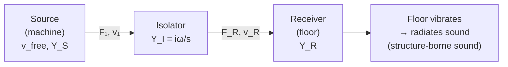

# Lecture 11 — Structure-borne Sound and Vibration Isolation

> [!abstract] The idea
> A machine on a floor is a mass on a spring. Below the resonance the spring just passes the force straight through. Near the resonance it amplifies it. Only above $\sqrt2\,f_0$ does the spring start to *help*, and from there the force on the floor falls 12 dB per octave. So vibration isolation is one design rule: make the mounting soft enough that $f_0$ sits well below $f/\sqrt2$. The static deflection tells you $f_0$ directly: $f_0\approx0.5/\sqrt{\xi_0}$. The rest of the lecture is the fine print: damping trades resonance height against isolation, and a real floor is not rigid, so what counts is how mobile the isolator is compared with the source and the floor.

> [!warning] Written after the lecture, from the deck only
> Written on Thursday 26 November 2026 from Jonas's slide deck (`34840_vibration_2026.pdf`, 54 pages), course text chapter 6 (Ohlrich, pp. 133–162) and the vibration problem set. There is no recording of this lecture, so anything Jonas said but did not put on a slide is missing. The 2026 deck still embeds the old "Moving Acoustics" animations (pages 31–33), which do not play in the PDF.

**Tuesday 17 November 2026 · Jonas Brunskog · 8:00, b.358 r.063.** Sources: [[34840_vibration_2026.pdf|Lecture 11 slides (54 pages; slide numbers = PDF pages)]] · [[Fundamentals_of_acoustics_2022.pdf|course text ch. 6, *Mechanical vibration and structureborne sound*, pp. 133–162]] (eq. numbers below are from there). Practice: [[Week 11 - Structure-borne Sound and Vibration Isolation|fully worked Week 11 problems]] · MATLAB `5. Semester/Acoustics and Noise Control/Matlab/Week11_Vibration_Isolation.m`.

> [!tip] You already know this circuit from 34870
> A force-driven mass–spring–damper is exactly the RLC circuit of [[Lecture 2 - Analogies - Mechanical Systems|34870 Lecture 2]]. In the **impedance analogy** ($F\leftrightarrow u$, $v\leftrightarrow i$) it is a series $L=m$, $R=r$, $C=1/s$. In the **mobility analogy** ($F\leftrightarrow i$, $v\leftrightarrow u$) it is a parallel circuit, and then the transmissibility is just a **current divider**: the force splits between the mass branch and the spring+damper branch, and only the second one reaches the floor (§7). 34840 does not ask for circuits. It works with forces and the complex mechanical impedance from [[Lecture 4 - Impedance Intensity and Sound Power|Lecture 4]], $Z=F/v$, and its inverse, the **mobility** $Y=v/F$.

## 1. What structure-borne sound is (pages 3–8)

Sound is often **made** by vibrating solids (an instrument, a pump, a wall) or **carried** through them and radiated into the air somewhere else. That is vibro-acoustics.

- **Low frequencies:** the vibration itself disturbs people (you feel it). Page 6: equal-sensation curves for whole-body vibration, vertical and horizontal. The curves dip lowest at a few hertz (the usual ISO 2631 figures are 4–8 Hz vertical, 1–2 Hz horizontal; read the slide for the exact minima).
- **High frequencies:** the vibration radiates as audible sound.
- **Several directions:** a solid point can move in 3 translations and 3 rotations, unlike the scalar pressure in air.

**Sources (pages 7–8):** transient (an impact, footfall, door slam, punch press, piston slap), tonal (an unbalanced rotating mass, motors, fans), surface roughness (wheel on rail, a bow on a violin string) and distributed excitation (a turbulent boundary layer). Periodic impacts give a line spectrum; a single impact gives a broad one.

## 2. What you measure (pages 9–11)

| | Motion | Force |
|---|---|---|
| Airborne sound | particle velocity $u=-\frac{1}{j\omega\rho}\frac{\partial p}{\partial x}$ (a vector) | **pressure $p$** (a scalar, easy) |
| Structure-borne sound | **displacement, velocity, acceleration** (vectors, easy to measure) | force, stress (hard to measure) |

The two worlds are mirror images: in air you measure the force variable, in solids the motion variable.

Harmonic, $e^{j\omega t}$: $\;v=j\omega\xi,\quad a=j\omega v=-\omega^2\xi.$ Typical ranges (page 10): displacement $10^{-11}$–$10^{-3}$ m, velocity $10^{-7}$–1 m/s, acceleration $10^{-3}$–$10^{4}$ m/s².

**Piezo-electric accelerometer (page 11):** a seismic mass sits on a piezo element. Well below the accelerometer's own resonance the element feels $F=m_{\rm seismic}\,a$, so the charge is proportional to the **acceleration**. It needs a **charge amplifier** (the 2024 exam MC asked exactly this: the output is a *charge*). Weights from a few grams to about 500 g. A heavy accelerometer on a light structure loads it, so pick a light one.

## 3. Linear mechanical systems: the three elements (pages 12–15)

A system is linear if the response is first order in the variables, so **superposition** holds. Discrete (lumped) models use three ideal elements; continuous models use partial differential equations (§6).

| Element | Force law | Mobility $Y=v/F$ | Impedance $Z=F/v$ | 34870 impedance analogy |
|---|---|---|---|---|
| Spring $s$ [N/m] | $F=s(\xi_2-\xi_1)$ | $j\omega/s$ | $s/j\omega$ | capacitor $C=1/s$ |
| Damper $r$ [kg/s] | $F=r(v_2-v_1)$ | $1/r$ | $r$ | resistor |
| Mass $m$ [kg] | $F=ma$ | $1/(j\omega m)$ | $j\omega m$ | inductor $L=m$ |

A spring transmits the same force at both ends (it is massless): page 15's free-body diagram.

## 4. The single-degree-of-freedom oscillator (pages 16–22)

A mass and a spring make a resonator with one resonance. Page 16 already gives the punchline: **above the resonance, vibrations are isolated**. In reality a block on springs has 3+3 directions, so six resonances (course text footnote, p. 154). Examples (pages 18–20): a pendulum, a Helmholtz resonator, a gas bubble in water, and the **loudspeaker** (page 20: cone = mass, front and rear suspension = two springs in parallel, $s=s_1+s_2$).

Energy (page 17): the motion swaps potential energy in the spring and kinetic energy in the mass.

**Free-body diagram (page 21) → equation of motion (eq. 6.2.4):**
$$m\frac{d^2x}{dt^2}+r\frac{dx}{dt}+sx=F(t)$$

**Page 22 definitions:**
$$\omega_0=2\pi f_0=\sqrt{\frac sm},\qquad \delta=\frac{r}{2m},\qquad \zeta=\frac{r}{2m\omega_0}=\frac{r}{2\sqrt{ms}},\qquad F_f=sx+r\frac{dx}{dt}$$

$\zeta$ is the **damping ratio**: $\zeta=1$ is critical damping, $r_c=2\sqrt{ms}=2m\omega_0$ (page 36). The last equation is the force on the floor, and page 22 boxes it in red: "**Vibration isolation!**" Everything in §7 starts there.

## 5. Forced response and frequency response functions (pages 23–29)

**Steady state** (page 23): after the start-up transient dies out, the mass moves at the driving frequency. The transient comes from the homogeneous equation and the initial conditions; we ignore it.

**Undamped** (page 24, eq. 6.2.10):
$$\hat x=\frac{F}{s}\,\frac{1}{1-\omega^2/\omega_0^2}=x_{\rm stat}\,\frac{1}{1-\Omega^2},\qquad \Omega=\frac{\omega}{\omega_0}$$
Infinite at $\Omega=1$, and the sign flips there: in phase with the force below, 180° out of phase above.

**Damped** (page 25, eq. 6.2.16):
$$\hat x=\frac{F}{s-\omega^2m+j\omega r}=x_{\rm stat}\,\frac{1}{1-\Omega^2+j2\zeta\Omega},\qquad \left|\frac{\hat x}{x_{\rm stat}}\right|=\frac{1}{\sqrt{(1-\Omega^2)^2+4\zeta^2\Omega^2}}$$
- Peak displacement at $\Omega_r=\sqrt{1-2\zeta^2}$, slightly below $\omega_0$ (eq. 6.2.24). Velocity peaks exactly at $\omega_0$.
- Height of the peak, small $\zeta$: $|x_{\max}|\approx x_{\rm stat}/(2\zeta)$ (eq. 6.2.26). The phase is −90° at $\omega_0$.

**The three regions (page 27, eq. 6.2.28)** — the 2022 exam asked which one applies below resonance:

| Region | Displacement | Who wins |
|---|---|---|
| $\Omega\ll1$ | $\lvert\hat x\rvert\approx F/s$ | **stiffness controlled** |
| $\Omega\approx1$ | $\lvert\hat x\rvert\approx F/(\omega_0 r)$ | **damping controlled** |
| $\Omega\gg1$ | $\lvert\hat x\rvert\approx F/(\omega^2m)$ | **mass controlled** |

This is the same picture as the loudspeaker in [[Lecture 8 - Loudspeakers|Lecture 8 §6]] and the panel absorber in [[Lecture 7 - Sound Absorption and Room Acoustic Design|Lecture 7]]: one resonator, three regimes.

**Frequency response functions (page 28, course text Table 6.2.1):** output over input.

| Response | Response/force | Force/response |
|---|---|---|
| Displacement | receptance $H(\omega)$ | dynamic stiffness |
| Velocity | **mobility** (admittance) $Y(\omega)=j\omega H$ | **impedance** $Z=1/Y$ |
| Acceleration | accelerance | apparent mass |

For the SDOF: $Y(\omega)=\dfrac{j\omega}{m(\omega_0^2-\omega^2)+j\omega r}$.

**Structural damping (page 38, eq. 6.2.29–31):** losses inside the spring material are modelled by a complex stiffness $s(1+j\eta)$, with **loss factor** $\eta$. It describes losses whatever their mechanism. Measured from the −3 dB bandwidth, $\eta=\Delta\omega_{-3\,\rm dB}/\omega_0$, and at resonance $\eta=2\zeta$.

**Motion excitation (page 29, eq. 6.2.42–43):** the floor moves with $\xi_f$ and shakes the mass through the spring and damper:
$$m\ddot\xi+r\dot\xi+s\xi=s\xi_f+r\dot\xi_f\qquad\Rightarrow\qquad \frac{\xi}{\xi_f}=\frac{s+j\omega r}{s-\omega^2m+j\omega r}$$
This is **the same function** as the force transmissibility of §7. Protecting a sensitive instrument from a shaking floor (Problem 4) and protecting the floor from a shaking machine are the same design problem.

## 6. Continuous systems: waves in solids (pages 30–34)

When the structure is bigger than about a wavelength, lumped elements no longer work and you need waves. Three wave types (page 30, course text §6.3):

| Wave | Equation | Speed | Notes |
|---|---|---|---|
| Longitudinal (rod) | $ES\,\xi''+\omega^2m'\xi=-F'$ | $c_L=\sqrt{E/\rho}$ (plate: $\sqrt{E/\rho(1-\nu^2)}$, ~5 % faster) | like sound in air; very stiff, radiates almost nothing |
| Shear / torsion | — | $c_S=\sqrt{G/\rho}$, $G=E/2(1+\nu)$ | matters in sandwich panels |
| **Bending** | $B\,w''''-\omega^2m'w=F'$ | $c_B=\sqrt{\omega}\,\sqrt[4]{B/m'}$ | **dispersive**; radiates well |

Typical speeds (Table 6.3.1): steel 5100–5300 m/s, aluminium ~5100, glass ~5000–5150, dense concrete 3360, soft rubber 70 m/s. The characteristic impedance $\rho c_L$ of steel is $10^5$ times that of air.

**Bending waves are the ones that matter for noise.** The motion is perpendicular to the surface, so they push air; and they have a low impedance, so they are easy to excite. Their speed grows with $\sqrt f$ (dispersion: page 33's pulse smears out into a ringing tail). For a thin plate of thickness $h$ (eq. 6.3.11):
$$c_B\approx\sqrt{1.8\,c_L\,h\,f},\qquad B'=\frac{Eh^3}{12(1-\nu^2)}$$

**Page 34, the bending-wave speed chart:** concrete 50–200 mm and glass 2–10 mm, with the air line $c=344$ m/s drawn in red. Where a plate's line crosses the air line, $c_B=c$: that is the **critical frequency** $f_c=c^2/(1.8\,c_Lh)$. Above it the plate radiates efficiently and sound goes straight through it (coincidence). The full story is the next lecture, sound insulation. The upper limit on the chart is where the thin-plate formula breaks down, at a bending wavelength of $6h$.

![[Courses/34840 Fundamentals of Acoustics and Noise Control/Images/Lecture11/bending_wave_speed.png]]

My numbers with Table 6.3.1 values: 4 mm glass **3.2 kHz**, 100 mm concrete **196 Hz**, 200 mm concrete **98 Hz**. Thick plates have a low $f_c$ (bad: it lands in the speech range), thin glass a high one.

## 7. Vibration isolation with an SDOF oscillator (pages 35–39)

Machine (mass $m$, driven by $F$) on an isolator ($s$, $r$) on a rigid floor. The force on the floor is $F_f=su+r\dot u$. Its ratio to the applied force is the **transmissibility** (page 35):
$$\boxed{T=\frac{|F_f|}{|F|}=\sqrt{\frac{1+\left(2\zeta\Omega\right)^2}{\left(1-\Omega^2\right)^2+\left(2\zeta\Omega\right)^2}}},\qquad \Omega=\frac{\omega}{\omega_0},\ \ \zeta=\frac{r}{r_c}=\frac{r}{2\sqrt{ms}}$$

(The slide writes $2\zeta\Omega$ as $2\frac{\omega}{\omega_0}\frac{r}{r_c}$. Same thing.)

![[Courses/34840 Fundamentals of Acoustics and Noise Control/Images/Lecture11/transmissibility.png]]

**Reading the curve (pages 36–37):**
- **$\Omega\ll1$:** $T\to1$. The spring is rigid compared with the mass; the full force goes into the floor. Not isolated.
- **$\Omega\approx1$:** $T\gg1$, about $1/(2\zeta)$: **+20 dB for $\zeta=0.05$**. The mounting makes things *worse*.
- **$\Omega=\sqrt2$: every curve crosses $T=1$**, whatever the damping. Check: $(1-2)^2=1$, so numerator = denominator.
- **$\Omega>\sqrt2$:** $T<1$, isolation. Undamped, $T=1/(\Omega^2-1)$: **−18 dB at $\Omega=3$**, **−40 dB at $\Omega=10$**, falling 12 dB per octave (40 dB per decade).
- **Damping cuts both ways.** It tames the resonance peak but spoils the isolation above $\sqrt2$, because the damper is a stiff path to the floor at high frequency. At $\Omega=10$: −39.9 dB with $\zeta=0$, **−32.9 dB with $\zeta=0.1$**, **−19.9 dB with $\zeta=0.5$**. Far above resonance $T\approx2\zeta/\Omega$, so the slope eventually drops from 12 to 6 dB per octave.

> [!important] The isolation design rule
> Choose the mounting so that $f_0<f/\sqrt2$ — in practice $f_0\le f/3$ for useful isolation. Soft springs, little damping. Damping is only needed to get *through* the resonance when the machine starts and stops.

**Transmissibility and effectiveness (page 38):** with a rigid foundation the isolation effectiveness (insertion loss) is
$$E_{\rm iso}=\frac{|F|^2}{|F_f|^2}=T^{-2},\qquad 10\log E_{\rm iso}=-20\log T .$$
With structural damping, $s(1+j\eta)$, and a rigid floor (eq. 6.4.19):
$$E_{\rm iso}=\left|1-\omega^2\frac{m}{s(1+j\eta)}\right|^2\approx\left|1-\Omega^2+j\eta\,\Omega^2\right|^2 .$$

**Static deflection gives $f_0$ (page 39, eq. 6.4.1–2):** put the machine on the springs and measure how far it sinks, $\xi_0$.
$$s=\frac{mg}{\xi_0},\qquad \omega_0=\sqrt{\frac sm}=\sqrt{\frac{g}{\xi_0}},\qquad \boxed{f_0\approx\frac{0.5}{\sqrt{\xi_0}}}\ \ (\xi_0\text{ in m})$$
The mass cancels. 4 mm → 7.9 Hz, 10 mm → 5.0 Hz, 25 mm → 3.2 Hz. Common practice is 4–10 mm (8–5 Hz): softer is better for isolation but makes the machine laterally wobbly.

> [!example] Two old exam MCs, done in one line each
> - **2024:** static deflection 10 mm, where does isolation start? $\omega_0=\sqrt{9.82/0.01}=31.3$ rad/s, so $\sqrt2 f_0=$ **7.04 Hz**.
> - **2022:** 100 kg on 10 mm, excited at 7 Hz. $f_0=5.0$ Hz, $\Omega=1.40\approx\sqrt2$, so $20\log T=$ **0.35 dB ≈ 0 dB**: no isolation at all.

## 8. Isolator hardware (pages 40–44)

**Page 40, materials table:**

| | Coil spring | Rubber | Cork | Felt |
|---|---|---|---|---|
| Static deflection limit | design free | up to 10 % of thickness | up to 6 % | — |
| Effective from | 5 Hz or less | 5 Hz or more | 40 Hz or more | 100 Hz or more |

**Coil steel springs (page 41):** large deflections (so low $f_0$), but almost no damping, and at high frequency the spring's own longitudinal waves give **surge resonances** at $f_n=\frac n2\sqrt{s/m_s}$ ($m_s$ = spring mass), where the isolation collapses. A rubber pad under the spring fixes this.

**Rubber:** the **dynamic** stiffness is higher than the static one, by 1.2 (40 °Shore A) to 2.2 (70 °Shore A) (course text Table 6.4.1). Use $s_{\rm dyn}$ in $f_0$. A short, fat block is stiffer than a slender one (shape factor, course text Fig. 6.4.7). So $f_0$ from static deflection is optimistic for rubber.

**Examples (pages 42–44):** a fan and motor on a heavy concrete common bed on steel springs with a canvas duct and flexible cord (every connection must be flexible, or it short-circuits the isolator); a gearbox under a wind turbine cover; and a hearing aid, where the receiver (loudspeaker) is isolated from the shell so it does not shake the microphone (feedback).

## 9. When the floor is not rigid: mobilities (pages 45–47)

Page 45 circles the problem: the concrete bed sits on **beams**. If the floor gives way, the simple $T$ is wrong. You need the **input mobility** of the receiver at the attachment point (page 46, course text §6.3.4):

| Structure, point force | Input mobility $Y$ |
|---|---|
| Rod, longitudinal, semi-infinite (end) | $\dfrac{1}{m'c_L}$ |
| Beam, bending, semi-infinite (end) | $\dfrac{1-j}{m'c_B}$ |
| Beam, bending, infinite (middle) | $\dfrac{1-j}{4m'c_B}$ (4× lower than the end) |
| Plate, bending, edge | $\dfrac{1}{3.5\sqrt{B'm''}}$ |
| Plate, bending, infinite (middle) | $\dfrac{1}{8\sqrt{B'm''}}$ |

$m'$ = mass per length, $m''$ = mass per area. The infinite plate's mobility is **real and frequency independent**: it behaves like a damper, because the power flows away as bending waves and never comes back.

Example: 140 mm concrete ($E=26$ GPa, $\rho=2300$, $\nu=0.2$): $B'=6.19\times10^6$ Nm, $m''=322$ kg/m², $Y_\infty=$ **2.8×10⁻⁶ m/(N·s)**.

**Measuring mobility (page 47, "from course 22001"):** drive with noise through a shaker and force transducer, measure the response with an accelerometer, two-channel FFT. $H_1=G_{AB}/G_{AA}$, coherence $\gamma^2=|G_{AB}|^2/(G_{AA}G_{BB})$ tells you whether the output is really caused by the input.

## 10. Power transmission and the general isolator (pages 48–53)

**Rigid coupling (pages 48–50, eqs. 6.4.5–8).** A source vibrates with **free velocity** $v_{\rm free}$ when hanging in the air, and has its own mobility $Y_S$. Bolt it to a receiver $Y_R$: the reaction force slows it down, $v_R=v_{\rm free}-Y_SF$, and $v_R=Y_RF$, so
$$F=\frac{v_{\rm free}}{Y_S+Y_R},\qquad v_R=\frac{Y_R}{Y_S+Y_R}\,v_{\rm free}$$
$$P=\tfrac12\Re\{Fv_R^*\}=\tfrac12|F|^2\Re\{Y_R\}=\tfrac12|v_{\rm free}|^2\frac{\Re\{Y_R\}}{|Y_S+Y_R|^2}=\tfrac12|v_R|^2\frac{\Re\{Y_R\}}{|Y_R|^2}$$
Using $v_{\rm free}$ you need both mobilities; using the coupled $v_R$ only the receiver's. It is the electrical source-and-load problem: $v_{\rm free}$ is the open-circuit voltage, $Y_S$ the internal impedance.

**With an isolator (pages 51–52, eqs. 6.4.11–17).** A massless spring passes the same force at both ends, $F_1=F_R$, and $F_1=s\left(\frac{v_1}{j\omega}-\frac{v_R'}{j\omega}\right)$. This gives $v_R'=\dfrac{Y_R}{j\omega/s+Y_S+Y_R}v_{\rm free}$: the isolator mobility $Y_I=j\omega/s$ simply sits **in series** with the two others. The effectiveness, before/after:
$$\boxed{E_{\rm iso}=\frac{|v_R|^2}{|v_R'|^2}=\left|1+\frac{j\omega/s}{Y_S+Y_R}\right|^2=\frac{1}{T^2}}\qquad\text{good isolation needs}\quad Y_I=\frac{j\omega}{s}\gg Y_S+Y_R$$

The isolator has to be much **more mobile** (softer) than the source and the receiver together. Rigid floor and a mass source ($Y_R=0$, $Y_S=1/j\omega m$) gives back $|1-\omega^2m/s|^2$, i.e. §7.

> [!example] Does the concrete floor spoil the isolation?
> 100 kg machine on $s=98.1$ kN/m ($f_0=5$ Hz), at 100 Hz: $Y_I=j6.4\times10^{-3}$, $Y_S=-j1.59\times10^{-5}$. On a rigid floor $10\log E_{\rm iso}=$ **52.1 dB**; on the 140 mm concrete plate above ($Y_R=2.8\times10^{-6}$) **51.9 dB**. Heavy floor, no problem. On a light timber floor or a ship deck $Y_R$ is far larger, and at the floor's resonances it peaks, which is where the isolation breaks down.

**Page 53, diesel engine on an elastic ship foundation:** the measured mobilities of isolator, engine and foundation are plotted together. The isolator is the most mobile one by 10–30 dB over most of the band, and the measured effectiveness is about 25 dB on average (course text Fig. 6.4.5). The dips are where the foundation or engine resonates and its mobility approaches the isolator's. The course text's counter-example (Fig. 6.4.6): a 105 m building on rubber expansion pads gets almost no isolation from underground trains, because the pads are far too stiff.

## 11. Traps and pitfalls

- **Isolation starts at $\sqrt2 f_0$, not at $f_0$.** Between $f_0$ and $\sqrt2f_0$ the force is still amplified.
- **More damping is not better isolation.** Above $\sqrt2f_0$ damping makes $T$ bigger. It only helps at resonance.
- **$f_0\approx0.5/\sqrt{\xi_0}$ needs $\xi_0$ in metres**, and the *total* static deflection under the full load (Problem 2b: coil + payload).
- **Springs in parallel add stiffness; springs in series add compliance.** A mass between two springs (one above, one below) sees them in **parallel** (Problem 1d).
- **$T$ in dB is $20\log$**, effectiveness is $10\log E_{\rm iso}$ with $E_{\rm iso}=T^{-2}$. Same number, opposite sign.
- **Sign of $u/u_f$.** Above resonance the ratio is **negative** (antiphase). Problem 4 gives −0.1 for that reason; plug in +0.1 and the formula returns a negative stiffness.
- **Rubber's dynamic stiffness > static.** $f_0$ from the static deflection is too low for rubber mounts.
- **Accelerometer output is a charge** (needs a charge amplifier), proportional to acceleration.
- **Mobility vs impedance:** $Y=v/F$, $Z=F/v$. "Soft" = high mobility. The isolator must be the *most* mobile part.

## 12. Exam angle

- **Part 1 (problems):** expect a mass on springs: natural frequency from $s$ and $m$ (with springs in parallel or series), from the static deflection, the response at a given frequency ($\xi$, $v$, $a$, force on the floor), and the stiffness needed for a given transmissibility. Problems 2–4 of the week are exactly that. Base excitation (instrument on a vibrating floor) is the same algebra.
- **Part 2 (MC):** recent exams had 1–2 vibration questions each: *what does an accelerometer output* (charge, 2024), *$f$ where isolation starts given $\xi_0$* (7.04 Hz, 2024), *stiffness/mass/damping-controlled below resonance* (2022), *transmissibility at 7 Hz for 100 kg on 10 mm* (≈0 dB, 2022). The critical-frequency questions (2022: two stacked plates keep the same $f_c$; 2024: $\Delta f_c$ for 100 → 150 mm concrete) belong to Lecture 12 but use §6's $B'$.

## 13. Quick self-check

> [!question]- A machine sinks 6 mm into its mounts. What is $f_0$, and from which frequency does the mounting isolate?
> $f_0=0.5/\sqrt{0.006}=6.4$ Hz; isolation above $\sqrt2\cdot6.4=9.1$ Hz.

> [!question]- Why do all transmissibility curves pass through $T=1$ at $\Omega=\sqrt2$?
> At $\Omega^2=2$, $(1-\Omega^2)^2=1$, so the denominator equals the numerator $1+(2\zeta\Omega)^2$ for every $\zeta$.

> [!question]- Undamped, how much isolation at three times $f_0$? At ten times?
> $T=1/(\Omega^2-1)$: 1/8 → −18 dB; 1/99 → −40 dB.

> [!question]- You add damping to an isolator running at $\Omega=10$. What happens?
> The isolation gets worse: −40 dB → −33 dB at $\zeta=0.1$, −20 dB at $\zeta=0.5$. Damping only helps near resonance.

> [!question]- Why are bending waves the important ones for radiated noise?
> The motion is normal to the surface (it pushes air) and their impedance is low (easy to excite). Longitudinal waves barely move the surface.

> [!question]- What is the critical frequency, and what does $c_B\propto\sqrt f$ have to do with it?
> The frequency where the bending wave speed equals the speed of sound in air; since $c_B$ grows with $\sqrt f$, every plate crosses $c$ somewhere, $f_c=c^2/(1.8c_Lh)$. 4 mm glass ≈ 3.2 kHz.

> [!question]- What must hold for an isolator to work on a real, flexible floor?
> $Y_I=j\omega/s\gg Y_S+Y_R$: the isolator must be far more mobile than source and receiver together. $E_{\rm iso}=|1+Y_I/(Y_S+Y_R)|^2$.

> [!question]- In the 34870 mobility analogy, what is the transmissibility?
> A current divider: the force (current) splits between the mass (capacitor to ground) and the spring+damper (inductor ‖ conductance to ground); $T$ is the fraction in the second branch, $(s+j\omega r)/(s-\omega^2m+j\omega r)$.
