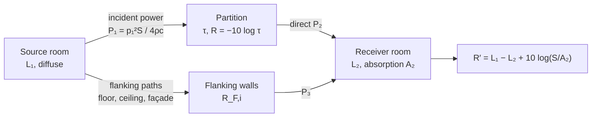

# Lecture 12 — Sound Insulation

> [!abstract] The idea
> A wall stops sound because it is heavy. The air has to shake the wall, and the wall has to shake the air on the other side. Below the critical frequency the wall's inertia does the work: double the mass or the frequency and you gain 6 dB (the **mass law**). At the **critical frequency** the bending waves in the wall travel as fast as the sound in air, the two lock together, and the insulation collapses into the **coincidence dip**. Above it only damping helps. If one heavy wall is not enough, split the mass into **two leaves with air between**: that buys 18 dB per octave instead of 6, but only above the **mass–air–mass resonance**. Whatever you build, the weakest element (a door, a crack, a flanking floor) sets the result.

> [!warning] Written after the lecture, from the deck only
> Written on Thursday 26 November 2026 from the slide deck (`34840_sound_insulation_2026.pdf`, 60 pages) and chapter 5 of the course text. There is **no recording** to check against. The official problem set **does exist** but carries the number 11: `34840_Problems 11_2026.pdf` ("Problems on Sound Insulation": party wall, factory windows, window in a wall) with `34840_Solutions 11_2026.pdf`. Learn files it under module 12. It is worked in full in [[Week 12 - Sound Insulation]], together with the deck's examples and every sound insulation question from the 2022–2024 exams.

**Tuesday 24 November 2026 · Jonas Brunskog.** Sources: [[34840_sound_insulation_2026.pdf|Lecture 12 slides (60 pages, numbered; the page numbers below are the PDF pages, which match the slide numbers)]] · [[Fundamentals_of_acoustics_2022.pdf|course text ch. 5, pp. 113–131]] (eq. numbers 5.x.y below). Room acoustics needed here: [[Lecture 6 - Room Modes and the Diffuse Sound Field|Lecture 6 §6–9]] (diffuse field, absorption area, Sabine). Absorbers: [[Lecture 7 - Sound Absorption and Room Acoustic Design]]. Structure-borne side of the same story: [[Lecture 11 - Structure-borne Sound and Vibration Isolation]]. Practice: [[Week 12 - Sound Insulation|the official sheet (Problems 11), deck examples and old exam questions, all worked]] · MATLAB `5. Semester/Acoustics and Noise Control/Matlab/Week12_Sound_Insulation.m`.

Constants: $\rho=1.2\ \mathrm{kg/m^3}$, $c=343$ m/s, so $\rho c=411.6$ Pa·s/m. These reproduce the 2024 exam solution.

## 1. Why do we hear the neighbours? (pages 2–5)

Two ways in (page 2):
- **Airborne sound:** a voice or a TV makes the air in the source room push on the wall. The wall vibrates and radiates into the next room.
- **Structure-borne sound:** footsteps, a slammed door or a machine hit the building directly. The vibration runs through the structure and radiates somewhere else, maybe several rooms away. That is [[Lecture 11 - Structure-borne Sound and Vibration Isolation|Lecture 11]]'s subject; here it shows up as **impact sound** (§4).

Page 3 makes the human point: the same neighbour noise annoys some people and not others. That is why the requirements are set as "percentage satisfied" classes (§4).

The deck has four parts (page 4): ratings and measurement; multi-element walls and leaks; single walls; double walls. Concepts list (page 5): loss factor, bending wave, critical frequency, transmission coefficient, transmission loss, sound reduction index, tapping machine, impact sound pressure level, mass law, coincidence frequency, forced and resonant transmission.

## 2. Transmission coefficient and sound reduction index (page 7, eq. 5.1.1–5.1.2)

$$\tau=\frac{P_2}{P_1}\ \text{(transmitted / incident power)},\qquad R=10\log_{10}\frac{P_1}{P_2}=10\log_{10}\frac1\tau=-10\log_{10}\tau\ \ \text{(dB)}$$

- $R$ is called the **sound transmission loss** or the **sound reduction index**. Same thing.
- $R=40$ dB means one part in $10^4$ of the power gets through. A good wall between flats is 55 dB: one part in 300 000.
- $\tau$ adds (power), $R$ does not. Every combination problem goes through $\tau$ (§5).

## 3. Measuring R between two rooms (pages 8–11, eq. 5.1.3–5.1.7)

Assume a **diffuse field** in both rooms ([[Lecture 6 - Room Modes and the Diffuse Sound Field|Lecture 6 §6]]). The intensity hitting a wall in a diffuse field is $p^2/4\rho c$, so the power onto the partition of area $S$ is
$$P_1=I_{\rm inc}S=\frac{\tilde p_1^2S}{4\rho c}.$$

In the receiver room the transmitted power is balanced by the absorption: $P_2=\tilde p_2^2A_2/(4\rho c)$, the steady-state energy balance of Lecture 6 §8. Divide:
$$\boxed{\ R=10\log_{10}\frac{P_1}{P_2}=L_1-L_2+10\log_{10}\frac{S}{A_2}\ \ \text{(dB)}\ }\qquad A_2=\frac{55.3\,V_2}{c\,T_2}\ (\approx0.161V_2/T_2)$$

- $S$ = area of the **partition** (not of the room). $A_2$ = absorption area of the **receiving** room, from its volume and measured reverberation time (Sabine).
- The $10\log(S/A_2)$ term corrects for the receiver room: a big wall lets more power through; a dead receiver room swallows it faster. Both change $L_2$ but not the wall.
- Lab (page 11): two reverberation rooms on separate foundations with the test wall in an opening between them, so nothing but the test wall carries sound.
- In a real building the receiver also gets sound through the floor, ceiling and façade. Then the measured value is the **apparent** index $R'$ (the prime means "flanking included", eq. 5.1.7, 5.4.1). See §13.

> [!example] Sheet problem 1: radio next door
> Run the formula backwards per octave band, $L_2=L_1-R'+10\log(ST_2/0.16V)$, A-weight and add: **33.7 dB(A)**. With a small bedroom ($A_2<S$) the correction term is positive.

> [!example] 2023 exam, part 2 Q8
> 80 dB in the source room, wall 4 × 3 m with $R=40$ dB, receiver 60 m³ with $T=0.5$ s. $A_2=19.35$ m², so $L_2=80-40+10\log(12/19.35)=$ **37.9 dB**.

## 4. Ratings: frequency range, $R_w$, impact sound, classes (pages 12–16, ch. 5.6–5.8)

**Frequency range (page 12):** 1/3-octave bands from 100 to 3150 Hz (16 bands), extendable to 50–5000 Hz. Standards ISO 10140 (lab) and ISO 16283 (field).

**Single-number rating $R_w$ (page 13, ISO 717-1):**
1. A **reference curve** in the 16 bands: +9 dB/octave from 100 to 400 Hz, +3 dB/octave from 400 to 1250 Hz, flat to 3150 Hz. In its "52" position it reads 33, 36, 39, 42, 45, 48, 51, **52**, 53, 54, 55, 56, 56, 56, 56, 56.
2. An **unfavourable deviation** is how far the measured $R$ falls **below** the reference in a band. Bands above the curve count zero.
3. Shift the reference in 1 dB steps until the sum of unfavourable deviations is as large as possible but **≤ 32 dB**.
4. $R_w$ = the shifted curve's value **at 500 Hz**.

Page 13's example: the curve moves from 52 (V1) up to 60 (V2), the deviations are 2.8 + 5.3 + 2.9 + 3.4 + 3.7 + 4.1 + 2.8 + 1.2 = 26.2 dB ≤ 32, so $R_w=60$ dB. The shape of the reference curve means a wall is allowed to be weak at low frequencies, where the ear is less sensitive.

**Impact sound (pages 14–15, eq. 5.6.1):** a standard **tapping machine** (five 500 g steel hammers, 40 mm fall, 10 taps per second) on the floor above; measure $L_2$ below.
$$L_n=L_2+10\log_{10}\frac{A_2}{A_0},\qquad A_0=10\ \mathrm{m^2}$$
$L_n$ is the level you would get if the receiving room had 10 m² of absorption. Here **lower is better**, the opposite of $R$. Page 15 plays the recording below a bare concrete floor and below the same floor with a carpet: the soft layer kills the hammer's high frequencies. The single number $L_{n,w}$ uses a falling reference curve (flat to 315 Hz, −3 dB/oct to 1000 Hz, −9 dB/oct above), unfavourable deviations are where the measurement is **above** the curve, same 32 dB rule, read at 500 Hz (course text §5.7.2).

**Danish classes, DS 490 (2018), page 16:** for dwellings.

| Class | Satisfied | Airborne $R'_w$ | Impact $L'_{n,w}$ | Noise level |
|---|---|---|---|---|
| A | > 90 % | ≥ 63 dB* | ≤ 43 dB* | ≤ 20 dB |
| B | 70–85 % | ≥ 58 dB* | ≤ 48 dB* | ≤ 25 dB |
| C | 50–65 % | ≥ 55 dB | ≤ 53 dB | ≤ 30 dB |
| D | 30–45 % | ≥ 50 dB | ≤ 58 dB | ≤ 35 dB |

\* frequency range extended down to 50 Hz. Class C is the usual level for new Danish dwellings. Read it as: even a class C building leaves a third or more of the residents bothered by their neighbours.

## 5. Multi-element partitions and leaks (pages 17–20, eq. 5.1.8–5.1.10)

A wall with a door, a window or a crack. Each element $i$ has area $S_i$ and $\tau_i$; the incident intensity is the same everywhere, so the powers add:
$$\tau_{\rm res}=\frac1S\sum_i\tau_iS_i,\qquad\boxed{\ R_{\rm res}=-10\log_{10}\Big(\frac1S\sum_iS_i\,10^{-0.1R_i}\Big)\ }$$

**Page 18, wall with a door:** wall 18 m² at 44 dB, door 2 m² at 26 dB. The slide reads a chart: $R_1-R_2=18$ dB and $S_2/S=10$ %, so $R_{\rm res}=R_2+9=35$ dB. The formula gives 35.4 dB. A 2 m² door has dragged a 44 dB wall down to 35.

**Leaks (pages 19–20):** an aperture has $\tau\approx1$, so
$$R_{\rm res}\approx-10\log_{10}\Big(10^{-0.1R_1}+\frac{S_{\rm ap}}S\Big)\quad\Rightarrow\quad R_{\rm res}\le-10\log_{10}\frac{S_{\rm ap}}S .$$
Page 19: 10 m² wall at 50 dB with a 3 m × 1/3 mm crack under a door, $S_{\rm ap}/S=10^{-4}$, gives **40 dB** (39.6 exactly). A gap you can barely see costs 10 dB. The open area alone sets a ceiling: $10^{-4}$ → 40 dB, whatever the wall.

Page 20: leakage hurts the **high frequencies first and most**. The wall's $R$ rises with frequency but the hole's stays at 0 dB, so the hole takes over at the top of the range. (A real narrow slit is not exactly $\tau=1$ and can even resonate; the formula is the course's approximation.)

> [!example] Sheet problem 3: window in a wall
> 20 m² at 45 dB, a 1 m² window drops it to 40 dB. Solve $S\tau_{\rm res}=S_1\tau_1+S_2\tau_2$ for the window: **28.5 dB**.

> [!tip] Design rule
> Make the weak element better, not the strong one. In the door example, improving the 44 dB wall to 60 dB gains almost nothing (35.4 → 36.0 dB); improving the door from 26 to 36 dB gains almost 7 dB (35.4 → 42.2 dB).

## 6. The single wall at normal incidence: the mass law (pages 21–26, eq. 5.2.1–5.2.15)

Page 21 asks: what property of a wall matters most? **The mass per unit area**, $m=\rho_Mh$ (kg/m²).

**Limp wall, normal incidence (page 23).** Newton on a thin wall moving with velocity $v$, with the same air velocity on both faces:
$$p_i+p_r-p_t=m\dot v=j\omega m v,\qquad v=\frac{p_t}{\rho c}=\frac{p_i-p_r}{\rho c}\quad\Rightarrow\quad\frac{p_i}{p_t}=1+\frac{j\omega m}{2\rho c}$$
$$\tau=\Big|1+\frac{j\omega m}{2\rho c}\Big|^{-2},\qquad R_0=10\log_{10}\Big[1+\Big(\frac{\omega m}{2\rho c}\Big)^2\Big]$$
$$\boxed{\ R_0\approx20\log_{10}\frac{\omega m}{2\rho c}=20\log_{10}(f\,m)-43\ \text{dB}\ }\qquad\text{(mass law, +6 dB per octave)}$$

- **+6 dB per doubling of frequency, +6 dB per doubling of mass.** Every heavy wall's insulation rises 6 dB per octave until something else takes over.
- The wall is a mass in series between two air impedances $\rho c$; the "2" is the air on both sides.
- The constant is really $20\log_{10}(\pi/\rho c)=-42.4$ dB with $\rho c=411.6$. The slide rounds to −43; I use the exact formula.
- Example (slide 27's wall, 55 kg/m²): $R_0=32.5$ dB at 100 Hz, 52.5 dB at 1 kHz.

**Thick wall with waves inside (pages 24–26, eq. 5.2.6).** If you treat the wall as a slab where longitudinal waves travel with $c_L$ (impedance $Z_m=\rho_Mc_L$, wavenumber $k_m=\omega/c_L$):
$$R_N=10\log\Big[\cos^2(k_mh)+\tfrac14\Big(\frac{Z_0}{Z_m}+\frac{Z_m}{Z_0}\Big)^2\sin^2(k_mh)\Big]$$
- Thin wall ($k_mh\ll1$): this collapses to the mass law above.
- Thick wall ($k_mh>1$): $R$ oscillates below an **upper limit** $R_{N,\max}=20\log\frac{\rho_Mc_L}{2\rho c}$: about **68 dB for wood, 80 for concrete, 94 for steel** (page 26). Page 25 shows it for 600 mm concrete: 6 dB/octave, then it flattens out.
- Crossover at $f_h=c_L/(2\pi h)$ (eq. 5.2.9): the frequency where the thickness stops being small compared with the wavelength *inside* the wall.

**Page 27, "Thus: the mass law is not enough!"** Measured curves for rubber, steel and concrete of the same 55 kg/m² all sit below the mass law, and steel and concrete have deep dips at their own $f_c$. Rubber (limp, no bending stiffness) follows the mass law best. The reason for the dips is bending stiffness (§7).

## 7. Bending waves and the critical frequency (pages 28–33, eq. 5.2.19–5.2.21)

Three wave types in solids (pages 28–30): longitudinal ($c_L=\sqrt{E/\rho}$), shear ($c_s=\sqrt{G/\rho}$), both non-dispersive; and **bending waves**, governed by $B\,\partial^4w/\partial x^4-\omega^2m'w=F'$:
$$c_B=\sqrt{\omega}\,\sqrt[4]{\frac Bm},\qquad B=\frac{E\,h^3}{12(1-\nu^2)}\ \text{(bending stiffness per unit width)},\qquad m=\rho_Mh .$$

Bending waves are **dispersive**: they get faster with frequency, as $\sqrt f$. Air is not: $c=343$ m/s at every frequency. So (page 31) there is exactly one frequency where the two lines cross. Concrete crosses at low frequency, thin glass at high frequency.

$$\boxed{\ f_c=\frac{c^2}{2\pi}\sqrt{\frac mB}\ }\qquad c_B=c\sqrt{\frac f{f_c}}\quad\text{(page 32–33)}$$

- $f_c$ is the **critical frequency**: bending waves as fast as sound in air.
- Put in $m$ and $B$: $f_c=\dfrac{c^2}{2\pi h}\sqrt{\dfrac{12\rho_M(1-\nu^2)}{E}}\propto\dfrac1h$. **Thicker wall, lower $f_c$.**
- 2024 exam Q8: concrete ($E=2.6\times10^{10}$ Pa, $\rho_M=2300$, $\nu=0.2$): $f_c=189$ Hz at 10 cm, 126 Hz at 15 cm, **−63 Hz**.

**Radiation from an infinite plate (page 33):** a free bending wave radiates into the air at the angle $\sin\theta=c/c_B$. Below $f_c$, $c_B<c$ and there is no real angle: the near field around the plate cancels and an infinite plate does not radiate its free bending waves at all (a finite plate radiates a little from its edges and corners). Above $f_c$ it radiates very efficiently.

## 8. Oblique incidence and coincidence (pages 34–39, eq. 5.2.11–5.2.24)

At an angle $\theta$, the incident wave sweeps along the wall with the **trace speed** $c/\sin\theta$, always faster than $c$. The wall is now forced with a bending pattern, so the **wall impedance** gets a stiffness term (page 34):
$$Z_s=j\omega m\Big[1-\Big(\frac f{f_c}\Big)^2\sin^4\theta\Big]+\text{loss}\qquad(\text{loss}=\eta\cdot\text{stiffness part})$$
$$\tau(\theta)=\Big|1+\frac{Z_s\cos\theta}{2\rho c}\Big|^{-2},\qquad R(\theta)=R_0+20\log\cos\theta+20\log\Big|1-\Big(\frac f{f_c}\Big)^2\sin^4\theta\Big|\quad\text{(page 35)}$$

The bracket is zero when the trace speed equals the bending wave speed, $c_B=c/\sin\theta$. That is **coincidence** (page 36):
$$f_{co}=\frac{f_c}{\sin^2\theta}\ \ge f_c .$$
At coincidence the mass and the bending stiffness cancel, only the damping $\eta$ is left, and the wall becomes almost transparent at that angle. Page 36's plot: at 0° the plain mass law; at 45° a dip at $2f_c$; at 75° a dip just above $f_c$, then 18 dB per octave above it (stiffness controlled). $f_c$ is the **lowest** coincidence frequency, reached at grazing incidence ($\theta=90°$).

**Grazing incidence (pages 37–38):** at $\theta\to90°$ the incident power through the wall goes to zero ($\propto\cos\theta$) while the radiation load $\propto1/\cos\theta$ blows up, so an **infinite** wall would transmit "everything" of nothing. That is a quirk of the infinite-wall model, and it is why the random-incidence result below is too pessimistic.

## 9. Random and field incidence (pages 40–42, eq. 5.2.16–5.2.18)

Between two rooms, sound arrives from all directions. Average $\tau(\theta)$ over a diffuse field (Paris' formula, page 40), using the limp mass law:
$$\tau=\int_0^1\tau(\theta)\,d(\cos^2\theta)=\Big(\frac{2\rho c}{\omega m}\Big)^2\ln\Big[1+\Big(\frac{\omega m}{2\rho c}\Big)^2\Big]$$
$$R_{\rm random}=R_0-10\log_{10}(0.23R_0)\approx R_0-10\ \text{dB},\qquad\boxed{\ R_{\rm field}=R_0-5\ \text{dB}\ }$$

- The random-incidence result is 8–11 dB under $R_0$ for $R_0$ = 30–60 dB, but real walls do better because they are finite (the grazing problem).
- **Field incidence** ≈ integrating only up to about **78°**. It matches measurements: **use $R_0-5$ dB** for real walls between rooms. This is the version the exams use (2023 Q10: "5 dB lower than normal incidence"; 2024 Q11: $R_1=R_2=20\log(\omega m/2\rho c)-5$).
- Page 42 is the design chart: $R$ against $f\cdot m$ for normal, field and random incidence.

## 10. Forced and resonant transmission: the general single-wall model (pages 43–47, eq. 5.2.25–5.2.27)

A finite plate's vibration has two parts (pages 43–44):
- **Forced field:** the plate follows the incident sound's trace wavenumber $k\sin\theta$. It radiates like the mass law predicts.
- **Resonant field:** free bending waves at the bending wavenumber $k_B$, set up by reflections at the plate's edges (the plate's own modes).

Below $f_c$ the resonant field is often **bigger** but radiates badly (§7), so the **forced** field carries the sound. Above $f_c$ the resonant field radiates well and **takes over**, and only the loss factor $\eta$ limits it (page 45). The working model, valid between diffuse rooms (page 46):

| Range | Formula | What sets it |
|---|---|---|
| Mass law (reference) | $R_0=20\log\dfrac{\omega m}{2\rho c}$ | mass |
| $f<f_c$, forced | $R\approx R_0+20\log\Big\lvert1-(f/f_c)^2\Big\rvert-5$ dB | mass, falling into the dip near $f_c$ |
| $f\ge f_c$, resonant | $R\approx R_0+10\log\dfrac{2\eta f}{\pi f_c}$ | mass **and damping**, rises 9 dB/octave |
| Upper limit | $R\le20\log\dfrac{\rho_Mc_L}{2\rho c}-5$ dB | thick-wall limit |

- Right at $f_c$ the resonant formula sits $10\log(2\eta/\pi)$ under $R_0$: **−19 dB** for $\eta=0.02$. Double the loss factor and you gain 3 dB everywhere above $f_c$.
- Above $f_c$: $R_0$ climbs 6 dB/octave and $10\log f$ adds 3, so **9 dB/octave**.

**Page 47, the four regions of a real single wall:** I stiffness controlled (below the first panel mode, $R$ falls with frequency), II resonance controlled (the low panel modes $f_{11}$…, dips), III **mass controlled**, 6 dB/octave, IV **coincidence** above $f_c$, damping controlled (more damping = shallower dip).

![[Courses/34840 Fundamentals of Acoustics and Noise Control/Images/Lecture12/Lecture12_single_wall.png]]

*My plot of the model for the 2024 exam's 10 cm concrete wall ($m=230$ kg/m², $f_c=189$ Hz, $\eta=0.02$). The forced formula dives to −∞ at $f_c$ (it is only meant for $f<f_c$); the resonant line takes over at 31 dB and climbs 9 dB/octave to the 74.5 dB upper limit. The circles are the 1/3-octave values; the $R_w$ procedure gives 48 dB for this model ([[Week 12 - Sound Insulation|Week 12 problem 12]]).*

## 11. Thicker, heavier, or stacked? (pages 48–51)

- **Heavy wall (page 48, 300 mm concrete):** $f_c$ is already below 100 Hz, so more thickness just adds mass and $R$ goes up everywhere. Thicker is better.
- **Lightweight wall (page 49, gypsum, $h$ up to 50 mm):** $f_c\propto1/h$, so a thicker board pulls its coincidence dip **down into the middle of the range**, where it does the most damage. Page 51 (right): 12.5 → 25 → 50 mm boards; the 50 mm board's dip lands near 600 Hz and $R_w$ is only **32 dB**.
- **Stacking (page 50):** $n$ loose layers of thickness $h$ have $I=nh^3/12$, so $B$ and $m$ both scale with $n$ and **$f_c$ does not move**. Page 51 (left): 1, 2 and 4 layers of 12.5 mm, the dip stays near 2.5 kHz and 4 layers give $R_w$ = **39 dB**, against 32 for one 50 mm board of the same mass.
- 2022 exam Q9: stacking two plates with $f_c=3000$ Hz → **3000 Hz**. (A single plate of double thickness would give 1500 Hz: that is the trap option.)

> [!important] Rule of thumb for lightweight walls
> Get the mass from several thin layers, not from one thick one. Same mass, same mass law, but the coincidence dip stays high, above the important range.

## 12. Double walls (pages 52–59, eq. 5.3.1–5.3.12)

Two leaves $m_1$, $m_2$ with an air gap $d$ (page 52: lightweight walls, page 53: a studio's double-glazed window). Solve plane waves in front, in the cavity and behind (page 54) and you get (page 55, eq. 5.3.6, mass-only leaves):
$$R_0=10\log\Big[\Big(\frac{\omega(m_1+m_2)}{2\rho c}\sin kd\Big)^2+\Big(\frac{\omega(m_1+m_2)}{2\rho c}\cos kd-\frac{\omega^2m_1m_2}{2(\rho c)^2}\sin kd\Big)^2\Big]$$

**The two special frequencies (page 56):**
$$\boxed{\ f_0=\frac c{2\pi}\sqrt{\frac\rho d\Big(\frac1{m_1}+\frac1{m_2}\Big)}\ }\ \text{mass–air–mass resonance},\qquad\boxed{\ f_d=\frac c{2\pi d}\ }\ (kd=1)$$

- $f_0$: the two leaves bounce on the air spring between them (stiffness $\rho c^2/d$). The minimum of $R$. It is the same physics as the membrane absorber in [[Lecture 7 - Sound Absorption and Room Acoustic Design|Lecture 7 §5]], with a second mass instead of a rigid wall.
- $f_d$: where the cavity stops being a simple spring and becomes a wave channel. Slide 56 asks "why this choice?" My answer: at $kd=1$ the two high-frequency asymptotes below meet exactly ($20\log(2\cdot1)=6$ dB), so it is just the crossover between them. It has no physical meaning of its own (the course text says the same).
- If $d$ is comparable to the wavelength there are also dips at $d=n\lambda/2$ (cavity resonances), visible in my plot at 1.7 and 3.4 kHz. In practice porous absorber in the cavity damps them.

**The general model (page 57, eq. 5.3.10–5.3.12):**

| Range | $R_0$ | In words | Slope |
|---|---|---|---|
| $f<f_0$ | $20\log\dfrac{\omega(m_1+m_2)}{2\rho c}=R_{(1+2)}$ | one wall with the total mass | 6 dB/oct |
| $f_0<f<f_d$ | $20\log\dfrac{\omega^3m_1m_2d}{2\rho^2c^3}\approx R_1+R_2+20\log(2kd)$ | depends on $m_1$, $m_2$ **and** $d$ | **18 dB/oct** |
| $f\ge f_d$ | $20\log\dfrac{\omega^2m_1m_2}{2(\rho c)^2}\approx R_1+R_2+6$ dB | $d$ no longer matters | 12 dB/oct |

Page 58 draws the ideal symmetric double wall: 6, then 18, then 12 dB per octave, with the dip at $f_0$. Page 59: an **asymmetric** double wall (two different boards) has **two** different critical frequencies, so the two coincidence dips do not land on top of each other. Use two different board thicknesses for exactly that reason.

![[Courses/34840 Fundamentals of Acoustics and Noise Control/Images/Lecture12/Lecture12_double_wall.png]]

*My plot of eq. 5.3.6 for the 2024 exam's wall: two 13 mm gypsum boards (15.6 kg/m² each), 10 cm apart. $f_0=68$ Hz, $f_d=546$ Hz. Below about 100 Hz the double wall is **worse** than the same 31.2 kg/m² in one leaf; at 600 Hz it is 32 dB better (2024 Q11). Normal incidence, no coincidence and no cavity damping, so the real wall is lower.*

> [!important] Design rules for double walls
> 1. Put $f_0$ **below** the range you care about (heavier leaves or a deeper cavity). Otherwise the double wall is worse than a single one at low frequency.
> 2. Fill the cavity with porous absorber to damp the cavity modes.
> 3. Use leaves with different $f_c$ (asymmetric).
> 4. Avoid rigid connections (studs, ties) between the leaves: they are structure-borne short-circuits around the air spring ([[Lecture 11 - Structure-borne Sound and Vibration Isolation|Lecture 11]]). Points 2 and 4 are standard practice and course text; the deck only shows the model.

## 13. Flanking and enclosures (course text §5.4–5.5, not on the slides)

**Flanking (eq. 5.4.4):** in a building, sound also goes through floors, ceilings and façades. Twelve flanking paths for a wall (three per flanking surface × four surfaces). Each path $i$ gets its own $R_{F,i}$, referred to the power on the partition, and the powers add:
$$R'=-10\log_{10}\Big(10^{-0.1R}+\sum_i10^{-0.1R_{F,i}}\Big)$$
A 55 dB wall with four flanking paths at 62 dB each ends at $R'=52.5$ dB. The same "weakest link" logic as §5.

**Enclosure around a machine (eq. 5.5.4):** with a diffuse field inside,
$$\Delta L=R+10\log_{10}\alpha .$$
Both the panel's $R$ **and** the absorption inside matter: an unlined box ($\alpha=0.05$) loses 13 dB of its $R$. Line it.

## 14. Traps and pitfalls

- **$S$ in $10\log(S/A_2)$ is the partition area**, not the room's surface; $A_2$ is the **receiving** room's absorption.
- **Combine through $\tau$, never by averaging dB.** Area-weighted dB averaging of 44 and 26 dB gives 42 dB; the right answer is 35.4.
- **$m$ is mass per area** (kg/m²) = density × thickness. The 2024 official solution even writes "kg/m³" for it: a typo.
- **Normal incidence vs field incidence.** $R_0$ is normal incidence; between rooms use $R_0-5$. The exam questions tell you which ("field mass law").
- **$f_c$ goes down when the wall gets thicker** ($\propto1/h$), not up. Stacking loose layers leaves it unchanged.
- **Coincidence at an angle is above $f_c$**: $f_{co}=f_c/\sin^2\theta$, not $f_c\sin^2\theta$ (the text version of the slide loses the fraction bar).
- **Below $f_0$ a double wall is a single wall** of mass $m_1+m_2$, and **near** $f_0$ it is worse.
- **Double wall with field incidence**: the 2024 solution puts −5 dB in each $R_1$, $R_2$ and then adds 6 dB. Follow the question's instruction rather than re-deriving.
- **$R$ high is good, $L_n$ high is bad.** Unfavourable deviations are below the curve for $R_w$, above it for $L_{n,w}$.
- **$R_w$ is read at 500 Hz** on the shifted reference curve, not at the measured curve.

## 15. Exam angle

**Part 2 (multiple choice):** sound insulation appeared in all three old exams, about two questions each time:

| Exam | Question | Topic | Answer |
|---|---|---|---|
| 2022 | Q8 | minimum $R$ of a window in a 50 dB wall | 40.5 dB |
| 2022 | Q9 | critical frequency after stacking two plates | unchanged, 3000 Hz |
| 2023 | Q8 | $L_2$ in the receiver room | 37.9 dB |
| 2023 | Q10 | diffuse vs normal incidence | 5 dB lower |
| 2024 | Q8 | change of $f_c$, concrete 10 → 15 cm | −63 Hz |
| 2024 | Q11 | double gypsum wall vs boards together, 600 Hz | +32.1 dB |

All six are one or two formulas: §3, §5, §7, §9, §11, §12. Worked in [[Week 12 - Sound Insulation]].

**Part 1 (problems like the hand-in):** none of the 2022–2024 part 1 problems was about insulation. The official sheet (Problems 11) shows the style to expect: sheet problem 2 chains a diffuse field inside a factory, $R$ of the windows, a half-space point source outside ($L_2=L_1-R-10\log(8\pi r^2/S)$), energy subtraction of the background and an absorbing ceiling ($\Delta L=10\log(A_2/A_1)$) into one answer, $R=21$ dB. A plausible part 1 question chains topics: a source with a known $L_W$ in a room → $L_1$ from the diffuse-field formula ([[Lecture 6 - Room Modes and the Diffuse Sound Field|Lecture 6 §14]]) → through a wall with a door → $L_2$ next door → what to improve. Or: mass law, $f_c$ and a double-wall design with $f_0$ and $f_d$.

## 16. Open points to check

1. Slide 23's "−43 dB": the exact constant is −42.4 dB with $\rho c=411.6$. Does Jonas accept either?
2. Slide 26's upper limits (68/80/94 dB): which $\rho_M$ and $c_L$ did he use? (My typical values reproduce them to 0.5 dB.)
3. Slide 45 labels a frequency $f_s$ where the plate becomes "thick". I read it as the thick-plate limit $f_h=c_L/2\pi h$ of eq. 5.2.9; check.
4. Is the forced/resonant model (page 46), including the loss factor, exam material for calculations, or only qualitative?
5. Is $R_w$ ever computed in an exam, or only described?

## 17. Quick self-check

> [!question]- A wall's mass is doubled. What happens to $R$ in the mass-controlled range? And if the frequency doubles?
> +6 dB in both cases: $R_0=20\log(\omega m/2\rho c)$.

> [!question]- Write the two-room formula and say what each area is.
> $R=L_1-L_2+10\log(S/A_2)$. $S$ = partition area, $A_2$ = absorption area of the receiving room ($55.3V/cT$).

> [!question]- A 10 m² wall of 50 dB has a crack with $S_{ap}/S=10^{-4}$. Roughly what is left?
> About 40 dB. The crack alone caps the wall at $-10\log(10^{-4})=40$ dB.

> [!question]- What is the critical frequency, physically?
> The frequency where the free bending wave speed in the plate equals the speed of sound in air, $f_c=\frac{c^2}{2\pi}\sqrt{m/B}$. Above it the plate radiates efficiently and coincidence dips appear.

> [!question]- A concrete wall gets 50 % thicker. What happens to $f_c$?
> It drops by a factor 1.5 ($f_c\propto1/h$): 189 → 126 Hz for 10 → 15 cm.

> [!question]- Why stack two 12.5 mm gypsum boards instead of using one 25 mm board?
> Same mass, but loose layers keep the thin board's $f_c$ (B and m both double), so the coincidence dip stays high. The thick board's $f_c$ halves into the important range.

> [!question]- Field incidence vs normal incidence?
> $R_{\rm field}\approx R_0-5$ dB (integration to about 78°). Pure random incidence would be $R_0-10\log(0.23R_0)$, about 10 dB under, but that is too pessimistic for finite walls.

> [!question]- Two leaves of 15.6 kg/m² with a 10 cm gap: $f_0$ and $f_d$? Slopes in the three ranges?
> $f_0=68$ Hz, $f_d=546$ Hz. 6 dB/oct below $f_0$, 18 dB/oct between, 12 dB/oct above $f_d$.
