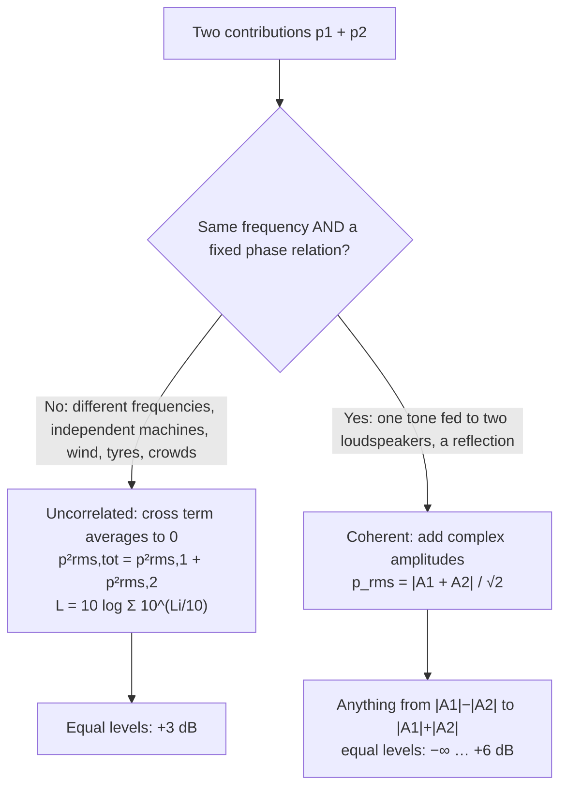
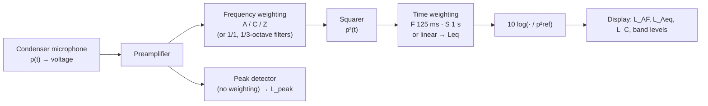

# Lecture 3 — Decibels, Frequency Analysis and Measurements

> [!abstract] The idea
> Everything a sound level meter reports is a mean-square pressure in disguise. Mean squares of uncorrelated parts add; amplitudes only add when the parts share one frequency and a fixed phase.

**Tuesday 15 September 2026 · Finn Agerkvist.** Sources: [[34840_Lecture3_2026_v2.pdf|Lecture 3 slides v2 (43 pages)]] · [[34840_Lecture3_2026_v2.pptx|PowerPoint]] · [[34840_Lecture3_addition_of_multiple_frequencies.pdf|in-class exercise: RMS of multi-frequency sums]] · [[Fundamentals_of_acoustics_2022.pdf|course text, §1.3, printed pp. 15–27]] · [[34840_SoundLevelMeter_Matlab_exercise_guide.pdf|Matlab sound-level-meter guide]]. Practice: [[Week 3 - Decibels Frequency Analysis and Measurements|fully worked Week 3 problems]]. Interactive version: [Sound Bench, Lecture 3](https://study.madsrudolph.dev/34840/#l3).

> [!note] Slide numbers
> Slide numbers refer to the **v2** deck (PDF page = slide number, 1–43). v2 differs from the original v1 `.pptx` only in small ways: slides 5, 7 and 8 are reordered (WHO now slide 5, working environment 7, household appliances 8), symbols are colour-keyed to their labels (slide 29: $f_c$, $f_l$, $f_u$; slide 42: "power spectral density (S)"), slide 12's caption now reads "…for same frequency", and the phasor-plot legend colours are fixed. No formula or number changed. Several slides are plots or audio demos; their message is described in words here.

## 1. Why we measure level (slides 3–8)

The opening slides are a tour of where levels show up in practice:

- **Metro Cityring, Marmorkirken (slide 4).** The construction-noise report lists, per period, the total $L_{\rm Aeq}$ (79.9–81.0 dB), the **rating level** $L_r$ (84.9–86.0 dB, i.e. 5 dB above $L_{\rm Aeq}$ — an adjustment the noise regulations add for the character of the noise), the **limit** (78 dB), the exceedance (6.9–8.0 dB) and the measurement uncertainty (3.7–4.1 dB). Verdict in every period: limit not met.
- **WHO and transport noise (slides 5–6).** Noise is rated the second-largest environmental health threat in western Europe after particle pollution; about 20 % of Europeans are exposed to levels considered harmful in the long term.
- **Working environment (slide 7).** **85 dB(A)** is the number to remember for occupational exposure (8-hour $L_{\rm Aeq}$).
- **Household appliances (slide 8).** The EU energy label on a dishwasher prints **50 dB**. That is a *sound power level* $L_{WA}$ (re 1 pW), a property of the machine, not a pressure level at some position.

All of these are single numbers distilled from a pressure signal. The rest of the lecture is how that distillation works.

## 2. RMS pressure (slide 9, text eq. 1.3.1)

$$p_{\rm rms}=\lim_{T\to\infty}\sqrt{\frac1T\int_0^T p^2(t)\,dt}.$$
Square (so negative half-cycles count too), average over time, then undo the square. For a sinusoid $p(t)=p_i\sin\omega t$, $\overline{\sin^2}=1/2$, so
$$p_{\rm rms}=\frac{p_i}{\sqrt2}\approx0.707\,p_i.$$
The **crest factor** (peak/RMS) of a pure tone is therefore $\sqrt2$, i.e. 3 dB (text ex. 1.3.12). Noise and impulses have much larger crest factors, which is why sound level meters also have a separate peak detector, $L_{\rm peak}=20\log(p_{\rm peak}/p_{\rm ref})$.

## 3. Decibels and levels (slide 17, text §1.3.2)

The ear spans more than a factor of a million in pressure, and perceived loudness tracks the logarithm far better than pressure itself. Hence levels:

| Level | Definition | Reference | Kind of quantity |
|---|---|---|---|
| Sound pressure level | $L_p=20\log\dfrac{p_{\rm rms}}{p_{\rm ref}}=10\log\dfrac{p^2_{\rm rms}}{p^2_{\rm ref}}$ | $p_{\rm ref}=20\ \mu\mathrm{Pa}$ (air), 1 µPa (water) | field (linear) |
| Particle velocity level | $L_u=20\log\dfrac{u_{\rm rms}}{u_{\rm ref}}$ | $u_{\rm ref}=1\ \mathrm{nm/s}$ | field (linear) |
| Sound intensity level | $L_I=10\log\dfrac{I}{I_{\rm ref}}$ | $I_{\rm ref}=10^{-12}\ \mathrm{W/m^2}$ | power-like (quadratic) |
| Sound power level | $L_W=10\log\dfrac{W}{W_{\rm ref}}$ | $W_{\rm ref}=10^{-12}\ \mathrm W$ | power-like (quadratic) |

**20 log for linear quantities, 10 log for quadratic ones**, so that doubling the pressure (4× the power) is +6 dB in both pictures. Going back: $p_{\rm rms}=p_{\rm ref}10^{L_p/20}$ and $p^2_{\rm rms}=p^2_{\rm ref}10^{L_p/10}$.

Anchor values from slide 17 worth knowing by heart:

| $p_{\rm rms}$ | 20 µPa | 1 mPa | 1 Pa | 1.4 Pa | 2 Pa | 10 Pa |
|---|---|---|---|---|---|---|
| $L_p$ | 0 dB | 34 dB | **94 dB** | 97 dB | 100 dB | 114 dB |

94 dB = 1 Pa is the calibrator level. 20 µPa is roughly the threshold of hearing at 1 kHz. A just-noticeable change for broadband sound is about 1 dB, which is one reason the decibel (not the bel) stuck.

**Level demo (slide 16).** Two six-step level ramps: *type A* raises the pressure in equal linear steps, *type B* in equal ratios (equal dB steps). Type B is the one that *sounds* evenly spaced: the ear is a logarithmic instrument.

## 4. Adding signals: the one question that decides everything (slides 10–14)

Square the sum of two pressures and average:
$$\overline{(p_1+p_2)^2}=\overline{p_1^2}+\overline{p_2^2}+2\,\overline{p_1p_2}.$$
Everything hinges on the cross term $\overline{p_1p_2}$ (slide 11 plots it: for $f_1\neq f_2$ it oscillates around zero and integrates to 0).

### 4.1 Different frequencies (slides 10, 12, 13)

$$p(t)=a_1\sin\omega_1t+a_2\sin\omega_2t,\ \omega_1\neq\omega_2\quad\Rightarrow\quad p_{\rm rms}=\sqrt{\frac{a_1^2+a_2^2}{2}}=\sqrt{p^2_{\rm rms,1}+p^2_{\rm rms,2}}.$$
With complex amplitudes $p=\Re\{\sum_iA_ie^{j\omega_it}\}$ and all $\omega_i$ distinct,
$$p_{\rm rms}=\sqrt{\sum_i\frac{|A_i|^2}{2}}=\sqrt{\sum_ip^2_{\rm rms,i}}.$$
Phases do not matter at all here. "Distinct" means the averaging time is long compared with the beat period $1/|f_1-f_2|$.

### 4.2 Same frequency (slide 10 bottom, slide 12)

$$p_{\rm rms}=\frac{|A_1+A_2|}{\sqrt2},\qquad \omega_1=\omega_2.$$
For two equal tones with phase difference $\varphi$: $|1+e^{j\varphi}|^2=2+2\cos\varphi$, so the level change relative to one tone is
$$\Delta L=10\log(2+2\cos\varphi):\quad 0^\circ\to+6.02,\ 60^\circ\to+4.77,\ 90^\circ\to+3.01,\ 120^\circ\to0,\ 180^\circ\to-\infty\ \mathrm{dB}.$$
"Phase difference only important for same frequency" (slide 12). Note that 90° gives exactly the incoherent +3 dB: on average over all phases the coherent sum behaves like the incoherent one.

### 4.3 The in-class table (addition of multiple frequencies PDF)

Write each component as a phasor (use $\sin\omega t=\Re\{-j\,e^{j\omega t}\}$), merge components with the **same** $\omega$ as complex numbers, then add $|A|^2/2$ over the **different** frequencies:

| $p_1+p_2$ | $p_2=-2\sin\omega_2t$ ($\hat p_2=2j$) | $p_2=-4\cos\omega_2t+\sin\omega_3t$ ($\hat p_2=-4,\,-j$) |
|---|---|---|
| $p_1=\cos\omega_1t$ ($\hat p_1=1$) | $\sqrt{\tfrac{1}{2}+\tfrac{4}{2}}=\sqrt{5/2}=1.581$ | $\sqrt{\tfrac12+\tfrac{16}2+\tfrac12}=\sqrt{18/2}=3$ |
| $p_1=\cos\omega_1t+3\sin\omega_2t$ ($\hat p_1=1,\,-3j$) | $\sqrt{\tfrac12+\tfrac{|-3j+2j|^2}2}=\sqrt{2/2}=1$ | $\sqrt{\tfrac12+\tfrac{|-4-3j|^2}2+\tfrac12}=\sqrt{27/2}=3.674$ |

The bottom-left cell is the instructive one: $3\sin\omega_2t$ and $-2\sin\omega_2t$ partly cancel to $\sin\omega_2t$ before squaring. The bottom-right cell adds $-4$ and $-3j$ as vectors: $|-4-3j|=5$, not 7 and not 1.

### 4.4 Multiple sources (slide 14, text eqs. 1.3.6–1.3.10)

Independent sources (wind, tyre noise, unsynchronised machines) are uncorrelated, so
$$p^2_{\rm rms,tot}=\sum_ip^2_{\rm rms,i},\qquad L_{p,\rm tot}=10\log\sum_i10^{L_i/10}.$$
Correlated sources need the full $\sqrt{\overline{(p_A+p_B+\dots)^2}}$. Handy consequences:

| Situation | Result |
|---|---|
| Two equal uncorrelated sources | +3.01 dB (70 + 70 → 73 dB, *not* 140 dB) |
| $N$ equal uncorrelated sources | $+10\log N$ (crowd: $p_{\rm rms}\propto\sqrt N$, text ex. 1.3.3) |
| Levels 6 dB apart | +1 dB on the louder (65 ⊕ 59 = 66.0 dB) |
| Levels 10 dB apart | +0.4 dB: the quieter one hardly matters |
| Two equal coherent tones in phase | +6.02 dB |

## 5. Background-noise correction (text ex. 1.3.4, eq. 1.3.10)

If the background is stationary and uncorrelated with the source, subtract mean squares:
$$L_{p,\rm source}=10\log\left(10^{L_{\rm tot}/10}-10^{L_{\rm bg}/10}\right).$$
Equivalently, with $\Delta L=L_{\rm tot}-L_{\rm bg}$, the correction is $-10\log(1-10^{-\Delta L/10})$:

| $\Delta L$ (dB) | 3 | 4 | 5 | 6 | 8 | 10 | 15 |
|---|---|---|---|---|---|---|---|
| subtract (dB) | 3.0 | 2.2 | 1.7 | 1.3 | 0.7 | 0.5 | 0.1 |

Rules of thumb from the text: the result is only reliable when the background is at least ~3 dB below the total; at more than 10 dB below, the correction is under 0.5 dB and is usually ignored. Example 1.3.7: total 66, background 59 → source 65 dB. Week 3 Problem 5 is the same calculation with a second machine as "background". (The text's line under eq. 1.3.10 says "as described in example 1.3.5"; it means example 1.3.4.)

## 6. Non-stationary sound: time weighting (slides 18–23, text eqs. 1.3.13–1.3.19)

Real signals (passing cars, production cycles) change level and spectrum, so "the" RMS depends on *which* time window. Slide 19 shows the squared pressure of a noise burst switched on from 3 to 9 s on top of a weak background.

### 6.1 Equivalent level $L_{\rm eq}$ (slide 20)

Uniform (linear) averaging over a stated interval:
$$L_{\rm eq,T}=20\log\frac{p_{\rm rms,eq}}{p_{\rm ref}},\qquad p_{\rm rms,eq}=\sqrt{\frac1{t_2-t_1}\int_{t_1}^{t_2}p^2(t)\,dt}.$$
Typical $T$: 15 min, 30 s (technical installations), **8 h (working environment)**, 24 h (traffic). If the level sits at steady values $L_i$ for durations $t_i$ (text eq. 1.3.17),
$$L_{\rm eq,T}=10\log\sum_i\frac{t_i}{T}10^{L_i/10}.$$
Text ex. 1.3.11: 84 dB for 15 min, 95 dB for 5 min, 71 dB for 20 min → **87.0 dB**. The short 95 dB spell dominates; the 71 dB part is irrelevant.

### 6.2 Running exponential average, F and S (slide 21, text eq. 1.3.13)

$$p^2_{{\rm rms},\tau}(t)=\int_{-\infty}^tp^2(u)\,\frac1\tau e^{-(t-u)/\tau}\,du,\qquad \tau_F=0.125\ \mathrm s\ (\textit{fast}),\quad\tau_S=1\ \mathrm s\ (\textit{slow}).$$
A leaky integrator: recent sound counts most, older sound fades. It gives a level *versus time* ($L_F(t)$, $L_S(t)$), whereas $L_{\rm eq}$ gives one number for the whole interval. After the source stops, the level decays linearly in dB at $10\log_{10}e/\tau$: **34.7 dB/s for F, 4.3 dB/s for S**. In the slide-21 plot the red curve is the slow weighting function seen from $t=6$ s.

What the plots on slides 22–23 show:

- **On/off source + background (slide 22):** $L_F$ jumps from ≈66 dB to ≈85 dB at 3 s and back at 9 s; overall $L_{\rm eq}=82.1$ dB, $L_{\rm A,eq}=74.4$ dB. Check: half the time at 85, half at 66 → $10\log\tfrac12(10^{8.5}+10^{6.6})=82.0$ dB. This is exactly Matlab Task B1.
- **On/off duty cycle (slide 23):** with the S time constant, short on/off cycles produce a sawtooth that settles around the mean; $L_{\rm eq}=77.3$ dB, $L_{\rm A,eq}=73.2$ dB. The slower the detector, the smaller the ripple.

### 6.3 Sound exposure level (text eq. 1.3.19)

For a single event (hammer blow, aircraft take-off), normalise the integral to $t_0=1$ s instead of dividing by the measurement time:
$$L_{AE}=10\log\left(\frac1{t_0}\int_{t_1}^{t_2}\frac{p_A^2(t)}{p_{\rm ref}^2}dt\right),\qquad L_{\rm Aeq,T}=L_{AE}+10\log n-10\log\frac{T}{t_0}$$
for $n$ identical events in $T$. The text also notes that an exponential detector with time constant $\tau$ has the same statistical uncertainty as linear averaging over $2\tau$ (250 ms for F).

## 7. Frequency weighting: A and C (slides 24–25, 35; text Table 1.3.2)

The hearing threshold (slide 24) is high at low frequencies, has its dip near 3–4 kHz (the ear canal, ≈2.5 cm, acting as a closed–open tube resonance, $f\approx c/4l$), and rises again above ~10 kHz. The **A-weighting** filter mimics this at moderate levels:
$$H_A(j\omega)=7.4\times10^{9}\,\frac{(j\omega)^4}{(j\omega+129.4)^2(j\omega+676.7)(j\omega+4636)(j\omega+76655)^2}.$$
Poles at 20.6, 107.7, 737.9 Hz and 12.2 kHz (in rad/s above). Values to remember (from Table 1.3.2; the slide formula reproduces them to within about 0.1 dB):

| $f$ (Hz) | 31.5 | 63 | 125 | 250 | 500 | 1000 | 2000 | 4000 | 8000 |
|---|---|---|---|---|---|---|---|---|---|
| A (dB) | −39.4 | −26.2 | −16.1 | −8.6 | −3.2 | 0 | +1.2 | +1.0 | −1.1 |
| C (dB) | −3.0 | −0.8 | −0.2 | 0 | 0 | 0 | −0.2 | −0.8 | −3.0 |

- $L_A$ (dB(A)) is the default single-number noise measure; it correlates much better with annoyance than the unweighted $L_Z$.
- C is nearly flat; a big $L_C-L_A$ is the tell-tale of strong low-frequency content. B and D are obsolete.
- With band levels $L_i$ and weightings $K_i$ (text eqs. 1.3.15–1.3.16):
$$L_Z=10\log\sum_i10^{L_i/10},\qquad L_A=10\log\sum_i10^{(L_i+K_i)/10}.$$
Text ex. 1.3.10 (one-third octaves 315–800 Hz at 52, 68, 76, 71, 54 dB): $L_Z=77.7$ dB, $L_A=74.7$ dB.

A 440 Hz tone gets $K\approx-4.1$ dB, which is why the Matlab 440 Hz test signal reads 74.0 dB flat and 69.9 dB(A).

## 8. Frequency analysis: octaves and fractions (slides 28–38, text §1.3.1)

### 8.1 Why logarithmic bands

Slide 28 plays two tone sequences: equal *linear* steps (add a constant Hz) sound like they bunch up at the top; equal *ratio* steps (multiply) sound even. Pitch, like loudness, is logarithmic. So analysers use **constant-percentage bandwidth**: every band is the same width on a log axis.

### 8.2 Octave and 1/n-octave bands (slides 29, 36)

$$f_{c,i}=f_0\,2^{i/n},\qquad f_l=\frac{f_c}{2^{1/(2n)}},\qquad f_u=f_c\,2^{1/(2n)},\qquad f_c=\sqrt{f_lf_u},$$
$$\Delta f=f_u-f_l=f_c\left(2^{1/(2n)}-2^{-1/(2n)}\right).$$

| Band | $f_u/f_l$ | $\Delta f/f_c$ | Example at 1 kHz |
|---|---|---|---|
| Octave ($n=1$) | 2 | 70.7 % | 707–1414 Hz |
| 1/3 octave | $2^{1/3}=1.26$ | 23.2 % | 891–1122 Hz |
| 1/12 octave (one semitone) | $2^{1/12}$ | 5.78 % | 57.8 Hz wide (Problem 4) |

Octave limits from slide 29: 125 Hz: 88–177; 250: 177–353; 500: 353–707; 1000: 707–1414; 2000: 1414–2828; 4000: 2828–5656 Hz. (The slide lists 63 Hz as 44–88; strictly $63\sqrt2=89$ Hz. The asterisk marks 63 as a rounded nominal value.)

**Nominal frequencies** (text Table 1.3.1): 20, 25, 31.5, 40, 50, **63**, 80, 100, **125**, 160, 200, **250**, 315, 400, **500**, 630, 800, **1000**, 1250, 1600, **2000**, 2500, 3150, **4000**, 5000, 6300, **8000**, 10000, 12500, **16000**, 20000 Hz (bold = octave centres). Because $2^{10}\approx10^3$, a third-octave is almost exactly a tenth of a decade, so real "third-octave" filters are spaced $10^{1/10}$ apart; the audible range is three decades = ten octaves = thirty third-octaves. A one-third octave equals four semitones (a major third, hence *Terzfilter*).

Slides 30–31 contrast the band edges on a linear axis (bands crowd at the bottom) with a log axis (equal spacing), and show a real octave filter bank: overlapping, flat-topped bandpass filters that cross at about −3 dB. Slide 37 shows the 1/3-octave bank, "similar to the filters in human hearing".

### 8.3 Adding band levels (slides 32–35, Parseval)

Since different frequency components are uncorrelated, the mean square splits into bands and the bands add back up (text eq. 1.3.5, Parseval):
$$p^2_{{\rm rms},f_c}=\sum_{i\in\text{band}}\frac{|A_i|^2}2,\qquad p^2_{\rm rms}=\sum_{\rm bands}p^2_{{\rm rms},f_c}.$$
Slide 34 worked example (octave bands):

| $f_c$ (Hz) | 125 | 250 | 500 | 1000 | total |
|---|---|---|---|---|---|
| SPL (dB) | 70 | 75 | 80 | 42 | **81.5** |
| $p_{\rm rms}$ (Pa) | 0.0632 | 0.1125 | 0.2 | 0.0025 | 0.238 |
| $p^2_{\rm rms}$ (Pa²) | 0.0040 | 0.0127 | 0.04 | 0.00000625 | 0.0567 |

The 1 kHz band at 42 dB contributes nothing visible. With the A-weights of slide 35 ($-16.1,-8.6,-3.2,0$) the same spectrum gives $L_A=77.2$ dB. Slide 38 ("Deepest Blues") is the 1/3-octave spectrum of the three 30 s parts of the music track used in Matlab Task D.

## 9. White and pink noise (slides 26, 39–42; text "Random noise")

| | White | Pink |
|---|---|---|
| Constant | power per **Hz** (flat PSD $S(f)$) | power per **octave / fraction** ($S(f)\propto1/f$) |
| Equal RMS in | 100–125 Hz and 1000–1025 Hz | 100–200 Hz and 1000–2000 Hz |
| In 1/3-octave bands | rises **+1 dB per band** (+3 dB/octave) | flat |
| In 1 Hz bands | flat | falls 3 dB/octave |
| Sounds | hissy, bright | balanced (matches auditory filters) |

For a 94 dB (1 Pa²) noise from 20 Hz to 20 kHz: white has $S=1/19980=5.0\times10^{-5}\ \mathrm{Pa^2/Hz}$ (slide 41); pink has $1/30=0.033\ \mathrm{Pa^2}$ in every third-octave (slide 40). Pink noise has 3× the octave-band mean square of its third-octave value.

In general (slide 42) a band's mean square is the integral of the power spectral density $S(f)$, in Pa²/Hz:
$$p^2_{\rm tot}=\int_{f_1}^{f_2}S(f)\,df\approx\sum_np^2_{[f_n,f_n+1\,\mathrm{Hz}]},\qquad S(f)=\frac{p^2_{[f,f+df]}}{df}.$$

Slide 26: both noises at $L_{\rm eq}=80$ dB, but $L_{A,\rm eq}$ is **70.6 dB for pink**, **76.3 dB for white**: pink puts more energy at low frequencies where A-weighting cuts hard.

Slide 27 is the same comparison on music (the 90 s "Deepest Blues" track, S time weighting): $L_{\rm eq}=82.7$ dB but $L_{A,\rm eq}=79.5$ dB. For the first 30 s the flat and A-weighted curves coincide (≈ 74–75 dB); at 30 s the flat level jumps to ≈ 82 dB while the A-weighted one barely moves — the bass comes in, and A-weighting discounts it. Check against the Matlab D3 part levels: $10\log\tfrac13(10^{7.44}+10^{8.20}+10^{8.58})=82.8$ dB, the same within rounding.

Text ex. 1.3.2: a tone always emerges from noise if the analysis bandwidth is narrow enough, because noise power in a band shrinks with bandwidth but the tone's does not. This is where FFT analysers shine.

## 10. The sound level meter (text §1.3.3, Fig. 1.3.3)

- **Microphone:** a condenser microphone (tensioned foil diaphragm close to a back plate, polarised externally or as an electret). The usual measurement size is ½ inch (≈13 mm): small enough to be omnidirectional and non-disturbing below ~1 kHz, but from a few kHz it diffracts the field (free-field correction, Fig. 1.3.5).
- **Three response types:** *free-field* (flat for axial incidence, point it at the source), *random-incidence* (flat in a diffuse field), *pressure* (small cavities, couplers).
- **Calibration:** 94 dB (1 Pa) at 1 kHz is the standard calibrator level.
- Random-noise measurements have a statistical error whose variance falls as 1/(bandwidth × averaging time): narrow bands need long averaging.

## 11. Matlab sound-level-meter exercise (Problem 6)

[[34840_SoundLevelMeter_Matlab_exercise_guide.pdf|Guide]], test signals in `_Learn/3a - Matlab SLM/Matlab_SLM - Copy.zip`, official solution in [[Matlab_SLM_solution.zip]]. All signals are sampled at 44.1 kHz and scaled directly in pascals, so `20*log10(rms/20e-6)` gives SPL.

| Task | What you build | Check values (guide) |
|---|---|---|
| A1 | $L_{\rm eq}$ of a whole signal: $p_{\rm rms}=\sqrt{\frac1{n_2-n_1+1}\sum p^2(n)}$ | 440HzSine **74 dB**, ToneComplex **76.5 dB** |
| A2 | Same over an interval $[t_1,t_2]$, index $n=t\,f_s+1$ | NonStationaryNoise: **85.0 dB** for 3–9 s, **82 dB** whole |
| B1 | Running exponential average `SPL_exp(sig,tau)` | NonStationaryNoise+background with F: $L_{\rm eq}$ **82.1**, $L_{A,\rm eq}$ **74.4 dB**, curve as slide 22 |
| C1 | A-weighting with `Afilter_44k1(sig)` | 440HzSine **69.9 dB(A)** |
| D1–D3 | 1/3-octave $L_{\rm eq}$ (20 Hz–20 kHz) with `n_octave_filter(fc,3,fs)` + `filter`, for three 30 s parts of DeepestBluesAreBlack, then total by summing band mean squares | **74.4, 82.0, 85.8 dB** |
| E1–E3 | Live recording via the Windows sound card (`SLM_Record.m`, Data Acquisition Toolbox) | Uncalibrated: look at spectral balance only |

**How the official solution works** (`SLM_34840_matlab_solutions.m` + `SoundLevelMeter_B_solution.m`):

- A1/A2 first do the sum of squares with a `for` loop to show the definition, then repeat it vectorised as `sqrt(mean(sig(n1:n2).^2))`.
- B1 turns the convolution with $\frac1\tau e^{-t/\tau}$ into a one-pole recursion,
$$\alpha=e^{-1/(\tau f_s)},\qquad \overline{p^2}(n)=\alpha\,\overline{p^2}(n-1)+(1-\alpha)p^2(n),\qquad \overline{p^2}(1)=p^2(1),$$
run in parallel on the raw and A-weighted signal. With $f_s=44.1$ kHz, $\alpha=0.99982$ (F) and $0.99998$ (S). The same thing is `filter(1-alpha,[1 -alpha],sig.^2)`.
- C uses `adsgn.m` (Couvreur's IEC A-weighting design: the analogue $H_A$ through `bilinear` at 44.1 kHz, accurate except close to Nyquist).
- D builds each 1/3-octave filter as a squared 2nd-order Butterworth bandpass (4th-order Linkwitz–Riley-style; band edges widened slightly so the bands sum flat). For low centre frequencies it designs the filter at a virtual lower sample rate and upsamples the coefficients with an FIR anti-image filter, because a direct narrow IIR at 20 Hz and 44.1 kHz is numerically ill-conditioned. D3 then uses Parseval: `sqrt(sum(p_rms.^2,2))`.

> [!warning] Matlab gotchas
> - The solution script names the files `NonstationaryNoise.wav`, `NonStationaryNoise+Background.wav` and `DeepestBluesareBlack.wav`, but the zip ships `NonStationaryNoise.wav`, `NonStationaryNoise+background.wav` and `DeepestBluesAreBlack.wav`. Windows does not care; on Linux `audioread` fails. Rename or symlink.
> - The guide writes the recursion as "`B=[1-alpha], A=[1 alpha]`". For MATLAB's `filter` the denominator must be `[1 -alpha]`; with `+alpha` the filter is wrong.
> - `adsgn` and `n_octave_filter` need the Signal Processing Toolbox (`bilinear`, `butter`, `fir1`, `upsample`).
> - Task E is Windows-only (`directsound`).

## 12. Traps and pitfalls

- **Coherent vs incoherent.** Same frequency + fixed phase → add complex amplitudes (up to +6 dB, down to −∞). Different frequencies or independent sources → add mean squares (+3 dB for equal levels). Never add dB values directly (70 + 70 ≠ 140).
- **20 log vs 10 log.** Pressure, velocity: 20 log. Intensity, power, mean squares: 10 log. When converting band levels back, use $10^{L/10}$ for $p^2$, not $10^{L/20}$.
- **Peak vs RMS.** SPL uses RMS. A 0.02 Pa amplitude is 0.0141 Pa RMS: forgetting $\sqrt2$ adds 3 dB.
- **"Amplitude doubles" is not "power doubles".** In phase: +6 dB. Uncorrelated: +3 dB.
- **Subtracting levels** needs mean squares too, and is unreliable when total and background differ by less than ~3 dB.
- **Overtones vs harmonics.** The fundamental is the 1st harmonic; the "first overtone" is the 2nd harmonic, $2f_0$.
- **Band edges.** Octave limits are $f_c/\sqrt2$ and $f_c\sqrt2$, not $f_c\pm f_c/2$. For 1/n octave use $2^{\pm1/(2n)}$.
- **White noise is not flat in third-octaves** (+1 dB/band). Pink noise is.
- **Missing bands contribute zero mean square, not "0 dB".** A band at 0 dB still contributes $p_{\rm ref}^2$.
- **$L_{\rm eq}$ is dominated by the loudest periods**: a short loud spell outweighs a long quiet one.
- **dB(A) on an appliance label** is a power level $L_{WA}$; you cannot compare it to an SPL without knowing distance and room.
- **A-weighting is a filter**, not a level offset: apply $K_i$ per band, then add mean squares.

## 13. Quick self-check

1. Two identical machines each give 80 dB at a point. What do both give? (83 dB.) Two loudspeakers fed one tone in phase? (86 dB.)
2. Why is a 120° phase lag between two equal tones "no change"? ($|1+e^{-j2\pi/3}|=1$.)
3. A machine gives 65 dB, background is 62 dB, total 66.8 dB. Can you trust a corrected source level? (Barely: $\Delta L$ only 4.8 dB.)
4. How wide is the 4 kHz octave band, and which harmonics of 769 Hz fall into it? (2828–5657 Hz; harmonics 4–7.)
5. White noise analysed in octaves: how much does the level rise per band? (+3 dB.)
6. What does the F detector read 0.5 s after a steady 90 dB source is switched off (no background)? (90 − 17.4 ≈ 72.6 dB.)
7. Why does pink noise at 80 dB read lower in dB(A) than white noise at 80 dB?
