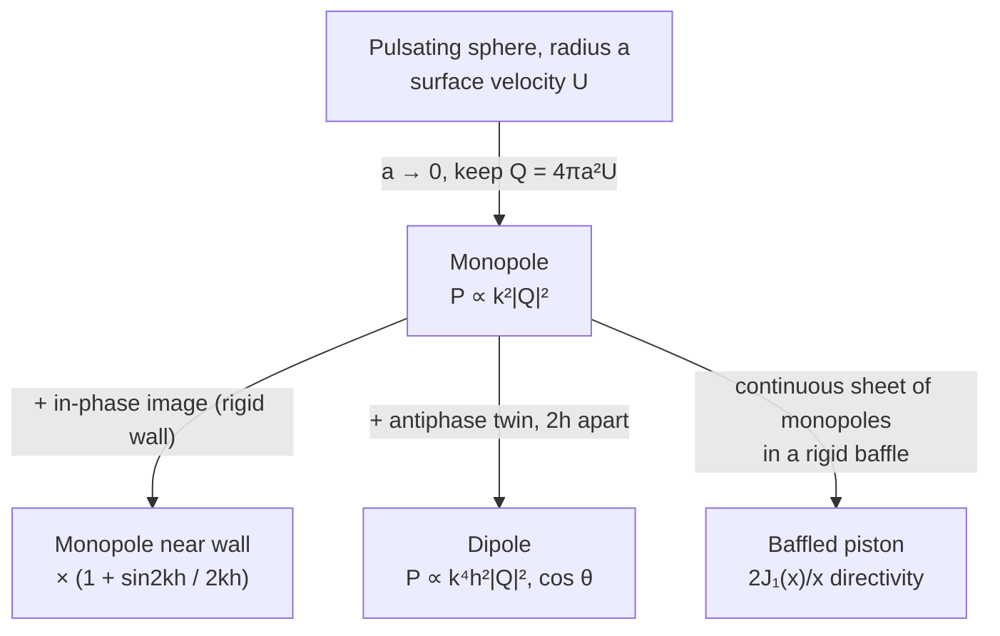
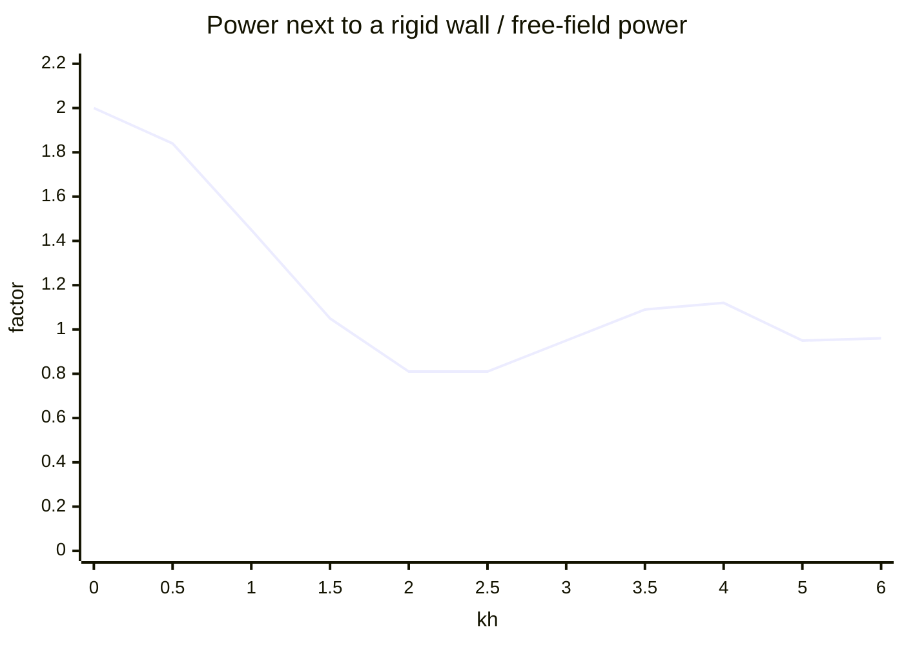
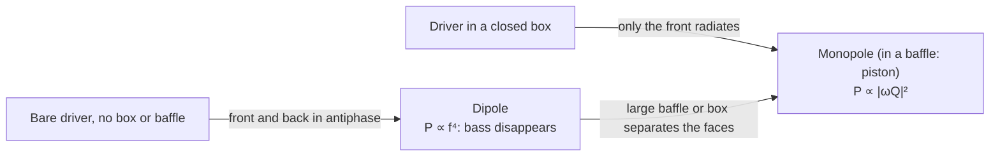

# Lecture 5 — Radiation of Sound: Monopoles, Dipoles and Pistons

> [!abstract] The idea
> A source radiates well only when it pushes a net volume of air and is not small compared with the wavelength. Everything else (a wall nearby, a second source in or out of phase, a baffle) just changes how much of the source's own pressure field pushes back on it in phase with its velocity.

**Tuesday 29 September 2026 · Finn Agerkvist.** Sources: [[34840_Lecture5_2026_v2.pdf|Lecture 5 slides v2 (37 pages; slide numbers below are the footer numbers, the hidden slides 7, 8, 25, 36 and 38 are not in the PDF)]] · [[34840_Lecture5_2026_v2.pptx|PowerPoint v2]] · [[Fundamentals_of_acoustics_2022.pdf|course text §1.6, pp. 37–48]]. The slides stop at monopoles, reflection and dipoles; the **baffled piston** (§8 below) is from the course text only. Practice: [[Week 5 - Radiation Monopoles Dipoles and Pistons|fully worked Week 5 problems]]. Interactive version: [Sound Bench, Lecture 5](https://study.madsrudolph.dev/34840/#l5).

Same conventions as Lecture 4: peak phasors, $e^{j\omega t}$, $k=\omega/c$, $p_{\rm rms}=|\hat p|/\sqrt2$. "Power" is always time-averaged.

## 1. What radiates sound (slides 3, 31)

Three mechanisms: **vibrating surfaces** (loudspeakers, panels, machines), **fluid injection** (exhausts, sirens) and **aerodynamic pressure** (wind turbines, fans, a hair dryer). This course only treats the first, which is also the most important. The key split:

| Source changes its volume? | Model at low frequency | Examples |
|---|---|---|
| Yes, net volume displacement | **Monopole** | Closed-box loudspeaker, exhaust outlet, pulsating bubble |
| No, it just pushes air sideways (a net force) | **Dipole** | Bare driver with no box, string, beam, cymbal, oscillating sphere |

## 2. The pulsating sphere (slides 4–6)

A sphere of radius $a$ whose surface moves radially with velocity $Ue^{j\omega t}$ produces the spherical wave from Lecture 2:
$$\hat p=A\frac{e^{j(\omega t-kr)}}{r},\qquad \hat u_r=\frac{A}{\rho c}\left(1+\frac1{jkr}\right)\frac{e^{j(\omega t-kr)}}{r}.$$
The **boundary condition** $\hat u_r(a)=U$ fixes $A$:
$$A=\frac{j\rho c k a^2 U e^{jka}}{1+jka}.$$
Slide 6 splits the result into three readable factors:
$$\hat p(r,t)=\underbrace{\rho cU}_{\text{plane-wave pressure}}\;\underbrace{\frac{1}{1+\dfrac{1}{jka}}}_{\text{source-size correction}}\;\underbrace{\frac{e^{j(\omega t-k(r-a))}}{r/a}}_{\text{spreading}}.$$
- Large sphere ($ka\gg1$): the correction is 1, and the surface pressure is $\rho cU$, exactly like a plane wave.
- Small sphere ($ka\ll1$): the correction is $\approx jka$, so the pressure is tiny and leads the velocity by 90°.

## 3. Phase between pressure and velocity (slides 9–13)

The animations ($a=11$ cm) show the two regimes:

| | $ka=0.2$ (100 Hz) | $ka=5$ (2500 Hz) |
|---|---|---|
| On the source surface | $p$ is **90° ahead** of $u$: the sphere mostly shoves air back and forth (mass-like load) | $p$ and $u$ **in phase**: real power is delivered |
| Far field ($kr\gg1$) | In phase | In phase |

So a small source is a poor radiator not because it is quiet at the surface but because its surface pressure is in quadrature with its velocity. This is the near-field story of Lecture 4 (§5) seen from the source.

## 4. Radiation impedance of the sphere (slides 14–15)

Radiation impedance = surface pressure divided by the volume velocity it pushes, $Z_{a,r}=\hat p(a)/\hat q$ with $\hat q=4\pi a^2U$:
$$Z_{a,r}=\frac{\rho c}{4\pi a^2}\,\frac{jka}{1+jka}.$$

| Regime | $Z_{a,r}$ | Meaning |
|---|---|---|
| $ka\gg1$ | $\dfrac{\rho c}{4\pi a^2}$ | Plane-wave equivalent: pure resistance |
| $ka\ll1$ | $\dfrac{\rho ck^2}{4\pi}+j\omega\dfrac{\rho}{4\pi a}$ | Small resistance $\propto f^2$ plus an **acoustic mass** $\rho/(4\pi a)$ |

The real part rises as $f^2$ and flattens at $ka\approx1$; the imaginary part peaks around $ka=1$ and then falls (slide 15 plot). At low frequency the reactance dominates: most of the force goes into moving a layer of air that behaves as if incompressible.

> [!tip] How heavy is the air layer?
> Convert the acoustic mass to mechanical with $S^2$ (Lecture 4): $M_m=(4\pi a^2)^2\cdot\rho/(4\pi a)=4\pi a^3\rho$, which is **three times the mass of air the sphere displaces**. (Derived here, not on the slides.)

## 5. The monopole (slides 17–21)

Let $a\to0$ while keeping the **volume velocity** $Q=4\pi a^2U$ (m³/s) finite. Then $ka\ll1$ at every frequency and
$$\boxed{\hat p(r,t)=\frac{j\omega\rho Q}{4\pi r}e^{j(\omega t-kr)}},\qquad
\hat u_r=\frac{j\omega\rho Q}{4\pi r\,\rho c}\left(1+\frac1{jkr}\right)e^{j(\omega t-kr)}.$$
Pressure is driven by the **volume acceleration** $j\omega Q$, not the volume velocity. Hence "poor radiation at low frequencies" for a fixed $Q$.

**Intensity (slide 19).** The $1/(jkr)$ near-field term is in quadrature and drops out:
$$I_r=\frac12\Re\{\hat p\hat u_r^*\}=\frac{(\rho\omega|Q|)^2}{32\pi^2r^2\rho c}=\frac{|\hat p|^2}{2\rho c}=\frac{p_{\rm rms}^2}{\rho c}.$$
This holds at **any** distance, not only in the far field. That is why Week 5 Problem 1 can use $p^2/\rho c$ at 1 m without knowing the frequency.

**Power, two ways (slides 20–21).**
$$P_a=4\pi r^2I_r=\frac12|Q|^2\Re\{Z_{a,r}\}=\boxed{\frac{\rho ck^2|Q|^2}{8\pi}}.$$
Both routes agree. Power $\propto k^2|Q|^2=|\omega Q|^2/c^2$: for flat power you need **constant volume acceleration**, so the displacement must fall as $1/f^2$. That is why subwoofers need large cones (see §8).

**Reciprocity (course text p. 38).** Swap a monopole source and a receiver and the pressure is the same, even with reflecting or absorbing surfaces present.

## 6. Monopole near a rigid wall: the image source (slides 23–30)

A rigid plane forces $u_n=0$. An identical **in-phase image source** at the mirror position (distance $h$ behind the wall, so the pair is $2h$ apart) satisfies that by symmetry. The exact field is
$$\hat p=\frac{j\omega\rho Q}{4\pi R_1}e^{j(\omega t-kR_1)}\left(1+\frac{R_1}{R_2}e^{-jk(R_2-R_1)}\right).$$
The bracket is the pressure relative to free field, the "ground effect" used in outdoor propagation. At low frequency it is $\approx1+R_1/R_2$; the first dip comes when $R_2-R_1=\lambda/2$.

**Far field** ($r\gg h$; $r_{1,2}\approx r\mp h\cos\theta$ in the phase, $r_1/r_2\approx1$ in the amplitude):
$$\hat p\approx\frac{j\omega\rho Q}{2\pi r}\cos(kh\cos\theta)\,e^{j(\omega t-kr)}.$$
- $kh\ll1$: pressure simply **doubles** (+6 dB) everywhere in the half space.
- **Slide 26 (v2 annotation "Doubling (2π vs 4π)")**: the prefactor changes from $j\omega\rho Q/(4\pi r)$ to $j\omega\rho Q/(2\pi r)$ because the two equal contributions add, $e^{+jkh\cos\theta}+e^{-jkh\cos\theta}=2\cos(kh\cos\theta)$. That factor 2 is the pressure doubling; the same $2\pi$ reappears in the Rayleigh integral for the baffled piston (§8).
- $kh\cos\theta=(2n+1)\pi/2$ gives nulls; this needs $kh\ge\pi/2$ (slide 26). The kh = 0.45 animation shows a plain doubled monopole, kh = 6.9 shows lobes.

**Power (slide 30).** Integrate over the half sphere only:
$$\boxed{P_a=\frac{\rho ck^2|Q|^2}{8\pi}\left(1+\frac{\sin 2kh}{2kh}\right)}$$

At $kh\to0$ the factor is 2 (+3 dB power): double pressure in half the space gives $4/2=2$. Above $kh\approx\pi/2$ (wall more than $\lambda/4$ away) the wall hardly changes the power. Physically the image's pressure arrives at the real source in phase with its velocity, adding radiation resistance: the wall **changes the power the source emits**, not just where it goes. This assumes the source delivers a fixed $Q$ regardless of load.

> [!example] Slide 39 question — two identical small boxes side by side, same low frequency
> Treat the pair as one source with $2Q$. **Far-field pressure: ×2 (+6 dB).** **Power: ×4 (+6 dB)** compared with one box. Each box radiates twice its solo power because it also works against its neighbour's pressure (course text Example 1.6.1). This is the same maths as the wall, with the image made real.

| Situation, $kh\ll1$, same $Q$ per source | Far-field pressure | Power |
|---|---|---|
| One monopole, free field | 1 | 1 |
| Same monopole against a rigid wall | ×2 (+6 dB), half space | ×2 (+3 dB) |
| Two in-phase monopoles close together | ×2 (+6 dB), full space | ×4 (+6 dB) |
| Two antiphase monopoles (dipole) | $\propto kh\cos\theta$ | $\times\frac{8}{6}(kh)^2$ (≪ 1) |

> [!note] Extension, not on the slides
> Each extra perpendicular wall adds another image: an edge (2 walls) gives ×4 power into a quarter space, a corner (3 walls) ×8 (+9 dB). This is why a subwoofer in a corner sounds stronger.

## 7. The dipole (slides 31–36)

Two monopoles of equal $|Q|$ in **antiphase**, separated by $2h$ (each $h$ from the centre). There is no net volume flow, just a net force. The near field is complicated; the far field is
$$\hat p=\frac{\rho\omega Q}{2\pi r}\sin(kh\cos\theta)\,e^{j(\omega t-kr)}\;\approx\;\frac{\rho c\,hk^2Q}{2\pi r}\cos\theta\,e^{j(\omega t-kr)},\quad kh\ll1.$$
- **Directivity $\cos\theta$**: a figure-of-eight with a null in the whole mid-plane (slide 32 polar plot).
- Pressure $\propto k^2h|Q|$: one extra factor $kh$ compared with a monopole. At kh = 0.45 the field is two lobes of opposite sign (slide 33); at kh = 7 the sources are many wavelengths apart and interfere in many lobes (slide 34).

**Power (slide 35).** Integrate over the full sphere:
$$P_a=\frac{\rho ck^2|Q|^2}{4\pi}\int_0^\pi\sin^2(kh\cos\theta)\sin\theta\,d\theta=\frac{\rho ck^2|Q|^2}{4\pi}\left(1-\frac{\sin2kh}{2kh}\right).$$
With $\sin(kh\cos\theta)\approx kh\cos\theta$:
$$\boxed{P_a\approx\frac{\rho c\,h^2k^4|Q|^2}{6\pi}=\frac{8(kh)^2}{6}\cdot\frac{\rho ck^2|Q|^2}{8\pi}}$$
Dipole power $\propto f^4$ (−12 dB per octave downwards at constant $Q$) against $f^2$ for a monopole. The small-$kh$ formula overestimates: about 4 % at $kh=0.46$ (Problem 5) and 22 % at $kh=1$ (the slide says 20 %).

> [!warning] What $h$ means
> In both the wall problem and the dipole, the two sources are $2h$ apart. For the wall, $h$ is the distance to the wall; for the dipole, $h$ is half the spacing. Week 5 Problems 3–5 all use $h=0.1$ m for a 20 cm separation.

### Source comparison (slide 37): $f=40$ Hz, $|Q|=0.1$ m³/s, $h=0.05$ m, $kh=0.037$

| Source | $p$ at 5 m (SPL) | Power ($L_W$) |
|---|---|---|
| Monopole, free space | 0.34 Pa (84.6 dB) | 88 mW (109.5 dB) |
| Monopole, rigid wall | 0.68 Pa (90.6 dB) | 176 mW (112.5 dB) |
| Dipole (on axis) | 0.025 Pa (62 dB) | 0.16 mW (82.0 dB) |

All reproduced in `Week5_Radiation.m` with $c=344$. The dipole is 27.5 dB below the monopole in power: $10\log_{10}(8(0.037)^2/6)$.

## 8. The baffled circular piston (course text §1.6.2, pp. 42–48)

A rigid disc of radius $a$ moving with velocity $U$ in an infinite rigid baffle. Think of it as a carpet of in-phase monopoles $U\,dS$; the baffle gives each one a coincident image, which doubles it. This gives the **Rayleigh integral**
$$\hat p=\frac{j\omega\rho}{2\pi}\int_S\frac{e^{j(\omega t-kh)}}{h}U\,dS,$$
with $2\pi$ instead of $4\pi$ because of the baffle ($h$ = distance from the surface element to the field point).

### 8.1 Far field and directivity
$$\hat p(r,\theta)=\frac{j\omega\rho Q}{2\pi r}\left[\frac{2J_1(ka\sin\theta)}{ka\sin\theta}\right]e^{j(\omega t-kr)},\qquad Q=\pi a^2U.$$
The bracket is the directivity $D(ka,\theta)$, equal to 1 on axis.

| $ka\sin\theta$ | $D$ | Meaning |
|---|---|---|
| 1.62 | 0.707 | −3 dB edge of the beam |
| 2.22 | 0.5 | −6 dB |
| 3.83 | 0 | First null; only exists when $ka>3.83$ |

At low $ka$ the piston is omnidirectional into the half space (a monopole on a rigid plane). At high $ka$ it beams.

### 8.2 On-axis near field
$$\hat p=2j\rho cU\,e^{j\omega t}e^{-jk\bar r}\sin(k\delta),\quad \delta=\tfrac12\left(\sqrt{r^2+a^2}-r\right),\ \bar r=\tfrac12\left(\sqrt{r^2+a^2}+r\right).$$
The on-axis pressure is **zero** where $\sqrt{r^2+a^2}-r=n\lambda$. Minima of order $n$ only exist for $ka\ge2\pi n$. For a 50 mm radius cone that means above about 6.9 kHz, where the piston model no longer applies, so the nulls are not seen in front of real loudspeakers. Far away ($r\gg a^2/\lambda$) the on-axis result reduces to $\rho ckQ/(2\pi r)$, the monopole-on-a-plane value.

### 8.3 Radiation impedance
$$Z_{a,r}=\frac{\rho c}{\pi a^2}\left[\underbrace{1-\frac{J_1(2ka)}{ka}}_{R_1}+j\underbrace{\frac{H_1(2ka)}{ka}}_{X_1}\right]\quad(H_1=\text{Struve function}).$$

| Regime | Acoustic $Z_{a,r}$ | Mechanical $Z_{m,r}=S^2Z_{a,r}$ |
|---|---|---|
| $ka\ll1$ | $\dfrac{\rho ck^2}{2\pi}+j\omega\dfrac{8\rho}{3\pi^2a}$ | $\dfrac{\pi a^4\rho ck^2}{2}+j\omega\dfrac{8\rho a^3}{3}$ |
| $ka\gg1$ | $\dfrac{\rho c}{\pi a^2}$ | $\rho c\pi a^2$ |

- The low-$ka$ resistance is **twice** the pulsating sphere's $\rho ck^2/(4\pi)$: the baffle's image.
- The reactance is an **air mass** moving with the piston, $M_{m,r}=8\rho a^3/3$ per side. For a 6.5″ cone ($a=65$ mm) that is 0.88 g per side; a driver in free air or a box sees it on both faces.
- $R_1$ climbs as $(ka)^2/2$, overshoots to about 1.09 near $ka\approx2$–3, and settles at 1. $X_1$ peaks around $ka\approx1$ and then decays as $2/(\pi ka)$.

| $ka$ | $R_1$ | $X_1$ | Directivity factor $Q(f)$ | DI |
|---|---|---|---|---|
| 0.1 | 0.0050 | 0.085 | 2.00 | 3.0 dB |
| 0.5 | 0.120 | 0.397 | 2.09 | 3.2 dB |
| 1 | 0.423 | 0.647 | 2.36 | 3.7 dB |
| 2 | 1.033 | 0.535 | 3.87 | 5.9 dB |
| 3 | 1.092 | 0.159 | 8.24 | 9.2 dB |
| 5 | 0.991 | 0.178 | 25.2 | 14.0 dB |

### 8.4 Power and directivity factor
$$P_a=\tfrac12|Q|^2\Re\{Z_{a,r}\}=\tfrac12|Q|^2\frac{\rho c}{\pi a^2}R_1\;\xrightarrow{ka\ll1}\;\frac{\rho ck^2|Q|^2}{4\pi}$$
This is twice the free monopole, as §6 predicts for $kh\to0$. Equivalently $P_a=\tfrac12|U|^2\Re\{Z_{m,r}\}$.

The **directivity factor** is on-axis intensity relative to an omnidirectional source of the same power:
$$Q(f)=\frac{(ka)^2}{R_1}=\frac{(ka)^2}{1-J_1(2ka)/(ka)},\qquad DI=10\log_{10}Q(f).$$
It tends to **2 (3 dB) at low frequency**, not 1, because everything goes into a half space. At high frequency it grows as $(ka)^2$.

## 9. The loudspeaker link

- **Why boxes exist:** a bare driver's rear wave is in antiphase with the front, so it is a dipole and its bass collapses as $f^4$. A closed box turns it into a monopole (slide 31: "loudspeaker drivers (no box)" are dipoles).
- **Constant volume acceleration gives flat power** (course text Example 1.6.6). Above its resonance a driver is mass-controlled ($a=F/M$), so a flat drive gives a flat $\omega Q$ and flat bass power. The price is that the excursion grows as $1/f^2$. Since excursion is limited, the only way to more bass is a bigger cone, hence large subwoofers.
- **Radiation mass adds to the moving mass.** $8\rho a^3/3$ per side is the "air load" in loudspeaker data ($M_{MS}$ includes it, see 34870 Lecture 7). Week 4 Problem 5 was told to ignore it. For that 75 mm radius cone the outside air load is $8\rho a^3/3=1.35$ g, about 7 % of the 20 g cone, so the 59 Hz resonance would drop by roughly 3 %.
- **Placement:** a speaker against a wall or in a corner gains bass power (§6), until the wall is more than about $\lambda/4$ away.
- Lecture 8 (27-Oct, Finn) covers loudspeakers properly, from an additional lecture note.

## 10. Admin and midterm evaluation (slides 41–42)

- **Individual hand-in:** published on DTU Learn on 28-Sep, **deadline Friday 9-Oct**.
- **Lab exercise:** starts 20-Oct, with the schedule on DTU Learn.
- **Next:** L6 06-Oct (CHJ) room modes and the diffuse field (pp. 81–101) → autumn break → L7 20-Oct (CHJ) absorption and room acoustic design → L8 27-Oct (FA) loudspeakers → L9–10 (TD) hearing → L11–12 (JBR) structure-borne sound and sound insulation → L13 01-Dec (FA) summary.
- **Midterm evaluation (slide 42):** an open discussion with three prompts: questions, what works well, what could work better. There is no content to learn from it.

## 11. Traps and pitfalls

- **$Q$ is volume velocity (m³/s), not a quality factor or the directivity factor $Q(f)$.** All three appear in this chapter.
- **Peak vs RMS:** $P_a=\rho ck^2|Q|^2/(8\pi)$ uses peak $|Q|$. With RMS $Q$ it becomes $\rho ck^2Q_{\rm rms}^2/(4\pi)$.
- **$p^2/\rho c$ works at any distance from a monopole.** The reactive near field adds no active intensity. It does not work in a standing wave or near a dipole's null.
- **Wall vs neighbour:** a wall doubles the power (+3 dB) and doubles pressure. A second real in-phase source quadruples the total power (+6 dB) and also doubles pressure. Do not mix them up.
- **The wall changes the emitted power.** This is a fixed-$Q$ (velocity source) assumption. Do not say "the same power is just squeezed into half the space": that would give +3 dB SPL, while the real answer at $kh\ll1$ is +6 dB.
- **Incoherent vs coherent sums:** different frequencies add as $p_{\rm rms}^2$ (Exam A); the same frequency adds as complex pressures (MC1 cancellation, dipole).
- **The small-$kh$ dipole formula overestimates power** (4 % at $kh=0.46$, 22 % at $kh=1$). Use $1-\sin2kh/2kh$ when $kh$ is not small.
- **Baffled-piston resistance is $\rho ck^2/(2\pi)$, not $/(4\pi)$.** The factor 2 is the baffle.
- **Slide 23 typo (still present in v2):** $e^{jkr_1}$ is missing the minus sign; it should be $e^{-jkr_1}$ (or $e^{j(\omega t-kr_1)}$ as on slide 24).

## 12. Quick self-check

1. Why does a small pulsating sphere radiate poorly even though its surface moves? (Surface pressure in quadrature with velocity: mass-like load, tiny $\Re\{Z\}$.)
2. Monopole at constant $|Q|$: how does power change per octave? (+6 dB.) And a dipole? (+12 dB.)
3. A source at $kh\ll1$ from a rigid wall: SPL change and $L_W$ change? (+6 dB, +3 dB.)
4. Two identical boxes side by side at 40 Hz: far-field SPL and $L_W$ versus one box? (+6 dB, +6 dB.)
5. Why does the directivity factor of a baffled piston tend to 2, not 1?
6. At what $ka$ does a piston's first directivity null appear? (3.83.)
