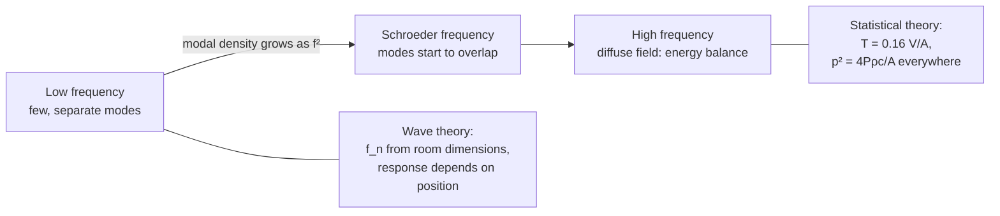
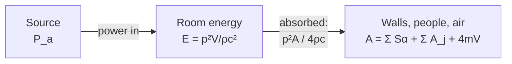
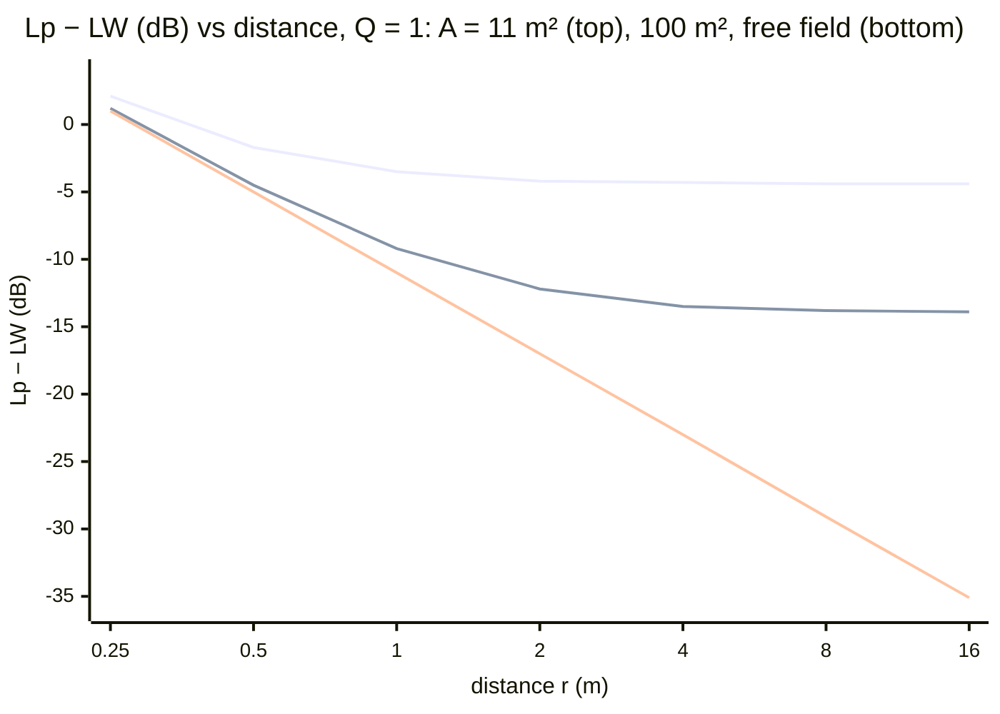

# Lecture 6 — Room Modes and the Diffuse Sound Field

> [!abstract] The idea
> At low frequencies a room is a 3-D organ pipe: a handful of standing waves (modes) at separate frequencies, and the response depends on where you stand. At high frequencies the modes are so dense that you can forget them and count energy instead: the power that goes in equals the power the walls absorb, and that single balance gives the reverberation time and the sound level in the room.

**Tuesday 6 October 2026 · Cheol-Ho Jeong.** Sources: [[34840_Room Acoustics.pdf|Lecture 6 slides (53 pages)]] · [[Fundamentals_of_acoustics_2022.pdf|course text ch. 3 (J. H. Rindel), pp. 81–101]]. Practice: [[Week 6 - Room Modes and the Diffuse Sound Field|fully worked Week 6 problems]]. Interactive version: [Sound Bench, Lecture 6](https://study.madsrudolph.dev/34840/#l6).

Slide numbers below are **PDF page numbers**; the numbers printed on the slides run 1–3 higher because some slides were hidden. Pressures are **RMS** throughout this lecture (the course text's convention for room acoustics), so $p^2$ is a mean-square pressure and there are no factors $\tfrac12$. Constants: $\rho=1.2\ \mathrm{kg/m^3}$, $c=343\ \mathrm{m/s}$ at 20 °C unless a problem says otherwise.

## 1. Free field vs room (slides 4–6)

In a free field the receiver gets one copy of the source signal: the spectrum keeps its shape and the impulse response is a single spike. In a room the receiver gets the direct sound plus a long tail of reflections. Two things change:
- **In frequency:** the spectrum picks up peaks at the room's natural frequencies (the **room modes**).
- **In time:** the sound does not stop when the source stops. It dies away gradually (**reverberation**).

Part 1 of the lecture (§2–§5 here) is the frequency picture; part 2 (§6–§11) is the time and energy picture. Room acoustics is often called a mix of art and science because the subjective side (what sounds good) matters as much as the physics.

## 2. One dimension first: two parallel walls (slides 8–12)

Start from the 1-D wave equation with $p\propto e^{j\omega t}$: $\left(\frac{d^2}{dx^2}+k^2\right)p=0$, solution $p=(A\cos kx+B\sin kx)e^{j\omega t}$.

**Rigid walls** at $x=0$ and $x=l$ mean the particle velocity is zero there. Since $u\propto\partial p/\partial x$, this forces $B=0$ and $\sin kl=0$:
$$kl=m\pi\quad\Rightarrow\quad \boxed{f_m=\frac{cm}{2l}},\qquad p=p_0\cos\!\left(\frac{m\pi x}{l}\right),\quad m=1,2,3,\ldots$$
So the wall spacing is a whole number of half-wavelengths, $l=m\lambda/2$. The pressure has its **maximum (antinode) at the rigid walls** and the velocity has its node there. Slide 12: $l=4$ m gives 43 Hz and 86 Hz ($c=344$).

The same idea covers a string (fixed ends: displacement node at the ends) and a wind instrument (slides 9–10). The slide 11 notation $\varphi$ is the velocity potential, $u=-\partial\varphi/\partial x$, $p=\rho\,\partial\varphi/\partial t$.

## 3. Modes of a rectangular room (slides 13–16; text §3.1.1)

Separate the 3-D wave equation $\nabla^2p+k^2p=0$ into $X(x)Y(y)Z(z)$. Each direction gives its own 1-D problem with rigid walls, so $k_x=\pi n_x/l_x$ etc., and $k^2=k_x^2+k_y^2+k_z^2$:
$$p=p_0\cos\!\left(\frac{\pi n_xx}{l_x}\right)\cos\!\left(\frac{\pi n_yy}{l_y}\right)\cos\!\left(\frac{\pi n_zz}{l_z}\right)$$
$$\boxed{f_{n_x,n_y,n_z}=\frac c2\sqrt{\left(\frac{n_x}{l_x}\right)^2+\left(\frac{n_y}{l_y}\right)^2+\left(\frac{n_z}{l_z}\right)^2}}$$
with $n_x,n_y,n_z=0,1,2,\ldots$ (not all zero). The indices count the **nodal planes** across each dimension.

| Type | Non-zero indices | Picture | Example |
|---|---|---|---|
| **Axial** (1-D) | one | Wave bouncing between one pair of walls | (1,0,0), (2,0,0) |
| **Tangential** (2-D) | two | Wave hitting two pairs of walls, parallel to the third | (1,1,0), (2,1,0) |
| **Oblique** (3-D) | three | Wave hitting all six walls | (1,1,1) |

Axial modes are the strongest (they lose energy at only two walls per round trip); oblique the weakest. Every mode has its maximum pressure in the **corners** (all cosines = ±1), so a corner is where you place a source to excite all modes and a microphone to hear all of them.

> [!example] Text Table 3.1.1 / slide 16: reading the room dimensions off the response
> The lowest peaks of the measured transfer function are at 25, 30 and 36 Hz, and they are axial modes (0,1,0), (1,0,0), (0,0,1). Invert $f_1=c/(2l)$: $l=343/(2\cdot25)=6.9$ m, $343/60=5.7$ m, $343/72=4.8$ m. The room is $5.7\times7.0\times4.8$ m (text values).

### 3.1 Questions from slide 19

1. **Microphone in the centre: which mode can you not hear, (1,0,0) or (2,0,0)?** (1,0,0). $\cos(\pi\cdot\tfrac12)=0$: every mode with an **odd** index has a nodal plane through the centre. Only modes with all indices even have a pressure maximum there (Problem 1.2).
2. **Where is $p=0$ for (2,0,0)?** On the planes $x=l_x/4$ and $x=3l_x/4$.
3. **Why are measured natural frequencies slightly lower than calculated?** The formula assumes perfectly rigid walls. Real walls give a little (they have finite, partly mass/compliance-like impedance and they absorb), which makes the room acoustically slightly larger and the resonances slightly lower; a lower air temperature than assumed also lowers $c$. *(The slide asks, but gives no answer; this is the standard explanation.)*

## 4. Transfer function and the home experiment (slides 16–17; text §3.1.2)

The transfer function from a source to a receiver fluctuates wildly at low frequency (slide 16, 20 → 80 Hz): each peak is a mode, and the levels between peaks are 20–30 dB lower. The slide 17 home experiment: sweep with a tone generator app on one phone and watch the spectrum on another (Spectroid). The peaks you find are the room modes of your own room.

**Design consequence (text §3.4.1):** avoid simple ratios between room dimensions. In a cube many modes coincide (**degenerate modes**, Problem 2), so the response has a few very strong peaks and big gaps in between. Small rooms for speech, music or measurements should have their modes below 100 Hz calculated before they are built.

## 5. How many modes? Mode count and modal density (slide 18; text §3.1.3)

**The geometric trick.** Plot every mode as a point $(n_xc/2l_x,\ n_yc/2l_y,\ n_zc/2l_z)$ in a 3-D "frequency space". The distance from the origin is the mode's frequency, so the modes below $f$ are the grid points inside an eighth of a sphere of radius $f$. Each point occupies a box of volume $c^3/(8V)$:
$$N_{\rm obl}\approx\frac{\pi f^3/6}{c^3/8V}=\frac{4\pi V}{3}\left(\frac fc\right)^3.$$
Adding the tangential (on the coordinate planes, counted as halves) and axial modes (on the axes, quarters):
$$\boxed{N(f)\approx\frac{4\pi V}{3}\left(\frac fc\right)^3+\frac{\pi S}{4}\left(\frac fc\right)^2+\frac{L}{8}\frac fc}$$
with $S=2(l_xl_y+l_xl_z+l_yl_z)$ the total surface area and $L=4(l_x+l_y+l_z)$ the total edge length. The **modal density** (modes per Hz) is the derivative:
$$\frac{dN}{df}=4\pi\frac{V}{c^3}f^2+\frac{\pi S}{2c^2}f+\frac L{8c}\;\approx\;\boxed{4\pi\frac{V}{c^3}f^2}\quad\text{(high }f\text{, any room shape)}.$$
Modes in a band: $N_{100\text{–}200}=N(200)-N(100)$ (slide 18).

> [!example] Check against the Problem 1 room (5 × 4 × 3 m, $c=343$)
> $V=60$, $S=94$, $L=48$. Below 80 Hz: $N=3.2+4.0+1.4=8.6$; actual count **8** ✔. Below 200 Hz: formula 78, actual 76. Between 100 and 200 Hz: 64 vs 63. The oblique term alone (3.2 below 80 Hz) is a poor estimate at low frequency; at 500 Hz it is already 82 % of the total.

The density grows as $f^2$: a few modes per 10 Hz at 100 Hz, hundreds per 10 Hz at a few kHz. This is what lets us switch to statistics.

### 5.1 Schroeder frequency and modal overlap (extension, not on the slides or in the text)

The learning objectives mention **modal overlap**. Each mode is a resonance with a half-power bandwidth set by the damping, $B=2.2/T$ (Hz). Modal overlap = (modes per Hz) × (bandwidth of each). When about three modes fall inside one bandwidth the individual peaks merge and the field becomes statistical. Setting $\frac{dN}{df}\cdot\frac{2.2}{T}=3$ with the oblique term gives the **Schroeder frequency**
$$f_S\approx2000\sqrt{\frac{T}{V}}\quad(T\text{ in s},\ V\text{ in m}^3).$$
Below $f_S$: think modes. Above: think diffuse field. Problem 3's room ($V=210$ m³, $T=3.1$ s) has $f_S\approx240$ Hz, so the 500 Hz octave band is safely diffuse. A 60 m³ living room with $T=0.5$ s has $f_S\approx180$ Hz.

## 6. The diffuse sound field (slides 21, 52; text §3.2.1–3.2.2)

**Definition (two conditions):**
1. The energy density (so $p^2$) is the **same everywhere**.
2. All directions of propagation are **equally probable**.

Neither the direct sound near the source nor the interference build-up near walls and corners is part of it. It is an idealisation that no real room achieves (slide 52: reverberation chambers are *reverberant*, not truly diffuse), but it is a very useful approximation. The text lists warning signs of a **non-diffuse** room: absorption concentrated on one surface (e.g. only the ceiling), no scattering objects, longest/shortest dimension above 3, volume above ~5000 m³.

**Mean-square pressure.** Plane waves of intensity $I_1$ per unit solid angle arrive from every direction and add incoherently:
$$p_{\rm diff}^2=\int_{4\pi}I_1\rho c\,d\psi=4\pi I_1\rho c.$$
**Power hitting a wall.** A wave from angle $\theta$ to the normal delivers $I_1\cos\theta$ per unit wall area (the $\cos\theta$ is the projected area). Integrate over the half sphere in front of the wall:
$$I_{\rm inc}=\int_{2\pi}I_1\cos\theta\,d\psi=\frac{p_{\rm diff}^2}{4\pi\rho c}\int_0^{2\pi}\!\!\int_0^{\pi/2}\cos\theta\sin\theta\,d\theta\,d\varphi=\boxed{\frac{p_{\rm diff}^2}{4\rho c}}$$
That is **four times less** than a plane wave of the same $p^2$ at normal incidence ($p^2/\rho c$): half of the waves travel away from the wall, and the rest arrive obliquely, on average with $\overline{\cos\theta}=\tfrac12$.

In energy-density form: $w=p^2/(\rho c^2)$ (potential + kinetic, equal on average), so
$$\boxed{I_{\rm inc}=\frac{wc}{4}}$$
which is the "$E\,c/4$" on slide 28.

## 7. Absorption: $\alpha$ and the equivalent absorption area (slides 28, 39; text §3.2.3)

The **absorption coefficient** $\alpha$ is the fraction of incident energy not reflected, $0\le\alpha\le1$. An open window has $\alpha=1$. The **equivalent absorption area** is the area of open window that absorbs the same:
$$\boxed{A=\sum_iS_i\alpha_i+\sum_jA_j+4mV=S\bar\alpha\ (+4mV)}\quad[\mathrm{m^2}]$$
- $S_i\alpha_i$: each surface; $\bar\alpha=A/S$ is the mean absorption coefficient.
- $A_j$: objects and people (slide 39 / text Table 3.4.2: a standing person in normal clothing is 0.59 m² at 500 Hz, about 1 m² at 1 kHz).
- $4mV$: air absorption (§9). Matters only at high frequency in big rooms.

The power absorbed by the room is $I_{\rm inc}A=p^2A/(4\rho c)$, or $cwA/4$.

Typical $\alpha$ (slide 39 / Table 3.4.1): bare concrete 0.01–0.04, glass 0.35 at 125 Hz falling to 0.04 (glass is a low-frequency panel absorber), carpet 0.03 rising to 0.35, a draped curtain with 100 mm air gap 0.10 → 0.70. Porous materials work at high frequency; panels at low frequency. Absorbers are next lecture.

## 8. Energy balance: build-up, steady state, decay (slides 22–24; text §3.2.4–3.2.5)

Total energy $E=wV=\dfrac{p^2}{\rho c^2}V$. Rate of change = power in − power absorbed:
$$\boxed{\frac{V}{\rho c^2}\frac{d(p^2)}{dt}=P_a-\frac{p^2A}{4\rho c}}$$

Three solutions, all with the same time constant $\tau=4V/(cA)$:

| Phase | Result |
|---|---|
| **Steady state** ($d/dt=0$) | $\boxed{p_s^2=\dfrac{4P_a\rho c}{A}}$ |
| **Build-up** (switch on at $t=0$) | $p^2(t)=p_s^2\left(1-e^{-cAt/4V}\right)$ |
| **Decay** (switch off at $t=0$) | $p^2(t)=p_s^2\,e^{-cAt/4V}$ |

On a dB scale the decay is a **straight line** (slide 23): that is why reverberation time is well defined. The build-up is fast at first: with $T=1$ s the level is 3 dB below steady state after 50 ms and within 0.3 dB after 0.2 s.

**Steady-state level in dB.** Take $10\log$ of $p_s^2=4P_a\rho c/A$ with $p_{\rm ref}=20\,\mu$Pa, $P_{\rm ref}=1$ pW, $A_0=1$ m²:
$$L_p=L_W+10\log\frac{4A_0}{A}+\underbrace{10\log\frac{\rho cP_{\rm ref}}{A_0p_{\rm ref}^2}}_{0.14\ \mathrm{dB}\,\approx\,0}\quad\Rightarrow\quad\boxed{L_p\approx L_W+10\log\frac{4}{A}}\ \ (A\text{ in m}^2)$$
More absorption, lower level: doubling $A$ takes 3 dB off the reverberant level.

## 9. Reverberation time: Sabine (slides 25–30; text §3.2.5)

**Definition:** $T$ (or $T_{60}$) is the time for the energy to fall to $10^{-6}$ of its starting value, a **60 dB** drop.

Set $e^{-cAT/4V}=10^{-6}$:
$$\boxed{T=\frac{24\ln10\cdot V}{cA}=\frac{55.3\,V}{cA}\approx0.16\,\frac VA}$$
The **decay rate** is $D=10\log_{10}e\cdot\frac{cA}{4V}=\frac{60}{T}$ dB/s. The constant $0.16=55.3/343$ only works with $V$ in m³ and $A$ in m².

**History (slide 27).** In 1895 the 27-year-old W. C. Sabine, with an organ pipe, a stopwatch and his ears, timed the decay to inaudibility (~60 dB) in rooms at Harvard and found $T\propto V/A$. The first quantitative link between reverberation and absorption.

**What sets $T$ (slide 26):** room volume (more volume, longer path between reflections, so fewer hits per second), the amount of absorption ("not always": only if the sound actually reaches it), and scattering ("not always": scattering makes absorption effective, §10.3).

> [!example] Slide 30 / text Fig. 3.4.3: $20\times10\times5$ m, ceiling $\alpha=0.8$, walls and floor $\alpha=0.1$
> $V=1000$ m³, $S=700$ m², $A=200(0.8)+500(0.1)=210$ m², $\bar\alpha=0.30$.
> Sabine: $T=55.3(1000)/(343\cdot210)=0.77\approx$ **0.8 s**. Eyring: $T=55.3(1000)/(343\cdot700\cdot0.357)=0.65\approx$ **0.6 s**. See §10.3 for why the measured value would be much longer than both.

## 10. Eyring, mean free path and non-diffuse rooms (slides 31–34; text §3.3.1, §3.4.4)

### 10.1 The ray picture
Follow one ray. Each reflection multiplies its energy by $(1-\bar\alpha)$, so after $n$ reflections $E_n=E_0(1-\bar\alpha)^n=E_0e^{n\ln(1-\bar\alpha)}$. The average distance between reflections is the **mean free path**
$$\boxed{l_m=\frac{4V}{S}}\ \text{(3-D)},\qquad l_m=\frac{\pi S_x}{U}\ \text{(2-D)},\qquad l_m=l\ \text{(1-D, two parallel walls)}.$$
In time $t$ the ray makes $n=ct/l_m$ reflections, so $E(t)=E_0e^{(c/l_m)\ln(1-\bar\alpha)t}$. Setting this to $10^{-6}E_0$:
$$\boxed{T=\frac{13.8\,l_m}{-c\ln(1-\bar\alpha)}}\qquad\text{(general formula)}$$

### 10.2 Eyring vs Sabine
With $l_m=4V/S$:
$$T_{\rm Eyring}=\frac{55.3\,V}{-cS\ln(1-\bar\alpha)}\approx\frac{0.16\,V}{-S\ln(1-\bar\alpha)},\qquad T_{\rm Sabine}=\frac{0.16\,V}{S\bar\alpha}.$$
Since $-\ln(1-\bar\alpha)=\bar\alpha+\bar\alpha^2/2+\ldots$, the two agree when $\bar\alpha<0.3$ and Eyring is always the shorter.

| | Sabine | Eyring |
|---|---|---|
| Based on | Diffuse-field energy balance | Ray reflections |
| Good for | $\bar\alpha<0.3$; recommended for normal rooms with mixed absorption | High absorption, $\bar\alpha>0.3$ |
| Anechoic limit $\bar\alpha=1$ | $T=0.16V/S\neq0$: **wrong** | $T=0$: correct |

### 10.3 When the room is not diffuse (text §3.4.4)
The room in §9 has all its absorption on the ceiling. Sound travelling horizontally between the hard walls almost never meets it. Using the general formula along each direction (with $T\approx0.04\,l_m/\bar\alpha$):

| Direction | $l_m$ (m) | $\bar\alpha$ | $T$ (s) |
|---|---|---|---|
| 3-D, Sabine | 5.7 | 0.30 | 0.8 |
| 3-D, Eyring | 5.7 | 0.30 | 0.6 |
| 2-D, horizontal | 10.5 | 0.10 | 4.2 |
| 1-D, length | 20 | 0.10 | 8.0 |
| 1-D, width | 10 | 0.10 | 4.0 |
| 1-D, height | 5 | 0.45 | 0.4 |

The measured decay is a mix of these: bent, and much longer than either formula. Adding scattering objects (furniture, machines, diffusers) redirects sound towards the absorbing ceiling and pulls $T$ back towards Sabine. "The absorption becomes more efficient when scattering elements are introduced." (For the 1-D case the correct average is $(1-\bar\alpha)=(1-\alpha_1)(1-\alpha_2)$, not the arithmetic mean.)

## 11. Air absorption (slides 37–38; text §3.3.2)

A wave loses energy as $e^{-mct}$ along its path, with the attenuation factor $m$ (m⁻¹) depending on frequency and humidity. Including it:
$$T_{\rm Sabine}\approx\frac{0.16\,V}{S\bar\alpha+4mV},\qquad T_{\rm Eyring}\approx\frac{0.16\,V}{4mV-S\ln(1-\bar\alpha)}.$$

| RH (%) at 20 °C | 1 kHz | 2 kHz | 4 kHz | 8 kHz |
|---|---|---|---|---|
| 40 | 0.0011 | 0.0026 | 0.0072 | 0.0237 |
| 50 | 0.0010 | 0.0024 | 0.0061 | 0.0192 |
| 60 | 0.0009 | 0.0023 | 0.0056 | 0.0162 |
| 80 | 0.0008 | 0.0020 | 0.0051 | 0.0133 |

**Humid air absorbs less than dry air** (above ~20 % RH). The $4mV$ term grows with volume, so it matters in concert halls at 2 kHz and above, and is why big halls are unavoidably less reverberant at high frequency. Example: a 20 000 m³ hall at 4 kHz, 50 % RH: $4mV=4(0.0061)(20\,000)=488$ m² of extra absorption.

## 12. Measuring $T$ (slides 40–42; text §3.4.6)

| Method | How | Pros/cons |
|---|---|---|
| **Interrupted noise** | Loudspeaker plays noise, switch off, record the decay | Needs loudspeaker, amplifier, generator; repeat and average because noise is random |
| **Impulse** | Balloon, pistol, hand clap; record the response | No source equipment; poor repeatability |

The decay is filtered in octave or third-octave bands. The dynamic range is seldom more than ~50 dB, so the 60 dB is extrapolated from a straight-line fit:

| Parameter | Fit range | Formula |
|---|---|---|
| $T_{60}$ | −5 to −65 dB | $t_{-65}-t_{-5}$ |
| $T_{30}$ | −5 to −35 dB | $2(t_{-35}-t_{-5})$ |
| $T_{20}$ | −5 to −25 dB | $3(t_{-25}-t_{-5})$ |
| EDT (early decay time) | 0 to −10 dB | $6(t_{-10}-t_0)$ |

The first 5 dB are skipped because the direct sound makes the start steeper. If the decay is a perfect straight line, EDT = T. **EDT matters most subjectively** (the ear judges reverberance from the early decay), e.g. in coupled rooms such as a theatre with a reverberant stage house, where the decay is bent. At low frequency in small rooms only two or three modes may lie in the band, and their beating makes the decay irregular.

## 13. Design targets (slides 35–36, 43–46; text §3.4.5)

| Use of room | Optimum $T$ (500–1000 Hz), s |
|---|---|
| Cinema | 0.4–1.0 |
| Rock concert | 0.8–1.1 |
| Lecture | 0.8–1.2 |
| Theatre | 1.0–1.2 |
| Opera | 1.3–1.7 |
| Symphony concert | 1.5–2.2 |
| Choir concert | 1.7–2.5 |
| Organ music | 2.0–3.0 |

- Classrooms: 0.6–0.9 s, flat from 100 to 4000 Hz (text).
- Optimum $T$ grows with volume (slide 43; the red arrow marks the lecture room "Aud22", about 0.8 s).
- For music, up to 50 % longer $T$ at 125 Hz is fine (slide 44); for speech keep it flat.
- Slide 46 volume per seat: 3–5 m³ for theatre/speech, 8–12 m³ for symphonic music, 10–14 m³ for choir/organ. Too much volume per seat gives too long a $T$ (the audience is most of the absorption).
- Examples (slide 35): listening room 0.5 s, auditorium 1.1 s, concert hall 2.5 s, church 8 s.

## 14. Steady-state level: direct + reverberant (slides 47–51; text §3.2.6)

Near the source the **direct** sound dominates and falls 6 dB per doubling of distance; far away the **reverberant** field is constant. Add them as energies:
$$p_{\rm dir}^2=\frac{QP_a\rho c}{4\pi r^2},\qquad p_{\rm rev}^2=\frac{4P_a\rho c}{A}(1-\bar\alpha)$$
$$\boxed{L_p=L_W+10\log\left(\frac{Q}{4\pi r^2}+\frac{4(1-\bar\alpha)}{A}\right)}\qquad(Q=1\text{ for an omnidirectional source})$$
The $(1-\bar\alpha)$ removes the direct sound's first hit on a wall from the reverberant energy, so the direct sound is not counted twice. In a reverberant room ($\bar\alpha<0.1$) it is ≈1 and the slides often drop it (slide 48/50).

> [!tip] Room constant (the name used in most textbooks)
> $R=\dfrac{A}{1-\bar\alpha}=\dfrac{S\bar\alpha}{1-\bar\alpha}$ turns the bracket into $\dfrac{Q}{4\pi r^2}+\dfrac4R$. The text's Fig. 3.2.4 uses exactly $A/(1-\alpha_m)$ as the curve parameter. *(The symbol $R$ is not on the slides.)*

**Reverberation (critical) distance** (slide 51): where direct = reverberant. With $Q=1$ and $(1-\bar\alpha)\approx1$:
$$\boxed{r_{\rm rev}=\sqrt{\frac{A}{16\pi}}\approx0.14\sqrt A}\qquad\Big(\text{with directivity: }r_{\rm rev}\sqrt Q\Big)$$
It depends only on the absorption. Closer than $r_{\rm rev}$: direct field. Farther: reverberant field, where $L_p\approx L_W+10\log(4/A)$. In Problem 3 ($A\approx11$ m²) $r_{\rm rev}=0.47$ m: practically the whole room is reverberant. A trumpet ($Q\gg1$) extends its direct field far beyond $r_{\rm rev}$ on axis.

**Real rooms (slide 47, text):** in large, fairly absorbing rooms ($\bar\alpha>0.2$, e.g. factory halls) the level keeps falling with distance instead of levelling off; the diffuse model fails there. The slope in dB per doubling of distance is then a better descriptor than $T$.

### 14.1 Sound power in a reverberation room (text eq. 3.2.14–15)
Turn the steady state around: measure $\overline{L_p}$ and $T$ in a reverberation room and get the power without an anechoic room:
$$P_a=\frac{p_s^2}{4\rho c}\cdot\frac{55.3V}{cT}\quad\Rightarrow\quad L_W=\overline{L_p}+10\log\frac{V}{1\,\mathrm{m^3}}-10\log\frac{T}{1\,\mathrm s}-14\ \mathrm{dB}.$$
(Problem 3 runs this formula forwards.)

## 15. Image sources, reflection density and echoes (text §3.3.3–3.3.4)

A reflection from a large flat wall looks like it comes from an **image source** behind the wall (same as Lecture 5's rigid wall). In a rectangular room the images form an infinite grid of image rooms. The reflections arriving within time $t$ come from images inside a sphere of radius $ct$:
$$N(t)=\frac{4\pi(ct)^3}{3V},\qquad\frac{dN}{dt}=4\pi\frac{c^3}{V}t^2.$$
Compare with the modal density $dN/df=4\pi Vf^2/c^3$: reflections get dense as $t^2$ in time, just as modes get dense as $f^2$ in frequency. This is why late reverberation sounds smooth.

**Echo:** a single reflection heard separately from the direct sound, if it arrives more than about **50 ms** late (17 m extra path). The "echo ellipse" around source and receiver marks the surfaces that are safe. Flutter echo (listed on slide 2) is a repeated echo between two parallel hard walls. Concave ceilings focus sound (bad); plane reflectors spread it evenly. Lateral (side-wall) reflections are important for concert halls; ceiling reflections for speech.

## 16. Traps and pitfalls

- **RMS vs peak.** Room-acoustic formulas ($p^2=4P\rho c/A$, $I_{\rm inc}=p^2/4\rho c$) use **RMS** $p$. Lecture 5's monopole formulas used peak amplitudes with a $\tfrac12$.
- **$c/4$, not $c$.** Diffuse incidence delivers $p^2/(4\rho c)$ per m², a quarter of the normal-incidence plane-wave value. Slide 28 writes the power on the whole surface ($cES/4$) and calls it $I_{\rm inc}$; it is a power (W), not an intensity.
- **$0.16=55.3/c$ needs SI units.** With $c=344$ it is 0.161; do not mix it with a different $c$ in the same calculation.
- **Odd index ⇒ node in the centre.** Only all-even modes are heard in the middle of the room. All modes are maximal in the corners.
- **Degenerate ≠ just "same frequency by accident".** In a cube, permutations of $(n_x,n_y,n_z)$ always coincide. (1,1,1) is *not* degenerate: it has no distinct permutation.
- **Band edges:** a third-octave band at $f_c$ runs from $f_c/2^{1/6}$ to $f_c\cdot2^{1/6}$ (Lecture 3). Use the exact edges, not ±10 %.
- **Sabine at high absorption overestimates $T$** and gives a non-zero $T$ for an anechoic room. Use Eyring for $\bar\alpha>0.3$.
- **A non-diffuse room can be far more reverberant than Sabine says** (absorption on one surface only). Scattering helps.
- **Time-averaged level (Leq) of an intermittent source:** average $p^2$ over time, not dB. On for 1/3 of the time ⇒ −4.8 dB (Problem 3).
- **Uncorrelated sources add as $p^2$** (Lecture 3), including in a reverberant room.
- The reverberant level does **not** depend on distance; the direct level does. Halving $A$ raises the reverberant level by 3 dB and doubles $T$.

## 17. Quick self-check

1. Lowest axial mode of a 6 m long room? (28.6 Hz)
2. In a 5 × 4 × 3 m room, which mode below 80 Hz has a pressure maximum at the centre? Why? (Only (2,0,0): odd indices put a node in the centre.)
3. How does the modal density scale with frequency and volume? ($\propto Vf^2$)
4. Show that the diffuse-field incident intensity is $p^2/(4\rho c)$. Where does each factor 2 come from?
5. A room has $V=200$ m³, $T=1$ s. Find $A$ and the reverberant $L_p$ for $L_W=90$ dB. ($A=32$ m², $L_p=90+10\log(4/32)=81$ dB)
6. When must you use Eyring instead of Sabine? (Mean absorption above ~0.3.)
7. What is the reverberation distance in a room with $A=50$ m²? (1.0 m)
8. Why is $T_{20}$ multiplied by 3?
9. Why can a room with a highly absorbing ceiling and hard walls have a much longer $T$ than Sabine predicts?
