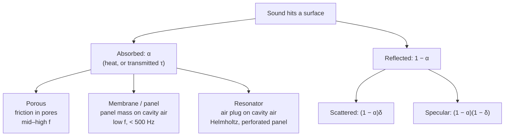
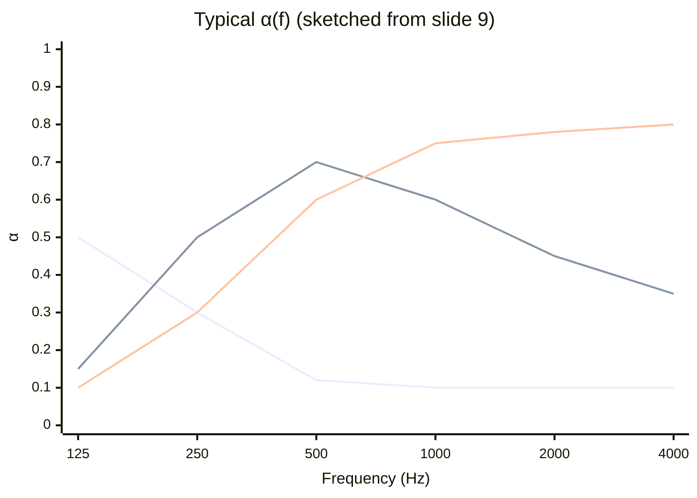
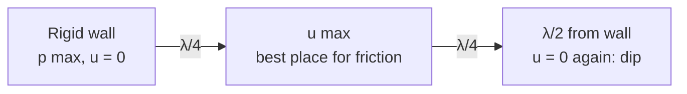
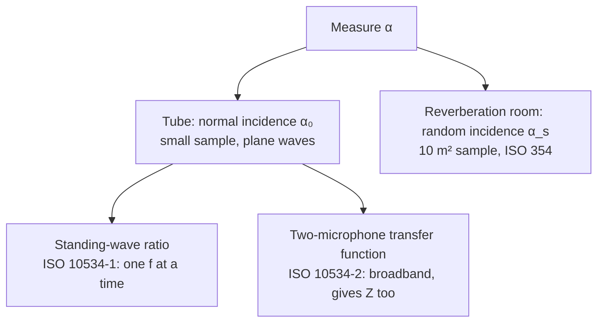

# Lecture 7 — Sound Absorption and Room Acoustic Design

> [!abstract] The idea
> An absorber turns sound energy into heat. It does so by putting friction where the air is moving fastest. A porous layer does this directly, and has to sit a quarter wavelength out from the wall to reach the velocity maximum. At low frequencies that is too far, so you build a mass–spring resonator instead: a panel or an air plug in a neck bouncing on the air in a cavity. Which one you pick, and where you put it, decides the reverberation time a room ends up with.

> [!warning] Written from the slides on lecture day
> This note was written from the slide deck and the course text on Tuesday 20 October 2026, before or during the lecture. Check it against what Cheol-Ho actually said in class, especially the in-class questions (slides 5 and 28) and the hidden answer on slide 25.

**Tuesday 20 October 2026 · Cheol-Ho Jeong.** Sources: [[34840-Sound Absorber 2026.pdf|Lecture 7 slides (49 pages, numbered 1–53; 16–18 are one picture page)]] · [[Fundamentals_of_acoustics_2022.pdf|course text ch. 4, pp. 103–112]] (plus §3.4.3–3.4.5, pp. 97–100, for the reverberation-time tables). Previous lecture: [[Lecture 6 - Room Modes and the Diffuse Sound Field]]. Practice: [[Week 7 - Sound Absorbers|fully worked Week 7 problems]]. Interactive version: [Sound Bench, Lecture 7](https://study.madsrudolph.dev/34840/#l7).

Constants as in the earlier weeks: $\rho=1.2\ \mathrm{kg/m^3}$, $c=344\ \mathrm{m/s}$, $\rho c\approx413\ \mathrm{Pa\,s/m}$ (the slides use 414), $\rho c^2\approx1.4\times10^5$ Pa.

## 1. Recap from Lecture 6 (slide 2)

- Room modes depend on the room's geometry and dimensions.
- Reverberation time from **Sabine** or **Eyring**: they differ in their assumptions, and air absorption matters at high frequency. Both need the total (equivalent) absorption area $A=S\bar\alpha$. Whether they are accurate depends on the sound field being diffuse (§9.3).
- The SPL in a room is a direct part plus a reverberant part:
$$L_p=L_W+10\log_{10}\left(\frac{Q}{4\pi r^2}+\frac4R\right),\qquad R=\frac{S\bar\alpha}{1-\bar\alpha}.$$
Here $Q$ is the directivity factor and $R$ the room constant. Absorption raises $R$, which lowers the reverberant level. That is the noise-control reason for absorbers; reverberation control is the other one.

## 2. What happens at a surface (slides 4–7)

The incident energy splits three ways:

| Part | Fraction of incident energy | Described by |
|---|---|---|
| Absorbed (incl. transmitted) | $\alpha$ (or $\alpha+\tau$ if you separate transmission) | Absorption coefficient |
| Reflected and scattered | $(1-\alpha)\,\delta$ | Scattering coefficient $\delta$ |
| Reflected specularly | $(1-\alpha)(1-\delta)$ | "Mirror" reflection |

> [!example] Slide 5: the reflected SPL
> Incident 70 dB on three surfaces with $\alpha=0.50,\ 0.90,\ 0.99$, assuming $\alpha$ is the same at every angle. The reflected energy is $(1-\alpha)$ of the incident, so
> $$L_{\rm refl}=70+10\log_{10}(1-\alpha)=\mathbf{67.0},\ \mathbf{60.0},\ \mathbf{50.0}\ \text{dB}.$$
> Taking $\alpha$ from 0.5 to 0.9 buys 7 dB; going on to 0.99 buys another 10 dB. Near $\alpha=1$ each extra "9" is worth 10 dB.

**Three basic treatments (slides 6–7):** absorption (attenuated reflection), reflection (one strong specular spike) and diffusion (many small reflections spread out in time and angle). Rooms sit somewhere in that triangle:

| Mostly … | Room types (slide 7) |
|---|---|
| Reflection + diffusion | Concert halls, recital halls, auditoria, theatres, worship spaces |
| Absorption + diffusion | Recording and broadcasting studios, conference rooms, home theatres |
| Absorption (noise control) | Factories, gymnasiums, swimming pools, libraries |

## 3. The three absorber types at a glance (slide 9, course text Fig. 4.3.1)

Lines from top-left: **membrane (M)** peaks at the lowest frequency, **resonator (R)** peaks in the middle, **porous (P)** rises and stays high. The summary slide puts it as "porous for high frequencies, membrane for low frequencies, resonators for troublesome narrow frequencies".

| Type | Mechanism | Where it works | Key formula |
|---|---|---|---|
| Porous | Viscous and thermal losses in the pores | Mid–high $f$; low limit set by thickness/air gap | Thickness or gap $\approx\lambda/4$ |
| Membrane | Panel mass on the cavity air spring | Low, narrow band, below 500 Hz | $f_r=\dfrac1{2\pi}\sqrt{\dfrac{\rho c^2}{mL}}\approx\dfrac{60}{\sqrt{mL}}$ |
| Helmholtz resonator | Air plug in a neck on the cavity spring | Very narrow band | $f_0=\dfrac c{2\pi}\sqrt{\dfrac{s}{V(l+\delta)}}$ |
| Perforated panel | Many Helmholtz resonators sharing one cavity | Wider band than a single resonator | $f_0=\dfrac c{2\pi}\sqrt{\dfrac{P}{L(l+\delta)}}$ |

## 4. Porous absorbers (slides 10–18, course text §4.3.1)

**What they are:** carpets, curtains, aerated plasters, unpainted brick mortar, fibrous materials (glass wool, stone wool), open-cell foams. A closed-cell foam is a poor absorber because the air cannot get into it.

**How they work:** the air in the sound wave is forced to move in and out of the pores. Its kinetic energy goes to heat through viscous friction against the huge internal surface (the grey "lossy boundary layer" in slide 10's sketch), plus thermal exchange with the fibres.

**What sets the absorption (slide 11):** frequency, thickness, composition, surface finish and mounting (rigid backing or an air gap). Acoustically a porous layer is described by its characteristic impedance $Z_c$ and complex wavenumber $k_t$. Physically it is described by its thickness, density, **flow resistivity** $\sigma$ (how hard it is to blow air through it, Pa·s/m²) and porosity.

> [!note] Flow resistivity has an optimum
> Too low and the air passes through with hardly any friction. Too high and the surface reflects most of the wave before it gets in. Slide 13 shows this: the 40 kg/m³ glass wool beats the 12 kg/m³ one, but even denser is not automatically better. The course text's tip: blow through a curtain to feel it.

### 4.1 The λ/4 rule (slide 15, course text Fig. 4.3.2)

In front of a rigid wall the incident and reflected waves form a standing wave. At the wall the **pressure** is maximum and the **particle velocity** is zero; a quarter wavelength out the velocity has its first maximum. A porous material only absorbs where the air moves, so

$$\boxed{d\approx\frac\lambda4\ \Rightarrow\ f_{\rm min}\approx\frac{c}{4d}}$$

is the frequency above which a layer of thickness (or distance from the wall) $d$ works well.

**Slide 15, cotton cloth 7 cm from the wall, normal incidence:**

| Distance = | Frequency | $\alpha_0$ |
|---|---|---|
| $\lambda/4$ | $344/(4\cdot0.07)=1.23$ kHz | Peak (~0.8) |
| $\lambda/2$ | 2.46 kHz | Dip (~0.2): the cloth sits at a velocity node |
| $3\lambda/4$ | 3.69 kHz | Peak again (~0.95) |

In a diffuse field the dip at $\lambda/2$ is much shallower, because the wave arrives at all angles and the node position smears out. The course text adds that with diffuse incidence the absorber is already good ($\alpha>0.8$) when the thickness or distance exceeds about $\lambda/8$.

### 4.2 What the measured curves show

| Slide | Parameter varied | Effect |
|---|---|---|
| 12 | Thickness (glass wool, 10–100 mm) | Thicker → absorption extends to lower frequencies |
| 13 | Density (glass wool 50 mm, 12–40 kg/m³; rock wool 40 vs 100 kg/m³) | Denser (higher $\sigma$) → somewhat more absorption, up to a point |
| 14 | Air gap behind the material (0, 5, 10, 20 cm) | Larger gap → more low-frequency absorption for the same material |

**Why the air gap is cheap absorption:** a porous layer does nothing useful in the high-pressure, zero-velocity zone right at the wall. Leaving air there instead of material costs nothing in absorption. That is why a curtain hung in front of a window works, and why suspended mineral wool ceilings 20 cm–1 m below the concrete deck absorb over a wide band (course text p. 106; slides 16–18, Ecophon/Rockfon products).

> [!warning] Don't paint it
> Mineral-wool ceiling tiles get a carefully controlled paint layer at the factory. Repainting them closes the pores and the absorption disappears (course text p. 106).

## 5. Membrane (panel) absorbers (slides 19–21, course text §4.3.2)

A non-porous panel (plywood, gypsum board, glass) at distance $L$ from a hard wall, with the cavity closed at the sides. The panel's mass per unit area $m$ (kg/m²) bounces on the air in the cavity, which acts as a spring. Absorption peaks at the **mass–spring resonance**:

$$\boxed{f_r=\frac1{2\pi}\sqrt{\frac{\rho c^2}{mL}}=\frac1{2\pi}\sqrt{\frac{1.4\times10^5}{mL}}\approx\frac{60}{\sqrt{mL}}\ \mathrm{Hz}}$$

**Where it comes from (Lecture 4):** a cavity of depth $L$ per unit area has stiffness $\rho c^2/L$ (the air spring $K_a=\rho c^2/V$ multiplied by $S^2$, divided by $S$). The panel mass per unit area is $m$. So $\omega_0^2=(\rho c^2/L)/m$.

**Example, Week 7 Problem 2.1:** 20 mm plywood at 600 kg/m³ gives $m=12$ kg/m²; with $L=50$ mm, $f_r=77$ Hz.

**Properties:**
- Works at low frequencies and in a narrow band, typically below 500 Hz.
- Heavier panel or deeper cavity → lower $f_r$.
- **Porous material in the cavity (slide 21):** (1) the maximum absorption $\alpha_{\max}$ goes up, because the damping increases; (2) the peak frequency shifts, downwards in the course text's Fig. 4.3.5. Slide 21's 2 mm and 12 mm plywood at 45 mm depth with and without glass wool show both effects.
- Slide 20's graph: $L$ = 9, 50 and 80 mm. The deeper the cavity, the lower the peak.

**Panel stiffness (course text eq. 4.5):** equation 4.4 assumes a limp panel. A stiff panel of dimensions $a\times b$ adds a bending term:
$$f_r=\frac1{2\pi}\sqrt{\frac{\rho c^2}{mL}+\frac{\pi^4}{m}\left[\left(\frac pa\right)^2+\left(\frac qb\right)^2\right]^2\frac{Eh^3}{12(1-\nu^2)}}$$
With an infinitely deep cavity only the stiffness term is left: that is a single-pane window.

**Where you find them:** wooden floors on joists, gypsum or wood panel walls, windows. They are what keeps a concrete-and-masonry room from sounding "dark and blurred" at low frequencies (course text p. 107, Kolding Teater panels).

## 6. Resonator absorbers (slides 22–29, course text §4.3.3)

### 6.1 The single Helmholtz resonator (slides 22–23)

Same physics as Lecture 4 §4: the air plug in the neck is the mass, the enclosed air is the spring.
$$\boxed{f_0=\frac c{2\pi}\sqrt{\frac{s}{V(l+\delta)}}},\qquad s=\frac{\pi d^2}{4},\quad \delta\approx0.8\,d.$$
- $s$ is the neck area, $V$ the cavity volume, $l$ the physical neck length, $\delta$ the **end correction**: the air just outside both ends of the neck moves too, so the effective length is longer than the physical one.
- Slide 23 writes the mechanical stiffness $k=\rho c^2s^2/V$ and the mass $m=\rho s l'$ with $l'=l+\delta$; $\omega_0^2=k/m$ gives the same formula.
- It absorbs only in a **very narrow band**, and its absorption curve is hard to predict, so in practice you only predict $f_0$. (Wine glass, beer bottle, "singing" glass on slide 22.)

> [!example] Slide 25: resonators in the ceiling of DR Studio 1 (answer box hidden on the slide)
> Neck Ø65 mm, 100 mm long; boxes 150×150×300 mm and 200×200×400 mm. With $s=3.32\times10^{-3}$ m², $l+\delta=0.100+0.8\cdot0.065=0.152$ m:
> - $V=6.75$ L → $f_0\approx\mathbf{98\ Hz}$
> - $V=16.0$ L → $f_0\approx\mathbf{64\ Hz}$
>
> My own calculation: the slide hides the answer. Whether the 100 mm is the neck length (it is drawn as the ceiling-slab thickness) and whether Cheol-Ho used $\delta=0.8d$ should be checked against the lecture. Either way the point is low-frequency bass control in a concert hall.

### 6.2 Perforated panel absorbers (slides 26–28)

A panel full of holes or slits in front of a common cavity. Each hole plus "its share" of the cavity is one Helmholtz resonator, so put $s/V=P/L$ into the Helmholtz formula:
$$\boxed{f_0=\frac c{2\pi}\sqrt{\frac{P}{L(l+\delta)}}},\qquad P=\frac{\text{open area}}{\text{total area}}.$$
For circular holes of diameter $d$ on a square grid with spacing $a$: $P=\pi d^2/(4a^2)$. Here $l$ is the panel thickness (the neck) and $L$ the cavity depth.

**Why $s/V=P/L$:** one hole serves a panel area $a^2$, so its cavity volume is $a^2L$, and $s/(a^2L)=P/L$.

**Slide 28 (= Week 7 Problem 2.2):** drill 10 mm holes on a 30 mm grid in the 20 mm plywood panel of Problem 2.1: $P=\pi\cdot5^2/30^2=8.7\%$, $\delta=8$ mm, $f_0=432$ Hz. The membrane at 77 Hz became a resonator at 432 Hz: the air plugs in the holes are much "lighter" per open area than the whole panel.

**Properties:**
- Wider bandwidth than single Helmholtz resonators; very widely used (perforated gypsum, steel ceiling tiles, slatted wooden panels).
- The damping should be tuned: small holes give viscous damping by themselves; usually a thin layer of mineral wool or glass "vlies" is placed in the cavity.
- **Course text footnote 2:** many perforated ceiling tiles with high $P$ and a deep cavity act more like a porous absorber whose high-frequency performance is reduced by the panel shielding it.

**Perforated bricks with mineral wool (slide 29):** a resonance peak $\alpha\approx1.1$ at about 315 Hz plus peaks at about 2.5 kHz and 5 kHz. $\alpha>1$ in a reverberation room is an edge-diffraction effect (§8.2). Used on the rear wall of Frihedshallen, Sønderborg, to stop echoes back to a stage 50 m away (course text Fig. 4.3.8).

### 6.3 Micro-perforated panels (slide 34)

Holes so small (sub-millimetre) that the viscous losses in the holes give all the damping needed, with no porous material at all. They can be transparent (glass, foil) and washable. Slide 34 shows a double/single foil system with $\alpha\approx0.8$–0.9 above 400 Hz. No formulas on the slides.

### 6.4 Case: Hall of the Council of Ministers, Christiansborg (slides 30–32)

A heavily decorated, hard room with no absorbers: long reverberation time and high noise level. Moveable absorbing screens were tried; the suggested fix was a **resonance absorber mounted under the tables** (slide 32 drawing: 50 mm rock wool, a perforated plate). The lesson: when the walls and ceiling are protected, look for surfaces nobody looks at.

### 6.5 Variable absorbers (slide 33)

Hinged panels that turn a reflective side or an absorptive side to the room (Dronningesalen, the Black Diamond, Copenhagen). One room, several reverberation times, for speech and for music.

## 7. Calculating α from the surface impedance (slides 35–36)

If you know the **surface impedance** $Z_n=p/v_n$ at the wall surface (N·s/m³, complex), normalise it by $\rho c$:
$$\zeta=\frac{Z_n}{\rho c}=r+jx\qquad(\text{dimensionless}).$$

| Incidence | Reflection factor | Absorption coefficient |
|---|---|---|
| (a) Normal | $R(0)=\dfrac{Z_n-\rho c}{Z_n+\rho c}$ | $\alpha_n=1-\lvert R(0)\rvert^2$ |
| (b) Oblique, angle $\theta$ | $R(\theta)=\dfrac{Z_n\cos\theta-\rho c}{Z_n\cos\theta+\rho c}$ | $\alpha(\theta)=1-\lvert R(\theta)\rvert^2$ |
| (c) Random (diffuse) | — | $\alpha_r=\dfrac{8r}{r^2+x^2}\left[1-\dfrac{r}{r^2+x^2}\ln\big((r+1)^2+x^2\big)+\dfrac{r^2-x^2}{x(r^2+x^2)}\tan^{-1}\dfrac{x}{r+1}\right]$ |

(b) assumes a **locally reacting** surface: $Z_n$ does not depend on the angle.

**Where (c) comes from** (not written on the slides, but it is the standard Paris formula): in a diffuse field the energy arriving at angle $\theta$ is weighted by $\cos\theta$ (projected area) and $\sin\theta$ (solid angle), so
$$\alpha_r=\int_0^{\pi/2}\alpha(\theta)\sin2\theta\,d\theta.$$
I integrated (b) numerically for the slide 36 example and got the closed form (c) to 9 digits. Formula (c) is that integral done analytically.

> [!example] Slide 36: $Z_n=500+j1000$ N·s/m³
> - $R=(Z-414)/(Z+414)=0.5877+0.4511j$, $\alpha_n=1-|R|^2=\mathbf{0.451}$.
> - $\zeta=1.208+2.415j$, $\alpha_r=\mathbf{0.53}$ (0.531).
> - Forget to divide by $\rho c$ (put $r=500$, $x=1000$ straight into (c)) and you get **0.0032**. Nonsense, and the slide shows it on purpose.
>
> Coincidence trap: here $\alpha_n$ equals $\Im R$ exactly. That only happens because $x=2r$; in general $\alpha_n=4r/[(r+1)^2+x^2]$.

**Useful special cases:**
- $Z_n=\rho c$ ($\zeta=1$): $R=0$, $\alpha_n=1$. A perfect match.
- $|Z_n|\to\infty$: rigid wall, $\alpha=0$.
- At grazing incidence ($\theta\to90°$) $R\to-1$ for any finite $Z_n$, so $\alpha\to0$.
- $\alpha_r$ never reaches 1 for a locally reacting surface; its maximum is about 0.95 (at $\zeta\approx1.6$, real). (Known result, not on the slides.)

## 8. Measuring absorption (slides 37–40, course text §4.2)

### 8.1 Standing-wave tube (slide 38, ISO 10534-1, ASTM C384)

A loudspeaker at one end, the sample at the other, a probe microphone moved along the tube. Incident amplitude $A$, reflected $B$. The pressure envelope swings between $|A|+|B|$ and $|A|-|B|$:

$$n=\frac{P_{\max}}{P_{\min}}=\frac{|A|+|B|}{|A|-|B|},\qquad |R_p|=\frac{|B|}{|A|}=\frac{n-1}{n+1},$$
$$\boxed{\alpha_0=1-|R_p|^2=1-\left(\frac{n-1}{n+1}\right)^2=\frac{4}{n+1/n+2}}$$

| $n$ (SWR) | $\alpha_0$ |
|---|---|
| 1 (no standing wave, $B=0$) | 1 (total absorption) |
| 2 | 0.89 |
| 3 | 0.75 |
| 10 | 0.33 |
| ∞ (rigid, $A=B$, $P_{\min}=0$) | 0 (total reflection) |

Only $|R|$ comes from $n$. The phase of $R$, and so $Z$, needs the position of the first minimum as well. One frequency per measurement, and only plane waves, so the tube diameter must be below about $0.58\lambda$ (above that, cross modes appear).

### 8.2 Two-microphone impedance tube (slide 39, ISO 10534-2)

Two fixed microphones, spacing $s$, the nearer one a distance $l$ from the sample. Broadband noise; measure the transfer function $H_{12}=p_2/p_1$. For pure incident and pure reflected waves the transfer functions are $H_{\rm inc}=e^{-jks}$ and $H_{\rm refl}=e^{jks}$, so
$$R_0=\frac{H_{12}-H_{\rm inc}}{H_{\rm refl}-H_{12}}\,e^{j2kl},\qquad \frac{Z}{\rho c}=\frac{1+R_0}{1-R_0},\qquad \alpha=1-|R_0|^2.$$
All frequencies at once, and you get the complex impedance, which is what §7 needs. (The slide writes $e^{\pm s(jk_a)}$ for the transfer functions, so the spacing is $s$ and $k_a$ is the air wavenumber; I have written them with the sign convention used in ISO 10534-2.)

### 8.3 Reverberation room method (slide 40, ISO 354, course text eqs. 4.1–4.3)

Measure $T_1$ in the empty reverberation room (volume $V$), then $T_2$ with a sample of area $S$ (normally 10 m²) on the floor. With Sabine:
$$T_1=\frac{0.16V}{S_{\rm room}\alpha_{\rm wall}},\qquad T_2=\frac{0.16V}{S\alpha+(S_{\rm room}-S)\alpha_{\rm wall}}$$
$$\boxed{\alpha=\frac{0.16V}{S}\left(\frac1{T_2}-\frac1{T_1}\right)+\alpha_{\rm wall}}$$
The $+\alpha_{\rm wall}$ is there because the sample covers wall that used to absorb a little. It is usually tiny and often dropped (Week 7 Problem 1.1 does so). Slide 40 also writes the general form with $55.3V/(c\,T)$, where the speed of sound may differ between the two measurements ($c_1$, $c_2$) because of temperature. Measured in 1/1 or 1/3 octaves from 100 to 5000 Hz. Slide 40's round-robin plot shows the same sample measured in about 13 labs: noticeable spread.

> [!warning] α > 1 is possible in the reverberation room
> Small samples often measure $\alpha_s>1$ (slide 29's bricks, course text Fig. 4.2.2). Diffraction at the sample edges makes it absorb more than its physical area, most at low frequencies where the sample is not large compared with $\lambda$. Practical consequence: the same amount of absorber spread out in patches absorbs more than one big block.

| | Tube | Reverberation room |
|---|---|---|
| Incidence | Normal (one angle) | Random (diffuse) |
| Sample | Small, cut to the tube | ~10 m² |
| Result | $\alpha_0$, and $Z$ (two-mic) | $\alpha_s$ (Sabine), can exceed 1 |
| Good for | Porous materials, model input | Design data for $T_{60}$ calculations |
| Not good for | Resonant panels, anything needing size | Phase/impedance information |

## 9. Room acoustic design with absorbers (course text §3.4.3–3.4.5 and §4.4)

### 9.1 Reverberation-time budget

$$T_{60}=\frac{0.16V}{A},\qquad A=\sum_iS_i\alpha_i+\sum_jn_jA_j+4mV$$
Surfaces, plus objects and persons (each $A_j$ in m²), plus air ($m$ in 1/m, from Table 3.4.3; matters above about 2 kHz in large rooms).

**Design recipe** (this is Week 7 Problem 1):
1. Find the absorption the room already has: $A_{\rm now}=0.16V/T_{\rm now}$.
2. Find the absorption the target needs: $A_{\rm target}=0.16V/T_{\rm target}$.
3. Subtract what people/furniture will add.
4. Divide the rest by the material's diffuse-field $\alpha$ to get the area.

| Material (course text Table 3.4.1) | 125 | 250 | 500 | 1k | 2k | 4k |
|---|---|---|---|---|---|---|
| Brick, bare concrete | 0.01 | 0.02 | 0.02 | 0.02 | 0.03 | 0.04 |
| Parquet on studs (membrane!) | 0.16 | 0.14 | 0.11 | 0.08 | 0.08 | 0.07 |
| Needle-punch carpet (thin porous) | 0.03 | 0.04 | 0.06 | 0.10 | 0.20 | 0.35 |
| Window glass (membrane!) | 0.35 | 0.25 | 0.18 | 0.12 | 0.07 | 0.04 |
| Curtain, draped to half area, 100 mm air gap | 0.10 | 0.25 | 0.55 | 0.65 | 0.70 | 0.70 |

Persons (Table 3.4.2, absorption area m² per person at 500 Hz): standing 0.59, standing with overcoat 0.91, seated musician with instrument 1.06. Week 7 uses 0.42 m² per seated student.

**Mix the types.** Windows and wood floors absorb bass, curtains and people absorb treble. A balanced $T_{60}(f)$ needs absorbers that cover each other's gaps (course text §4.1).

### 9.2 Targets

**Optimum $T_{60}$ at 500–1000 Hz with audience (Table 3.4.5):**

| Use | $T_{60}$ (s) |
|---|---|
| Cinema | 0.4–1.0 |
| Rock concert | 0.8–1.1 |
| Lecture | 0.8–1.2 |
| Theatre | 1.0–1.2 |
| Opera | 1.3–1.7 |
| Symphony concert | 1.5–2.2 |
| Choir concert | 1.7–2.5 |
| Organ music | 2.0–3.0 |

Classrooms: 0.6–0.9 s, flat from 100 to 4000 Hz. Concert halls: up to 50 % longer at 125 Hz, somewhat shorter at high frequency (air absorption makes that unavoidable).

**Danish rules (course text Fig. 4.4.1; BR95-era values as printed, check the current BR18 if it matters):**

| Room | Requirement |
|---|---|
| Normal classroom | $T<0.9$ s (avg. 125–2000 Hz) |
| Special classroom, day care | $T<0.6$ s |
| School open-plan area | $A>0.9\times$ floor area |
| Gym hall / swim hall | 1.6 s / 2.0 s |
| Corridors, staircases (schools, dwellings) | $T<0.9/1.3$ s (500–2000 Hz) |
| Industry, $V<200$ m³ | $T<0.6$ s |
| Industry, 200–1000 m³ | Depends on volume, up to 1.3 s |
| Industry, $V>1000$ m³ | $A>0.6\times$ floor area ($>0.7\times$ if height > 5 m) |
| One-person office | $T<0.6$ s |
| Open-plan office 75–300 m² / >300 m² | $A>0.8$ / $0.9\times$ floor area |
| Office corridors | $T<1.0$ s |

Large halls and open-plan areas are specified as a **minimum absorption area**, because $T_{60}$ is hard to calculate or measure meaningfully in them.

### 9.3 Where to put the absorption

- **The ceiling is the obvious place:** large, free, out of reach of damage (suspended mineral-wool tiles, or vertical baffles when the ceiling is full of installations; Fig. 4.4.2).
- **With all absorption in the ceiling**, $T_{60}$ depends only on the room height (Fig. 4.4.3):
$$T=\frac{0.16V}{A}=\frac{0.16\,(\text{floor}\cdot h)}{\text{floor}\cdot\alpha}=\frac{0.16\,h}{\alpha}.$$
With $\alpha=0.8$: 3 m → 0.6 s, 4 m → 0.8 s, 5 m → 1.0 s. A tall room needs absorbers on the walls too.
- **Non-diffuse rooms** (course text §3.4.4, Table 3.4.4): with only the ceiling absorbing, sound bouncing horizontally between hard walls decays much more slowly than Sabine predicts. In the book's 5×10×20 m example Sabine gives 0.8 s, but the horizontal decays are 4–8 s. Scatterers (furniture, diffusers) push the sound into the absorber and bring $T$ back towards Sabine: *the available absorption becomes more efficient when the room has scattering elements*.
- **Speech intelligibility** (Fig. 4.4.4): a long decay masks the weak consonants that follow strong vowels. Reverberation control in stations and sports halls is about intelligibility of the PA, not only noise.
- **Rooms for speech:** reverberation control is not enough. Useful reflections should arrive within about 40 ms of the direct sound, so leave the centre of a classroom ceiling reflective and put the absorber around it (ODEON example, Fig. 4.4.5).

## 10. Diffusers: scattering surfaces (slides 41–46)

A diffuser spreads the reflected energy over many directions and over time instead of one specular spike (slide 42: "10 ms diffusion", the level of the reflection drops about 10 dB but the energy is not lost).

**Why diffusers (slide 43):**
- Spatially dispersed sound → a more uniform distribution of sound in the room.
- Strong troublesome echoes are reduced or dispersed (the "!!!" on the slide).
- Maybe not essential in non-music spaces.

Forms: convex curved surfaces, irregular relief, Schroeder-type wells (slide 43 sketches). Examples: the DTU reverberation chamber, Helsinki Music Centre, Musikverein Vienna (statues and ornament), Carnegie Hall (slides 44–45).

**Slide 46 (Tachibana, Tokyo University):** a 2-D room with smooth walls keeps a regular pattern of ray paths (205 ms shown); adding triangles or cylinders on the walls quickly turns it into a uniform, diffuse field. Diffusion is what makes Sabine's assumption come true.

## 11. Reflectors (slides 47–51)

Why reflectors in auditoria:

| Purpose | How |
|---|---|
| Support a weak source | Reflectors above and behind a speaker; concave reflectors; orchestra shell (Pritzker Pavilion, Chicago) |
| Balance and ensemble for musicians | Orchestra shell and suspended reflectors 7–10 m above the orchestra; a tilted rear wall is often enough |
| Block echo paths | Re-route reflections so that $a_1+a_2-a_0<17$ m (a 50 ms delay) |
| Level and clarity at remote seats | Ceiling reflectors angled towards the back rows |
| More lateral reflections | Side-wall reflections (concert halls) |

The 17 m comes from the echo ellipse (course text §3.3.3): a reflection arriving more than 50 ms after the direct sound, i.e. a path more than $343\times0.05\approx17$ m longer, can be heard as an echo. Examples: curved pulpit reflector in a church, "flying saucers" in the Royal Albert Hall, the old DR Studio 1 and DR Koncerthuset Studie 1.

## 12. Summary (slides 52–53)

- **Absorbers** control (reduce) reverberation time and sound level. Porous for high frequencies, membranes for low, resonators for troublesome narrow bands. **Calculating α (!!!)** for normal, oblique and random incidence. Measured in a tube or a reverberation room.
- **Diffusers** spread sound in time and space and reduce audible echoes.
- **Reflectors** support weak sources, raise level and clarity at remote seats, block echo paths, give lateral reflections, and help musicians hear each other.

## 13. Traps and pitfalls

- **Normalise by $\rho c$** before using the random-incidence formula. Forgetting it turns 0.53 into 0.0032 (slide 36).
- **$\alpha_n\neq\alpha_r$.** A tube gives normal incidence; design calculations need random incidence (reverberation room or Paris). They can differ in either direction.
- **λ/4 is measured from the wall**, not from the front of the absorber. A thin cloth 7 cm out peaks at $c/(4\cdot0.07)$.
- **Membrane formula uses mass per unit area** $m=\rho_{\rm panel}h$ (kg/m²), not the panel's density.
- **Perforated panel: $L$ is the cavity depth, $l$ the panel thickness.** Do not swap them. And $P$ is a fraction (0.087), not a percentage (8.7).
- **End correction $\delta=0.8d$ uses the diameter**, not the radius, and is added once to the physical neck length.
- **Room method: area is the sample area**, and the $+\alpha_{\rm wall}$ term is often negligible but not zero.
- **$\alpha_s>1$** from a reverberation room is a real measured number (edge diffraction), not a mistake.
- **Sabine needs a diffuse field.** All absorption on one surface (ceiling) without scattering gives a longer $T$ than predicted.
- **SWR $n$ is a pressure ratio, not a level.** If it is given in dB, first $n=10^{L/20}$.

## 14. Quick self-check

1. Why must a porous absorber sit about λ/4 from the wall to work? (That is where the particle velocity, and so the friction, is largest.)
2. A thin curtain 10 cm from a window: where is its first normal-incidence peak? (≈ 860 Hz.)
3. Doubling the cavity depth behind a limp panel: what happens to $f_r$? (÷√2.)
4. What does porous material inside a membrane absorber's cavity do? (Higher $\alpha_{\max}$, shifted, usually lower, peak.)
5. Standing-wave ratio 3: $\alpha_0$? (0.75.)
6. Why can a 10 m² sample measure $\alpha>1$? (Edge diffraction.)
7. All absorption in a 4 m high ceiling with $\alpha=0.8$: $T$? (0.8 s.)
8. What path-length difference makes a reflection an echo risk? (> 17 m, 50 ms.)
