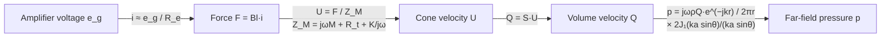

# Lecture 8 — Loudspeakers

> [!abstract] The idea
> A loudspeaker is a volume-velocity source. The far-field pressure follows the cone's **acceleration**, $p\propto\omega Q$. Above the resonance the moving mass controls the motion, so the acceleration is $F/M$ whatever the frequency and the response is flat. Below the resonance the suspension spring takes over and the output falls 12 dB per octave. At the top end the cone becomes large compared with the wavelength: it starts to beam, and then it stops moving as one piece.

> [!warning] Prepared the evening before the lecture
> Written on Monday 26 October 2026 from the slide deck (`34840_Lecture8_2026.pdf`, 33 pages), Finn's supplement *An Introduction to Loudspeakers* (8 pages) and Problems 8. Check it against what Finn says on Tuesday. Questions worth asking are listed at the end (§14).

**Tuesday 27 October 2026 · Finn Agerkvist · 8:00, b.358 r.063.** Sources: [[34840_Lecture8_2026.pdf|Lecture 8 slides (33 pages, no slide numbers; the numbers below are PDF pages)]] · [[Introduction to Loudspeakers -2021.pdf|Finn's loudspeaker supplement]] (the "additional lecture note" in the plan; the course text has no loudspeaker chapter) · baffled piston: [[Fundamentals_of_acoustics_2022.pdf|course text §1.6.2, pp. 42–48]], already in [[Lecture 5 - Radiation Monopoles Dipoles and Pistons|Lecture 5 §8]]. Practice: [[Week 8 - Loudspeakers|fully worked Week 8 problems]] · MATLAB `5. Semester/Acoustics and Noise Control/Matlab/Week8_Loudspeakers.m`. Interactive version: [Sound Bench, Lecture 8](https://study.madsrudolph.dev/34840/#l8).

> [!tip] You have seen all of this already, in more depth
> This lecture is a one-morning version of 34870 lectures 7–9, which you have done this term: [[Lecture 7 - Moving Coil Loudspeakers]] (T-S parameters, impedance, Lab D), [[Lecture 8 - Loudspeaker Enclosures]] (closed and vented box) and [[Lecture 9 - Loudspeaker Systems & Crossovers]]. The difference is the toolset. 34840 does **not** use the analogy circuits for calculations. It works with forces, $Z_{M}=j\omega M+R_t+K/j\omega$, and the monopole formula, and that is all the exam can ask. Slide 33 even advertises 34870 as the follow-up.

Constants: the Week 8 answers come out with $\rho=1.2\ \mathrm{kg/m^3}$, $c=343\ \mathrm{m/s}$, so $\rho c=411.6$ Pa·s/m. Voltages and pressures on the sheet are **rms** unless it says amplitude.

## 1. Overview and the example driver (pages 2–4)

The deck runs: volume-velocity source → low-frequency response → equations of motion → high-frequency response and directivity → nonlinearities → circuit models → electrical impedance → loudspeakers vs microphones → systems → headphones and micro speakers.

**Page 3, the Peerless NE225 8″ woofer:** on-axis, 30° and 60° responses. The three curves overlap at low frequency and spread apart higher up, where the off-axis curves fall away. That is directivity (§4). The ragged on-axis response at the top is diaphragm break-up (§5). Finn's supplement uses the same driver in its Figure 2.

**The parts (supplement Fig. 1):** a permanent magnet and pole pieces concentrate the flux in a narrow **air gap**; the **voice coil** sits in the gap and is glued to the **diaphragm** (cone + dust cap). The inner suspension (**spider**) and outer suspension (**surround**) let it move axially and stop it rocking sideways. The spider and surround are the spring $K$.

**Page 4, the two regimes, with $a$ = diaphragm radius:**

| | Without enclosure | With enclosure (or infinite baffle) |
|---|---|---|
| **Low frequency, $ka\ll1$** | **Dipole**: front and back are in antiphase and cancel, so output is low and goes as $\cos\theta$ | **Monopole**: only the front radiates, so output is much higher |
| **High frequency, $ka>1$** | 1) directivity, because the diaphragm is no longer small; 2) diaphragm vibration resonances (break-up) | same |

The dipole case is [[Lecture 5 - Radiation Monopoles Dipoles and Pistons|Lecture 5]]'s antiphase pair: radiated power $\propto f^4$ at low $kh$, which is why bass vanishes from a bare driver held in the air.

## 2. The loudspeaker as a volume-velocity source (page 5)

**Why a volume-velocity source:** the driver's internal (mechanical) impedance is far larger than the radiation impedance of the air in front of it, so the air hardly loads the cone. The cone moves with the same $Q$ whatever the room, a wall or a baffle does. Lecture 5's wall and twin examples assumed exactly this: the source holds $|Q|$ fixed and the neighbour changes the power it delivers.

Baffled, low frequency ($ka\ll1$): a monopole on a rigid plane, so the half-space version of the monopole formula:
$$\hat p(r)=\frac{j\omega\rho\hat Q}{2\pi r}\,e^{j(\omega t-kr)},\qquad j\omega\hat Q=S\,\frac{d\hat U}{dt}\ \text{(volume acceleration)}.$$

$2\pi$ instead of $4\pi$ is the baffle's mirror image (pressure doubling). Free space, a closed box with $ka\ll1$: use $4\pi r$. Problems 1 and 2 are exactly this choice.

> [!important] Pressure follows acceleration
> $p\propto\omega Q=S\cdot(\text{acceleration})$. For a flat response the **acceleration** must be constant with frequency, so the velocity must fall as $1/f$ and the displacement as $1/f^2$. Everything else in the lecture follows from this one line.

## 3. Equations of motion, simplified: the flat region (page 7)

Four approximations in a row (supplement §1.2):

1. Coil current from Ohm's law, ignoring the coil inductance and the back-EMF: $\hat\imath=\hat e_g/Z_e\approx\hat e_g/R_e$.
2. Force on the coil: $\hat F=Bl\,\hat\imath$.
3. Well above resonance, $f\gg f_s=\frac1{2\pi}\sqrt{K/M}$, the mass soaks up all the force: $\dfrac{d\hat U}{dt}\approx\dfrac{\hat F}{M}$.
4. So $\hat Q=S\hat U=\dfrac{S}{j\omega}\dfrac{d\hat U}{dt}\approx\dfrac{S\,Bl}{j\omega R_eM}\,\hat e_g$.

Into the monopole formula, the $j\omega$ cancels:
$$\boxed{\ \hat p(r)\approx\frac{\rho\,S\,Bl}{2\pi\,R_e\,M}\,\frac{e^{j(\omega t-kr)}}{r}\,\hat e_g\ }$$

**Frequency independent.** High output needs a large area $S$, a large force factor $Bl$, a small moving mass $M$ and a small $R_e$. The $Bl/(R_eM)$ trade-off is the whole of woofer design in one fraction: a bigger magnet raises $Bl$ but a longer coil raises $R_e$ and $M$.

Symbols: $e_g$ amplifier voltage, $i$ coil current, $U$ diaphragm velocity, $R_e$ DC resistance of the coil, $B$ flux density in the gap (T), $l$ wire length in the gap (m), $M$ moving mass (cone + coil + suspension share + the air load), $K$ suspension stiffness.

> [!example] Problem 3.1: $Bl=8$ Tm, $R_e=5\ \Omega$, $a=6$ cm, $M=20$ g, 2.8 V rms, baffled, $r=2$ m
> $\rho S\,Bl\,e/(2\pi rR_eM)=1.2\cdot0.01131\cdot8\cdot2.8/(2\pi\cdot2\cdot5\cdot0.02)=0.242$ Pa → **81.65 dB at 300 Hz and at 900 Hz**. The volume velocity is $1.34\times10^{-3}$ and $0.448\times10^{-3}$ m³/s: three times the frequency, a third of the $Q$, the same pressure.

## 4. High frequencies: the baffled piston and its directivity (pages 8–12)

Split the piston into small monopoles $\hat U\,dS$, each radiating into half space, and add them (the Rayleigh integral):
$$\hat p=\int_S j\omega\rho\,\frac{e^{j(\omega t-kh)}}{2\pi h}\,\hat U\,dS .$$

In the far field ($r\gg a$), write $h\approx r-y\sin\theta\cos\varphi$ in the phase and $h\approx r$ in the amplitude. The integral then separates into "baffled monopole × directivity":
$$\hat p=\underbrace{\frac{2J_1(ka\sin\theta)}{ka\sin\theta}}_{\text{directivity}}\ \underbrace{\frac{j\omega\rho\hat Q}{2\pi r}\,e^{j(\omega t-kr)}}_{\text{baffled monopole}} .$$

Combined with §3 (supplement eq. 1):
$$\hat p\approx\rho\,\frac{S\,Bl}{M R_e}\,\frac{2J_1(ka\sin\theta)}{ka\sin\theta}\,\frac{e^{j(\omega t-kr)}}{2\pi r}\,\hat e_g .$$

- On axis ($\theta=0$) the directivity factor is 1 at every frequency, so the on-axis response stays flat. The power response does not: the beam narrows, so less power goes out sideways.
- −3 dB where $ka\sin\theta=1.62$; first null where $ka\sin\theta=3.83$.

**Page 12, piston radius 8.5 cm, level re on axis at 10°, 30° and 60°** ($ka=1$ at 642 Hz):

| Angle | −3 dB at | First null at |
|---|---|---|
| 10° | 6.0 kHz | 14.2 kHz |
| 30° | 2.1 kHz | 4.9 kHz |
| 60° | 1.2 kHz | 2.8 kHz |

(My numbers from $1.62$ and $3.83$ with $c=343$; read them off the slide's plot to check.) Rule of thumb: an 8″ woofer starts to beam above about 1 kHz. That is one reason a two-way system hands over to a tweeter at 2–3 kHz (§10).

## 5. Break-up: the cone stops being a piston (pages 13–15)

At high frequency the velocity is no longer uniform, $U=U(r,\varphi)$: bending waves travel across the cone and its surround and set up modes (page 15: an FEM simulation by D. G. Nielsen at 2 kHz, coloured rings = alternating phase).

- Superposition of monopoles **still applies**: the Rayleigh integral holds with the actual $U(r,\varphi)$ inside. It just no longer simplifies to $2J_1(x)/x$, so you need finite element methods.
- Consequences: the peaks and dips in the on-axis curve, and polar patterns that do not follow the piston prediction (supplement §1.3, Fig. 2–3).

## 6. Low frequencies: the resonance (pages 16–18)

Below the mass-controlled region, all three mechanical forces count:
$$\hat F_M=j\omega M\hat U,\qquad\hat F_R=R_t\hat U,\qquad\hat F_{Sp}=Kx=K\!\int\!\hat U\,dt=\frac{K}{j\omega}\hat U$$
$$\hat F=\Big(j\omega M+R_t+\frac{K}{j\omega}\Big)\hat U=Z_{Mtot}\,\hat U,\qquad\omega_s=\sqrt{K/M},\quad f_s=\frac1{2\pi}\sqrt{\frac KM}$$

Volume velocity (page 17, which peaks at the resonance and falls on both sides):
$$\hat Q=S\,\frac{Bl\,\hat\imath}{Z_{Mtot}}\approx\frac{S\,Bl}{R_e}\,\frac{1}{j\omega M+R_t+K/j\omega}\,\hat e_g$$

Pressure (page 18, a **second-order high-pass**):
$$\hat p(r)=j\omega\rho\hat Q\,\frac{e^{j(\omega t-kr)}}{2\pi r}\approx\frac{\rho S\,Bl}{R_eM}\;\frac{\omega^2}{\omega^2-j\omega\frac{R_t}{M}-\omega_0^2}\;\frac{e^{j(\omega t-kr)}}{2\pi r}\,\hat e_g$$

- $\omega\gg\omega_0$: the fraction → 1, which is §3's flat response.
- $\omega\ll\omega_0$: the fraction → $-\omega^2/\omega_0^2$, a **12 dB per octave** fall. Stiffness control: velocity $\propto\omega$, so acceleration $\propto\omega^2$.
- $f_s$ is the lowest frequency the driver produces "with ease" (supplement).

> [!important] $R_t$ includes the electrical damping
> The coil moving in the field generates a back-EMF $e=Bl\,U$, which drives a current through the amplifier's (near-zero) output impedance and $R_e$. That current brakes the cone like a resistance $(Bl)^2/R_e$. The simplified model ignored the back-EMF; it is folded back in by using the **total** damping $R_t=R_m+(Bl)^2/R_e$ (page 16 says "damping (including electrical)"). In hi-fi drivers the electrical part dominates. Problem 3.2: $(Bl)^2/R_e=64/5=12.8$ Ns/m of the 18.

> [!example] Problem 3.2: add $K=2000$ N/m, $R_t=18$ Ns/m
> $f_s=\frac1{2\pi}\sqrt{2000/0.02}=50.3$ Hz, total $Q_t=\sqrt{KM}/R_t=0.35$ (overdamped, no peak). At 30 Hz the spring wins ($K/\omega=10.6$ against $\omega M=3.8$): $|Z_M|=19.3$, **67.49 dB**. At 300 Hz it is almost mass controlled: $|Z_M|=40.8$ against $\omega M=37.7$, **80.96 dB**, 0.7 dB under the 3.1 answer.

## 7. Enclosures: the closed box and the vented box (pages 19–20, supplement §1.4.1)

**Closed box (supplement only).** The air in a box of volume $V_{ab}$ is a spring in series with the cone's motion, which adds to the suspension:
$$K_{ab}=\frac{\rho c^2}{V_{ab}}\ \text{(acoustic)},\qquad K_{mb}=S^2\frac{\rho c^2}{V_{ab}}\ \text{(mechanical)},\qquad K_{m,eff}=K+K_{mb}.$$
A smaller box makes the system stiffer, so the resonance rises: $f_c=\frac1{2\pi}\sqrt{(K+K_{mb})/M}$. That is the price of a compact box. It is also [[Lecture 4 - Impedance Intensity and Sound Power|Lecture 4]]'s cabinet stiffness again.

**Vented (bass-reflex) box, a Helmholtz resonator boosting low frequencies.** A port (vent) in the box: the air plug in the port on the box spring is a Helmholtz resonator tuned near or below $f_s$. Total output $Q=Q_D+Q_P$ (driver + port; page 19 draws $U_L$, $U_D$, $U_P$). Page 20 plots three curves (red driver, green vent, blue total):
- Around the tuning frequency $f_B$ the port does the radiating and the cone hardly moves (lower excursion, lower distortion).
- **Below $f_B$** port and cone move in antiphase and cancel, so the total falls at **24 dB per octave** (4th order) instead of the closed box's 12.
- Net result: more bass from the same driver and box size, bought with a steeper roll-off and a slower transient.

Formula for the port is [[Lecture 7 - Sound Absorption and Room Acoustic Design|Lecture 7]]'s Helmholtz resonator, $f_0=\frac{c}{2\pi}\sqrt{s/(V\,l')}$. The 34870 version: [[Lecture 8 - Loudspeaker Enclosures]] and the System D project (vent 160 mm → $f_B\approx25$ Hz).

## 8. Displacement (page 21)

$$\hat x=\int\hat U\,dt=\frac{\hat U}{j\omega}$$

Flat pressure needs constant acceleration, so $x\propto1/f^2$ above $f_s$. Below $f_s$ the displacement levels off at the static value $F/K$ (page 21's curve: flat at low f, falling 12 dB/octave above the resonance). **Bass needs excursion**: halve the frequency at the same SPL and the cone must move four times as far. It is the excursion, not the power, that runs out first in a small woofer. Problem 3.2: 1.2 mm rms at 30 Hz against 0.06 mm at 300 Hz.

## 9. Nonlinearities (page 22) — 34871 in January

- $Bl(x)$: the coil leaves the gap at large excursion and loses force. $K(x)$: the suspension stiffens. $L_e(x)$: the inductance changes with coil position.
- Result: **harmonic distortion** (multiples of each tone) and **intermodulation** (sum and difference products when two tones play: a bass tone modulates a treble tone).
- Page 22 has simulated audio examples at 1 V, 10 V and 100 V (sound clips, not in the PDF): clean, slightly distorted, badly distorted. The spectra show the extra lines growing.
- You take 34871 Nonlinear Transducers in January: this is its whole subject.

## 10. Circuit models and the electrical impedance (pages 23–25)

Page 23: one circuit with an electrical part ($R_e$, $L_e$), a gyrator ($Bl$) to the mechanical part, and a transformer ($S$) to the acoustic radiation load. The table is the **impedance analogy**:

| Electrical | Mechanical | Acoustical |
|---|---|---|
| Voltage $e$ | Force $F$ | Pressure $p$ |
| Current $i$ | Velocity $U$ | Volume velocity $Q$ |

**Electrical impedance (page 24):** a peak at the resonance (tens of ohms; the curve also rises at high f because of $L_e$).
$$Z_e=R_e+j\omega L_e+\frac{(Bl)^2}{Z_M}$$
At resonance $Z_M$ is at its minimum $R_m$, so $(Bl)^2/R_m$ is large: the cone moves the most and generates the largest back-EMF $e_L=Bl\,U$, which opposes the current. "All parameters for box design can be obtained from electrical measurements" is exactly what you did in 34870 Lab D (added mass or added box, then the T-S parameters).

**Microphone vs loudspeaker (page 25):** the same transducer run backwards, with the same circuit and a gyrator. A loudspeaker is designed to be **mass controlled** (flat $p$ above $f_s$). A dynamic microphone is designed to be **resistance controlled** (flat velocity, so flat EMF). [[Lecture 7 - Moving Coil Loudspeakers|34870 L7 §3]] has the full argument.

## 11. Loudspeaker systems (pages 26–30)

**High-frequency driver (page 26):** a dome tweeter with an impedance peak near 1 kHz and a response that starts above it.

**Woofers and tweeters (page 27):**

| Driver | Diameter | $f_s$ |
|---|---|---|
| Woofer | 5–18+ inch | 20–50 Hz |
| Midrange | 2–5 inch | 50–200 Hz |
| Tweeter | 0.75–1.5 inch | 500–1000 Hz |

**Why several units (page 28):** a big cone makes bass (it moves a lot of air without huge excursion) but beams and breaks up at high frequency (§4–5). A small dome is the other way round. Typical two-way (supplement §1.5): 6″ woofer ($f_s\approx50$ Hz) up to about 3 kHz, 1″ tweeter ($f_s\approx1$ kHz) above.

**Crossover networks (page 29):** a low-pass to the woofer and a high-pass to the tweeter, passive or active, analogue or digital. The slide plays the same music through each filter (audio clips not in the PDF). Keep the tweeter's crossover well above its own $f_s$, or it is driven below resonance with big excursion and distortion. Your System D design: LR4 at 325 Hz woofer→mid, tweeter HP2 near 3 kHz.

**Page 30, "Design or acoustics?":** a classic box, a B&W Nautilus and a B&O BeoLab 5. The shapes are not only styling: the Nautilus tapering tube absorbs the back wave, and the BeoLab's acoustic lenses spread the treble horizontally.

## 12. Headphones and micro speakers (page 31, supplement §1.6)

A closed (circumaural) headphone drives a **small sealed volume**: the cup plus the ear canal. That volume is an acoustic spring (compliance) and nothing else, at frequencies where it is small compared with $\lambda$:
$$Z_A=\frac{K_A}{j\omega}=\frac1{j\omega C_A},\qquad C_A=\frac{V}{\rho c^2},\qquad \hat p=\frac{1}{j\omega C_A}\hat Q .$$

Compare free space, $p=j\omega\rho Q/(4\pi r)$: there pressure follows volume **acceleration**; in a cavity it follows **displacement** ($Q/j\omega$ = volume displacement).

- **Below the driver's resonance** the diaphragm is stiffness controlled, so its displacement is constant with frequency ($x=F/K$, §8). Cavity pressure ∝ displacement, so the response is **flat below resonance** (supplement: "the frequency response is flat below the driver resonance frequency"). That is the opposite of a loudspeaker in a room, and it is why headphones give deep bass from a 40 mm driver.
- It only works with a **seal**. A leak is a resistance/mass path to the outside that bleeds the low frequencies away (the page 31 plot compares seal conditions; the bass drops with a bad fit).
- Micro speakers (phones, laptops): no inner suspension (no spider), very flat diaphragm.

> [!example] Problem 4: why the headphone is silent off the head
> 100 dB inside 50 cm³ at 100 Hz needs only $Q=\omega C_Ap=4.45\times10^{-7}$ m³/s. Radiated into free space at 0.5 m that is **8.5 dB SPL**. Same $Q$, ratio $p_{\rm free}/p_{\rm cavity}=k^2V/(4\pi r)$: −91.5 dB.

## 13. Balanced armature (page 32, supplement §1.7)

Hearing aids and in-ear monitors. A small armature (a reed) sits between two magnets; a **stationary** coil around it changes the balance of the flux, and the magnetic force bends the armature. A pin connects it to a tiny diaphragm. The coil does not move, so the moving mass is tiny. The supplement says it gives "the best combination of size and efficiency". It is a cavity driver like the headphone: it presses on the ~1–2 cm³ of a sealed ear canal.

Page 33 is the advert for **34870 Electroacoustic transducers and systems (E2)**: analogy circuits, microphones, loudspeakers, systems, listening rooms. You are doing it already.

## 14. Traps and pitfalls

- **$2\pi r$ or $4\pi r$?** Baffle (or a large wall the speaker sits in) → $2\pi r$, power through a hemisphere $2\pi r^2$. Small box in free space → $4\pi r$, sphere $4\pi r^2$. The sheet says "infinite baffle" in P2 and P3 and "free space" in P1 and P4.
- **$p\propto\omega Q$, not $Q$.** At three times the frequency the mass-controlled cone has a third of the $Q$ and the same $p$ (P3.1).
- **Ignore the suspension = the mass-controlled limit.** That is only valid well above $f_s$: 30 Hz with $f_s=50$ Hz is not (P3.2).
- **$R_t$ already contains $(Bl)^2/R_e$.** Don't add it twice.
- **Rms or amplitude:** P1 gives an amplitude (0.1 Pa), P3 an rms voltage. Convert before taking a level.
- **$L_I$ is not $L_p$.** $I=p_{\rm rms}^2/\rho c$ with $\rho c=411.6$, not 400, so $L_I=L_p-0.13$ dB in the far field.
- **Headphone pressure follows displacement**, $p=Q/j\omega C_A$, not $j\omega\rho Q/4\pi r$.
- **The baffled piston directivity is a far-field result.** On axis it is 1 at every frequency; it only makes off-axis curves fall.
- **Below $f_B$ a vented box falls at 24 dB/octave**, not 12.

## 15. Questions for Tuesday

1. Problem 4: does Finn intend the removed headphone as a monopole in free space ($4\pi r$)? The printed 8.55 dB fits that (I get 8.53 with $c=343$, 8.48 with 344). The baffled version would give 14.5 dB.
2. Page 12: are the curves for $a=8.5$ cm with $c=343$ or 344? Read off the −3 dB points to check §4's table.
3. Page 20: what box and port numbers produced the vented-box curves? Is $f_B$ set at $f_s$?
4. Page 31: the measured headphone curves: which line is "sealed" and which is a leak?
5. Is the vented box or the closed-box stiffness formula exam material, or only the infinite-baffle model of the problems?

## 16. Quick self-check

1. Why is the far-field pressure of a mass-controlled driver independent of frequency? ($p\propto\omega Q$ and $Q\propto1/\omega$.)
2. Write $Z_M$ and $f_s$. What does the response do below $f_s$? (12 dB/octave down.)
3. What is $R_t$ made of? ($R_m+(Bl)^2/R_e$.)
4. An 8.5 cm radius cone: at what frequency is it 3 dB down at 30°? (≈2.1 kHz.)
5. Why does a headphone have flat bass below its resonance? (Cavity pressure ∝ displacement, and a stiffness-controlled diaphragm has constant displacement.)
6. Which is bigger, the cone's excursion at 30 Hz or at 300 Hz for the same SPL? By how much in the mass-controlled region? (×100 at 30 Hz.)
7. Why do loudspeaker systems have more than one driver? (Bass needs area and excursion; treble needs a small, light, stiff diaphragm that doesn't beam or break up.)
