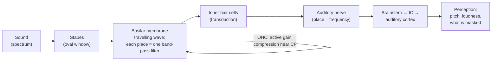
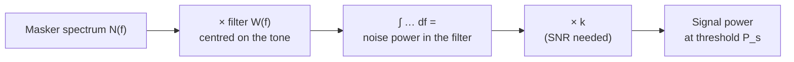

# Lecture 9 — Our Hearing: Frequency Selectivity and Masking

> [!abstract] The idea
> The inner ear is a bank of band-pass filters. Each place on the basilar membrane responds best to one frequency, high at the base and low at the apex. A tone is only masked by the noise that gets **into its own filter**. That single rule (the power spectrum model) lets you measure the filters from masking thresholds, and it gives the **ERB**: about 133 Hz wide at 1 kHz, roughly a sixth of an octave. The filters are not linear. The outer hair cells amplify soft sounds near each place's best frequency, which makes the tuning sharp and level dependent. Lose them (sensorineural hearing loss) and the filters go broad, masking gets worse and loudness grows too fast.

> [!warning] Written after the lecture, from the deck only
> Written on Thursday 26 November 2026 from the slide deck (`hearing_2026.pdf`, 51 pages, no slide numbers; the numbers below are PDF pages), the course text ch. 2 and the exercise with its official solutions. I did not attend and there is no recording. The deck's audio demos (in `frequency_selectivity.zip`, §11) and anything Torsten said beyond the slides are therefore missing.

**Tuesday 3 November 2026 · Torsten Dau · 8:00, b.358 r.063.** Sources: [[hearing_2026.pdf|Lecture 9 slides (51 pages)]] · [[Fundamentals_of_acoustics_2022.pdf|course text ch. 2 "Ear, hearing and speech", §2.4–2.6, pp. 64–72]] (masking, loudness, auditory filters) · [[34840_Psychological_Acoustics_Exercise_2026.pdf|Psychological Acoustics exercise]]. Practice: [[Week 9 - Psychological Acoustics|fully worked exercise]] · MATLAB `5. Semester/Acoustics and Noise Control/Matlab/Week9_Psychological_Acoustics.m`. Previous lecture: [[Lecture 8 - Loudspeakers]]. Bandwidth scales to compare with: [[Lecture 3 - Decibels Frequency Analysis and Measurements|Lecture 3 §8, octave and third-octave bands]]. Interactive version: [Sound Bench, Lecture 9](https://study.madsrudolph.dev/34840/#l9).

## 1. What the lecture is for (pages 6–10)

Page 6 lists four goals. They are also a good checklist for the exam:
1. Explain frequency selectivity: relate frequency to the **place** of maximum excitation on the basilar membrane (BM).
2. Interpret masking experiments: how masking reveals the auditory filter's **bandwidth and shape**.
3. Describe cochlear nonlinearity: tell **auditory filters** apart from **excitation patterns**, and explain the level dependence.
4. Connect this to hearing loss: broader tuning, more masking, **loudness recruitment**.

Frequency selectivity is what lets you follow one voice at a party (page 8, the cocktail party effect). Masking is the tool that measures it.

**Masking, two definitions (page 10):**
- The **process** by which the threshold of audibility of one sound is raised by the presence of another (masking) sound.
- The **amount** (in dB) by which that threshold is raised.

Page 10's figure is the one to remember: the absolute threshold of hearing, plus the masked thresholds produced by a narrow band of noise near 500 Hz at four levels. Each masked threshold is a peak around the masker. The peaks are steep on the low-frequency side and spread far up in frequency on the high side, more so the louder the masker. That is the **upward spread of masking** (§8). Page 37 brings this figure back once the theory is in place.

## 2. Where frequency selectivity comes from: the cochlea (pages 11–20)

- **Anatomy (pages 12–13):** outer ear → middle ear (ossicles, ending in the stapes) → cochlea. The cochlea is a coiled tube split into scala vestibuli, scala media and scala tympani. The **basilar membrane** separates media from tympani and carries the **organ of Corti**: one row of **inner hair cells** (IHC, the sensors that drive the auditory nerve) and three rows of **outer hair cells** (OHC, the amplifiers), under the tectorial membrane.
- **The travelling wave (page 14):** the stapes pushes the oval window, a wave runs along the BM from the base towards the apex, and the round window lets the fluid move.
- **Frequency-to-place (pages 15–16, von Békésy, Nobel prize 1961; the slide says 1960):** the BM is narrow and stiff at the **base (0 mm)** and wide and floppy at the **apex (35 mm)**. A high frequency peaks near the base, a low frequency travels further and peaks near the apex. Page 15 animates 250 Hz, 4 kHz and a click (slowed down 360×). The wave always travels from base to apex; it grows until the place where the membrane's local resonance matches the frequency, then dies quickly.
- **Decomposition (pages 17–18):** a complex sound with many components excites many places at once, each component at its own place. "Frequency selectivity begins with a mechanical frequency-to-place transformation." Sound input → cochlear response (peaks at different places) → neural representation (spatially distributed activity).
- **To the brain (pages 19–20):** stapes → BM motion at one place → IHC receptor potential → auditory-nerve spikes → brainstem → inferior colliculus → auditory cortex. Each nerve fibre inherits the tuning of its place.

> [!tip] Filter bank picture
> Treat every place on the BM as the output of a band-pass filter centred at that place's **characteristic frequency (CF)**. Neighbouring places have neighbouring CFs and **overlapping** passbands. The 2023 exam phrased it as "a series of cascading low-pass filters, lowest cut-off at the apex, highest at the base": same physics, seen as the travelling wave losing its high frequencies as it moves towards the apex.

## 3. Psychophysics: how to get at the filters in a human (pages 21–22)

Psychophysics links **physical** variables (p, f, I, ΔI, …) to **psychological** ones (loudness, pitch, timbre, just-noticeable differences). You cannot put a probe on a living person's BM, so you infer the filters from what the listener can or cannot hear. Page 22: if two components fall in the same filter they are **unresolved**; in different filters they are heard separately (2023 exam Q14: "the two tones fall within separate auditory filters and are perceived as two separate tones").

## 4. Fletcher's band-widening experiment: the critical band (pages 23–24)

**Fletcher (1940):** measure the threshold of a tone in band-pass noise **centred on the tone**, keep the noise **spectrum level** (power per Hz) fixed, and widen the band.

- While the band is narrower than the filter, every extra hertz of noise gets in: the threshold rises **3 dB per doubling** of bandwidth.
- Once the band is wider than the filter, the extra noise falls outside it and does nothing: the threshold **stops rising**.
- The bandwidth where it flattens is the **critical bandwidth**. Page 24 (data from Moore 1997): at 2 kHz the threshold climbs from 71.3 dB (50 Hz band) to 75 dB at 400 Hz and stays flat up to 3200 Hz, so $\Delta f_{CB}\approx400$ Hz at 2 kHz.

Page 23 also describes the CD demo: a 2 kHz tone in ten steps of 5 dB, first in quiet, then in broadband noise, then in noise bands that narrow step by step (1000 Hz …). You count the steps you can hear. The count stays the same until the band gets narrower than the critical band.

![[Courses/34840 Fundamentals of Acoustics and Noise Control/Images/Lecture9/band_widening.png]]
*My plot of the power spectrum model with rectangular ERB-wide filters, noise at 40 dB/Hz and k = 0.3 (the exercise's numbers): the knee sits at the ERB. Note that the knee at 2 kHz is at 241 Hz here, not Fletcher's 400 Hz (§7).*

## 5. The power spectrum model of masking (page 25)

$$\boxed{\ P_s=k\int_0^\infty W(f)\,N(f)\,df\ }$$

- $P_s$: signal power at threshold. $W(f)$: the auditory filter's power response, centred on the signal. $N(f)$: the masker's power spectrum density. $k$: the signal-to-noise ratio needed at the filter output to detect the tone (a constant for a given listener and task).
- Assumptions: the listener uses **one filter**, the one centred on the signal; only noise passing that filter counts; the threshold is a fixed SNR at its output.
- With a **rectangular** filter of width $\Delta f$ and white noise of density $N_0$ wider than the filter: $P_s=k\,N_0\,\Delta f$. In decibels:
$$L_s=N_{0,\rm dB}+10\log_{10}k+10\log_{10}\Delta f .$$
That is the whole of the exercise's Problems 1 and 3.

### 5.1 Measuring the shape: low-pass noise (pages 26–28)

Fix the tone at $f_0$ and use noise whose upper edge sits $\Delta f$ below it. As $\Delta f$ shrinks, more of the filter's lower skirt is filled and the threshold rises (page 27: data at 0.5, 2 and 8 kHz versus $\Delta f$ from −1.4 to 0 kHz). With flat noise density $N_0$:
$$P_s=k\,N_0\int_0^{f_0-\Delta f}W(f)\,df\quad\Rightarrow\quad W(f_0-\Delta f)=\frac{1}{kN_0}\,\frac{dP_s}{d(f_0-\Delta f)} .$$
The **derivative** of the threshold curve gives the filter shape.

**The catch (page 28): off-frequency listening.** With noise only below the tone, the listener does better by using a filter shifted **upwards**, away from the noise. It loses a little signal but much more noise. The measured "filter" then comes out too sharp.

### 5.2 Notched noise and the rounded exponential (pages 28–29)

Put noise on **both** sides of the tone with a notch of width $2\Delta f$ around it. Shifting the filter now lets in more noise from the other side, so off-frequency listening no longer pays. This is the standard method (Patterson's notched-noise method). The measured filter at 1 kHz (page 29) is a pointed peak with straight skirts on a dB scale, down 50 dB about ±0.5 kHz away. It is fitted by the **rounded exponential (roex)**:
$$W(g)=(1+pg)\,e^{-pg},\qquad g=\frac{|f-f_c|}{f_c}$$
- $g$ is the normalised distance from the centre. $p$ sets bandwidth and skirt slope: larger $p$ = sharper.
- With a large dynamic range, or thresholds near the absolute threshold, a floor is added: $W(g)=(1-r)(1+pg)e^{-pg}+r$.
- My addition (not on the slides): the area under the roex is $4f_c/p$, so **ERB $=4f_c/p$**, $p=4f_c/{\rm ERB}$. At 1 kHz, $p=30.2$. The −3 dB points sit at $pg=1.678$, so the 3 dB bandwidth is $0.84\cdot$ERB.

![[Courses/34840 Fundamentals of Acoustics and Noise Control/Images/Lecture9/roex_filters.png]]
*My plot: roex filters with $p=4f_c/\mathrm{ERB}$. Linear frequency axis: the filters get wider with centre frequency, but all have about the same relative width.*

## 6. The equivalent rectangular bandwidth (pages 30–31)

**Definition:** the width of a rectangular filter with the same peak gain and the same area (same total power passed for white noise) as the real filter:
$$\Delta f_{ERB}\,D_{\max}=\int_{-\infty}^{\infty}D(f)\,df\qquad(D_{\max}=0\ \mathrm{dB}=1)$$

**Glasberg and Moore's formula (the one to know by heart):**
$$\boxed{\ \mathrm{ERB}=24.7\,(4.37F+1)\ \mathrm{Hz},\qquad F\ \text{in kHz}\ }$$

| Centre frequency | 100 Hz | 250 Hz | 500 Hz | 1 kHz | 2 kHz | 4 kHz | 10 kHz |
|---|---|---|---|---|---|---|---|
| ERB (Hz) | 35.5 | 51.7 | 78.7 | 132.6 | 240.6 | 456.5 | 1104 |
| ERB / $f_c$ | 0.35 | 0.21 | 0.16 | 0.13 | 0.12 | 0.11 | 0.11 |

- At low frequencies the ERB tends to 24.7 Hz; at high frequencies it grows almost in proportion to $f$ (about 11 % of $f_c$, a constant-Q filter bank).
- **Each ERB is about 0.89 mm on the basilar membrane** (page 30). Check (mine): counting ERBs from 0 to 20 kHz, $21.4\log_{10}(4.37\cdot20+1)\approx41.6$ ERBs, times 0.89 mm ≈ 37 mm, close to the 35 mm BM.

**Page 30's quiz: how does the threshold of a tone in broadband noise depend on frequency?** By the power spectrum model, $L_s=N_{0,\rm dB}+10\log_{10}(k\cdot\mathrm{ERB})$. The ERB grows with frequency, so the threshold rises: almost flat at low frequencies, then about +3 dB per octave (10 dB per decade) where the ERB is proportional to $f$. The course text (§2.4.1, Fig. 2.4.1) says the same about white-noise masking: nearly flat to 500 Hz, then +10 dB per decade, and the masked threshold moves dB for dB with the noise level. Exercise Problem 1.2 is this quiz with numbers: 50.3, 56.0 and 65.2 dB at 0.1, 1 and 10 kHz.

Page 31 asks: why does the masked threshold depend on the noise power **entering the filter**? Because detection happens at the filter output; noise outside the passband never meets the tone.

## 7. The critical bandwidth dispute: ERB, Bark and third octaves (page 32)

Two schools, two formulas, both on page 32 and in the course text §2.6:

| | Formula ($F$ in kHz) | 100 Hz | 1 kHz | 2 kHz | 10 kHz |
|---|---|---|---|---|---|
| **Cambridge, ERB** (Glasberg & Moore, notched noise) | $24.7(4.37F+1)$ | 35.5 | 132.6 | 240.6 | 1104 |
| **Munich, critical band / Bark** (Zwicker) | $25+75(1+1.4F^2)^{0.69}$ | 100.7 | 162.2 | 300.8 | 2306 |
| **Third octave** | $(2^{1/6}-2^{-1/6})f=0.232f$ | 23.2 | 231.6 | 463.2 | 2316 |

![[Courses/34840 Fundamentals of Acoustics and Noise Control/Images/Lecture9/bandwidth_scales.png]]
*From `Week9_Psychological_Acoustics.m`. Same shape as page 32's figure, drawn from the three formulas.*

- **The disagreement is at low frequencies.** Zwicker's critical band levels off at about 100 Hz below 500 Hz; the ERB keeps shrinking towards 25 Hz. Page 32's data points (notched-noise studies) follow the ERB line down to 100 Hz.
- Above ~500 Hz the critical band is close to a third octave (course text §2.6.1). The ERB is narrower than a third octave everywhere above **about 200 Hz** (where $24.7(4.37F+1)=232F$, $F=0.199$ kHz): the ear is sharper than a third-octave analyser. This is why third-octave bands (Lecture 3) are a reasonable but slightly coarse stand-in for the ear.
- **Bark scale (course text):** stack critical bands edge to edge and 24 of them cover the audible range. Band 1 is 0–100 Hz, band 8 is 920–1080 Hz (around 1 kHz), band 17 is around 4 kHz and 700 Hz wide.
- Fletcher's 400 Hz at 2 kHz (page 24) is larger than both formulas (241 and 301 Hz). Fletcher's band-widening data are noisy and the "knee" is hard to place. Use the **ERB formula** whenever the exam says ERB, as the exercise does.

## 8. Level dependence, masking patterns and excitation patterns (pages 33–37)

**The filters change with level (page 33).** If the filters were linear, their shape would not depend on the noise level used to measure them. It does. At 1 kHz and a medium level (50 dB SPL) the filter is roughly **symmetric on a linear frequency scale**. At high levels it becomes strongly **asymmetric**: the **low-frequency side broadens**; the high side stays steep. (2024 exam Q14: "auditory filters become broader with level.")

**Two kinds of experiment (page 34):**
- So far: fix the **signal**, vary the masker → the **auditory filter** at one frequency.
- Classic masking studies did the opposite: fix the **masker**, vary the **signal** frequency → a **masking pattern** (masked audiogram), like page 10's figure.

**The excitation pattern (page 35)** is the masker's output from **every** filter, plotted against each filter's centre frequency: an estimate of how strongly the masker excites each place on the BM. A masking pattern looks like the excitation pattern, so many filters contribute to it, not one.

> [!important] Filters and excitation patterns are mirror images
> Even with symmetric filters, the excitation pattern is **asymmetric**: it falls steeply below the masker and slowly above it. Filters centred **above** the masker are wider (the ERB grows with $f$), and their low-frequency skirts still pick up the masker. At high levels the filters broaden on their **low** side, so even more filters above the masker are reached: the excitation pattern broadens on the **high**-frequency side (page 36, curves 20–90 dB at 1 kHz). That is the **upward spread of masking**: a loud low sound masks higher sounds much more than a loud high sound masks lower ones (2024 exam Q12).

Course-text numbers for narrow-band masking curves (§2.4.1): about **100 dB/octave** on the low side, about **60 dB/octave** on the high side; the low side is almost independent of level, the high side gets shallower as the level goes up. "Masking increases non-linearly with level."

**Back to page 3 (page 37):** page 10's figure again. Now you can read it: the 500 Hz noise excites places above 500 Hz more and more as the level rises, so it masks tones up to several kHz at 80 dB.

## 9. Two demos of auditory nonlinearity (pages 38–39)

- **Page 38, masking pattern by ear:** a tone sweeping 500 → 2000 Hz (log, 10 s) under a third-octave noise at 1 kHz, signal-to-masker ratio fixed at −30 dB, played at two overall levels. In a linear ear both levels would sound the same, since only the ratio matters. They don't: at the higher level the tone disappears over a wider range **above** 1 kHz. Upward spread of masking, heard live.
- **Page 39, combination tones:** a fixed tone $f_1$ (left speaker), a rising tone $f_2$ (right speaker), then both together. Together you also hear a tone that **falls** while $f_2$ rises: the cubic difference tone $2f_1-f_2$. The two speakers are separate, so this tone is not in the air. It is made **in the cochlea** by the nonlinear BM response (exercise Problem 3).

## 10. Frequency selectivity and hearing loss (pages 40–46)

**Page 40:** a listener with a one-sided cochlear loss. The impaired ear's auditory filters and psychophysical tuning curves are much **broader** than the normal ear's. Why?

**The BM input-output function (page 41, Ruggero et al. 1997, CF = 11 kHz):** BM velocity (dB) vs SPL for a tone at CF.

| Input level | Slope (dB/dB) | Meaning |
|---|---|---|
| Low (≈ 0–30 dB) | 0.96 | almost linear, with large gain |
| Middle (≈ 30–80 dB) | 0.18 | **compression 5.6:1** ($1/0.18$) |
| High (≈ 90 dB +) | 0.52 | compression ≈ 2:1 |

- **Live vs post-mortem (page 42):** after death the response is **linear** (slope 1) and much lower at low levels. The difference is the **active mechanism**: the OHCs push on the BM and amplify soft sounds. Gain is large for soft sounds and small for loud ones, which is the compression.
- **Page 43, dynamic compression:** a wide range of input levels (say 0–100 dB) is squeezed into a smaller range of BM response. A linear system would need a much larger output range.
- **Only at CF (page 44, CF = 10 kHz):** amplification and compression act only near CF (10 kHz curve compressive). Well below CF the response is linear (3 kHz: slope 1). So the cochlear filter is sharp and tall at low levels (the active gain sits at the tip) and gets broader as level goes up (the gain at the tip saturates, the passive skirt does not). **Frequency selectivity is level dependent in an intact cochlea, and much reduced in an impaired one.** (2024 Q15: OHCs enable the internal amplification of weak sounds; 2023 Q15: they give level-dependent gain, larger for soft sounds.)

| Normal cochlea | Reduced active amplification (OHC loss) |
|---|---|
| High sensitivity near CF | Elevated hearing thresholds |
| Sharp tuning at low to moderate levels | Broad frequency tuning |
| Compressive BM growth | Less compression, abnormal (too fast) loudness growth |

*(Page 45.)*

**Loudness recruitment (page 46):** threshold is higher than normal; above threshold loudness grows **faster** than normal; at high levels it catches up with normal loudness. That is what a missing compressor does: the soft sounds lost their gain, the loud sounds never had much. (2024 Q13, 2023 Q13.) Course text §2.5.1: recent work says impaired listeners may have a loudness at threshold that is clearly above zero ("softness imperception").

**Combination tones and hearing loss (exercise 3.4):** the combination tones come from the same nonlinearity. A damaged cochlea is **more linear**, so the combination tones get weaker. (Otoacoustic emissions, the clinical version of this, use the same idea.)

## 11. Demos, simulations and applications (pages 47–51)

**Pages 47–49 (Baer and Moore 1993):** music and speech processed to imitate an impaired ear. The simulation **smears the short-term spectrum** (the excitation pattern is a blurred spectrum) so a normal listener's excitation pattern looks like an impaired one's. Versions: symmetric broadening by a factor of 3, asymmetric broadening, and (page 49) broadening plus a sloping hearing loss with threshold elevation and recruitment. The point: reduced selectivity makes speech in noise and music muddier even when everything is loud enough.

The demo files are in `_Learn/9 - …/frequency_selectivity.zip` (155 MB, not unpacked): `17/18_unprocessed_music`, `19/20_music_symm_broaden`, `21/22_music_asymm_broaden`, `33/34_comb_music`, the same set for speech (`55`–`72`), `critical_band1–5.wma` (Fletcher demo), `excitation_1000_30dB.wav`, `hoerbeispiel1_1–3.wav`, `loudness.wma`, and Békésy animations `s250_40`, `s4k_40`, `cl` (250 Hz, 4 kHz, click; `.avi` + `.mp4`).

**Applications (page 50):** perceptual audio coders (MP3/AAC: put the quantisation noise where it is masked), multi-channel compression in hearing aids, auditory-model front-ends for speech recognition, objective speech and sound-quality measures, and clinical diagnostics.

**Take-home (page 51):** (1) the cochlea analyses frequency: different frequencies peak at different places; (2) masking reveals the auditory filters' bandwidth, shape and level dependence; (3) hearing impairment reduces the active gain, broadens tuning and makes complex scenes hard.

## 12. From the course text: masking in time and loudness (§2.4.2–2.5)

Not on the slides, but in ch. 2 and fair game for multiple choice:
- **Partial masking:** the masker does not make the sound inaudible but makes it **quieter** (the car radio that is far too loud at a red light).
- **Forward masking (post-masking):** a strong sound masks a weak one that comes **after** it, for about **200 ms**. **Backward masking (pre-masking):** a weak sound **before** a strong one, only about **20 ms**.
- **Loudness** in **sone**, loudness level in **phon** (for a 1 kHz tone, phon = dB SPL). 1 sone = 40 phon. Stevens' power law: $N=2^{(L-40)/10}$ sone, so **+10 phon = twice as loud**.
- **Temporal integration:** loudness builds up with a time constant of about **100 ms**; short bangs sound weaker than their peak level suggests.
- **Loudness summation** (exercise Problem 2): at fixed total intensity, a sound spread over **several** auditory filters is louder than the same power inside **one** filter. Below the critical bandwidth, loudness does not depend on bandwidth.
- A sound level meter with A- or C-weighting does **not** measure loudness, because it ignores masking and summation; loudness needs dedicated software (ISO 532).

## 13. Traps and pitfalls

- **ERB formula takes kHz.** $24.7(4.37F+1)$ with $F=1$ for 1 kHz, not 1000. Same for the Bark formula.
- **ERB ≠ critical band ≠ third octave.** At 1 kHz: 132.6, 162.2, 231.6 Hz. If a problem says ERB, use the ERB formula.
- **dB/Hz is a density.** Add $10\log_{10}(\text{bandwidth})$ to get a band level, and convert to linear units if you add powers. 40 dB/Hz over 132.6 Hz is 61.2 dB, not 40.
- **Only the noise inside the filter counts.** A noise narrower than the ERB gives a threshold independent of centre frequency (exercise 1.3: 47.8 dB everywhere).
- **Narrowest filter = lowest threshold.** In broadband noise a 100 Hz tone is easier to detect than a 10 kHz tone (ignoring the absolute threshold).
- **Filter vs excitation pattern.** Filters broaden on the **low** side with level; excitation (and masking) patterns broaden on the **high** side. Don't swap them.
- **Upward, not downward, spread of masking.** Low maskers hit high signals.
- **Combination tones are below $f_1$** ($2f_1-f_2$, $3f_1-2f_2$ …) when $f_2>f_1$, and they move opposite to $f_2$.
- **Hearing loss makes the ear more linear**, not "more nonlinear": less compression, weaker combination tones, broader filters, recruitment.
- **IHC sense, OHC amplify.** The active gain is the outer hair cells.

## 14. Exam angle

**Part 1 (problems):** the exercise is the template. Expect:
- ERB at a given frequency from the formula; masked threshold of a tone in noise with the power spectrum model, $L_s=N_{0,\rm dB}+10\log_{10}k+10\log_{10}\min(\Delta f_{\rm noise},{\rm ERB})$; or the reverse (noise density needed to mask a tone).
- Combination-tone frequencies $f_1-n(f_2-f_1)$ and a level rule given in the text, then "which of them fall in the same filter?"
- Loudness of noise bands: compare the bandwidth with the ERB.
- Possibly loudness in sone from phon, $N=2^{(L-40)/10}$.

**Part 2 (multiple choice):** in 2023 and 2024, questions 12–15 were all hearing (this lecture and the physiological-acoustics lecture). The correct statements were:
- "Upward spread of masking is stronger than towards lower frequencies." (2024 Q12)
- "A hearing loss reduces the internal amplification of weaker sounds, leading to loudness recruitment." (2024 Q13)
- "Auditory filters become broader with level." (2024 Q14)
- "Outer hair cells enable the internal amplification of weaker sounds." (2024 Q15, 2023 Q15)
- "The BM can be modelled as cascading low-pass filters, lowest cut-off at the apex, highest at the base." (2023 Q12)
- "A sensorineural impairment decreases sensitivity and reduces the cochlear compression." (2023 Q13)
- "Two tones in separate auditory filters are heard as two separate tones." (2023 Q14)

## 15. Quick self-check

1. Where on the BM does a 4 kHz tone peak compared with a 250 Hz tone?
2. Compute the ERB at 2 kHz. Is it wider or narrower than a third-octave band?
3. Write the power spectrum model. What are $W$, $N$ and $k$?
4. A tone at 1 kHz in white noise of 30 dB/Hz with $k=0.3$, rectangular ERB filter: threshold?
5. Why does low-pass-noise masking give a filter that is too sharp, and how does notched noise fix it?
6. Auditory filters broaden on which side with level? Excitation patterns?
7. What is the BM compression ratio in the mid-level range of page 41, and what produces it?
8. Two noise bands with the same power at 100 Hz, 20 Hz and 50 Hz wide. Which is louder, and why?

> [!question]- Answers
> 1. Closer to the **base** (stiff, narrow end). 250 Hz peaks near the apex.
> 2. $24.7(4.37\cdot2+1)=240.6$ Hz. A third octave at 2 kHz is 463 Hz, so the ERB is **narrower** (about half).
> 3. $P_s=k\int W(f)N(f)\,df$: $W$ = filter power response centred on the signal, $N$ = masker spectrum density, $k$ = SNR at the filter output needed for detection.
> 4. $30+10\log_{10}0.3+10\log_{10}132.6=30-5.23+21.23=$ **46.0 dB**.
> 5. With noise only below the tone, the listener uses a filter shifted **up**, away from the noise (off-frequency listening), so the threshold falls too fast and the derived filter looks too sharp. Noise on both sides punishes any shift.
> 6. Filters broaden on the **low**-frequency side; excitation patterns broaden on the **high**-frequency side.
> 7. Slope 0.18 dB/dB, i.e. **5.6:1**. The OHC active mechanism (gain that shrinks with level, only near CF).
> 8. The **50 Hz** band: the ERB at 100 Hz is 35.5 Hz, so the 50 Hz band spreads over more than one filter (loudness summation); the 20 Hz band sits inside one.
