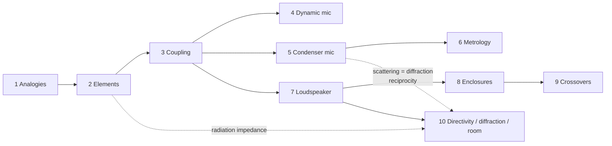

# 34870 Oral exam: the ten topics and where each one lives

> [!info] The rules (from `Literature/00 - Basic Material/34870_Oral_Exam_Rules_2026.pdf`, VCH, Nov 2026)
> - **One topic drawn at random** from the ten below. You develop it on the blackboard and/or orally. The censor and the examiners then ask questions. Those start from the topic but can go anywhere in the course.
> - **About 25 minutes per student**, including marking and changeover. **Classroom 019, building 352.**
> - **Slots on Wed 9 and Thu 10 December**, first come first served. ⏰ **Sign up by Fri 4 December** on the booking sheet under DTU Learn → Content → Basic Material. If you don't book, you get a random slot.
> - **Aids: printed or handwritten material only, nothing electronic.** Use it to consult, not to read from. So **print this map and the notes it points to.**
> - **The oral counts 70 %; the exercises and project count 30 %.** The final mark is given right after the oral. Every exercise and the project must be passed.

> [!tip] How the examiners say they examine (same PDF, page 2)
> The questions follow your answers. If the basics look shaky they go down to them; if you are solid they go up to detail. Everyone eventually hits a question they can't answer, and that is expected.
> - **Concepts, not memorised slides.** Ask yourself *why* each thing is the way it is.
> - **Use the problems, labs and project.** They are the practical side of the theory, so tie every topic to something you measured or simulated.
> - **See the connections between topics.** Examples: the scattering of a microphone body (L6) and the diffraction of a loudspeaker box (L11) are the same physics by reciprocity. The radiation mass (L3) appears again in the loudspeaker (L7), the vent (L8) and the micro-speaker (L11).
> - **Rehearse out loud**, with a colleague or with someone who doesn't know the course.

**Everyday drill:** [[Quiz Feedback - Labs A-E#5. Oral exam drill: questions the feedback tells us to expect|Quiz feedback §5]] (questions the lab feedback predicts) and the *Exam angle* section at the end of each lecture note.

---

## Coverage at a glance

| # | Topic | Main notes | Lab / project tie | Coverage |
|---|---|---|---|---|
| 1 | Analogies: impedance and mobility | L1, L2 | Lab A part 1 + 4d | ✅ solid |
| 2 | Acoustic / mechanical elements and systems | L2, L3 (+ L10 §1) | Lab A part 2 | ✅ solid |
| 3 | Coupling electrical–mechanical–acoustic | L4 §2–3 | Lab A parts 3–4 | ✅ solid |
| 4 | Dynamic microphones | L4 §4–5, L5 §2 | Problems 4 | ✅ (no lab) |
| 5 | Condenser microphones | L5 §4, L6 §1–3 | Lab B, Problems 5 | ✅ solid |
| 6 | Metrology, uncertainty, calibration | L6 §4–8 | Lab C | ✅, but the recording of 6 was never watched |
| 7 | The electrodynamic loudspeaker | L7 (+ L11 §4) | Lab D | ✅ solid |
| 8 | Enclosures: closed and vented | L8 | Lab D, project Task 1 | ✅ solid |
| 9 | Systems and crossovers | L9 | Lab E part 2, the whole project | ✅ solid |
| 10 | Directivity, box diffraction, room | L11 + Problems 11 | Lab E part 1 | ⚠️ **thinnest**: L11 was a pre-read until 26-Nov, now checked against the deck |

---

## 1. Analogies: impedance and mobility

**Examiners' example questions**
- Explain the network variables, power, impedance and admittance in the electrical, mechanical and acoustic domains. Define the mechanical and acoustic elements from those variables and give their electrical equivalents in **both** analogies.
- What are the limits of analogies and lumped models?
- Draw a simple circuit in both analogies. Which equations do you use to analyse each one?
- What are resonance and anti-resonance? What are the impedance and admittance there? Plot the frequency response of a simple resonator and explain its features.

**Where it is**
- [[Lecture 1 - Analogies - Introduction]]: §2 limits of the lumped model, §4 duality, §6 the full variable table in both analogies, §7 the elements.
- [[Lecture 2 - Analogies - Mechanical Systems]]: §2 variables and elements, §3 the 1-DOF resonator worked.
- [[Lecture 10 - Advanced Topics - Mixed Models & Metamaterials]] §1: *when the lumped model breaks* (size against λ). This is the best answer to "limits".
- [[Lab A - Runthrough]] part 4d explains every resonance and anti-resonance.

**Watch out:** resonance is where |Z| is **minimum** (series) or **maximum** (parallel). Say which variable you are looking at. This lost points in Lab A ([[Quiz Feedback - Labs A-E]]).

## 2. Acoustic elements and systems / Mechanical elements and systems

**Examiners' example questions**
- Explain the mechanical elements and how to compute their values from real objects.
- Explain the acoustic elements and how to compute their values from real geometries.
- What is radiation impedance, and how can it be modelled with a lumped circuit?
- When and why do we need a length (end) correction? How does it relate to the radiation impedance?

**Where it is**
- [[Lecture 2 - Analogies - Mechanical Systems]] §5: elements derived from real objects.
- [[Lecture 3 - Analogies - Acoustic Systems]]:
  - §3 the tube: open tube gives a mass, closed tube gives a compliance;
  - §5 losses;
  - §7 Helmholtz resonator;
  - **§8 radiation impedance and end corrections.** The end correction *is* the mass part of the radiation impedance.
- [[Lab A - Runthrough]] part 2: the silencer and its radiation impedance.
- The same radiation network reappears in **Problems 11.2**; see [[Lecture 11 - Radiation, Environment, Micro-speakers & Nonlinear Models|L11]] §9.

## 3. Coupling between electrical, mechanical and acoustic systems

**Examiners' example questions**
- Explain transduction and transducers.
- Give an example of an acoustic–mechanical transducer and how it is modelled.
- Give an example of an electro–mechanical transducer and how it is modelled.
- Explain impedance conversion, and how to combine and simplify coupled circuits.

**Where it is**
- [[Lecture 4 - Analogies - Transducers & Dynamic Microphones]]:
  - §2a the four controlled sources;
  - §2b area S, mechanical ↔ acoustic (transformer);
  - §2c Bl, electrical ↔ mechanical (gyrator in the impedance analogy);
  - §2d electrostatic transduction;
  - §2e impedance conversion;
  - §3 Problems 4.1–4.4.
- [[Lab A - Runthrough]] parts 3 (mechanical–acoustic) and 4 (electrical–mechanical, with the (Bl)²/Z_M term).

## 4. Dynamic microphones

**Examiners' example questions**
- What is the proximity effect, and what makes it more pronounced?
- Explain the parts of the dynamic microphone's circuit, its transduction and its sensitivity response.
- How are bandwidth, Q and sensitivity related? How do you tune them in practice?

**Where it is**
- [[Lecture 4 - Analogies - Transducers & Dynamic Microphones]]:
  - §4a the circuit;
  - §4b the transfer function;
  - §4c sensitivity × bandwidth;
  - §4d extending the bandwidth with cavities and a vent;
  - §5 Problems 4.
- [[Lecture 5 - Microphone Directionality & Condenser Microphones]] §2d: the proximity effect. It grows with the gradient (pressure-difference) principle and as you get closer, and it is strongest in the bass.
- MATLAB `Problems4_DynamicMicrophone`.

## 5. Condenser microphones

**Examiners' example questions**
- What do you want from a measurement microphone, and what from an audio microphone?
- Explain the parts of the circuit, the transduction and the sensitivity response.
- Why is a polarisation voltage used?
- How does the microphone body affect the measured pressure, and how is that compensated?

**Where it is**
- [[Lecture 5 - Microphone Directionality & Condenser Microphones]] §4:
  - 4a characteristics;
  - 4b–4f transduction (the bias is what linearises it);
  - 4g–4h polarised and electret designs;
  - 4i the full three-domain circuit;
  - 4j the transfer function.
- [[Problems 5 - Condenser Microphone, Worked]].
- [[Lecture 6 - Microphone Scattering, Metrology & Calibration]] §1–3: free-field vs pressure microphones, scattering, and the **free-field correction**.
- [[Lab B - Runthrough]]: the measured scattering on the mock-up, +8.6 dB at 1155 Hz on axis.
- Link to topic 10: the body's scattering and a box's diffraction are the same thing (reciprocity, L11 deck slide 34).

## 6. Metrology, uncertainty, acoustic calibration

**Examiners' example questions**
- How is a condenser microphone calibrated with an actuator? How do you get f_s and Q?
- How is the primary reference for acoustic measurement realised? (Reciprocity calibration.)
- Explain uncertainty, traceability, repeatability and reproducibility.

**Where it is**
- [[Lecture 6 - Microphone Scattering, Metrology & Calibration]]:
  - §4 metrology;
  - §5 GUM uncertainty;
  - §6 standards, traceability and reciprocity;
  - §7 f_s and Q from a measured curve;
  - §8 calibrators and pistonphones.
- [[Lab C - Preparation]]: the actuator method, the vocabulary and the f_s/Q procedure.
- [[Lab BC - Quiz model answers]].
- MATLAB `Problems6_Metrology_Calibration`.

**Gap:** the Lecture 6 recordings were transcribed but not watched. The open questions at the end of the L6 note (tube-end vs baffled T(s), type A/B for Lab C) are still open. Ask Vicente at a project Q&A.

## 7. The electrodynamic loudspeaker

**Examiners' example questions**
- Sketch a moving-coil loudspeaker and explain its parts and how it works.
- Explain its circuit, transduction, pressure response and electrical input impedance.
- What are the Thiele-Small parameters, and how are they measured?
- What are the main nonlinearities, and why do they occur?

**Where it is**
- [[Lecture 7 - Moving Coil Loudspeakers]]:
  - §1 construction;
  - §2 circuit;
  - §3 why "mass control";
  - §4–5 transfer functions;
  - §6 impedance;
  - §7–8 T-S parameters and how to measure them;
  - §10 nonlinearity.
- [[Lab D - Preparation]] and [[Lab D+E - Study Plan]] sessions 1–2: our woofer's T-S parameters, f_S 22.7 Hz.
- Nonlinearity in depth: [[Lecture 11 - Radiation, Environment, Micro-speakers & Nonlinear Models|L11]] §4. These are Bl(x), K(x) and Le(x) plus thermal effects. The lecture spent one slide on it (34871 covers it in January), but the exam question is listed here.

**Watch out:** |Z|max = R_E + (Bl)²/R_MS. Don't put electrical units on mechanical or acoustic elements ([[Quiz Feedback - Labs A-E]]).

## 8. Loudspeaker enclosures: closed and vented

**Examiners' example questions**
- Which elements are added to the circuit for a closed box, and what do they do? And for a vented box?
- How do the pressure response functions differ from measured closed- and vented-box responses? How do you tune them?
- How do you get the low-frequency far-field response of a vented box from near-field measurements?

**Where it is**
- [[Lecture 8 - Loudspeaker Enclosures]]:
  - §2–5 closed box;
  - §6 V_AS from added compliance;
  - §7 near field → far field;
  - §8–12 vented box, alignments, impedance and vent design.
- [[Lab D+E - Study Plan]] session 2 and [[Project Quiz 1 - Submitted answers]] Task 1. These hold our own numbers: f_B 24.6 Hz for L = 160 mm, and the losses that show only with the vent open.
- The near-field recipe: p_near ∝ U/a, so scale each near-field pressure by its own radius before adding them: **p_far ∝ a_D·p_cone + a_P·p_vent** (complex sum). The vent's pressure is 3.2× (10 dB) higher than the cone's for the same U. See [[Lab D+E - Study Plan]] §2.4.

## 9. Loudspeaker systems: crossover networks

**Examiners' example questions**
- Why are crossovers needed in multi-unit systems?
- Active vs passive crossovers: the differences and the design procedures.
- What are the challenges of designing a multi-unit system?
- Why must the measured phase of each unit be corrected, and how?

**Where it is**
- [[Lecture 9 - Loudspeaker Systems & Crossovers]]:
  - §1 why, and active vs passive;
  - §2–3 ideal filters and why the sum isn't 1;
  - §5 real drivers (L-pad, Zobel, driver phase);
  - §7.3 phase unwrapping and distance compensation.
- The project:
  - [[Project Quiz 1 - Submitted answers]] Task 2;
  - [[Tuning plan - System D]];
  - `Project/Lab Day 10-Nov - Results.pdf` and `Lab Day 12-Nov - Results.pdf`.
- [[Lab E - Runthrough]] part 2: phase compensation d = −1.15 m.

**Our design** (a ready example for the board):
- woofer: LR4 at 325 Hz in the DSP;
- mid: passive LP2 0.82 mH / 6.8 µF;
- tweeter: HP2 5.6 µF / 0.22 mH plus an L-pad;
- result: ±2 dB on axis, 150 Hz–15 kHz.

## 10. Loudspeakers: directivity, box diffraction, room interaction

**Examiners' example questions**
- Explain directivity using the piston in a baffle.
- How does mounting the unit in a box change its response, and how is that dealt with?
- Define the directivity function, the directivity factor and the coverage, and relate them.

**Where it is**
- [[Lecture 11 - Radiation, Environment, Micro-speakers & Nonlinear Models]]:
  - §1 the piston, directivity and near field;
  - §2 environment, baffle step and room;
  - **§8 *From the lecture*** (the deck check: modes, power response, Q and DI, diffraction, coverage);
  - **§9 Problems 11 worked**.
- [[Lab E - Runthrough]] and [[Lab D+E - Study Plan]] session 3:
  - one driver on three mountings;
  - circle dips at 1059 and 2115 Hz;
  - the measured circle-minus-IEC difference against `diffrac.m` (1.4 dB RMS);
  - IEC-screen directivity against the piston.
- [[Lecture 3 - Analogies - Acoustic Systems]] §8b: radiation impedance, which the power response is built on.

**The chain to say out loud:**
1. D(θ) = 2J₁(ka sinθ)/(ka sinθ). The piston beams once ka > 1.
2. The on-axis response stays flat but the radiated power falls, so the directivity factor Q rises.
3. Q decides the balance between direct and reverberant sound in a room.
4. A box is a finite baffle. Its edges send back an inverted, delayed copy: a peak where the path difference is λ/2, a dip where it is λ, and a 6 dB baffle step around c/(πW).
5. Fixes: offset the driver, round the edges, equalise the baffle step.
6. The microphone body does the same thing in reverse (reciprocity).
