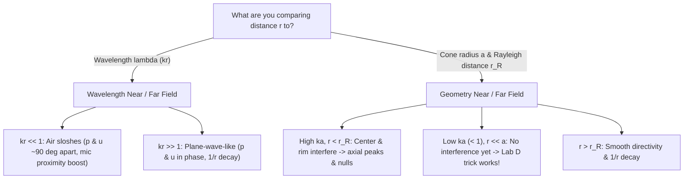

# Near Field vs. Far Field — Visual Guide

> [!abstract] The core reason it feels confusing
> In electroacoustics, **"near field vs. far field"** is used for **two different physical transitions** — depending on whether you compare your distance $r$ to the **wavelength ($\lambda$)** or to the **size of the speaker cone ($a$)**.

---

## 1. The Two Meanings of Near Field vs. Far Field

![[Courses/34870 Electroacoustics/Images/Concepts/fig1_two_nearfields.png]]

### Meaning 1 — Wavelength View ($kr \ll 1$ vs. $kr \gg 1$)
For a spherical wave from a small source, the radial particle velocity is:
$$u_r = \frac{p}{\rho c}\left(1 + \frac{1}{jkr}\right)$$

- **Near field ($kr \ll 1$, i.e. $r \ll \lambda / 2\pi$):** The $\frac{1}{jkr}$ term dominates. Particle velocity is huge and lags pressure by **~90°**, meaning air mostly **sloshes back and forth** (acting like an inert mass) without radiating net power.
  - **Course link:** Because $\frac{dp}{dr} \propto \left(1 + \frac{1}{jkr}\right)p$, directional/gradient mics get a massive low-frequency boost close to a source — the **proximity effect** ([[Lecture 5 - Microphone Directionality & Condenser Microphones|Lecture 5 §2d]]).
- **Far field ($kr \gg 1$, i.e. $r \gg \lambda / 2\pi$):** The wave front looks locally like a **plane wave**: $p$ and $u$ are **in phase** ($p/u = \rho c$), sound power radiates freely, and $|p| \propto 1/r$ (−6 dB per doubling of distance).

### Meaning 2 — Geometry View ($r$ vs. cone size $a$ & Rayleigh distance $r_R$)
A real loudspeaker diaphragm has radius $a$, so rays from the center ($r$) and the rim ($\sqrt{r^2 + a^2}$) travel different distances to an on-axis mic ([[Lecture 11 - Radiation, Environment, Micro-speakers & Nonlinear Models (pre-read)|Lecture 11 §1.3]]):
$$|p(r)| = 2\rho c U\,\left|\sin\!\left(\frac{k}{2}\left(\sqrt{r^2+a^2}-r\right)\right)\right|$$

- **Geometric near field (Fresnel zone, $r < r_R = \pi a^2/\lambda$):** At high frequencies ($ka \gtrsim 1$), the center and rim rays arrive out of phase, creating peaks and destructive nulls along the axis. At low frequencies ($ka < 1$), $\lambda$ is much larger than $2a$, so no nulls exist.
- **Geometric far field (Fraunhofer zone, $r \gg a$ and $r > \pi a^2/\lambda$):** Rays are nearly parallel, interference settles into a smooth directivity pattern $\frac{2J_1(ka\sin\theta)}{ka\sin\theta}$, and pressure decays cleanly as $1/r$.

---

## 2. Why the Lab D "Near-Field Trick" Works

![[Courses/34870 Electroacoustics/Images/Concepts/fig2_labD_nearfield_trick.png]]

> [!tip] Putting the mic right at the dust cap ([[Lecture 7 - Moving Coil Loudspeakers|Lecture 7 §12]] & [[Lab D - Preparation|Lab D]])
> When $r \ll a$ and **$ka < 1$**, there is no cone interference yet, and the front radiation impedance is purely mass-like ($Z_{AR} \approx j\omega M_{A1}$):
> $$p_{\mathrm{near}} \approx j\omega \frac{8\rho}{3\pi^2 a} U \qquad\text{vs.}\qquad p_{\mathrm{ff}} = j\omega \frac{\rho}{2\pi r} U \qquad\Longrightarrow\qquad \boxed{\frac{p_{\mathrm{near}}}{p_{\mathrm{ff}}} = \frac{16\,r}{3\pi\,a}}$$
> Because **both pressures are proportional to $j\omega U$**, they share the exact same frequency response shape below $ka = 1$ — shifted only by a constant $+20\log_{10}(16r/3\pi a)$ (which drowns out room reflections so you can measure bass in an ordinary room). Once $ka \gtrsim 1$, $Z_{AR}$ turns resistive and the cone beams, so the trick breaks down.
