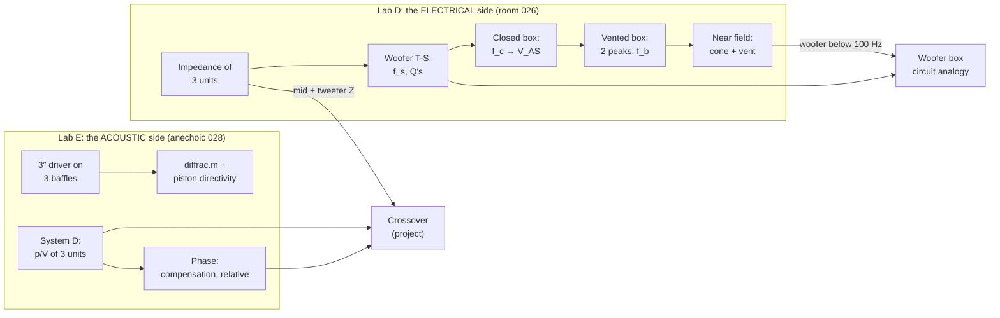

# Lab D + Lab E: a plan to understand both labs completely

Four sessions, about an hour each. In every session you open **one MATLAB file**, run it section by section (*Run Section*, Ctrl+Enter), and read the graph with the explanation below next to it. The quiz (Q10, Q11) is easiest after sessions 3 and 4, the oral in December wants all four.

> [!tip] The one idea that ties them together
> **Lab D measures how the speaker looks to the amplifier** (volts and amps: impedance). **Lab E measures what comes out acoustically** (pascals per volt, in free field). The project's crossover is designed with both: its voltage output depends on the Lab D impedances, and that voltage times the Lab E pressure-per-volt, summed with phase, is what you hear.

## What to open (and what to leave closed)

| Open | Where | Why |
|---|---|---|
| **`LabD_Loudspeakers1_Study.mlx`** | `5. Semester/Electroacoustics/Matlab/` | Sessions 1–2. Every Lab D step on our own data: formula → one line → result → graph. |
| **`LabE_Loudspeakers2_Study.mlx`** | same folder | Sessions 3–4. Every Lab E step, including `diffrac.m`. |
| `analyse_labD.m` | labs repo `Lab D/matlab/` | After session 2: `r = analyse_labD;` prints the whole Lab D summary in one go. Compare it with what you got step by step. |
| `ts_from_Z.m`, `fb_from_Z.m` | same | The Appendix B method and the f_b finder as functions. Read them: they are the same steps as in the study script. |
| `import_labD.m` | same | Read only. Why there are 41 files, and the two fixes (R = 32.9 Ω, V_amp = 2·AI0). |
| `phaseunwrap.m`, `diffrac.m` | labs repo `Lab E/matlab/course/` | Read the top of each. `phaseunwrap` is one line of maths. |
| *not needed* | `measure_lab*.m`, `labX_run.m`, `test_lab*.m` | Lab-day tools; they talk to the hardware. |

Both study scripts load the data straight from the labs repo, so `Labs/` must be pulled. If MATLAB complains about the path, `cd` to the `Matlab` folder first. The `.html` next to each `.mlx` has every output and graph, for reading on the phone.

---

## Session 1: impedance, and the woofer's T-S parameters (Lab D)

Open `LabD_Loudspeakers1_Study.mlx`, run up to and including **Part 2b2**.

### 1.1 How Z is measured

The amplifier drives the speaker through a known R; the card records V_amp and V_loud. The same current flows through both, so

$$Z_L = R\,\frac{V_{loud}/V_{amp}}{1 - V_{loud}/V_{amp}}$$

Two fixes are baked into our files: R was typed in wrong on the day (R_E instead of 32.9 Ω), and the amplifier's bridged output meant AI0 saw only half of V_amp. The script recomputes Z from the raw spectra and gets **exactly** the stored Z (difference 0). The sanity check is the brief's: |Z| must land on R_E at low frequency, and it does (and the woofer peak on the data sheet's 117 Ω).

### 1.2 The three units

![[labD_fig1_three_units.png]]

Read every impedance curve left to right:

1. **Flat at R_E, phase 0:** only the wire.
2. **The peak = the mechanical resonance.** The motor turns the mechanical impedance upside down: Z_E = R_E + jωL_E + (Bl)²/Z_M. Z_M is smallest at resonance, so the electrical bump is largest there.
3. **Phase: + below, − above, crossing 0 at the peak going down.** Below resonance the cone is stiffness-controlled; a stiffness turned upside down looks like an *inductance* (+). Above, the cone is mass-controlled, which looks like a *capacitance* (−). This is the precise way to read a resonance (and what the Lab A grader wanted).
4. **The rise at high frequency:** the coil's inductance L_E.

| Unit | Peak | Note |
|---|---|---|
| tweeter | **1.45 kHz, 6.7 Ω** | low and broad: heavily damped |
| midrange | **90 Hz, 19 Ω** | in its DALI box, port closed (not free air) |
| woofer, closed box | **42 Hz, 121 Ω** | |

**Why the project needs these:** a passive crossover sees this load, not a resistor. At 1.45 kHz the tweeter is 6.7 Ω instead of 3.6; at 10 kHz the midrange is about 3× its R_E. A filter designed for a nominal resistor shifts its corner.

### 1.3 Appendix B: f_s and the Q's from one curve

![[labD_fig2_free_air_method.png]]

- Z_max at the peak, r_c = Z_max/R_E, and the level **Z_r = √(R_E·Z_max)**: halfway between R_E and Z_max on a log axis.
- f₁ and f₂ are where |Z| = Z_r. Look at the phase panel: there it is about ±45°, the half-power points of the motional part.
- Q_M = f_s√r_c/(f₂ − f₁), Q_E = Q_M/(r_c − 1), Q_T = Q_M/r_c.

| | Ours (free air) | Data sheet |
|---|---|---|
| f_s | **22.7 Hz** | 23 Hz |
| Z_max | 117 Ω | 117 Ω |
| Q_MS | 9.9 | 9.12 |
| Q_ES | 0.51 | 0.42 |
| Q_TS | 0.49 | 0.40 |

**What the Q's mean:** Q_MS is the rubber's own damping, Q_ES is the damping by the back-EMF pushing current through R_E. Q_ES is 20× smaller, so the electrical damping wins and Q_TS ≈ Q_ES.

### 1.4 Closed box

![[labD_fig3_free_vs_closed.png]]

The box's air is a second spring behind the cone: **f_c ≈ 42 Hz**, Q_TC = 0.84. Same method, same formulas.

> [!note] Why the script and `analyse_labD` differ slightly
> The study script reads the peak at the nearest measured point (f_s 22.75, f_c 41.75 Hz). `analyse_labD` fits a parabola through the three top points (22.72, 42.01 Hz). That small difference moves V_AS from 209 to 213 L. Both are fine; quote one and say which.

> [!question]- Check yourself (session 1)
> 1. Why is the phase positive *below* resonance, when the cone is stiffness-controlled there? → The motor inverts the mechanical impedance: (Bl)²/(1/jωC) = jω(Bl)²C, an inductance.
> 2. What would |Z| at 5 Hz be if we forgot the factor 2 on V_amp? → About half: the free-air peak would read ~55 Ω instead of 117.
> 3. Why can't Appendix B be used on the vented box? → Two peaks, no single Z_max/f₁/f₂ pair; the method assumes one second-order resonance.

---

## Session 2: V_AS, the vent, the near field (Lab D)

Run the rest of `LabD_Loudspeakers1_Study.mlx`, then `r = analyse_labD;` in the labs repo to see it all in one printout.

### 2.1 V_AS from two resonances

The box spring adds to the suspension spring (stiffnesses add), the mass stays the same, and f² follows the stiffness:

$$\frac{f_c^2}{f_s^2} = 1 + \frac{V_{AS}}{V_B} \quad\Rightarrow\quad V_{AS} = V_B\left[\left(\tfrac{f_c}{f_s}\right)^2 - 1\right]$$

V_B = 0.435 × 0.45 × 0.45 = **88.1 L**, α = 2.37, **V_AS = 209 L** (213 L with the refined peaks; data sheet **150 L**).

- The same theory says Q_TC/Q_TS = f_c/f_s. Ours: 1.73 against 1.84, 6 % apart; the Q ratio gives 176 L.
- **Why too big:** the method assumes the same moving mass in both measurements, but the air load on the cone's back is different in free air (our "free air" was the driver in the box with the back cover off) and in the closed box; units of one model spread by ±15 % on V_AS; and the old box may leak. Say it as a range, **175–215 L from our data, 150 L on the data sheet**.
- M_MS (40 g vs 50.5), Bl (8.0 vs 10.1 T·m) and C_MS all inherit this error, because they are computed from V_AS.

### 2.2 The vented box: two peaks and a dip

![[labD_fig4_vented.png]]

- **Two peaks:** box air (spring) + vent air (mass) form a Helmholtz resonator. Coupled to the cone's mass-spring, two resonators make two modes (f_L ≈ 11 Hz, f_H ≈ 45 Hz).
- **The dip between them is f_b.** There the vent air swings by itself, and the box pressure holds the cone still. A still cone gives no back-EMF, so |Z| falls towards R_E, and the phase crosses 0 going *up*.
- **Longer tube → more air mass → lower f_b**, and you can see the lower peak move most.

$$f_b = \frac{c}{2\pi}\sqrt{\frac{S_P}{V_B\,(L + 1.46a)}}$$

The **end correction** 1.46a (0.85a at the flanged inner end + 0.61a at the free end) is the air dragged along at the tube's ends.

| Tube   | Measured (  | Z       | dip)    | Formula with end correction | Group report (no end correction) |     |
| ------ | ----------- | ------- | ------- | --------------------------- | -------------------------------- | --- |
| 160 mm | **23.4 Hz** | 23.3 Hz | 26.5 Hz |                             |                                  |     |
| 200 mm | **22.8 Hz** | 21.3 Hz | 23.7 Hz |                             |                                  |     |
| 240 mm | **21.5 Hz** | 19.8 Hz | 21.6 Hz |                             |                                  |     |
|        |             |         |         |                             |                                  |     |

### 2.3 Near field at the cone and the vent

![[labD_fig5_near_field.png]]

Close to a source, p_near = jω M_A1 U with M_A1 = 8ρ/(3π²a): the **same jωU shape as the far field**, at a higher level. That is how you get an "anechoic" 20 Hz in an ordinary room.

- **The cone has a broad notch near f_b:** the vent holds it still (the same physics as the impedance dip).
- **Below f_b, cone and vent are ~180° apart** (bottom panel): the vent air goes out while the cone goes in. That is why a vented box falls at 24 dB/octave below f_b.
- **The vent microphone above f_b** mostly hears the cone, 10 cm away; the vent's own output falls 12 dB/octave there.
- **The sharp wiggle at 56 Hz in every curve is the room**, not the speaker. Room 026 is 3.35 × 3.05 × 3.09 m; two of its axial modes, c/2L, land at 55.5 and 56.3 Hz. It is not in the impedance, which proves it is acoustic.
- The NI card samples both channels on one clock, so **this phase is valid** (unlike Lab E's sound card).

### 2.4 Adding cone and vent

![[labD_fig6_near_field_sum.png]]

p_near ∝ U/a, so the two pressures only add after scaling each by its radius: **p_far ∝ a_D·p_cone + a_P·p_vent**. The sum (black) is the box's far-field response: flat down to about f_b, then falling steeply because the vent and the cone cancel below f_b. This is the curve the project's woofer-box circuit analogy must reproduce.

> [!question]- Check yourself (session 2)
> 1. Why does the |Z| dip of the vented box give f_b? → At f_b the Helmholtz resonator holds the cone still; no cone motion, no back-EMF, |Z| → R_E.
> 2. Why must the vent's near-field pressure be scaled before adding it to the cone's? → p_near ∝ U/a; the vent's a is 3.25 cm, the cone's 10.55 cm, so the same U gives 3.2× (10 dB) more pressure at the vent.
> 3. `analyse_labD` reports a cone notch at 5.9 Hz for the 160 mm tube. Believe it? → No: it searches from 5 Hz and finds noise. Search 12–60 Hz (as the study script does).

---

## Session 3: baffles, diffraction, beaming (Lab E, part 1)

Open `LabE_Loudspeakers2_Study.mlx`, run up to the end of **Part 1**. The `diffrac` section takes a minute.

### 3.1 One driver, three mountings

![[labE_fig1_mountings.png]]

- **Only magnitude, on purpose:** the UMIK runs on its own USB clock, so every run starts at a random delay and its absolute phase means nothing. Say this in the quiz.
- **Small box: about 6 dB under the screens at 250–600 Hz (6.2 against the circle, 5.7 against both screens averaged), level above 3 kHz.** That is the **baffle step**: a big baffle mirrors the source (half space), which doubles the pressure (+6 dB). The small box's front only acts as a baffle once it is big compared with the wavelength.
- **Circular screen: deep regular dips.** **IEC screen: smooth.**

### 3.2 Why the circle has dips exactly there

Every edge point re-radiates an **inverted** copy of the wave. With the driver centred, all edge points are a = 0.30 m away, so all the copies arrive together, Δ behind the direct sound:

$$\Delta = a + \sqrt{a^2 + r^2} - r = 0.318\ \text{m}$$

Inverted, so it **adds at Δ = λ/2** and **cancels at Δ = λ**: peaks at 539 / 1617 Hz, dips at **1078 / 2156 Hz**; measured dips **1059 / 2115 Hz**. On the IEC screen the edges sit 0.20–0.44 m away, the copies never line up, and the ripple averages out. That is exactly why the IEC screen is the standard baffle. At 30° the circle's edges are no longer equidistant from the microphone and its ripple smears out too.

### 3.3 diffrac.m

![[labE_fig2_circle_diffrac.png]]

- The model puts a line of edge sources around the outline (the circle as a 200-corner polygon) and adds them to the direct sound. Output in dB **re free field** (an infinite baffle would be +6 dB).
- The measured curve includes the driver itself, so it is shifted onto the model's level from 300 Hz to 5 kHz; only the **shape** is compared.
- **The dips line up.** The **point source** keeps rippling to 20 kHz; the **3 cm piston** ripples less above a few kHz, like the measurement. A piston with ka > 1 sends little sound sideways along the baffle, so the edges have less to diffract.

### 3.4 IEC screen: how the driver beams

![[labE_fig3_iec_directivity.png]]

Off-axis ÷ on-axis removes both the driver and the baffle; what is left is the beaming. A rigid piston in a baffle: **D(θ) = 2J₁(x)/x, x = ka·sinθ**, −3 dB at x = 1.62, first null at x = 3.83.

| 60° | −3 dB | first null |
|---|---|---|
| piston, a = 3 cm | 3.40 kHz | 8.06 kHz |
| measured | **3.45 kHz** | **7.96 kHz** |

At 15–30° the measured nulls come early above 10 kHz: the cone stops moving as one rigid piece (**break-up**).

> [!question]- Check yourself (session 3)
> 1. Why can the circle–IEC *difference* be compared with diffrac without any shifting? → The driver is the same in both, so it cancels; only the two baffles are left. (Agrees with diffrac to 1.4 dB RMS, 300 Hz–5 kHz.)
> 2. Why is the edge wave's first effect a *peak* at Δ = λ/2 rather than a dip? → The edge source is inverted: half a wavelength late plus a sign flip = in phase.
> 3. Why does a 25 mm tweeter hardly beam at 8 kHz while the 21 cm woofer is −15 dB at 30° above 3 kHz? → ka = 1 at 4.4 kHz for the tweeter, at 520 Hz for the woofer.

---

## Session 4: System D, phase, and the crossover (Lab E, part 2)

Run the rest of `LabE_Loudspeakers2_Study.mlx`.

### 4.1 The three units

![[labE_fig4_system.png]]

| Unit | Level (dB re 1 Pa/V) | ka = 1 at | 30° − 0°, 3–8 kHz |
|---|---|---|---|
| woofer (Scan-Speak 26W/8534G00, 21 cm) | 7.7 at 150–600 Hz | 520 Hz | **−15.6 dB** |
| midrange (DALI Spektor 2, 5¼″) | 2.8 at 150–600 Hz, 3.3 at 1–3 kHz | 1.04 kHz | −7.5 dB |
| tweeter (Spektor 2, 25 mm dome) | **12.4 at 1–3 kHz** | 4.4 kHz | −0.7 dB |

**Crossover reasoning:**
- The tweeter is **~9 dB louder** than the midrange → the crossover must attenuate it.
- Tweeter and midrange cross near 950 Hz, but the tweeter's resonance is **1.45 kHz** (Lab D). Crossing there would drive it at resonance → cross at **2.5–3 kHz** instead. DALI's own crossover for this box: **2.6 kHz**.
- The woofer must hand over well below 1.5 kHz: it beams above that and has break-up peaks at 2.5–3 kHz.
- Below ~100 Hz Lab E is not valid (the chamber, and the vent was plugged) → the woofer's low end comes from **Lab D's near field**.

### 4.2 Phase

![[labE_fig5_phase.png]]

Every measured phase is the unit's own phase **plus** a delay (flight time + the sound card's random delay), which wraps hundreds of times. `phaseunwrap.m` adds back 2πf·d/c and unwraps. One d for all three units, **d = −1.15 m**: negative because the card delay was *shorter* than the flight time, so this "distance" is not physical.

- **The tweeter phase goes wild below ~500 Hz:** it is 30–50 dB down there, i.e. noise, and noise has a random phase. Unwrap runs from the lowest frequency up, so every random jump there adds a full 360° to the *whole* rest of the curve. Only unwrap where the unit actually plays (Louis's question).
- **The clean way: relative phase, ∠(H_a/H_b).** Both units are in the same run, so the delay cancels and nothing needs unwrapping.

| | 300 Hz | 3 kHz |
|---|---|---|
| woofer − midrange | −12° | −53° |
| tweeter − midrange | **+163°** | **+75°** |

Woofer and midrange are nearly in phase where they will cross. The tweeter is almost inverted at low frequency (a second-order high-pass gives up to +180° below its resonance) and about 90° ahead at the crossover. So the filter orders and the tweeter's polarity are chosen **against this curve**, so that the units add instead of cancel around 2.6 kHz.

> [!question]- Check yourself (session 4)
> 1. Why does the relative phase not need d at all? → The delay is common to all three units in one run, so it cancels in H_a/H_b.
> 2. Why measure all three units in *one* run (Nmeas = 3)? → Each new run gets a new random sound-card delay; separate runs would make the relative phase meaningless.
> 3. Why not cross the tweeter at 950 Hz where the curves meet? → It would be driven at and below its 1.45 kHz resonance: large excursion, distortion, risk to the dome.

---

## Then: the quiz

After session 4, open [[Lab DE - Quiz model answers]] and write Q10 and Q11 **in your own words**. The four figures are in `Lab DE - Quiz figures/`. Insert them with "+" → Insert Image.

## Things to fix in our group reports (tell Louis and Sophie)

**Lab D report (`Lab D/report/LabD_report.tex`):**
- The header and footer still say "Lab C — Microphone calibration, measured 29 September" (template left over); the same in the Lab E report.
- **V_AS formula is missing the square:** V_AS = V_AB[(f_c/f_s)² − 1]; and "0.215 cm³" should be **0.213 m³ = 213 L**.
- "a 1–2 dB difference between the measured and calculated resonance frequencies" → Hz, not dB. The calculation also needs the end correction (L + 1.46a); see the table in 2.2.
- "With the cone's decreased movement, its electrical resistance is also decreased" → the cone's small motion means a small **back-EMF**, so the *motional impedance* drops and |Z| → R_E.
- Figures: units in [brackets] (Lab A lost points for that), no phase plots, the near field as "Transfer Function" on a linear scale with no unit → |p/V| in dB re 1 Pa/V. "Resistor 1–8" in the tweeter legend are the 8 repeat runs (run 3 clipped 5 %).
- The near-field f_b markers (22.75 / 21 / 19.6 Hz) are not all on the cone minimum; the impedance dips (23.4 / 22.8 / 21.5) are more precise.

**Lab E report (`Lab E/report/LabE_report.tex`):**
- Room: 028/025 (anechoic), not 026. Angles: 0, 15, **30**, 60°, not 20.
- "Small box … at 400 Hz a large spike up to 10 dB": no; the small box's +10 dB peak is at **11 kHz** (the driver's break-up). At 250–600 Hz it is the *screens* that are higher (the baffle step).
- "Circular screen at 30° … very sharp drop at around 1000 Hz": the sharp 1 kHz dip is at **0°**; at 30° the ripple is smoother.
- The plots run to 20 kHz: the rise above 18.4 kHz is the UMIK, not the speaker. Stop at 18 kHz.
- "Transfer Function" axis → |p/V| (dB re 1 Pa/V); Frequency (Hz).

## Numbers to know by heart

| | |
|---|---|
| R_E tweeter / mid / woofer | 3.4 / 4.6 / 5.7 Ω |
| Resonances | tweeter 1.45 kHz, mid 90 Hz (in box), woofer f_s 22.7 Hz, f_c 42.0 Hz |
| Woofer Q_MS / Q_ES / Q_TS | 9.9 / 0.51 / 0.49 (free air) |
| V_B, V_AS | 88.1 L, 175–215 L (data sheet 150 L) |
| f_b for 160 / 200 / 240 mm | 23.4 / 22.8 / 21.5 Hz |
| Room mode in the near field | 56 Hz (3.05 and 3.09 m) |
| Circle Δ, dips | 0.318 m; 1078 / 2156 Hz predicted, 1059 / 2115 measured |
| Baffle step | ≈ 6 dB (box vs screens, 250–600 Hz) |
| Piston 60°, a = 3 cm | −3 dB 3.4 kHz, null 8.1 kHz (measured 3.45 / 7.96) |
| Tweeter vs mid | +9 dB; cross at 2.5–3 kHz (DALI 2.6 kHz) |
| Phase | d = −1.15 m; tweeter − mid +163° → +75° |
