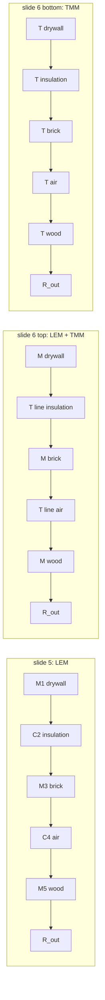

# Lecture 10 — Advanced Topics: Mixed Models and Metamaterials

> [!info] Lecture Info
> **Date:** Monday 26 October 2026, 13:00 (about 2 h of the slot, per Frieder's announcement of 25-Oct) · Lyngby b.352 r.019 · **FL** (Frieder Lucklum). Written **before the lecture** from the deck: check it against what is said, and add a *From the lecture* section afterwards.
> **Slides:** [[Courses/34870 Electroacoustics/_Learn/Lecture 10 - Advanced Topics/34870_AdvancedTopics_26102026 - Copy.pdf|Advanced Topics deck]] (13 pages, 2 slides per page, 26 slides: mixed models on slides 1–15, metamaterials on 16–25). learn-sync filed it under `_Learn/` instead of `Slides/` because the file name has no "lecture" in it; it is the right file.
> **Problems:** none handed out. The deck works one example in three ways (the five-layer wall, slides 4–9), and slides 2 and 18 carry numbers too, so those are worked here (§2, §4, §6).
> **Scripts:** [Lecture10_AdvancedTopics_MixedModels.m](file:///home/mads/DTU/5.%20Semester/Electroacoustics/Matlab/Lecture10_AdvancedTopics_MixedModels.m) (+ `.html` export, formula first) in `5. Semester/Electroacoustics/Matlab/`, and [p10.py](file:///home/mads/DTU/5.%20Semester/Electroacoustics/LTspice/Lecture%2010%20-%20Mixed%20Models/p10.py) in `5. Semester/Electroacoustics/LTspice/Lecture 10 - Mixed Models/`, which draws the slides' three LTspice circuits (`P10_Wall_LEM_TMM.asc`; `--verify` runs LTspice headless and matches the closed form to 1e-10 dB; `--plots` writes `Images/Lecture10/`).
> **Previous:** [[Lecture 9 - Loudspeaker Systems & Crossovers|Lecture 9]] · **Next:** Lecture 11 (Finn Agerkvist, postponed from 22-Oct): *Radiation, acoustic environment, µ-speakers / nonlinear circuit models*, **Mon 2-Nov 13:00**.

> [!warning] Today, not in this lecture: the Lab D/E quiz is due tonight
> Frieder's announcement repeats it: **Lab D/E - Loudspeakers quiz, deadline Mon 26-Oct (evening)**. Q1–9 are ticked in the saved attempt, but **Q10 and Q11 still have to be written in your own words** from [[Courses/34870 Electroacoustics/Labs/Lab DE - Quiz model answers|the model answers]], then the checklist at the end of that note, then Submit. Nothing has been submitted.

> [!abstract] Where this lecture sits
> Everything so far was **lumped elements** (LEM): masses, springs, dampers and their acoustic cousins, valid while every part is much smaller than the wavelength. This lecture shows what to do when that breaks. **Distributed models** (transfer matrices) handle layers and tubes exactly in 1-D. **Numerical models** (FEM, BEM) handle any shape at a price in run time. The message is to **mix them**: lumped where it is good enough, distributed or numerical only where it has to be. The second half is a teaser for **acoustic metamaterials**: periodic structures whose internal resonances block sound in bands, analysed with the same mass-spring thinking. It ends with course and thesis advertising (34848, 34865, a special course, four MSc topics).

---

## 1. Limits of the lumped element method — slide 2 (repetition)

Lumped elements assume:

- **dimensions ≪ wavelength**, in *every* domain (electrical, mechanical, acoustic);
- **homogeneous** element properties;
- **idealised** behaviour: no parasitics, rigid bodies, sound-hard walls.

**Extension: real boundaries.** A real surface (absorber, skin, ear) is not sound-hard. Describe it by a frequency-dependent **surface impedance** and terminate the circuit with it. Example on the slide: a lumped ear drum.

## 2. Worked: the lumped ear-drum impedance — slide 2

Two series R-L-C branches in parallel (acoustic impedance, Pa·s/m³):

| Branch | R | C | L |
|---|---|---|---|
| 1 | 50.6 MΩ | 1.9 pF | 9400 H |
| 2 | 31.1 MΩ | 2.1 pF | 983.8 H |

$$Z_i = R_i + j\omega L_i + \frac{1}{j\omega C_i}, \qquad Z_{ED} = \frac{Z_1 Z_2}{Z_1 + Z_2}$$

| Result | Formula | Value | Slide plot |
|---|---|---|---|
| Branch 1 resonance | $f_1 = \frac{1}{2\pi\sqrt{L_1C_1}}$ | **1191 Hz** | first dip of \|Z\| ≈ 1.2 kHz ✓ |
| Branch 2 resonance | $f_2 = \frac{1}{2\pi\sqrt{L_2C_2}}$ | **3502 Hz** | second dip ≈ 3.5 kHz ✓ |
| Damping | $Q_i = \frac{1}{R_i}\sqrt{L_i/C_i}$ | $Q_1$ = 1.39, $Q_2$ = 0.70 | broad, shallow dips ✓ |
| \|Z\| at 20 Hz | $\approx \frac{1}{\omega(C_1+C_2)}$ | **1.99·10⁹** Pa·s/m³ | ≈ 2·10⁹ at the left edge ✓ |
| Low-frequency equivalent volume | $V = (C_1 + C_2)\rho c^2$ | **0.56 cm³** | — |

At low frequency the drum is just a stiffness (phase −90°, falling 20 dB/decade), equivalent to about half a cubic centimetre of air. Around 1–4 kHz the masses and the damping show up, and above the second resonance the phase turns positive (mass-controlled). This is the "lumped ear drum" a coupler or ear-canal model ends in (§5).

## 3. Beyond lumped: distributed and numerical models — slide 3

**Distributed element models** (two-port method, **transfer matrix method**, TMM): a section of tube, string or layer is described exactly by a 2×2 matrix between its input and output (pressure, velocity). It is the infinitesimal limit of a chain of lumped L–C cells, so it "requires calculus", but the result is closed-form. For a uniform layer of thickness $l$ with $Z_0 = \rho c$ and $k = \omega/c$:

$$\begin{pmatrix}p_{in}\\ u_{in}\end{pmatrix} = \begin{pmatrix}\cos kl & jZ_0\sin kl\\ \dfrac{j\sin kl}{Z_0} & \cos kl\end{pmatrix}\begin{pmatrix}p_{out}\\ u_{out}\end{pmatrix}$$

This is a lossless **transmission line**; in LTspice it is the `T` element with $T_d = l/c$ and $Z_0 = \rho c$, which is how slide 6 draws it. Small $kl$: $\cos kl \approx 1$, $\sin kl \approx kl$, and the matrix becomes a series mass $\rho l$ plus a shunt compliance $l/(\rho c^2)$: the lumped model is the first-order approximation of the line.

**Numerical models** split the geometry into small finite elements and solve the full PDE: **FEM** (finite elements, volume mesh), **BEM** (boundary elements, surface mesh only, natural for radiation into open space: Lab B's `CylinderPlaneWave`), **FDM** (finite differences). A FEM model of an acoustic domain ends in

$$(\mathbf K - \omega^2\mathbf M)\,\mathbf p = \mathbf 0$$

with the global stiffness matrix $\mathbf K$ and mass matrix $\mathbf M$: the same mass-and-spring idea, with thousands of degrees of freedom.

## 4. Worked: the five-layer wall — slides 4–9

**The problem** (slide 4). Plane wave, normal incidence, through drywall 1 cm | insulation 3 cm | brick 5 cm | air gap 1 cm | wood 2 cm (order from the sketch). Find the transmission $p_{out}/p_{in}$.

| Layer | ρ [kg/m³] | c [m/s] | l [cm] | Lumped as |
|---|---|---|---|---|
| drywall | 600 | 6000 | 1 | mass $M_1 = \rho l$ = 6 kg/m² |
| insulation | 200 | 500 | 3 | compliance $C_2 = l/(\rho c^2)$ = 6.0·10⁻¹⁰ m/Pa |
| brick | 2000 | 3600 | 5 | mass $M_3$ = 100 kg/m² |
| air | 1.2 | 343 | 1 | compliance $C_4$ = 7.08·10⁻⁸ m/Pa |
| wood | 550 | 4000 | 2 | mass $M_5$ = 11 kg/m² |

Far side: air, $R_{out} = \rho_0c_0$ = 411.6 Pa·s/m. Per unit area, impedance analogy: pressure is the across variable, particle velocity the through variable.

### 4.1 The three models (slides 5–6)

All three are chains of two-ports, so the transmission is one matrix product: with the total ABCD matrix $\begin{pmatrix}A & B\\ C & D\end{pmatrix}$ of the chain,

$$\frac{p_{out}}{p_{in}} = \frac{1}{A + B/R_{out}}, \qquad \text{series } Z: \begin{pmatrix}1 & Z\\0 & 1\end{pmatrix}, \quad \text{shunt } Y: \begin{pmatrix}1 & 0\\ Y & 1\end{pmatrix}$$

![[Courses/34870 Electroacoustics/Images/Lecture10/L10_wall_transmission.png]]

*LTspice run of `P10_Wall_LEM_TMM.asc` (the slides' circuits), identical to the MATLAB closed form.*

### 4.2 Reading the curve, number by number

| Feature | Check | Value | Models give | Slide |
|---|---|---|---|---|
| Level at 20 Hz | mass law $\frac{p_{out}}{p_{in}} \approx \frac{\rho_0c_0}{j\omega m''}$, $m'' = \sum\rho_i l_i$ = 123 kg/m² | −31.5 dB | LEM −31.0 (it leaves out the 6 kg/m² of insulation), TMM −31.4 | ≈ −30 dB ✓ |
| 1st peak | air gap as a spring between (drywall + brick) and wood: $f = \frac{1}{2\pi}\sqrt{\frac{1}{C_4}\left(\frac{1}{M_1+M_3} + \frac{1}{M_5}\right)}$ | 189.4 Hz | 189 Hz in all three | just under 200 Hz ✓ |
| 2nd peak | insulation as a spring between drywall and (brick + wood): $f = \frac{1}{2\pi}\sqrt{\frac{1}{C_2}\left(\frac{1}{M_1} + \frac{1}{M_3+M_5}\right)}$ | 2723 Hz | **LEM 2731**, mixed 2395, TMM 2393 | orange LEM peak to the right of the others ✓ |
| … corrected | add a third of the insulation's own mass (6 kg/m²) to the drywall | **2378 Hz** | matches mixed/TMM within 0.6 % | |
| 3rd, 4th peak | **thickness resonances** of the insulation, $f_n = \frac{nc}{2l}$ = 8.33, 16.7 kHz (shifted by the loading of the neighbours) | — | mixed 9.13 / 17.10 kHz, TMM 9.12 / 17.07 kHz; **absent in LEM** | peaks near 9 and 17 kHz, LEM keeps falling ✓ |
| 5th peak | half-wave of the 1 cm **air gap**, $c/2l$ = 17.15 kHz | — | 17.15 kHz (mixed, TMM) | the twin peak at the right edge |

> [!important] What the example teaches
> - The **lumped model is good to about 1 kHz** (within 1.3 dB of the TMM below 1 kHz) and gets the first resonance exactly.
> - It fails on the **soft layer first**: at its own resonance the insulation is already $l/\lambda$ = 0.16 thick, its mass is not negligible (it weighs as much as the drywall), and above that it has standing waves.
> - The **stiff layers can stay lumped** even where they are not small compared with λ (brick: 0.28 λ at 20 kHz), because what matters is their own first thickness resonance $c/2l$: 300 kHz (drywall), 36 kHz (brick), 100 kHz (wood), all above the band.
> - So the **mixed model** (masses lumped, soft layers as lines) is already as good as the full TMM: within **0.08 dB below 2 kHz**, peaks within 0.2 %. As complex as necessary, as simple as possible.

### 4.3 Cost: 1-D, 2-D, 3-D FEM — slides 7–9

| Model | Physics | Size | Run time | Result |
|---|---|---|---|---|
| LEM (LTspice) | — | 5 elements | < 0.1 s for 10 000 steps/decade | misses the insulation modes |
| 1-D FEM | acoustics only | 10⁴ elements, 10⁵ DOFs (> 8 elements/cm), 200 steps/decade | 9 s | = TMM |
| 2-D FEM | acoustics + mechanics | 1670 elements → 1510 | 0:18 → 1:05 min | = TMM (my reading: at normal incidence the extra mechanics adds nothing visible) |
| 3-D FEM | acoustics + mechanics | 21 800 elements → 8920 | 2:55 → 21:28 min | = TMM |

(The second number in each row is the refined model; the slide marks it in red.) For this plane-wave problem all of that effort only reproduces the TMM. FEM pays off when the geometry is not a stack of uniform layers.

## 5. Mixed models in practice — slide 10

Every method can be coupled to the others through coupling equations, like the transduction equations of lectures 4–7 couple the electrical and mechanical domains. Choose per part: **as complex as necessary, as simple as possible.**

| Device | Lumped (LEM) | Distributed (TMM) | Numerical (FEM/BEM) |
|---|---|---|---|
| **Loudspeaker** | electromagnetic circuit (voice coil, magnet) | — | FEM for the cone/suspension mechanics (break-up), maybe the enclosure; **BEM** for the outer radiation (baffle diffraction: Lab E's `diffrac`) |
| **In-ear device** | transducers (mics, receivers) | ear canal | FEM for the ear canal if not a plain tube |
| | ear drum (§2) | or TMM for the ear drum | |

This is the bridge to the loudspeaker project: the LTspice model of the drivers is lumped, while the measured Lab E responses already contain the box diffraction that a lumped model cannot give.

## 6. Acoustic metamaterials — slides 16–21

**What they are** (slide 17): (semi-)periodic composite materials whose internal structure tunes the **effective dynamic** acoustic and elastic properties (effective density ρ and bulk modulus κ). "New physics":

- **band gaps**: frequency ranges with no propagation at all;
- **negative** effective properties (ρ < 0 and/or κ < 0) → waveguiding, lensing, cloaking. Slide 17's ρ–κ map: ordinary materials sit in the ρ > 0, κ > 0 quadrant; one negative = waves decay (enhanced absorption, slow sound near the boundaries); both negative = negative refraction.
- Examples in nature: butterfly wings, peacock feathers, opals (photonic crystals, 1-D/2-D/3-D periodicity).

**Two mechanisms** (slide 18):

### 6.1 Bragg scattering: the mass-spring line

Masses m spaced l on a string with tension T:

$$\frac{d^2y_n}{dt^2} = \omega_0^2(y_{n+1} - 2y_n + y_{n-1}), \qquad \omega_0^2 = \frac{T}{ml}$$

Try $y_n = e^{j(\omega t - knl)}$ → the **dispersion relation**

$$\omega(k) = 2\omega_0\left|\sin\frac{kl}{2}\right|, \qquad c(k) = \frac{\omega}{k} = \frac{2\omega_0}{k}\sin\frac{kl}{2}, \qquad c_g(k) = \frac{\partial\omega}{\partial k} = \omega_0 l\cos\frac{kl}{2}$$

- Low k (long waves): $\omega \approx \omega_0 l\,k$, non-dispersive, $c = c_g = \omega_0 l$.
- At $kl = \pi$ (wavelength = 2 cells, the edge of the **Brillouin zone**) the frequency tops out at $2\omega_0$ and $c_g = 0$: a standing wave, each cell reflects in phase with the others (Bragg).
- Above $2\omega_0$ there is no real k: a stop band. The gap sits where the **wavelength is comparable to the period**, which is why Bragg gaps need big structures for low frequencies.

### 6.2 Local resonance: masses with internal resonators

Each main mass m (springs k) carries a resonator $m_R$ on a spring $k_R$, period d:

$$0 = 2(1 - \cos kd) - \left(\frac{\omega}{\omega_0}\right)^2\left(1 + \frac{m_R/m}{1 - \omega^2/\omega_R^2}\right), \qquad \omega_0^2 = \frac{k}{m}, \quad \omega_R^2 = \frac{k_R}{m_R}$$

The bracket is an **effective mass** $m_{eff}/m = 1 + \frac{\mu}{1 - \omega^2/\omega_R^2}$, $\mu = m_R/m$: just above $\omega_R$ it is **negative**, and no wave propagates. With $a = 2(1-\cos kd)$, $W = (\omega/\omega_0)^2$, $\Omega_R = \omega_R/\omega_0$ it is a quadratic in W with two branches:

$$\frac{W^2}{\Omega_R^2} - W\left(1 + \mu + \frac{a}{\Omega_R^2}\right) + a = 0$$

Worked with an illustrative resonator ($\mu$ = 1, $\Omega_R$ = 0.5; the slide gives no numbers): the gap runs from **0.484 ω₀** (top of the lower branch at $kd = \pi$) to **$\Omega_R\sqrt{1+\mu}$ = 0.707 ω₀** (start of the upper branch at k = 0). The gap opens **around $\omega_R$**, far below the Bragg limit $2\omega_0$: a **sub-wavelength** band gap, set by the resonator and not by the period. That is the whole attraction: low-frequency insulation from a structure much thinner than the wavelength. A heavier resonator (larger μ) widens it.

### 6.3 2-D and 3-D — slides 19–21

- **2-D mass-spring array** (slide 19): the dispersion becomes a surface over $(k_x, k_y)$; one plots it along the edge of the irreducible Brillouin zone Γ → X → M → Γ. Lucklum's printed honeycomb-like structure (1 mm cell, 0.8 mm holes) shows a **complete band gap** around 7–8·10⁵ Hz (ultrasonic) for all directions.
- **3-D mass-spring lattice** (slide 20, Lucklum et al., APL 2018): a printed lattice of spheres on thin rods, band diagram along Γ–X–M–Γ–R–X|M–R with a **166 % relative band gap** (normalised frequency up to ≈ 0.45), confirmed by measured transmission along ΓX, ΓM, ΓR.
- Literature examples (slide 21, pictures only): the steel-cylinder sculpture of Martínez-Sala (Nature 1995, the classic first sonic-crystal measurement), a micro-machined phononic crystal (Hopkins 2011), pillar plates (Assouar 2012), 3-D printed lattices, Fang's Helmholtz-resonator waveguide with negative effective modulus (2006), a membrane-loaded tube with negative density (Physics Today 2016), and slit/resonator panels for low-frequency absorption (Jiménez 2017; Yang & Sheng 2017).

## 7. Courses and projects on offer — slides 11–14, 22–25

| What | When | Content | Prerequisites |
|---|---|---|---|
| **34848** Challenges in Acoustic Microsystems | 3 weeks, **January** | a real hearing-aid industry challenge (Demant or WS Audiology), modelled and simulated; COMSOL crash course, full-time group project, report + presentation, individual quiz | lumped/distributed models and/or FEM/BEM; recommended: Fundamentals of Acoustics, Electroacoustics, FEMVIB or Numerical Acoustics |
| **34865** Numerical Acoustics | 13 weeks, **spring** (VCH + FL) | theory + weekly group exercises, then a project with guest lectures; MATLAB-based OpenBEM and MATLAB PDE (FEM); project presentation + oral exam | |
| **Special course: acoustic metamaterials** | on demand, about once a year (spring/summer), 3–5 students, 5 ECTS over ≈ 6 months, flexible | intro lectures (metamaterials, phononic crystals, dispersion, Brillouin zone, TMM for metamaterials), own project, graded report | |
| **MSc thesis topics** (contact FL, b.352 r.020, fluc@dtu.dk) | | 1. complex 3-D metamaterial lattices (mass-spring for vibration, interconnected Helmholtz resonators for sound); 2. (tunable) Helmholtz resonators for broadband low-frequency absorption; 3. phoxonic crystals (light + sound, with the Metamaterials group, cleanroom); 4. tailored porous/metaporous insulators | modelling: lumped + FEM/COMSOL; fabrication by high-resolution 3-D printing; characterisation with impedance tubes and vibrometers |

> [!note] Relevant for planning
> 34871 Nonlinear Transducers is already the January slot in the study plan, so 34848 would collide with it. 34865 (spring) fits the thread from this course into the 6th semester and a possible acoustics thesis: see `Obsidian/Notes/DTU Study Path.md`.

## 8. Exam angle

This lecture is mostly outlook (no problem sheet, no quiz). What could still come up as a follow-up question at the oral:

- **When does a lumped model stop being valid, and what would you do instead?** Size vs wavelength, per domain; check each part's own first resonance; replace only that part by a line (TMM) or FEM; terminate with a surface impedance for real boundaries.
- **Lumped vs line:** the line matrix reduces to series $\rho l$ + shunt $l/(\rho c^2)$ for $kl \ll 1$. Same idea as the radiation impedance and tube end corrections of lectures 3 and 7.
- **Mass law** at low frequency: $p_{out}/p_{in} \approx \rho_0 c_0/(j\omega m'')$, −20 dB/decade (34840 overlap).

## 9. Open questions

- [ ] Check the note against the lecture; add *From the lecture* (a recording would arrive as `Slides/…mp4` via learn-sync, transcribe as for lectures 7–9).
- [ ] Is the five-layer wall available as an LTspice file from Frieder (slides 5–6)? If so, compare with `P10_Wall_LEM_TMM.asc`.
- [ ] Does any of this appear in the project (e.g. modelling the box walls or the port as a line)?
