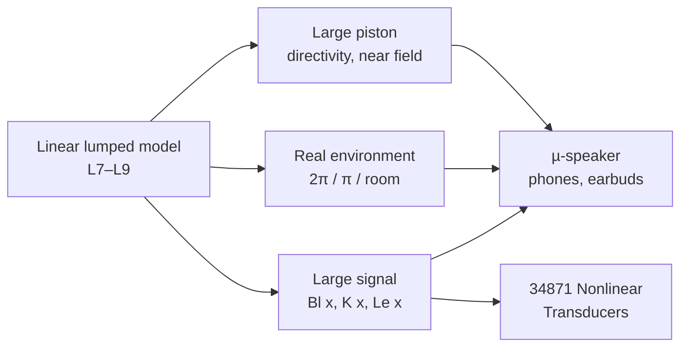
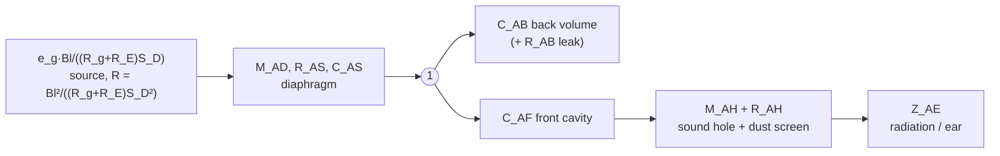

# Lecture 11: Radiation, Acoustic Environment, µ-speakers and Nonlinear Circuit Models

> [!info] Lecture Info
> **Date:** Monday 2 November 2026, 13:00 · Lyngby b.352 r.019 · **FA** (Finn Agerkvist). Postponed from Thu 22-Oct. **Thu 29-Oct is project work, not this lecture** (course plan + Frieder's announcement of 25-Oct).
> **Written before the lecture with no slides:** nothing for lecture 11 is on DTU Learn yet. This pre-read is built from the course plan's reading (**Beranek & Mellow 2019 §13.7** radiation, **§8.1–8.3** cell-phone transducers, **§6.18** nonlinearity; Leach 2.13 is not in the vault), from earlier notes, and from our own System D woofer. When the deck arrives, check this note against it and add a *From the lecture* section.
> **Script:** [p11.py](file:///home/mads/DTU/5.%20Semester/Electroacoustics/LTspice/Lecture%2011%20-%20Radiation%20%26%20Nonlinear/p11.py) in `5. Semester/Electroacoustics/LTspice/Lecture 11 - Radiation & Nonlinear/` prints every number below. `--verify` runs the nonlinear netlist `P11_Nonlinear_Woofer.cir` in LTspice headless and matches the Python model to 0.000 dB. `--plots` writes `Images/Lecture11/`.
> **Previous:** [[Lecture 10 - Advanced Topics - Mixed Models & Metamaterials|Lecture 10]] · **Builds on:** [[Lecture 3 - Analogies - Acoustic Systems|L3 §8]] (radiation impedance), [[Lecture 7 - Moving Coil Loudspeakers|L7 §10–12]] (displacement, nonlinearity, near field) · **Leads to:** [[34871 Nonlinear Transducers]] (January, Finn's course).

> [!abstract] Where this lecture sits
> So far the loudspeaker has been a **linear lumped circuit** radiating into **free space** through a **small** piston. This lecture removes all three assumptions:
> 1. **The piston is not small.** Above ka ≈ 1 it beams, and close to it the field is messy (§1).
> 2. **The space is not free.** Walls, floors, the box and the room change level and power (§2).
> 3. **The circuit is not linear.** At large excursion Bl, the suspension stiffness and Le depend on x, which creates distortion (§4).
>
> The micro-speaker (§3) is where all three meet: a tiny piston, a phone-sized acoustic environment, and an excursion limit that sets the bass.



---

## 1. Radiation from a piston in an infinite baffle (Beranek §13.7)

### 1.1 Radiation impedance: repetition from L3

$$Z_{AR} = \frac{\rho c}{\pi a^2}\left[\,1 - \frac{J_1(2ka)}{ka} + j\,\frac{H_1(2ka)}{ka}\right]$$

| Regime | Real part | Imaginary part | Lumped |
|---|---|---|---|
| $ka \ll 1$ | $\approx (ka)^2/2$, tiny | $\approx 8ka/3\pi$ | mass $M_{A1} = \dfrac{8\rho}{3\pi^2 a}$ |
| $ka \gg 1$ | $\to 1$ ($\rho c/S$) | $\to 0$ | resistor $\rho c/S$ |

![[Courses/34870 Electroacoustics/Images/Lecture11/L11_radiation_impedance.png]]

**System D woofer** (a = 105.5 mm): $M_{A1}$ = 3.08 kg/m⁴, which is **3.8 g of air per face**. In a baffle both faces carry it (7.6 g), which is why M_MD 36.7 g (our fit) turns into M_MS ≈ 44 g.

> [!tip] The power argument in one line
> Below ka ≈ 1 the radiation resistance grows as ω², while the cone velocity of a mass-controlled driver falls as 1/ω. Power = |U|²R_A stays flat, so the response is flat: that is *why* a mass-controlled driver works at all. Above ka ≈ 1, R_A stops growing, so the **radiated power falls**. The on-axis pressure can stay up for a while because the sound is concentrated forward (§1.2).

### 1.2 Directivity

Far field, angle θ from the axis:

$$\boxed{\;\frac{p(\theta)}{p(0)} = \frac{2J_1(ka\sin\theta)}{ka\sin\theta}\;}$$

- **ka = 1** (circumference = wavelength) is the turning point. For our woofer that is **517 Hz**.
- The first **null** appears when $ka\sin\theta = 3.83$, so a null at 90° first exists above **1983 Hz**.

| f | ka | −6 dB beamwidth | at 90° |
|---|---|---|---|
| 100 Hz | 0.19 | omni | 0.0 dB |
| 500 Hz | 0.97 | omni | −1.0 dB |
| 1 kHz | 1.93 | wider than ±90° | −4.4 dB |
| 1.5 kHz | 2.90 | ±50° | −11.7 dB |
| 2 kHz | 3.86 | ±35° | (null) |
| 3 kHz | 5.80 | ±22° | −19.4 dB (side lobe) |

![[Courses/34870 Electroacoustics/Images/Lecture11/L11_directivity.png]]

> [!example] Tie to the project and Lab E
> This is the reason for the crossover. Lab E measured the woofer **−15.6 dB at 30° above 3 kHz**, and the formula gives −11.7 dB at 30° at 3 kHz (ka sin 30° = 2.9). The extra few dB in the measurement come from the real cone not being a flat rigid piston. Our design crosses woofer → mid at **325 Hz** (ka = 0.63), so the woofer never works in its beaming region. The data sheet's 30°/60° curves split from the on-axis curve at about 1 kHz, as predicted.

The **directivity factor** Q (or the index DI = 10 log Q) compares on-axis intensity with the average over all directions. A baffled piston at low frequency has Q = 2 (DI = 3 dB) because it radiates into half space only. DI grows to ≈ (ka)² at high ka.

### 1.3 Near field on the axis and the Rayleigh distance

The exact on-axis pressure of a baffled piston is

$$|p(r)| = 2\rho c u\,\left|\sin\!\left(\frac{k}{2}\left(\sqrt{r^2+a^2}-r\right)\right)\right|$$

- Axial **zeros** where $\sqrt{r^2+a^2}-r = n\lambda$, which requires $n\lambda \le a$. The **last maximum** is at $r = (a^2 - \lambda^2/4)/\lambda$.
- Beyond the **Rayleigh distance** $r_R = S/\lambda = \pi a^2/\lambda$ the 1/r law holds (some texts use $a^2/\lambda$, so check which one Finn uses). For the woofer that is 10 cm at 1 kHz and 31 cm at 3 kHz.

For the woofer: at 1 kHz, λ = 34 cm > 2a, so there is no axial maximum at all and the field is "simple". At 3 kHz the last maximum is at 6.9 cm. **Lab D's near-field trick** (microphone almost touching the dust cap, [[Lecture 7 - Moving Coil Loudspeakers|L7 §12]]) is valid only while ka < 1, for exactly this reason.

---

## 2. The acoustic environment

### 2.1 Solid angle: walls and corners

A small source with a fixed volume velocity U, radiating into a solid angle Ω:

$$p(r) = \frac{j\omega\rho\,U}{\Omega\,r}, \qquad R_A = \frac{\rho c k^2}{\Omega}, \qquad W = |U|^2 R_A$$

| Placement | Ω | SPL | Power |
|---|---|---|---|
| free field | 4π | 0 | 0 |
| on a wall / in a baffle | 2π | **+6 dB** | +3 dB |
| wall + floor | π | **+12 dB** | +6 dB |
| corner | π/2 | **+18 dB** | +9 dB |

> [!important] Why the power goes up too
> The wall does not just "fold" the same power into a smaller space (that alone would give +3 dB SPL). The reflected image source sits *on top of* the real one, so the source sees **double the radiation resistance** and, at constant U, **delivers double the power**. Twice the power into half the space gives 4× the intensity: +6 dB. This only holds while the source is closer than about λ/4 to the boundary. Further away you get comb filtering instead (the image is a separate source).

### 2.2 Baffle step

A box is a "wall" only for wavelengths smaller than its front. At low frequency the box disappears and the driver radiates into 4π. The response therefore falls **6 dB** below about

$$f_{step} \approx \frac{c}{\pi W}$$

For the System D box, W = 0.45 m, so **f_step ≈ 243 Hz**. That matches Lab E: the box was **5.7 dB under the screens at 250–600 Hz**. The edge diffraction ripple on top of the step is what the circle/IEC screens in Lab E showed (dips at 1059/2115 Hz on the circle).

### 2.3 In a room

The level at distance r from a source with directivity Q, in a room with absorption area A (Sabine):

$$L_p = L_W + 10\log\left(\frac{Q}{4\pi r^2} + \frac{4}{A}\right), \qquad r_c = \sqrt{\frac{QA}{16\pi}}$$

Example: V = 100 m³, T60 = 0.5 s gives A = 0.161V/T = 32.2 m². Then **r_c = 0.80 m** for Q = 1, 1.13 m for Q = 2 and 1.60 m for Q = 4. Beyond r_c the listener hears mostly the **power response**, not the on-axis response. This is the bridge to [[34840 Fundamentals of Acoustics and Noise Control|34840]] (same formula, and your lab exercise of 28-Oct measured T20/T30). Below the Schroeder frequency the room is **modes**, not a diffuse field. In a small room a woofer in a corner excites every mode (pressure maximum), which is §2.1 in disguise.

---

## 3. Micro-speakers (Beranek ch. 8: cell phones)

The same moving-coil physics, squeezed into about 1 cm³. The *values* below are illustrative (a typical 15 × 11 mm unit). The *mechanisms* are Beranek's.

### 3.1 The circuit (Beranek Fig. 8.2, all on the acoustic side)



It is the closed-box circuit from L8 plus a **front chamber**. Three things are new:

1. **Acoustic suspension.** The back volume (≈ 1 cm³) is stiffer than the suspension. With $V_{AS}$ ≈ 0.74 cm³ and $V_B$ = 1 cm³, f_s = 800 Hz rises to **f_c ≈ 1.06 kHz**. A leak in the back volume removes this "air cushion": the bass changes *and* the diaphragm can be damaged (Beranek §8.3).
2. **Front cavity + sound hole = Helmholtz low-pass.** $\omega_0^2 = 1/(M_{AH}C_{AF})$, with the dust-screen resistance setting the Q. With 0.1 cm³ and a 1.2 mm × 0.8 mm hole, **f₀ ≈ 4.3 kHz**. It is set at the top of the wanted band.
3. **The load is unknown.** For the receiver, Z_AE depends on how hard the phone is pressed to the ear. The fix is a **controlled leak**: make it bigger than any accidental leak, so the response stops depending on the user ("leak-tolerant receiver", Fig. 8.3).

### 3.2 Why there is no bass: it is volume displacement

At low frequency the far-field pressure is set by the **volume acceleration**, $p = \rho\,\omega^2 V_d/(\Omega r)$. For a fixed SPL the needed volume displacement grows as $1/f^2$:

| 90 dB SPL at 10 cm (phone on a table, 2π) | peak excursion with S_D = 1.2 cm² |
|---|---|
| 1 kHz | 0.10 mm |
| 500 Hz | 0.39 mm |
| 200 Hz | **2.4 mm** (impossible: micro-speakers move about ±0.3–0.5 mm) |
| 100 Hz | 9.8 mm |

So a phone speaker is **excursion-limited below about 500 Hz** and **thermally limited above**. That is why phones use a **smart amplifier**: a DSP model of the speaker (Beranek §8.3) predicts x(t) and the coil temperature from the measured voltage and current, and limits the signal. Peak limiting and compression make it *sound* louder. The excursion model inside that DSP is exactly the nonlinear model of §4.

---

## 4. Nonlinear circuit models (Beranek §6.18, Klippel)

### 4.1 Which parameter depends on what

| Nonlinearity | Depends on | Matters at | Mechanism |
|---|---|---|---|
| **Bl(x)** | displacement | low f (large x) | coil leaves the gap: force *and* back-EMF change |
| **K_MS(x) = 1/C_MS(x)** | displacement | below f_s | suspension hardens at the ends |
| **Le(x)** | displacement | HF modulated by LF | coil in/out of the iron; plus the **reluctance force** $\tfrac12 i^2\,dLe/dx$ |
| Le(i) | current | HF | iron permeability (B–H curve) |
| R_E(T) | temperature | all | **power compression**, thermal |
| cone E(ε) | strain | break-up | cone material |
| Doppler | displacement | HF modulated by LF | moving source |

The data-sheet number for "linear" is **X_max**. For the 26W/8534G00 the coil is 18 mm high in a 6 mm gap, so it is **overhung** and $X_{max} = (18-6)/2 = 6$ mm, which is exactly the data sheet's "linear excursion ±6 mm". The **Alu ring** in the magnet ("Magnet System w. Alu Ring") is Beranek's **shorting ring** (Fig. 6.23): it makes Le less dependent on x and on i. Klippel's definition: X_max is where **Bl has dropped to 82 %** or **C_MS to 75 %** (or 10 % THD).

### 4.2 The model: the L7 circuit with x-dependent elements

Electrical loop and mechanical loop, with the state x carried along:

$$u_g = R_E\,i + \frac{d}{dt}\big(L_e(x)\,i\big) + Bl(x)\,\dot x$$

$$Bl(x)\,i \;+\; \tfrac12\,i^2\,\frac{dL_e}{dx} \;=\; M_{MS}\,\ddot x + R_{MS}\,\dot x + K_{MS}(x)\,x$$

(The reluctance term is left out of p11.py. Add it if Finn's model has it.) The parameters are usually **polynomials in x**, e.g. $Bl(x) = b_0 + b_1x + b_2x^2 + \dots$. Even-order coefficients (symmetric) give mainly **odd** harmonics. Odd-order coefficients (asymmetric) give **even** harmonics and a **DC offset**.

> [!tip] How to draw it in LTspice (what Finn will probably show)
> A plain .AC analysis cannot do this: the circuit has to be solved in time (.TRAN). Every x-dependent element becomes a **behavioural source** (B-source) that reads the node holding x. In `P11_Nonlinear_Woofer.cir` each state variable is a capacitor voltage:
> ```
> .func Bl(x) {BL0/(1+B2*(x-XOFF)**2)}
> Bpsi 0 psi I=V(in) - RE*V(psi)/Le(V(x)) - Bl(V(x))*V(u)    ; flux linkage psi = Le(x) i
> Bu   0 u   I=Bl(V(x))*V(psi)/Le(V(x)) - RMS*V(u) - Kms(V(x))*V(x)
> Cu   u 0   {MMS}                                              ; mass = capacitor (mobility)
> Bx   0 x   I=V(u)      ; Cx x 0 1                             ; x = ∫u dt
> ```
> Using the flux linkage ψ = Le(x)·i as the state keeps d(Le·i)/dt correct when Le changes with x. In a drawn schematic the same thing is done with an `L=` inductor replaced by a B-source, and `Bl·i` / `Bl·u` as the two coupled sources of the gyrator.

### 4.3 What the model predicts for our woofer

Assumed shapes ([[Courses/34870 Electroacoustics/Images/Lecture11/L11_nonlinear_params.png|figure]]): Bl symmetric, 82 % at ±X_max, centred 0.5 mm outward. K 1.33× at X_max, slightly harder outward. Le 1.80 mH inward, 1.20 mH outward.

Below f_s the cone moves **Bl·C_MS/R_E = 1.71 mm per volt**, so X_max is reached at only **3.5 V peak**. That is one reason for the high-pass (and the vent) in the project.

| f | V peak | x peak | H2 | H3 | THD |
|---|---|---|---|---|---|
| 20 Hz | 1 | 0.9 mm | 0.7 % | 0.3 % | 0.8 % |
| 20 Hz | 5 | 4.6 mm | 3.3 % | 8.4 % | 9.0 % |
| 20 Hz | 10 | 9.0 mm | 5.7 % | 37 % | 37 % |
| 40 Hz | 10 | 4.1 mm | 2.8 % | 2.4 % | 3.7 % |
| 100 Hz | 10 | 0.8 mm | 0.7 % | 0.1 % | 0.7 % |

(THD of the cone *acceleration*, which is the far-field pressure. Each harmonic n is weighted by n² relative to the displacement, so the pressure THD is larger than the displacement THD below f_s.)

![[Courses/34870 Electroacoustics/Images/Lecture11/L11_thd.png]]

Things to notice:
- **Distortion is a low-frequency, large-excursion problem.** At 100 Hz the same 10 V is clean, because x is 10 times smaller.
- **Symmetric nonlinearity → odd harmonics (H3) dominate.** The asymmetries (Bl offset, K asymmetry, Le(x)) produce H2.
- **DC offset:** the asymmetric terms rectify part of the signal, so the coil's mean position moves (−0.2 to −0.6 mm here). That moves the coil further into the asymmetric region, so the effect can feed itself. Which way it goes depends on the asymmetry and on f relative to f_s (Klippel).
- **Intermodulation:** 10 V at 40 Hz + 2 V at 1 kHz puts sidebands at 1 kHz ± 40 Hz of **14 %** (±80 Hz: 4 %). The 4 mm excursion drags Bl and Le up and down at 40 Hz and modulates the 1 kHz tone. This is the argument for a **two-way system**: keep the tweeter/mid away from the large woofer excursion.

![[Courses/34870 Electroacoustics/Images/Lecture11/L11_intermod.png]]

### 4.4 Thermal: power compression

R_E rises about **0.39 %/K** (copper). A coil at +100 K has R_E × 1.39, which is **−2.9 dB** sensitivity on a voltage drive. At very low frequency the temperature follows each half cycle (odd harmonics). Normally it is too slow, so you get **compression** instead. Ferrofluid in the gap carries heat away (at the price of extra damping, lower Q_MS).

---

## 5. Exam angle (oral, 9–10 Dec)

Likely questions and a one-line answer each:
- *Why does a loudspeaker beam?* Its size compares to λ: 2J₁(v)/v, ka = 1 at the circumference = λ, first null at ka sin θ = 3.83.
- *Why +6 dB against a wall?* The image source doubles the radiation resistance, so double the power goes into half the space.
- *What limits a phone speaker in the bass?* Volume displacement ∝ 1/f² for constant SPL, and x_max ≈ 0.3 mm.
- *Name three loudspeaker nonlinearities and where they matter in frequency.* Bl(x) at low f, K(x) below f_s, Le(x) as HF modulated by LF; plus thermal compression.
- *How do you simulate them?* Time domain, parameters as functions of x, behavioural sources. Harmonics come from one tone and IMD from two tones.
- *Why overhung?* Constant Bl over ±(l_vc − h_g)/2, at the cost of copper outside the gap (less efficient).

## 6. Questions to ask Finn

1. Does he define the Rayleigh distance as a²/λ or πa²/λ?
2. Which nonlinear model does he use in LTspice: Le(x) with the reluctance force, or just Bl(x) and K(x)?
3. Is the micro-speaker part about phones (Beranek ch. 8) or about MEMS speakers?
4. How much of this is examinable, given that 34871 covers it in depth?

## 7. After the lecture

- [ ] Deck arrived on Learn? Check §1–4 against it and correct.
- [ ] *From the lecture* section (and the recording, when it arrives: transcribe with the whisper venv).
- [ ] If Finn gives problems: work them in p11.py.
