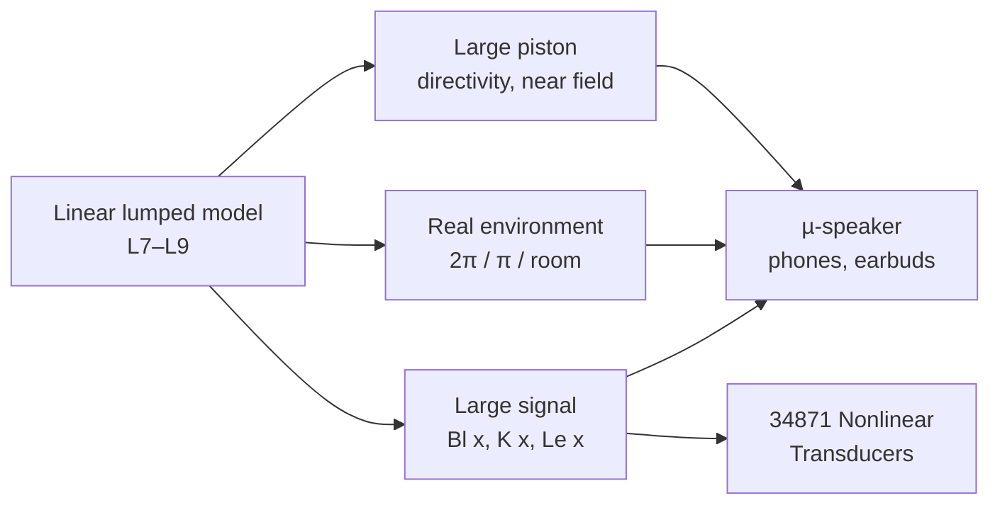
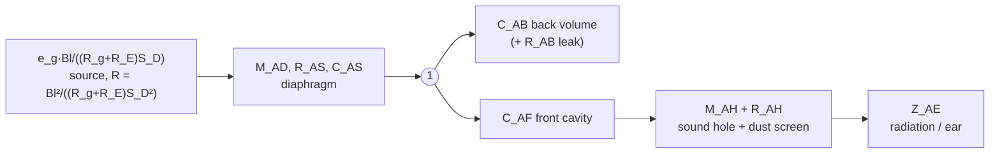
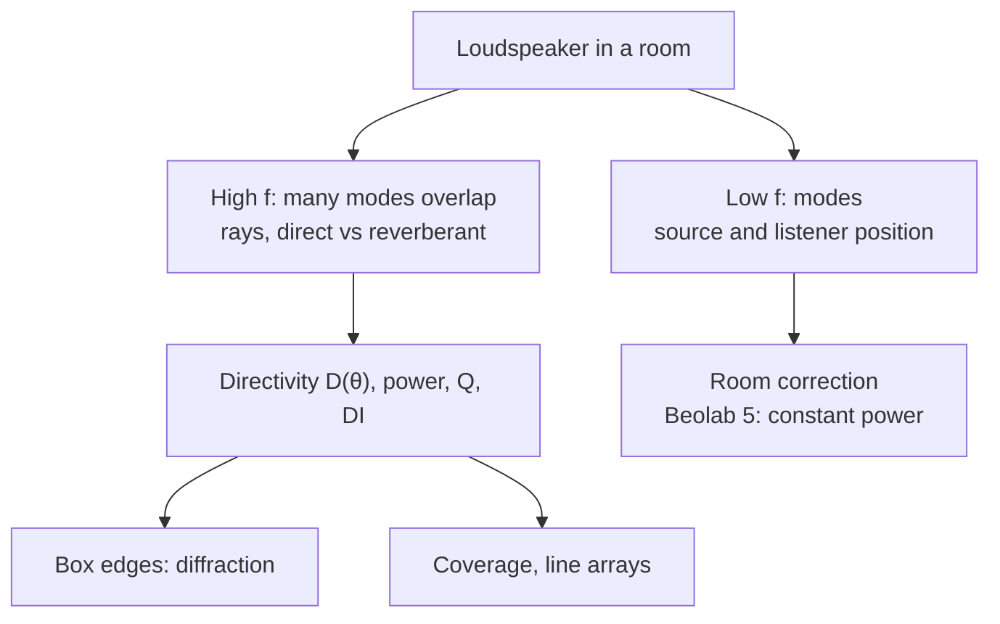

# Lecture 11: Radiation, Acoustic Environment, µ-speakers and Nonlinear Circuit Models

> [!info] Lecture Info
> **Date:** Monday 2 November 2026, 13:00 · Lyngby b.352 r.019 · **FA** (Finn Agerkvist). Postponed from Thu 22-Oct. **Thu 29-Oct is project work, not this lecture** (course plan + Frieder's announcement of 25-Oct).
> **How this note was made:** §1–4 were written *before* the lecture from the course plan's reading (**Beranek & Mellow 2019 §13.7**, **§8.1–8.3**, **§6.18**) and our own System D woofer. The deck arrived on 30-Oct as `_Learn/Lecture 11 …/17-Loudspeakers3_RoomInteraction_v3.pptx`; a printable PDF copy is `Slides/Lecture 11 - Radiation and acoustic environment (from pptx).pdf` (63 pages, cited below as *p. N*). **On 26-Nov the note was checked against that deck:** see **§8 From the lecture** (what Finn actually covered, and what the pre-read got right or wrong) and **§9 Problems 11** (worked, checked against the official solutions). No recording was published for this lecture.
> **Oral exam:** this lecture plus Lab E is exam topic **10, *Loudspeakers: directivity, box diffraction, room interaction***. See [[Oral Exam - Topic Map]].
> **Script:** [p11.py](file:///home/mads/DTU/5.%20Semester/Electroacoustics/LTspice/Lecture%2011%20-%20Radiation%20%26%20Nonlinear/p11.py) in `5. Semester/Electroacoustics/LTspice/Lecture 11 - Radiation & Nonlinear/` prints every number below. `--verify` runs the nonlinear netlist `P11_Nonlinear_Woofer.cir` in LTspice headless and matches the Python model to 0.000 dB. `--plots` writes `Images/Lecture11/`.
> **Previous:** [[Lecture 10 - Advanced Topics - Mixed Models & Metamaterials|Lecture 10]] · **Builds on:** [[Lecture 3 - Analogies - Acoustic Systems|L3 §8]] (radiation impedance), [[Lecture 7 - Moving Coil Loudspeakers|L7 §10–12]] (displacement, nonlinearity, near field) · **Leads to:** [[34871 Nonlinear Transducers]] (January, Finn's course).

> [!abstract] Where this lecture sits
> So far the loudspeaker has been a **linear lumped circuit** radiating into **free space** through a **small** piston. This lecture removes all three assumptions:
> 1. **The piston is not small.** Above ka ≈ 1 it beams, and close to it the field is messy (§1).
> 2. **The space is not free.** Walls, floors, the box and the room change level and power (§2).
> 3. **The circuit is not linear.** At large excursion Bl, the suspension stiffness and Le depend on x, which creates distortion (§4).
>
> The micro-speaker (§3) is where all three meet: a tiny piston, a phone-sized acoustic environment, and an excursion limit that sets the bass.
>
> **What the lecture weighted (see §8):** mostly the **room** (modes at low frequency, the direct/reverberant balance at high frequency), **directivity and power response**, and **box diffraction**. Headphones, micro-speakers and balanced-armature receivers came from a guest. **Nonlinearity got a single slide** ("covered in detail in 34871"). So §4 below is deeper than the lecture, but the exam's topic-7 question about nonlinearities still makes it useful.



---

## 1. Radiation from a piston in an infinite baffle (Beranek §13.7)

### 1.1 Radiation impedance: repetition from L3

$$Z_{AR} = \frac{\rho c}{\pi a^2}\left[\,1 - \frac{J_1(2ka)}{ka} + j\,\frac{H_1(2ka)}{ka}\right]$$

| Regime | Real part | Imaginary part | Lumped |
|---|---|---|---|
| $ka \ll 1$ | $\approx (ka)^2/2$, tiny | $\approx 8ka/3\pi$ | mass $M_{A1} = \dfrac{8\rho}{3\pi^2 a}$ |
| $ka \gg 1$ | $\to 1$ ($\rho c/S$) | $\to 0$ | resistor $\rho c/S$ |

![[Courses/34870 Electroacoustics/Images/Lecture11/L11_radiation_impedance.png]]

**System D woofer** (a = 105.5 mm): $M_{A1}$ = 3.08 kg/m⁴, which is **3.8 g of air per face**. In a baffle both faces carry it (7.6 g), which is why M_MD 36.7 g (our fit) turns into M_MS ≈ 44 g.

> [!tip] The power argument in one line
> Below ka ≈ 1 the radiation resistance grows as ω², while the cone velocity of a mass-controlled driver falls as 1/ω. Power = |U|²R_A stays flat, so the response is flat: that is *why* a mass-controlled driver works at all. Above ka ≈ 1, R_A stops growing, so the **radiated power falls**. The on-axis pressure can stay up for a while because the sound is concentrated forward (§1.2).

### 1.2 Directivity

Far field, angle θ from the axis:

$$\boxed{\;\frac{p(\theta)}{p(0)} = \frac{2J_1(ka\sin\theta)}{ka\sin\theta}\;}$$

- **ka = 1** (circumference = wavelength) is the turning point. For our woofer that is **517 Hz**.
- The first **null** appears when $ka\sin\theta = 3.83$, so a null at 90° first exists above **1983 Hz**.

| f | ka | −6 dB beamwidth | at 90° |
|---|---|---|---|
| 100 Hz | 0.19 | omni | 0.0 dB |
| 500 Hz | 0.97 | omni | −1.0 dB |
| 1 kHz | 1.93 | wider than ±90° | −4.4 dB |
| 1.5 kHz | 2.90 | ±50° | −11.7 dB |
| 2 kHz | 3.86 | ±35° | (null) |
| 3 kHz | 5.80 | ±22° | −19.4 dB (side lobe) |

![[Courses/34870 Electroacoustics/Images/Lecture11/L11_directivity.png]]

> [!example] Tie to the project and Lab E
> This is the reason for the crossover. Lab E measured the woofer **−15.6 dB at 30° above 3 kHz**, and the formula gives −11.7 dB at 30° at 3 kHz (ka sin 30° = 2.9). The extra few dB in the measurement come from the real cone not being a flat rigid piston. Our design crosses woofer → mid at **325 Hz** (ka = 0.63), so the woofer never works in its beaming region. The data sheet's 30°/60° curves split from the on-axis curve at about 1 kHz, as predicted.

The **directivity factor** Q (or the index DI = 10 log Q) compares on-axis intensity with the average over all directions. A baffled piston at low frequency has Q = 2 (DI = 3 dB) because it radiates into half space only. DI grows to ≈ (ka)² at high ka.

### 1.3 Near field on the axis and the Rayleigh distance

The exact on-axis pressure of a baffled piston is

$$|p(r)| = 2\rho c u\,\left|\sin\!\left(\frac{k}{2}\left(\sqrt{r^2+a^2}-r\right)\right)\right|$$

- Axial **zeros** where $\sqrt{r^2+a^2}-r = n\lambda$, which requires $n\lambda \le a$. The **last maximum** is at $r = (a^2 - \lambda^2/4)/\lambda$.
- Beyond the **Rayleigh distance** $r_R = S/\lambda = \pi a^2/\lambda$ the 1/r law holds (some texts use $a^2/\lambda$, so check which one Finn uses). For the woofer that is 10 cm at 1 kHz and 31 cm at 3 kHz.

For the woofer: at 1 kHz, λ = 34 cm > 2a, so there is no axial maximum at all and the field is "simple". At 3 kHz the last maximum is at 6.9 cm. **Lab D's near-field trick** (microphone almost touching the dust cap, [[Lecture 7 - Moving Coil Loudspeakers|L7 §12]]) is valid only while ka < 1, for exactly this reason.

---

## 2. The acoustic environment

### 2.1 Solid angle: walls and corners

A small source with a fixed volume velocity U, radiating into a solid angle Ω:

$$p(r) = \frac{j\omega\rho\,U}{\Omega\,r}, \qquad R_A = \frac{\rho c k^2}{\Omega}, \qquad W = |U|^2 R_A$$

| Placement | Ω | SPL | Power |
|---|---|---|---|
| free field | 4π | 0 | 0 |
| on a wall / in a baffle | 2π | **+6 dB** | +3 dB |
| wall + floor | π | **+12 dB** | +6 dB |
| corner | π/2 | **+18 dB** | +9 dB |

> [!important] Why the power goes up too
> The wall does not just "fold" the same power into a smaller space (that alone would give +3 dB SPL). The reflected image source sits *on top of* the real one, so the source sees **double the radiation resistance** and, at constant U, **delivers double the power**. Twice the power into half the space gives 4× the intensity: +6 dB. This only holds while the source is closer than about λ/4 to the boundary. Further away you get comb filtering instead (the image is a separate source).

### 2.2 Baffle step

A box is a "wall" only for wavelengths smaller than its front. At low frequency the box disappears and the driver radiates into 4π. The response therefore falls **6 dB** below about

$$f_{step} \approx \frac{c}{\pi W}$$

For the System D box, W = 0.45 m, so **f_step ≈ 243 Hz**. That matches Lab E: the box was **5.7 dB under the screens at 250–600 Hz**. The edge diffraction ripple on top of the step is what the circle/IEC screens in Lab E showed (dips at 1059/2115 Hz on the circle).

### 2.3 In a room

The level at distance r from a source with directivity Q, in a room with absorption area A (Sabine):

$$L_p = L_W + 10\log\left(\frac{Q}{4\pi r^2} + \frac{4}{A}\right), \qquad r_c = \sqrt{\frac{QA}{16\pi}}$$

Example: V = 100 m³, T60 = 0.5 s gives A = 0.161V/T = 32.2 m². Then **r_c = 0.80 m** for Q = 1, 1.13 m for Q = 2 and 1.60 m for Q = 4. Beyond r_c the listener hears mostly the **power response**, not the on-axis response. This is the bridge to [[34840 Fundamentals of Acoustics and Noise Control|34840]] (same formula, and your lab exercise of 28-Oct measured T20/T30). Below the Schroeder frequency the room is **modes**, not a diffuse field. In a small room a woofer in a corner excites every mode (pressure maximum), which is §2.1 in disguise.

---

## 3. Micro-speakers (Beranek ch. 8: cell phones)

The same moving-coil physics, squeezed into about 1 cm³. The *values* below are illustrative (a typical 15 × 11 mm unit). The *mechanisms* are Beranek's.

### 3.1 The circuit (Beranek Fig. 8.2, all on the acoustic side)



It is the closed-box circuit from L8 plus a **front chamber**. Three things are new:

1. **Acoustic suspension.** The back volume (≈ 1 cm³) is stiffer than the suspension. With $V_{AS}$ ≈ 0.74 cm³ and $V_B$ = 1 cm³, f_s = 800 Hz rises to **f_c ≈ 1.06 kHz**. A leak in the back volume removes this "air cushion": the bass changes *and* the diaphragm can be damaged (Beranek §8.3).
2. **Front cavity + sound hole = Helmholtz low-pass.** $\omega_0^2 = 1/(M_{AH}C_{AF})$, with the dust-screen resistance setting the Q. With 0.1 cm³ and a 1.2 mm × 0.8 mm hole, **f₀ ≈ 4.3 kHz**. It is set at the top of the wanted band.
3. **The load is unknown.** For the receiver, Z_AE depends on how hard the phone is pressed to the ear. The fix is a **controlled leak**: make it bigger than any accidental leak, so the response stops depending on the user ("leak-tolerant receiver", Fig. 8.3).

### 3.2 Why there is no bass: it is volume displacement

At low frequency the far-field pressure is set by the **volume acceleration**, $p = \rho\,\omega^2 V_d/(\Omega r)$. For a fixed SPL the needed volume displacement grows as $1/f^2$:

| 90 dB SPL at 10 cm (phone on a table, 2π) | peak excursion with S_D = 1.2 cm² |
|---|---|
| 1 kHz | 0.10 mm |
| 500 Hz | 0.39 mm |
| 200 Hz | **2.4 mm** (impossible: micro-speakers move about ±0.3–0.5 mm) |
| 100 Hz | 9.8 mm |

So a phone speaker is **excursion-limited below about 500 Hz** and **thermally limited above**. That is why phones use a **smart amplifier**: a DSP model of the speaker (Beranek §8.3) predicts x(t) and the coil temperature from the measured voltage and current, and limits the signal. Peak limiting and compression make it *sound* louder. The excursion model inside that DSP is exactly the nonlinear model of §4.

---

## 4. Nonlinear circuit models (Beranek §6.18, Klippel)

### 4.1 Which parameter depends on what

| Nonlinearity | Depends on | Matters at | Mechanism |
|---|---|---|---|
| **Bl(x)** | displacement | low f (large x) | coil leaves the gap: force *and* back-EMF change |
| **K_MS(x) = 1/C_MS(x)** | displacement | below f_s | suspension hardens at the ends |
| **Le(x)** | displacement | HF modulated by LF | coil in/out of the iron; plus the **reluctance force** $\tfrac12 i^2\,dLe/dx$ |
| Le(i) | current | HF | iron permeability (B–H curve) |
| R_E(T) | temperature | all | **power compression**, thermal |
| cone E(ε) | strain | break-up | cone material |
| Doppler | displacement | HF modulated by LF | moving source |

The data-sheet number for "linear" is **X_max**. For the 26W/8534G00 the coil is 18 mm high in a 6 mm gap, so it is **overhung** and $X_{max} = (18-6)/2 = 6$ mm, which is exactly the data sheet's "linear excursion ±6 mm". The **Alu ring** in the magnet ("Magnet System w. Alu Ring") is Beranek's **shorting ring** (Fig. 6.23): it makes Le less dependent on x and on i. Klippel's definition: X_max is where **Bl has dropped to 82 %** or **C_MS to 75 %** (or 10 % THD).

### 4.2 The model: the L7 circuit with x-dependent elements

Electrical loop and mechanical loop, with the state x carried along:

$$u_g = R_E\,i + \frac{d}{dt}\big(L_e(x)\,i\big) + Bl(x)\,\dot x$$

$$Bl(x)\,i \;+\; \tfrac12\,i^2\,\frac{dL_e}{dx} \;=\; M_{MS}\,\ddot x + R_{MS}\,\dot x + K_{MS}(x)\,x$$

(The reluctance term is left out of p11.py. Add it if Finn's model has it.) The parameters are usually **polynomials in x**, e.g. $Bl(x) = b_0 + b_1x + b_2x^2 + \dots$. Even-order coefficients (symmetric) give mainly **odd** harmonics. Odd-order coefficients (asymmetric) give **even** harmonics and a **DC offset**.

> [!tip] How to draw it in LTspice (what Finn will probably show)
> A plain .AC analysis cannot do this: the circuit has to be solved in time (.TRAN). Every x-dependent element becomes a **behavioural source** (B-source) that reads the node holding x. In `P11_Nonlinear_Woofer.cir` each state variable is a capacitor voltage:
> ```
> .func Bl(x) {BL0/(1+B2*(x-XOFF)**2)}
> Bpsi 0 psi I=V(in) - RE*V(psi)/Le(V(x)) - Bl(V(x))*V(u)    ; flux linkage psi = Le(x) i
> Bu   0 u   I=Bl(V(x))*V(psi)/Le(V(x)) - RMS*V(u) - Kms(V(x))*V(x)
> Cu   u 0   {MMS}                                              ; mass = capacitor (mobility)
> Bx   0 x   I=V(u)      ; Cx x 0 1                             ; x = ∫u dt
> ```
> Using the flux linkage ψ = Le(x)·i as the state keeps d(Le·i)/dt correct when Le changes with x. In a drawn schematic the same thing is done with an `L=` inductor replaced by a B-source, and `Bl·i` / `Bl·u` as the two coupled sources of the gyrator.

### 4.3 What the model predicts for our woofer

Assumed shapes ([[Courses/34870 Electroacoustics/Images/Lecture11/L11_nonlinear_params.png|figure]]): Bl symmetric, 82 % at ±X_max, centred 0.5 mm outward. K 1.33× at X_max, slightly harder outward. Le 1.80 mH inward, 1.20 mH outward.

Below f_s the cone moves **Bl·C_MS/R_E = 1.71 mm per volt**, so X_max is reached at only **3.5 V peak**. That is one reason for the high-pass (and the vent) in the project.

| f | V peak | x peak | H2 | H3 | THD |
|---|---|---|---|---|---|
| 20 Hz | 1 | 0.9 mm | 0.7 % | 0.3 % | 0.8 % |
| 20 Hz | 5 | 4.6 mm | 3.3 % | 8.4 % | 9.0 % |
| 20 Hz | 10 | 9.0 mm | 5.7 % | 37 % | 37 % |
| 40 Hz | 10 | 4.1 mm | 2.8 % | 2.4 % | 3.7 % |
| 100 Hz | 10 | 0.8 mm | 0.7 % | 0.1 % | 0.7 % |

(THD of the cone *acceleration*, which is the far-field pressure. Each harmonic n is weighted by n² relative to the displacement, so the pressure THD is larger than the displacement THD below f_s.)

![[Courses/34870 Electroacoustics/Images/Lecture11/L11_thd.png]]

Things to notice:
- **Distortion is a low-frequency, large-excursion problem.** At 100 Hz the same 10 V is clean, because x is 10 times smaller.
- **Symmetric nonlinearity → odd harmonics (H3) dominate.** The asymmetries (Bl offset, K asymmetry, Le(x)) produce H2.
- **DC offset:** the asymmetric terms rectify part of the signal, so the coil's mean position moves (−0.2 to −0.6 mm here). That moves the coil further into the asymmetric region, so the effect can feed itself. Which way it goes depends on the asymmetry and on f relative to f_s (Klippel).
- **Intermodulation:** 10 V at 40 Hz + 2 V at 1 kHz puts sidebands at 1 kHz ± 40 Hz of **14 %** (±80 Hz: 4 %). The 4 mm excursion drags Bl and Le up and down at 40 Hz and modulates the 1 kHz tone. This is the argument for a **two-way system**: keep the tweeter/mid away from the large woofer excursion.

![[Courses/34870 Electroacoustics/Images/Lecture11/L11_intermod.png]]

### 4.4 Thermal: power compression

R_E rises about **0.39 %/K** (copper). A coil at +100 K has R_E × 1.39, which is **−2.9 dB** sensitivity on a voltage drive. At very low frequency the temperature follows each half cycle (odd harmonics). Normally it is too slow, so you get **compression** instead. Ferrofluid in the gap carries heat away (at the price of extra damping, lower Q_MS).

---

## 5. Exam angle (oral, 9–10 Dec)

Likely questions and a one-line answer each:
- *Why does a loudspeaker beam?* Its size compares to λ: 2J₁(v)/v, ka = 1 at the circumference = λ, first null at ka sin θ = 3.83.
- *Why +6 dB against a wall?* The image source doubles the radiation resistance, so double the power goes into half the space.
- *What limits a phone speaker in the bass?* Volume displacement ∝ 1/f² for constant SPL, and x_max ≈ 0.3 mm.
- *Name three loudspeaker nonlinearities and where they matter in frequency.* Bl(x) at low f, K(x) below f_s, Le(x) as HF modulated by LF; plus thermal compression.
- *How do you simulate them?* Time domain, parameters as functions of x, behavioural sources. Harmonics come from one tone and IMD from two tones.
- *Why overhung?* Constant Bl over ±(l_vc − h_g)/2, at the cost of copper outside the gap (less efficient).

## 6. Questions to ask Finn

1. Does he define the Rayleigh distance as a²/λ or πa²/λ?
2. Which nonlinear model does he use in LTspice: Le(x) with the reluctance force, or just Bl(x) and K(x)?
3. Is the micro-speaker part about phones (Beranek ch. 8) or about MEMS speakers?
4. How much of this is examinable, given that 34871 covers it in depth?

## 7. After the lecture

- [x] Deck arrived (30-Oct, pptx). §1–4 were checked against it on 26-Nov; see §8.
- [x] *From the lecture* section (§8). No recording was published.
- [x] Problems 11 worked (§9), in MATLAB rather than p11.py: `5. Semester/Electroacoustics/Matlab/Lecture11_Radiation_Problems11.m` / `.mlx` / `.html`.
- [ ] The questions in §6 are still open. Ask at a project Q&A if they matter (the Rayleigh distance and the micro-speaker part were not in the deck).

---

## 8. From the lecture (deck checked 26-Nov)

The deck is titled *Radiation and acoustic environment* (Finn, `17-Loudspeakers3_RoomInteraction_v3`). Its outline (p. 3) has three parts:
- **room interaction**: low frequencies (eigenmodes, source position, listening position) and high frequencies (directivity and power response, direct vs reverberant sound, PA and line arrays, box edges);
- **problem solving** in MATLAB (§9);
- **headphones and hearing aids**: balanced-armature receivers, presented by guest Birgitte Bække.



### 8.1 Low frequencies: the room is modes (p. 4–14)

- **Rectangular room modes** (p. 6): $f_N = \frac{c}{2}\sqrt{(n_x/l_x)^2+(n_y/l_y)^2+(n_z/l_z)^2}$, with mode shapes $\cos(n_x\pi x/l_x)\cos(\dots)\cos(\dots)$. Most sources are omnidirectional down there. This is the same formula as 34840 lecture 6, and our 34840 lab room had modes at 39.2/52.2/54.9/… Hz.
- **Modal sum** (p. 8, Jacobsen & Juhl §8.2.3):
  $p(r,r_0) = \frac{c^2}{4\pi^2V}\sum_m \frac{A_m\,\psi_m(r)\,\psi_m(r_0)}{f^2-f_m^2-jf_m/(2\pi\tau_m)}$
  - The **source position** $r_0$ and the **listener position** $r$ enter symmetrically, through the mode shape $\psi_m$. A corner source excites every mode, since every mode has a pressure maximum in a corner. The slide's corner curve sits about 15 dB above the centre curve and has more peaks.
  - $\tau_m$ is the modal damping time.
- **Radiation impedance in a room** (p. 9): $P_a = \tfrac12\mathrm{Re}(Z_a)|U|^2$.
  - In free field a monopole has $\mathrm{Re}(Z_a) = \rho\omega^2/4\pi c$, so constant power needs constant **volume acceleration**. That is a mass-controlled driver, the same argument as in §1.1.
  - In the diffuse field of a room the mean square pressure is $p^2_{dif} = \frac{4\rho c}{A}P_a$. The reverberant level is set by the **power**, not by the on-axis response.
- **Beolab 5 trick** (p. 4, 10). The speaker measures its own radiation impedance in the room, identifies up to 24 modes, and applies the inverse to its output. This gives constant radiated power, so constant average p².
  - It removes the effect of where the **source** stands, but not of where the **listener** sits.
  - This is §2.1's "the wall raises Re(Z_a)" seen from the room's side.
- **Placement** (p. 14):
  - Far from the walls, reflections arrive later. They disturb localisation less and the comb filtering is weaker.
  - Close to boundaries there is more bass, because the radiation impedance is higher and the modes are excited harder.
  - This matches §2.1 (solid angle). The pre-read was right.

### 8.2 High frequencies: directivity and power response (p. 11–27)

- Above the Schroeder region the modes overlap and spatial variation is small, so **ray tracing** works (p. 11–13).
- **Directivity** (p. 15–18). The piston is a sum of point sources over its face, which gives exactly §1.2's $D(f,\theta) = 2J_1(ka\sin\theta)/(ka\sin\theta)$.
  - Notation warning (p. 16): Jacobsen calls particle velocity *U* and volume velocity *Q*. The slides use U for volume velocity, as in the rest of the course.
  - p. 18 plots an 8 cm piston at 10/30/60°.
- **Radiated power with a flat on-axis response** (p. 19–20). For an a = 12 cm piston EQ'd to 1 Pa on axis, the power is flat to about 500 Hz and then falls. *"As the piston becomes more directive, the radiation concentrates mostly on the axis."* A speaker that measures flat on axis therefore puts out **less and less power** at high frequency.
- **Directivity factor** (p. 21). There are two equivalent definitions:
  - on-axis intensity relative to an omni source **of the same power**;
  - omni power relative to the directive source's power **for the same on-axis intensity**.

  For the baffled piston ($2U_S = U_{omni}$ because of the baffle):
  $$\boxed{Q_S(f) = \frac{(ka)^2}{1 - J_1(2ka)/ka}}$$
  It goes to **2 at low frequency** (half space, DI = 3 dB) and to about (ka)² at high ka. This confirms the pre-read's claim in §1.2, and here is the formula behind it.
- **Directivity index** DI = 10 log Q (p. 22). It sets the direct/reverberant balance. Other examples:

  | Source | DI |
  |---|---|
  | monopole on a baffle | 3 dB |
  | cardioid | 4.7 dB |
  | hypercardioid | 6 dB |
  | dipole | 4.8 dB |

  Our 6 cm piston from Problem 1 has Q = 3.1 / 10.4 / 29 (DI 5.0 / 10.2 / 14.6 dB) at 1.5 / 3 / 5 kHz. The System D woofer (a = 10.6 cm) has DI 3.0 / 3.7 / 5.7 / 12.0 dB at 100 / 500 / 1000 / 2000 Hz. That is another reason the crossover sits at 325 Hz.
- **Why this matters in a room** (p. 23–27). The reverberant field is fed by the power, so a speaker whose DI rises at high frequency sounds **dull in the reverberant field** even when it is flat on axis. p. 26 demonstrates this in a concert-hall simulation: direct only, reverberant only, DI = 10 dB, and high DI above 1 kHz. p. 24 shows a real 8″ woofer (Peerless NE225).
  - The Beolab 5 **acoustic lens** (p. 27) aims for a smooth power response and narrow vertical spread.

### 8.3 Box diffraction (p. 28–39): the core of exam topic 10

- **Box vs infinite baffle** (p. 28). The size and shape of the enclosure cause diffraction.
- **Edge sources** (p. 29). Each edge sends out a **delayed and inverted** copy of the direct wave.
  - A path difference of **λ/2** gives **doubling**, a peak of up to +6 dB over the baffled level.
  - A path difference of **λ** gives **cancellation**.
  - Below all of this the box is too small and the response drops 6 dB to the 4π level. That is the **baffle step** of §2.2, which the deck shows as the step from 0 to +6 dB in the circular-screen plot (p. 30–31).
- **Terai's model** (p. 32): the impulse response of a monopole on a thin finite baffle is the direct sound plus a line integral along the edge. `diffrac.m` implements it (p. 38): `diffrac(corners, r, angles, source_radius, fs)`, valid for a **thin** baffle, with the source at (0,0). It is the same function as in Lab E and Problems 11.3.
- **Single edge, normalised to free field** (p. 33–34, Agerkvist AES 1997), including the **shadow zone** behind the edge.
- **The link to microphones** (p. 35). Diffraction causes both the **free-field correction of a microphone** and the **response of a monopole on a baffle**. By **reciprocity** (source and receiver swapped, same directivity) they are the same physics.
  - Lab B's mock-up scattering (+8.6 dB at 1155 Hz on axis) and Lab E's circle dips (1059/2115 Hz) are the same phenomenon seen from the two ends.
  - This is a good link to state in the oral.
- **Offset driver on a rectangle** (p. 36–37, labelled *Lab E*): the edge distances differ, so the ripple is smoothed.
- **Minimising diffraction** (p. 39): **rounded edges** and **asymmetric driver placement**.

### 8.4 Coverage, arrays, room correction (p. 40–45)

- **Coverage** (p. 40–41, Kuttruff ch. 10). The deck lists what to consider:
  - **reach**, the distance at which the diffuse field takes over;
  - how the directivity changes with frequency;
  - processing (phase and level);
  - the perceived direction of the source (precedence effect);
  - avoiding feedback.

  The deck gives no formula. The relation the exam question asks for ("define and relate D, Q and coverage") is:
  - **D(θ, φ)** is the shape: the pressure relative to on-axis.
  - **Q** is the on-axis intensity relative to the average over all directions, $Q = 4\pi\,\big/\oint D^2\,d\Omega$. It is one number per frequency.
  - **Coverage** is the angle within which D stays above a limit, usually −6 dB, i.e. the beamwidth.

  A narrower coverage means a larger Q. That means a longer **reach** in a room, because the critical distance is $r_c = \sqrt{QA/16\pi}$ (§2.3). For the 6 cm piston at 3 kHz, the −6 dB coverage is ±42° and Q = 10.4.
  - *(The −6 dB definition is the common convention, not from the deck.)*
- **Line arrays** (p. 42–43). DSP gives each unit its own delay and frequency response, which allows beam steering. Design tools are shown.
- **Room correction** (p. 44–45). Correct the spectral balance of the **reverberant** field without spoiling the direct sound.
  - Exact EQ for one seat is a bad idea. A **smooth correction averaged over several positions** works better.
  - p. 45: Olive et al. 2009 compared commercial systems, using the response averaged over 6 seats. The curves are labelled from most to least preferred, with the uncorrected response dashed.

### 8.5 Headphones, micro-speakers, balanced armature (p. 47–57)

- **Headphones** (p. 47).
  - A small closed volume is a compliance, $C_A = V/\rho c^2$. A stiffness-controlled diaphragm driving a compliance gives a **flat pressure response below f_s, provided there is no leak**.
  - This is the pressure-chamber version of the micro-speaker load in §3.1. It is the reason a leak kills headphone bass.
- **Acoustic resonances in the small volume** (p. 51), for a cylinder of length l and diameter D:
  - along the axis, $f_N = Nc/2l$;
  - across it, $f_{10} = 1.84c/\pi D$, $f_{20} = 3.05c/\pi D$, $f_{01} = 3.83c/\pi D$;
  - plus the ear-canal resonance.
  - (The π is lost in the text extraction; these are the standard cylinder cross-mode constants.)
- **Micro-speakers** (p. 48–50). They are a few mm thick with diameters from 10 mm. Diaphragm and suspension are one plastic piece, with **no spider**.
  - p. 50 compares B&O A8 and iPod earphone parameters (Klippel LPM). The A8 has R_e 18.7 Ω, f_s 231 Hz, M_ms 13 mg (the table's "kg" is a typo), C_ms 36 mm/N and Bl 0.36 N/A. The iPod has R_e 33 Ω, f_s 280–300 Hz and Bl 0.6 N/A.
  - My pre-read §3 (Beranek's phone receivers, the back volume, the front-cavity Helmholtz) is **not in the deck**. Treat it as background.
- **Balanced-armature receivers** (p. 54–57) are the hearing-aid and in-ear driver (Joe Jensen PhD, DTU), modelled with a **5-mass model**. They were not in the pre-read.

### 8.6 Nonlinearity (p. 58): one slide

The slide says only this:
- "Covered in detail in course 34871 (Jan)."
- "Nonlinear Bl(x), Cm(x) and LE(x) generate harmonics and intermodulation products."
- It shows a single-tone and a dual-tone example at 1, 10 and 100 V.

The pre-read §4 agrees with this and goes much further.

### 8.7 The pre-read against the deck

| Pre-read section | Verdict |
|---|---|
| §1.1 radiation impedance, power argument | ✅ matches p. 9, 19 |
| §1.2 directivity 2J₁(v)/v, Q → 2 at LF, DI ≈ (ka)² at HF | ✅ matches p. 15–16, 21–22 (formula added above) |
| §1.3 near field / Rayleigh distance | ➖ not in the deck. Keep it for the near-field measurement (L7 §12, Lab D) |
| §2.1 solid angle, +6 dB at a wall | ✅ matches p. 14 in words |
| §2.2 baffle step c/πW | ✅ matches p. 28–31 (6 dB step) |
| §2.3 critical distance | ✅ matches p. 25–27 and the diffuse field on p. 9 |
| §3 micro-speakers (Beranek phones) | ⚠️ the lecture did headphones, earphones and BA receivers instead (§8.5) |
| §4 nonlinear models | ➖ one slide only (§8.6). Deeper than examinable in 34870, but useful for the topic-7 question |
| *missing from the pre-read* | **room modes and source/listener position (§8.1), power response and Beolab 5 (§8.1–8.2), the reciprocity link to microphones (§8.3), coverage, line arrays and room correction (§8.4)** |

**Conclusions slide (p. 61), word for word:**
- Loudspeakers interact with the room.
- Room modes are important at low frequencies.
- Loudspeakers are more directive at high than at low frequencies.
- **Power response is just as important as on-axis response.**
- The edges of the loudspeaker box produce diffraction affecting direct sound.

---

## 9. Problems 11, worked

The sheet `Exercises/34870-Problems11.pdf` is headed "Problems 10", but it is the one filed with this lecture. Air: ρ = 1.2, c = 344.
- **Solved in:** `5. Semester/Electroacoustics/Matlab/Lecture11_Radiation_Problems11.m` (also `.mlx` and `.html`). It was run headless on 26-Nov, and the figures are in `Images/Lecture11/L11_P*.png`.
- **Official solutions:** `Exercises/34870Solutions11.pdf` (3 pages) covers **Problems 1 and 2 only**. Problem 1 agrees. Problem 2 agrees: the same network, about 84 dB flat power and about 0.3 % efficiency.
- **One mismatch:** the official polar plots are at 1.5, 3 and **6** kHz, while the sheet asks for 5 kHz. The script follows the sheet.

### Problem 1: directivity of a 6 cm piston

ka = 2πfa/c = **1.64 / 3.29 / 5.48** at 1.5 / 3 / 5 kHz.

| f | ka | −6 dB half-angle | at 90° | first null |
|---|---|---|---|---|
| 1.5 kHz | 1.64 | never down 6 dB | −3.1 dB | none |
| 3 kHz | 3.29 | ±42° | −17.2 dB | none (ka < 3.83) |
| 5 kHz | 5.48 | ±24° | −18.1 dB (side lobe) | **44.4°**, then a side lobe at −17.6 dB |
| (6 kHz, official) | 6.58 | ±20° | −27.9 dB | 35.6° |

The −6 dB point is where ka sinθ = 2.215. The plot trick: a negative dB value used as a radius flips the polar plot. So the script plots dB + 40, clipped at 0, which is the same as the official solution's `max(dB + 40, 0)`.

![[Courses/34870 Electroacoustics/Images/Lecture11/L11_P1_directivity.png]]

### Problem 2: radiated power and efficiency

Given: S_D = 500 cm² (a = 12.6 cm), Bl = 10 Tm, R_E = 5 Ω, M_MS = 100 g, L_E ignored, 1 V.

**a)** Above resonance the cone is mass controlled, and i = V/R_E. Then
$$U = S_D\frac{Bl\,V}{R_E\,j\omega M_{MS}} = \frac{0.05\cdot10\cdot1}{5\cdot0.1}\cdot\frac{1}{j\omega} = \frac{1}{j\omega}\ \text{m}^3/\text{s}$$
so |U| = 1/ω: constant volume acceleration. The back-EMF is negligible above (Bl)²/(2πR_E M_MS) = 32 Hz.

**b)** $P_A = \tfrac12\mathrm{Re}(Z_{AR})|U|^2$. There are two ways to get Re(Z_AR):
- **exact:** $\frac{\rho c}{\pi a^2}(1 - J_1(2ka)/ka)$;
- **network** (L3 §8b): $M_{A1}\parallel[R_{A2} + (R_{A1}\parallel C_{A1})]$.

Results:
- **Below the knee:** $P_A = \rho/4\pi c$ = 2.78·10⁻⁴ W = **84.4 dB re 1 pW**, independent of frequency.
- **Above the knee:** Re Z → ρc/S, so the power falls 6 dB/octave.
- **The knee** is at ka = √2, i.e. **614 Hz**.
- **The two methods agree** within 0.36 dB below the knee. The network misses only the small J₁ ripple above it.

![[Courses/34870 Electroacoustics/Images/Lecture11/L11_P2_power.png]]

**c)** $P_E = V^2/2R_E$ = 0.1 W, so $\eta_0 = P_A/P_E$ = **0.28 %**. The formula is $\eta_0 = \rho (Bl)^2S_D^2/(2\pi c R_E M_{MS}^2)$, the reference efficiency of L7 §9. Above the knee η falls with the power. The official plot shows about 3·10⁻³ flat, then falling: it agrees.

### Problem 3: cabinet diffraction with `diffrac.m` (no official solution)

**a) Point source in the centre of a circle with R = 30 cm, heard at 2 m.**
- Every edge point is equally far away, so the whole rim arrives at once and the ripple is worst.
- The extra path is Δ = R + √(r² + R²) − r = 0.322 m. Prediction: a peak at Δ = λ/2 (**532 Hz**) and a dip at Δ = λ (**1064 Hz**).
- diffrac gives **+9.9 dB at 538 Hz** and **−1.3 dB at 1077 Hz**, oscillating around +6 dB above that.
- At 30° and 60° the edge arrivals spread out in time and the ripple shrinks.
- **This is Lab E's circular baffle** (a = 0.30 m): we measured dips at 1059 and 2115 Hz, and the measured circle-minus-IEC difference matched diffrac to 1.4 dB RMS.

![[Courses/34870 Electroacoustics/Images/Lecture11/L11_P3a_circle.png]]

**b) Source off centre.** The circle is moved by (10, 5) cm, so the source sits 11 cm off centre. The edge distances now span 19–41 cm. The 0 → +6 dB step is unchanged, but the ripple from 300 Hz to 5 kHz drops from **11.2 to 5.1 dB**. This is why drivers are placed asymmetrically (p. 39).

![[Courses/34870 Electroacoustics/Images/Lecture11/L11_P3b_offset.png]]

**c) Own shapes.** The test front is 20 × 35 cm, with a 5 cm piston 7.5 cm above the middle, heard on axis.
- The ripple from 500 Hz to 8 kHz is **3.4 dB** with the driver centred, **2.8 dB** with it 3 cm off-centre, and **2.8 dB** with 5 cm chamfered corners added.
- So the **offset helps but the chamfer does not.** In a thin-baffle model a chamfer is still a sharp edge.
- Real roundovers work because they make the edge gradual over a distance comparable to λ, which diffrac cannot model.
- The narrow front also moves the baffle step up to a few hundred Hz (c/πW).

![[Courses/34870 Electroacoustics/Images/Lecture11/L11_P3c_shapes.png]]
