# Lecture 5 — DC-DC Converters

> [!info] For Monday 26 Oct, 8:30, Ballerup
> **Deck:** [[Courses/62755 Power Electronics/_Learn/Lecture 5 DC-DC Converters/DCConverters.pdf|DCConverters.pdf]] (47 slides, posted 17-Oct; the older `Slides/Lecture 5 DC-DC Converters.pdf` from August has 71 slides and is superseded) · **Course files:** [[Courses/62755 Power Electronics/_Learn/Lecture 5 DC-DC Converters/DCconverters.zip|DCconverters.zip]] (Simulink `Buck_Converter.slx`, `Boost_Converter.slx`, the three `*_Lab.slx` models for Lab 4, `DC_small_signal.slx`, and `assignment52.m`) · **Homework:** [[Courses/62755 Power Electronics/Exercises/Assignment 3.pdf|Assignment 3]] (8 problems, Rashid ch. 5 examples) · Ashraf's announcement (25-Oct): "the topic of the lecture tomorrow is DC converters".
> **Worked Assignment 3:** `5. Semester/Power Electronics/Matlab/Assignment3_DCDC.m` (formula first, one MATLAB line, result; `.html` export next to it). Summary in the table at the end.
> The equations in the deck are pictures, so they are typed out here. **Written before the lecture from the slides: check it against what Ashraf actually says.** The Learn module is called "Lecture 5", but in the course's week plan this is the DC/DC week (the numbering runs a week behind the slide file names).

## The one idea

A DC-DC converter chops a DC voltage with a fast switch and filters the result. The **duty cycle** $k = t_1/T$ (on-time over period) sets the average output. With no resistors in the power path, an ideal converter is **lossless**: power in = power out, so stepping the voltage down steps the current up and vice versa. Everything else in the lecture is bookkeeping of the two switch states (*mode 1* switch on, *mode 2* switch off) under the assumption of **steady state**: each current or voltage ends a period where it started.

```mermaid
flowchart LR
    A["Chopper, R load<br/>Va = kVs"] --> B["Chopper, RL + E load<br/>exponentials, I1, I2, ripple"]
    B --> C["Step-up chopper<br/>Va = Vs/(1-k)"]
    C --> D["Quadrants<br/>direction of v and i"]
    D --> E["Regulators with LC filter<br/>buck, boost, buck-boost"]
    E --> F["Critical L and C<br/>continuous conduction"]
    F --> G["Averaging + state space<br/>for the feedback loop"]
    G --> H["Input filter<br/>chopper current harmonics"]
```

## 1. Step-down converter with a resistive load (slides 4–9)

Switch closed for $t_1 = kT$, open for $t_2 = (1-k)T$, $f = 1/T$. The output is a pulse train between $V_s$ and 0.

$$V_a = \frac1T\int_0^{t_1} v_0\,dt = \frac{t_1}{T}V_s = kV_s, \qquad I_a = \frac{V_a}{R} = \frac{kV_s}{R}$$

$$V_o = \left(\frac1T\int_0^{kT} v_0^2\,dt\right)^{1/2} = \sqrt{k}\,V_s, \qquad P_i = \frac1T\int_0^{kT} v_0 i\,dt = k\frac{V_s^2}{R}$$

**Effective input resistance** seen by the source: $R_i = V_s/I_a = R/k$. At small k the converter looks like a huge resistor to the source (the curve on slide 5). With a switch drop $v_{ch}$, replace $V_s$ by $V_s - v_{ch}$ on the load side; that is where efficiency below 100 % comes from in Assignment 3.1.

**Two ways to control it** (slide 7):
- **PWM** (constant frequency, vary $t_1$): the usual choice, harmonics at known frequencies, easy filter design.
- **Frequency modulation** (fix $t_1$ or $t_2$, vary f): needs a wide frequency range and puts harmonics at unpredictable frequencies, so the filter is hard.

**Making the duty cycle** (slide 9): compare a reference $V_r$ with a sawtooth carrier $v_{cr} = \frac{V_r}{T}t$. The switch turns off where they cross, at $kT$, so

$$k = \frac{V_{cr}}{V_r} = M \quad (\text{the modulation index})$$

## 2. Step-down converter with an RL load and a battery E (slides 10–13)

The realistic load: a DC motor = R + L + back-emf E. A freewheeling diode $D_m$ carries the current while the switch is off.

**Mode 1** (switch on, $0 \le t \le kT$): $V_s = Ri_1 + L\dfrac{di_1}{dt} + E$

$$i_1(t) = I_1 e^{-tR/L} + \frac{V_s - E}{R}\left(1 - e^{-tR/L}\right), \qquad i_1(kT) = I_2$$

**Mode 2** (switch off, diode on, time reset to 0): $0 = Ri_2 + L\dfrac{di_2}{dt} + E$

$$i_2(t) = I_2 e^{-tR/L} - \frac{E}{R}\left(1 - e^{-tR/L}\right), \qquad i_2\big((1-k)T\big) = I_3 = I_1$$

**Steady state** ($I_3 = I_1$) closes the two equations. With $z = TR/L$:

$$I_1 = \frac{V_s}{R}\left(\frac{e^{kz} - 1}{e^{z} - 1}\right) - \frac{E}{R}, \qquad I_2 = \frac{V_s}{R}\left(\frac{e^{-kz} - 1}{e^{-z} - 1}\right) - \frac{E}{R}$$

**Ripple:**

$$\Delta I = I_2 - I_1 = \frac{V_s}{R}\,\frac{1 - e^{-kz} + e^{-z} - e^{-(1-k)z}}{1 - e^{-z}}$$

Setting $d(\Delta I)/dk = 0$ gives $e^{-kz} = e^{-(1-k)z}$, so the **ripple is largest at k = 0.5**:

$$\Delta I_{max} = \frac{V_s}{R}\tanh\frac{R}{4fL} \;\approx\; \frac{V_s}{4fL} \quad \text{when } 4fL \gg R$$

> [!tip] What to remember
> The ripple goes down with $f$ and with $L$, not with R. Doubling the switching frequency halves the ripple: that is the whole argument for fast switches (slide 18).

**Continuous or not** (slide 13). If $L/R \gg T$ the current never reaches zero. Otherwise it dies out during mode 2 ($I_1 = 0$). The current is continuous as long as $I_1 \ge 0$:

$$x = \frac{E}{V_s} \;\le\; \frac{e^{kz} - 1}{e^{z} - 1}$$

> [!warning] With E = 0 the condition always holds
> The right-hand side is positive for any finite L, so with no back-emf the current is continuous for every L. That matters in **Assignment 3.2**, where E = 0 V (Rashid's example has E = 5 V): part (h), "critical inductance", has no finite answer.

## 3. Step-up converter (slides 14–17)

Switch closed: current builds up in L from the source. Switch open: L's stored energy is pushed through the diode into the load, on top of $V_s$.

$$v_L = L\frac{di}{dt}, \quad \Delta I = \frac{V_s}{L}t_1, \qquad v_0 = V_s + L\frac{\Delta I}{t_2} = V_s\left(1 + \frac{t_1}{t_2}\right) = \frac{V_s}{1-k}$$

As $k \to 1$ the ideal output goes to infinity (slide 14 plot); in practice losses cap it.

**Into a battery E** (slide 15): mode 1 $i_1 = \frac{V_s}{L}t + I_1$ (needs $V_s > 0$), mode 2 $i_2 = \frac{V_s - E}{L}t + I_2$, which falls only if $V_s < E$. Condition for controllable transfer: $0 < V_s < E$. If not met, the current keeps rising (unstable).

**With a resistive load** (slides 16–17), mode 2 has R in the loop: $V_s = Ri_2 + L\frac{di_2}{dt} + E$. With $z = TR/L$:

$$I_1 = \frac{V_s kz}{R}\,\frac{e^{-(1-k)z}}{1 - e^{-(1-k)z}} + \frac{V_s - E}{R}, \qquad I_2 = \frac{V_s kz}{R}\,\frac{1}{1 - e^{-(1-k)z}} + \frac{V_s - E}{R}$$

$$\Delta I = I_2 - I_1 = \frac{V_s}{R}kz = \frac{V_s}{L}kT$$

> [!bug] Slide 17 prints $\Delta I = \frac{V_s}{R}kT$
> That is not even in amperes. It is $\frac{V_s}{R}kz$ with $z = TR/L$, i.e. $\frac{V_s}{L}kT$ (the same as slide 14's $\Delta I = V_s t_1/L$). Assignment 3.4 uses the correct one: 0.769 A.

Valid for $E \le V_s$. If $E \ge V_s$, the inductor dumps its energy through R into the source and the current becomes discontinuous.

**Frequency limits** (slide 18): k can only go from $k_{min}$ to $k_{max}$ because the switches need finite time to turn on and off. Ripple goes as $1/f$, so f should be as high as the devices allow.

## 4. Quadrants (slides 19–24)

Which signs the load voltage $v_L$ and current $i_L$ can take:

| Quadrant | $v_L$ | $i_L$ | Circuit | Power |
|---|---|---|---|---|
| **First** | + | + | step-down chopper (S1, freewheel D4) | source → load (motoring) |
| **Second** | + | − | S4 shorts the load, D1 returns energy to $V_s$ | load → source (regenerative braking) |
| **First + second** | + | ± | S1/D4 and S4/D1 together | "two-quadrant", rectifier or inverter |
| **Third + fourth** | − | ± | S3/D2 and S2/D3 | negative voltage |
| **Four-quadrant** | ± | ± | full H-bridge S1–S4, D1–D4 | any |

**Second quadrant in equations** (slides 20–21). S4 on: the motor's E drives current through L and R, $0 = L\frac{di_L}{dt} + Ri_L - E$, so $i_L = I_1 e^{-tR/L} + \frac{E}{R}(1 - e^{-tR/L})$ rises to $I_2$. S4 off: L's energy goes back to $V_s$ through D1, $-V_s = L\frac{di_L}{dt} + Ri_L - E$:

$$i_L = I_2 e^{-tR/L} + \frac{-V_s + E}{R}\left(1 - e^{-tR/L}\right), \quad I_1 = \frac{-V_s}{R}\left[\frac{1 - e^{-(1-k)z}}{1 - e^{-z}}\right] + \frac{E}{R}, \quad I_2 = \frac{-V_s}{R}\left(\frac{e^{-kz} - e^{-z}}{1 - e^{-z}}\right) + \frac{E}{R}$$

> [!danger] Two-quadrant converter: never fire S1 and S4 together
> They are in the same leg across $V_s$: both on = a short circuit of the supply (slide 22). Dead time in the gate drive prevents it.

## 5. Switching-mode regulators (slide 25)

A DC converter plus an LC output filter plus feedback = a regulator that holds a fixed output from an unregulated input. Available as ICs, with the switching frequency set by an external R and C. Rule of thumb: the oscillator period should be about **100× the transistor's switching time** (0.5 µs switching → 50 µs period → 20 kHz max).

All three below assume a **lossless circuit**, **continuous inductor current** and linear current ramps (L large).

### 5.1 Buck (slides 26–29)

Q1 switch, $D_m$ freewheel diode, then L and C to the load. Mode 1: Q1 on, current rises from $I_1$ to $I_2$. Mode 2: Q1 off, the current falls through $D_m$.

$$e_L = L\frac{di}{dt}: \quad V_s - V_a = L\frac{\Delta I}{t_1}, \qquad -V_a = -L\frac{\Delta I}{t_2}$$

$$t_1 = \frac{\Delta I\,L}{V_s - V_a}, \quad t_2 = \frac{\Delta I\,L}{V_a}, \quad T = t_1 + t_2 = \frac{\Delta I\,L\,V_s}{V_a(V_s - V_a)}$$

$$\boxed{V_a = kV_s}, \qquad I_s = kI_a, \qquad \Delta I = \frac{V_a(V_s - V_a)}{fLV_s} = \frac{V_s k(1-k)}{fL}$$

**Capacitor ripple** (slide 29). The capacitor takes the inductor's ripple; its current is positive for half the period with average $\Delta I/4$:

$$\Delta V_c = \frac1C\int_0^{T/2}\frac{\Delta I}{4}dt = \frac{\Delta I\,T}{8C} = \frac{\Delta I}{8fC} = \frac{V_a(V_s - V_a)}{8LCf^2V_s} = \frac{V_s k(1-k)}{8LCf^2}$$

**Critical values** (boundary of continuous conduction): the ripple reaches twice the average, $\Delta I = 2I_L = 2I_a$, and $\Delta V_c = 2V_a$:

$$L_c = \frac{(1-k)R}{2f}, \qquad C_c = \frac{1-k}{16Lf^2}$$

### 5.2 Boost (slides 30–32)

L from the source, M1 shorts the end of L to ground, $D_m$ feeds C and the load.

$$V_s = L\frac{\Delta I}{t_1}, \quad V_s - V_a = -L\frac{\Delta I}{t_2} \;\Rightarrow\; \boxed{V_a = \frac{V_s}{1-k}}, \qquad I_s = \frac{I_a}{1-k}$$

$$\Delta I = \frac{V_s(V_a - V_s)}{fLV_a} = \frac{V_s k}{fL}$$

During $t_1$ the diode is off and **the capacitor alone feeds the load** ($I_c = I_a$), so

$$\Delta V_c = \frac{I_a t_1}{C} = \frac{I_a(V_a - V_s)}{V_a f C} = \frac{I_a k}{fC}$$

**Critical values:** $\Delta I = 2I_L = 2I_s$ and $\Delta V_c = 2V_a$:

$$\frac{kV_s}{fL} = \frac{2V_s}{(1-k)^2R} \;\Rightarrow\; L_c = \frac{k(1-k)^2R}{2f}, \qquad C_c = \frac{k}{2fR}$$

> [!bug] Slide 32 prints $L_c = k(1-k)R/(2f)$
> That is one factor $(1-k)$ short of the line just above it ($2I_s = 2V_s/((1-k)^2R)$). The standard result (Erickson: $K_{crit} = k(1-k)^2$) agrees with $k(1-k)^2R/(2f)$. For Assignment 3.6 it is **44.4 µH** (correct) vs **133 µH** (slide). Worth asking Ashraf which he expects.

### 5.3 Buck-boost (slides 33–36)

Q1 connects L to the source; when Q1 opens, L's current flows through C, $D_m$ and the load **with reversed polarity**. Output can be below or above $V_s$, and is **inverted**.

$$V_s = L\frac{\Delta I}{t_1}, \quad V_a = -L\frac{\Delta I}{t_2} \;\Rightarrow\; \boxed{V_a = -\frac{V_s k}{1-k}}, \qquad I_s = \frac{I_a k}{1-k}$$

$$\Delta I = \frac{V_s V_a}{fL(V_a - V_s)} = \frac{V_s k}{fL}, \qquad I_L = I_s + I_a = \frac{I_a}{1-k}$$

As in the boost, the capacitor alone feeds the load during $t_1$:

$$\Delta V_c = \frac{I_a t_1}{C} = \frac{I_a V_a}{(V_a - V_s)fC} = \frac{I_a k}{fC}$$

**Critical values:** $\Delta I = 2I_L$, $\Delta V_c = 2V_a$. Since $I_L = \frac{I_a}{1-k} = \frac{kV_s}{(1-k)^2R}$,

$$L_c = \frac{(1-k)^2R}{2f}, \qquad C_c = \frac{k}{2fR}$$

> [!bug] Slide 36 writes $2I_L = \frac{2kV_s}{(1-k)R}$ and $L_c = \frac{(1-k)R}{2f}$
> Same missing $(1-k)$ as the boost: $I_L = I_a/(1-k)$ and $I_a = kV_s/((1-k)R)$ multiply to $(1-k)^2$. Assignment 3.7: **36 µH** (correct) vs **48 µH** (slide).

### 5.4 Comparison (slide 37)

| Regulator | Ideal gain $G(k) = V_a/V_s$ | Notes |
|---|---|---|
| Buck | $k$ | output ≤ input, continuous output current (L at the output) |
| Boost | $\dfrac{1}{1-k}$ | output ≥ input, continuous **input** current, pulsed output current |
| Buck-boost | $\dfrac{-k}{1-k}$ | inverted, both currents pulsed |
| Ćuk, SEPIC | $\dfrac{-k}{1-k}$, $\dfrac{k}{1-k}$ | on the slide's plots only |

With winding resistance $r_L$ and capacitor ESR $r_C$ (Rashid table 5.1 on the slide), the boost and buck-boost gains no longer go to infinity as $k \to 1$: they peak and fall back. That is why real boosts stop around $k \approx 0.8$–0.9.

## 6. Diode rectifier-fed boost: power-factor correction (slides 38–39)

A diode rectifier + capacitor draws short current spikes (PF ≈ 0.9 at best with R, worse otherwise: see Lecture 3). Put a boost converter between the rectifier and the capacitor, and control its inductor current to follow a **rectified sine in phase with the voltage**: the input current becomes sinusoidal, PF ≈ 1. The loop on slide 38: the voltage controller $K_1$ compares $V_o$ with $V_{ref}$, its output is multiplied by the rectified input voltage to make $I_{ref}$, and the current loop drives M1. The three-phase version (slide 39) runs the boost in **DCM** on purpose: in discontinuous mode the average inductor current per cycle follows the input voltage automatically.

## 7. Averaging and state-space models (slides 40–45)

The converters run in closed loop, so the feedback design needs a small-signal model: how does $v_o$ move when k moves a little?

**Averaged switch** (slide 41): treat the switch network as a two-port with independent $(i_1, v_2)$ and dependent $v_1 = f_1(i_1, v_2)$, $i_2 = f_2(i_1, v_2)$, averaged over one period.

**State space** (slides 42–45), for the buck with states $x_1 = i_L$, $x_2 = v_C$ and input $u_1 = V_s$:

Mode 1 (S1 on):

$$x_1' = -\frac1L x_2 + \frac1L u_1, \qquad x_2' = \frac1C x_1 - \frac{1}{RC}x_2 \quad\Rightarrow\quad A_1 = \begin{pmatrix} 0 & -\frac1L \\ \frac1C & -\frac{1}{RC}\end{pmatrix}, \; B_1 = \begin{pmatrix}\frac1L \\ 0\end{pmatrix}$$

Mode 2 (S1 off, diode on): the same A, but no source: $A_2 = A_1$, $B_2 = 0$.

**Averaged model** = weight each mode by its share of the period:

$$A = A_1 k + A_2(1-k), \qquad B = B_1 k + B_2(1-k) = \begin{pmatrix}\frac kL \\ 0\end{pmatrix}$$

$$x_1' = -\frac1L x_2 + \frac kL u_1, \qquad x_2' = \frac1C x_1 - \frac{1}{RC}x_2$$

i.e. the buck averages to a source $kV_s$ driving an LC low-pass into R (the circuit on slide 45). Steady state ($x' = 0$) gives back $V_a = kV_s$.

> [!bug] Sign typos in the slides' second state equation
> Slides 42 and 44 write $x_2' = -\frac1C x_2 + \frac{1}{RC}x_2$, and slide 45's matrix has $+\frac{1}{RC}$. From $Cx_2' = x_1 - \frac1R x_2$ (also on slide 42) the correct line is $x_2' = \frac1C x_1 - \frac{1}{RC}x_2$, which matches $A_1$ on slide 43. Use slide 43.

## 8. Input filter (slides 46–47)

The source current of a chopper is a pulse train of height $I_a$ and width $kT$. Its Fourier series:

$$i_h(t) = kI_a + \sum_{n=1}^{\infty}\frac{I_a}{n\pi}\sin 2n\pi k\,\cos 2n\pi ft + \sum_{n=1}^{\infty}\frac{I_a}{n\pi}(1 - \cos 2n\pi k)\sin 2n\pi ft$$

so the n-th harmonic has peak $\frac{2I_a}{n\pi}|\sin n\pi k|$; the fundamental is largest at k = 0.5: $i_{1h} = \frac{2I_a}{\pi}\sin(2\pi ft)$.

An **LC input filter** ($L_e$ in series, $C_e$ across the converter input) keeps these out of the supply. The harmonic current divides between $C_e$ and the source branch:

$$I_{ns} = \frac{1}{1 + (2n\pi f)^2 L_e C_e}I_{nh} = \frac{1}{1 + (nf/f_0)^2}I_{nh} \;\approx\; I_{nh}\left(\frac{f_0}{nf}\right)^2, \qquad f_0 = \frac{1}{2\pi\sqrt{L_e C_e}}$$

40 dB/decade above $f_0$: put $f_0$ well below the switching frequency.

## Assignment 3 at a glance

All worked in `Assignment3_DCDC.m` (+ `.html`). The "slide" column only appears where the deck's formula is wrong.

| | Topic | Uses | Results |
|---|---|---|---|
| **3.1** | buck, R = 10 Ω, 220 V, 2 V switch drop, k = 0.5 | §1 | $V_a$ = 109 V, $V_o$ = 154.1 V, η = 99.09 %, $R_i$ = 20.18 Ω, RF = 100 %, fundamental 98.1 V rms |
| **3.2** | buck, RL, **E = 0**, 7.5 mH, 1 kHz | §2 | $I_1$ = 18.37 A, $I_2$ = 25.63 A, ΔI = 7.27 A (approx. 7.33), $I_a$ = 22 A, $I_o$ = 22.10 A, $R_i$ = 19.82 Ω, $I_R$ = 15.77 A, **(h) no critical L with E = 0** (with E = 5 V it would be 0.665 mH) + 3 plots |
| **3.3** | L for 10 % ripple, 550 V, 200 A, 250 Hz | §2 | **L = 27.5 mH** for the worst case k = 0.5 (Rashid's reading of "maximum ripple", his printed answer; exact $\tanh$ formula also 27.5 mH). At the actual operating point k = 0.0909 only **9.09 mH** is needed |
| **3.4** | boost, R = 5 Ω, 6.5 mH, k = 0.5 | §3 | $I_1$ = 3.64 A, $I_2$ = 4.41 A, ΔI = 0.769 A + plots |
| **3.5** | buck regulator 12 → 5 V | §5.1 | k = 0.4167, L = 145.8 µH, C = 200 µF, $L_c$ = 5.83 mH, $C_c$ = 0.40 µF |
| **3.6** | boost regulator 5 → 15 V | §5.2 | k = 0.667, ΔI = 0.889 A, $I_2$ = 1.944 A, ΔV_c = 60.6 mV, **$L_c$ = 44.4 µH (slide formula: 133 µH)**, $C_c$ = 0.444 µF |
| **3.7** | buck-boost, k = 0.25 | §5.3 | $V_a$ = −4 V, ΔV_c = 56.8 mV, ΔI = 0.8 A, $I_p$ = 2.067 A, **$L_c$ = 36 µH (slide: 48 µH)**, $C_c$ = 1.56 µF |
| **3.8** | buck + $L_e$–$C_e$ filter, 110 → 60 V, 20 A | §5.1, §8 | $L_e$ = 681.8 µH, $C_e$ = 8.33 µF; simulation gives ΔI_Le = 2.02 A, ΔV_c = 1.55 V. **Load L: the 5 % spec is met even with L = 0** (ΔV_c/R = 0.5 A = 2.5 %), so there is no unique answer. Input-current fundamental 12.6 A peak (8.91 A rms), DC 10.9 A |

> [!note] What the answers were checked against
> There are no official solutions on Learn. Every problem is a Rashid (4th ed.) chapter 5 example, so the book's printed answers are the reference (the book itself is not in the vault, so these are checked against the known example answers): 3.1, 3.4, 3.5 match exactly; 3.6 and 3.7 match the book **when the slide's critical-L formula is used** (133 µH, 48 µH); 3.3 matches with the worst-case reading (27.5 mH); 3.2 differs from the book on purpose because the assignment sets E = 0 V instead of 5 V. MATLAB run headless on 26-Oct: every number in the table above comes from that run.

> [!warning] Things to settle with Ashraf
> - 3.3: worst case over k (27.5 mH, the book) or the actual k = 0.0909 (9.09 mH)?
> - 3.2 (h) has no finite answer with E = 0. Is E = 0 intended (the course's `assignment52.m` also uses 0)?
> - 3.6/3.7 critical L: slide formula or the corrected one?
> - 3.8: which reading of "5 % load current ripple" gives a load L?
> - Deadline, group or individual, and hand-in form of Assignment 3 (not in the announcements yet). Assignment 2 was the Overleaf group report: only touch your own parts there.

## Questions to settle in the lecture

- Is the 47-slide `DCConverters.pdf` the deck for both DC/DC weeks, or is part of the 71-slide August deck still in play?
- How much of the state-space averaging (§7) is exam material, and is `DC_small_signal.slx` used in Lab 5 (feedback control)?
- Lab 4 (open-loop buck/boost/buck-boost) date: the `*_Lab.slx` models in the zip are presumably the pre-lab.
